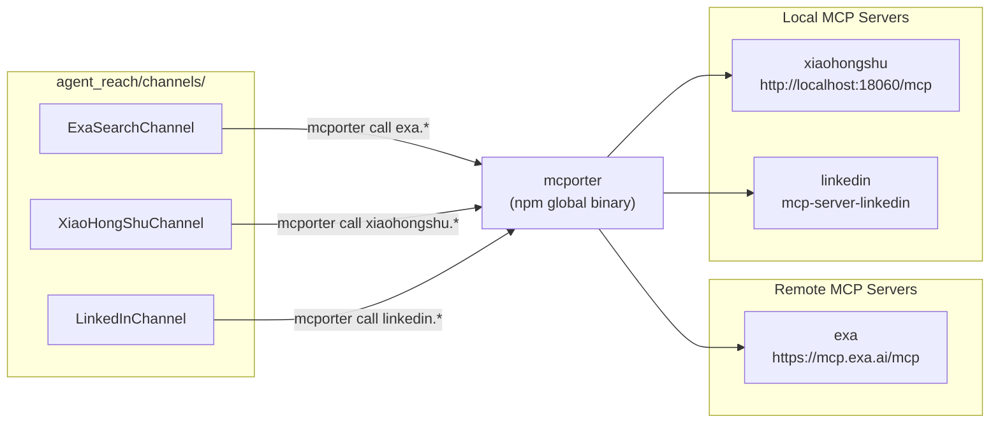
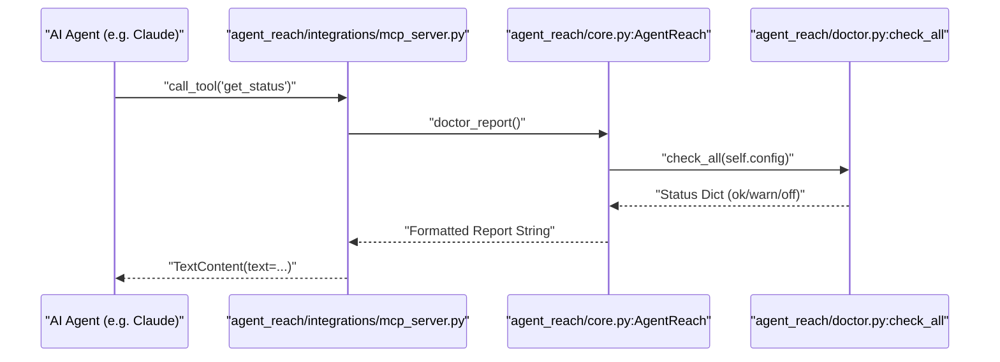

<!-- source: DeepWiki mcp.deepwiki.com · repo Panniantong/Agent-Reach · page 4.3 mcporter Setup · fetched 2026-10-30 -->

# mcporter Setup

<details>
<summary>Relevant source files</summary>

The following files were used as context for generating this wiki page:

- [agent_reach/core.py](agent_reach/core.py)
- [agent_reach/guides/setup-twitter.md](agent_reach/guides/setup-twitter.md)
- [agent_reach/integrations/mcp_server.py](agent_reach/integrations/mcp_server.py)
- [config/mcporter.json](config/mcporter.json)
- [tests/test_mcporter_config.py](tests/test_mcporter_config.py)

</details>


This page covers what `mcporter` is, how Agent Reach uses it as an MCP bridge, the `config/mcporter.json` configuration structure, and the setup steps for each dependent channel. It also documents the Agent Reach MCP server which exposes internal diagnostics.

For broader configuration of Agent Reach credentials and settings, see [Configuration](). For details on the individual channels that use mcporter (XiaoHongShu, Exa, LinkedIn), see [Channels]().

---

## What mcporter Is

`mcporter` is a command-line tool (`npm install -g mcporter`) that acts as a bridge between a shell process and one or more **MCP servers** (Model Context Protocol servers). Agent Reach's channel implementations invoke it as a subprocess to call tools exposed by remote or local MCP servers.

The two key operations Agent Reach performs via `mcporter`:

| Command | Purpose |
|---|---|
| `mcporter list` | Lists all configured MCP server names; used to check if a server is registered |
| `mcporter call <expr>` | Calls a tool on a configured MCP server, e.g. `exa.web_search_exa(query: "foo")` |
| `mcporter config add <name> <url>` | Registers an MCP server endpoint by name |

mcporter is installed via npm and must be on `PATH` for mcporter-dependent channels to function.

Sources: [agent_reach/integrations/mcp_server.py:7-9](), [config/mcporter.json:1-11]()

---

## Configuration and Inspection

### Configuration Structure (`config/mcporter.json`)
The repository ships a reference configuration at `config/mcporter.json` [config/mcporter.json:1-11](). This file uses the `mcpServers` key to declare named MCP server endpoints.

```json
{
  "mcpServers": {
    "exa": {
      "baseUrl": "https://mcp.exa.ai/mcp"
    },
    "xiaohongshu": {
      "baseUrl": "http://localhost:18060/mcp"
    }
  },
  "imports": []
}
```

| Field | Type | Description |
|---|---|---|
| `mcpServers` | object | Map of logical server name → endpoint config |
| `mcpServers.<name>.baseUrl` | string | HTTP(S) URL of the MCP server's endpoint |
| `imports` | array | Additional config files to merge |

Sources: [config/mcporter.json:1-11]()

### Configuration Inspection Helper
Agent Reach provides an `inspect_mcporter_config()` helper [tests/test_mcporter_config.py:12-12]() to read and validate the configuration without actually starting the `mcporter` process. This utility:
- Merges home-directory (`~/.mcporter/mcporter.json`) and project-level configurations [tests/test_mcporter_config.py:24-52]().
- Respects the `MCPORTER_CONFIG` environment variable for explicit overrides [tests/test_mcporter_config.py:54-76]().
- Enforces security by rejecting symlinks to prevent unauthorized configuration injection [tests/test_mcporter_config.py:86-120]().
- Returns a `McporterConfigInspection` object containing `server_names` and the configuration `source`.

Sources: [tests/test_mcporter_config.py:1-158]()

---

## Channels That Depend on mcporter

**Channel-to-MCP-server mapping:**



Sources: [config/mcporter.json:1-11](), [agent_reach/integrations/mcp_server.py:7-9]()

---

## Agent Reach's Own MCP Server

Agent Reach includes its own MCP server implementation at `agent_reach/integrations/mcp_server.py` [agent_reach/integrations/mcp_server.py:1-79](). This server allows external AI agents (like Claude Code or Cursor) to inspect the health and capabilities of Agent Reach via the MCP protocol.

### Implementation Details
- **Class/Function**: `create_server()` [agent_reach/integrations/mcp_server.py:29-69]() initializes an MCP `Server` instance.
- **Dependency**: Requires `mcp` Python package (`pip install agent-reach[mcp]`) [agent_reach/integrations/mcp_server.py:19-26]().
- **Transport**: Uses `stdio_server` for communication [agent_reach/integrations/mcp_server.py:74-75]().

### Exposed Tools
| Tool Name | Description | Implementation |
|---|---|---|
| `get_status` | Returns which channels are installed and active. | Calls `AgentReach.doctor_report()` [agent_reach/integrations/mcp_server.py:54-55]() |

### Data Flow for get_status


Sources: [agent_reach/integrations/mcp_server.py:29-79](), [agent_reach/core.py:23-42]()

---

## Setup by Channel

### Exa Search (Remote server)
Exa uses a publicly hosted MCP endpoint. 
```bash
npm install -g mcporter
mcporter config add exa https://mcp.exa.ai/mcp
```
The configuration is stored in `mcporter.json` under the `exa` key [config/mcporter.json:3-5]().

### XiaoHongShu (Local Docker server)
XiaoHongShu requires a locally running MCP server (`xiaohongshu-mcp`) exposed over HTTP.
```bash
npm install -g mcporter
# Start the MCP server (Docker required)
docker run -d --name xiaohongshu-mcp -p 18060:18060 xpzouying/xiaohongshu-mcp
# Register the local endpoint
mcporter config add xiaohongshu http://localhost:18060/mcp
```
The `XiaoHongShuChannel` requires an `xsec_token` for note fetching and uses the MCP server to verify login status.

Sources: [config/mcporter.json:6-8](), [agent_reach/integrations/mcp_server.py:7-9]()

---

## Diagnostics

The `AgentReach.doctor()` method [agent_reach/core.py:34-37]() evaluates channel health. For mcporter-dependent channels, the logic typically checks:
1. If the `mcporter` binary exists on the system.
2. If the required server (e.g., `exa`, `xiaohongshu`) is present in the `mcporter` configuration.
3. If the server is reachable and (for authenticated platforms) the session is valid.

Sources: [agent_reach/core.py:34-42](), [agent_reach/integrations/mcp_server.py:46-49]()

---

