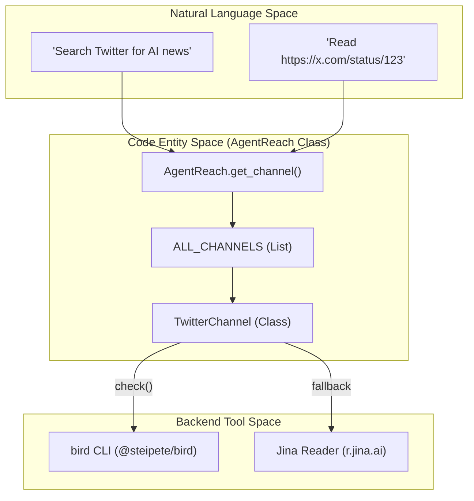
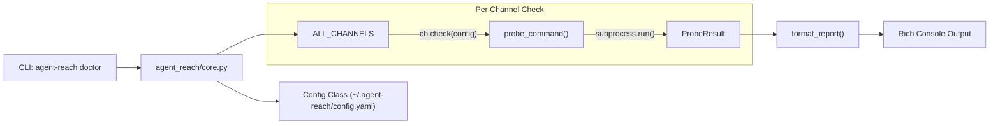

<!-- source: DeepWiki mcp.deepwiki.com · repo Panniantong/Agent-Reach · page 7 Glossary · fetched 2026-10-30 -->

# Glossary

Relevant source files

The following files were used as context for generating this wiki page:

- [CLAUDE.md](CLAUDE.md)
- [README.md](README.md)
- [agent_reach/__init__.py](agent_reach/__init__.py)
- [agent_reach/backends/__init__.py](agent_reach/backends/__init__.py)
- [agent_reach/channels/base.py](agent_reach/channels/base.py)
- [agent_reach/channels/rss.py](agent_reach/channels/rss.py)
- [agent_reach/probe.py](agent_reach/probe.py)
- [docs/wechat-group-qr.jpg](docs/wechat-group-qr.jpg)
- [pyproject.toml](pyproject.toml)
- [tests/test_probe.py](tests/test_probe.py)

This page provides definitions for codebase-specific terms, jargon, and abbreviations used throughout Agent Reach. It serves as a technical reference for onboarding engineers to understand the internal nomenclature and the specific tools integrated into the system.

## Core Concepts

### Channel
A **Channel** is a pluggable adapter providing a standardized interface for interacting with a specific internet platform (e.g., Twitter, GitHub, Reddit). Each channel is responsible for URL detection, health/dependency status reporting, and content retrieval [agent_reach/channels/base.py:1-23]().

### ALL_CHANNELS
The global registry of all supported platforms. It is an ordered list of instantiated `Channel` objects used for URL routing. The system iterates through this list and calls `can_handle(url)` on each; the first channel to return `True` is selected [agent_reach/channels/__init__.py:31-48]().

### Tier (0/1/2)
Channels are categorized into tiers based on their configuration requirements [agent_reach/channels/base.py:35-35]():
*   **Tier 0 (Zero Config):** Works out-of-the-box with no API keys or login (e.g., V2EX, RSS, Web) [agent_reach/channels/rss.py:11-11]().
*   **Tier 1 (Needs Key/Tool):** Requires a free API key or specific system tool installation (e.g., Twitter via `bird`, YouTube via `yt-dlp`).
*   **Tier 2 (Complex Setup):** Requires cookies, stealth browsers, or local Docker containers (e.g., XiaoHongShu, Instagram).

### can_handle & check()
*   **`can_handle(url)`**: A method implemented by every channel to determine if a given URL belongs to its platform using domain or path pattern matching [agent_reach/channels/rss.py:13-14]().
*   **`check(config)`**: A diagnostic method used by `agent-reach doctor`. It verifies if the required backends are functional and sets the `active_backend` [agent_reach/channels/base.py:61-70]().

### active_backend & ordered_backends
*   **`active_backend`**: The specific backend currently serving a channel (e.g., `bird` for Twitter). Set during `check()` [agent_reach/channels/base.py:38-38]().
*   **`ordered_backends()`**: Returns a candidate list of backends in probe order, prioritizing user overrides defined in `config.yaml` [agent_reach/channels/base.py:45-59]().

### System Entity Mapping

The following diagram illustrates how natural language platform requests map to specific code entities and backend CLI tools.

**Platform Routing and Backend Mapping**

Sources: [agent_reach/channels/base.py:29-70](), [agent_reach/channels/__init__.py:31-48](), [agent_reach/core.py:7-25]()

---

## Technical Components & Backends

### bird / birdx
A Node.js-based CLI tool (`@steipete/bird`) used as the primary backend for the Twitter channel. It handles authenticated requests for reading tweets and searching [README.md:113-113]().

### mcporter
The **Model Context Protocol (MCP) bridge**. It is a CLI tool that allows Agent Reach to call tools from various MCP servers (like Exa or XiaoHongShu) via a unified interface [README.md:139-143]().

### MCP (Model Context Protocol)
An open standard that enables AI models to connect to external data sources. Agent Reach uses MCP servers for platforms like XiaoHongShu and LinkedIn [README.md:111-119]().

### SKILL.md
A specialized Markdown file containing a structured "Usage Guide" that AI agents (like Claude Code or Cursor) read to understand which commands to run for specific user requests [CLAUDE.md:24-24]().

### doctor
The diagnostic command (`agent-reach doctor`) that executes the `check()` method for all registered channels to report system health [CLAUDE.md:13-13]().

### Jina Reader
A fallback web reading service (`https://r.jina.ai/`) that converts any URL into clean Markdown. It is used as a fallback for several channels [README.md:98-98]().

### yt-dlp
A command-line media downloader used by the `YouTubeChannel` to extract video metadata and subtitles [pyproject.toml:37-37]().

### bili-cli
The primary backend for Bilibili, replacing `yt-dlp` due to risk control blocks. It allows searching and video detail extraction without login [README.md:98-98]().

### OpenCLISiteChannel & _opencli_site.py
A shared base class for platforms that reuse a Chrome browser session via the `opencli` tool (Facebook, Instagram). It handles common browser-bridge logic [agent_reach/backends/opencli.py:10-16]().

### probe_command & ProbeResult
A utility in `agent_reach/probe.py` that distinguishes between missing, broken (stale venv), and timeout failure modes by actually executing the CLI tool [agent_reach/probe.py:47-81]().

---

## Specialized Terms

### xsec_token
A mandatory security token required by the XiaoHongShu (XHS) API for fetching note details [README.md:118-118]().

### Node (V2EX)
In the context of the `V2EXChannel`, a **Node** refers to a specific sub-forum or category (e.g., `python`, `tech`) [README.md:120-120]().

### Cookie Auth
A method where the user exports cookies (via **Cookie-Editor**) and provides them to Agent Reach to bypass login screens [README.md:126-130]().

### Residential Proxy
A recommended configuration for server-side deployments to bypass Data Center IP blocks on platforms like Reddit or Bilibili [README.md:131-131]().

### Zero Config
Platforms that work immediately after `pip install` without any API keys or cookies (Tier 0) [README.md:108-110]().

### Scaffolding
The design philosophy where Agent Reach acts as a "glue layer" that sets up independent upstream tools for the AI agent to call directly [CLAUDE.md:37-39]().

### Groq Whisper
A transcription pipeline used by the `XiaoyuzhouChannel` to convert podcast audio into text using Groq's API [README.md:122-122]().

---

## Internal Logic Flow

The following diagram describes the data flow when the `agent-reach doctor` command is executed to verify system health.

**Doctor Diagnostic Data Flow**

Sources: [agent_reach/probe.py:47-81](), [agent_reach/channels/base.py:61-70](), [CLAUDE.md:17-21]()

### Key Classes
*   **AgentReach**: The central orchestrator for request routing [agent_reach/__init__.py:7-9]().
*   **Config**: Manages `config.yaml`, API keys, and proxy settings [CLAUDE.md:19-19]().
*   **ProbeResult**: Data class containing status ("ok", "broken", etc.) and output from a command probe [agent_reach/probe.py:28-36]().
*   **McporterConfigInspection**: A dataclass returned by `inspect_mcporter_config()` to check MCP tool availability without starting the bridge.

Sources: [README.md:1-154](), [agent_reach/channels/base.py:1-70](), [agent_reach/probe.py:1-120](), [CLAUDE.md:1-44](), [pyproject.toml:1-65]()