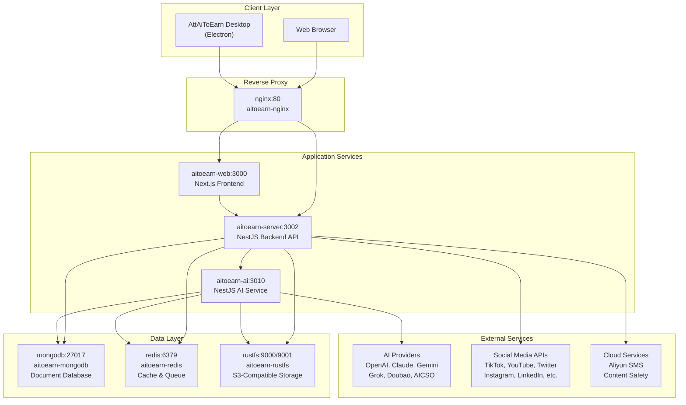
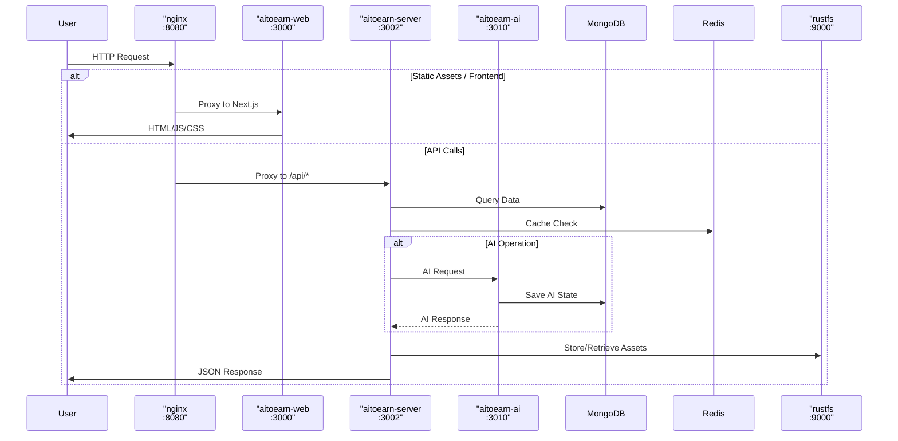
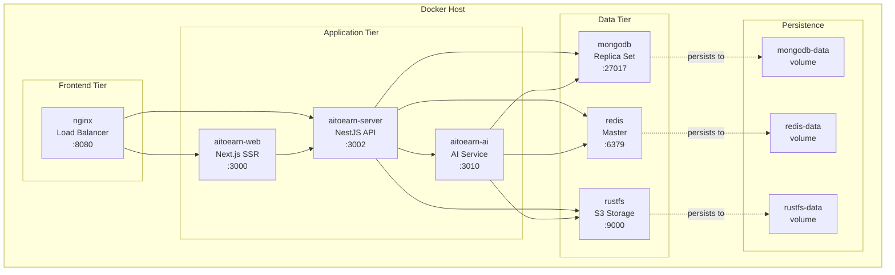

<!-- source: DeepWiki mcp.deepwiki.com · repo yikart/AiToEarn · page 1 Overview · fetched 2026-10-30 -->

# Overview

Relevant source files

The following files were used as context for generating this wiki page:

- [DOCKER_DEPLOYMENT_CN.md](DOCKER_DEPLOYMENT_CN.md)
- [DOCKER_DEPLOYMENT_EN.md](DOCKER_DEPLOYMENT_EN.md)
- [README.md](README.md)
- [README_CN.md](README_CN.md)
- [docker-compose.yml](docker-compose.yml)
- [presentation/agent_0.png](presentation/agent_0.png)
- [presentation/display-1.5.2png.png](presentation/display-1.5.2png.png)
- [wechat.jpg](wechat.jpg)

AiToEarn is a comprehensive AI-powered content marketing platform that enables creators, brands, and businesses to build, distribute, and monetize content across 14+ global social media platforms. The system provides an integrated environment for AI-assisted content creation, multi-platform publishing, automated engagement, and analytics through both web and desktop interfaces.

Sources: [README.md:2-21](), [README.md:66-70]()

## System Purpose

AiToEarn serves as a full-stack growth and monetization platform designed to streamline the entire content marketing lifecycle. The platform addresses key pain points for content creators and businesses:

**Content Creation & Management**
- AI-powered content generation for text, images, and video
- Content drafting and version control
- Multi-format content support
- Calendar-based content scheduling

**Multi-Platform Distribution**
- One-click publishing to 14+ platforms simultaneously
- Platform-specific content adaptation
- Scheduled and calendar-timed publishing
- Import and redistribution of historical content

**Engagement & Growth**
- Automated comment responses and interaction management
- Hotspot and trend detection across platforms
- Brand monitoring and content discovery
- Precision user mining through comment analysis

**Analytics & Monetization**
- Cross-platform performance tracking
- Full-funnel data analysis
- Revenue tracking and campaign management

**AI Automation**
- All In Agent: Autonomous AI agent for content creation and platform operation
- Multi-provider AI model orchestration (OpenAI, Claude, Gemini, Grok, Doubao, AICSO)

Sources: [README.md:66-158](), [README.md:30-36]()

## Supported Platforms

AiToEarn integrates with the widest range of global social media platforms:

| Platform Category | Platforms |
|-------------------|-----------|
| **Chinese Platforms** | Douyin, Xiaohongshu (Rednote), WeChat Channels, WeChat Official Accounts, Kuaishou, Bilibili |
| **Global Platforms** | TikTok, YouTube, Facebook, Instagram, Threads, Twitter/X, Pinterest, LinkedIn |

Sources: [README.md:18-20]()

## System Architecture

AiToEarn follows a microservices architecture with three main application services, orchestrated through Docker Compose.

### High-Level Service Architecture

**Docker Compose Service Architecture**

Sources: [docker-compose.yml:1-286]()

The system consists of seven containerized services defined in `docker-compose.yml`:

| Service Container | Image | Internal Port | External Port | Purpose |
|-------------------|-------|---------------|---------------|---------|
| `aitoearn-nginx` | nginx:alpine | 80 | 8080 | Reverse proxy and unified entry point |
| `aitoearn-web` | aitoearn/aitoearn-web | 3000 | - | Next.js frontend application |
| `aitoearn-server` | aitoearn/aitoearn-server | 3002 | - | Main backend API service |
| `aitoearn-ai` | aitoearn/aitoearn-ai | 3010 | - | AI orchestration service |
| `aitoearn-mongodb` | mongo:latest | 27017 | 27017 | Primary database |
| `aitoearn-redis` | redis:latest | 6379 | 6379 | Cache and job queue |
| `aitoearn-rustfs` | rustfs/rustfs | 9000, 9001 | 9000, 9001 | Object storage for assets |

All services communicate through a Docker bridge network named `aitoearn-network`.

Sources: [docker-compose.yml:2-271]()

### Request Flow

Sources: [docker-compose.yml:248-270](), [README.md:170-182]()

### Access Points

After deployment, the system is accessible through:

| Endpoint | URL | Description |
|----------|-----|-------------|
| Web Frontend | http://localhost:8080 | Main user interface |
| Backend API | http://localhost:8080/api | RESTful API endpoints |
| RustFS Console | http://localhost:9001 | Object storage management |
| MongoDB | localhost:27017 | Database (internal) |
| Redis | localhost:6379 | Cache/Queue (internal) |

Sources: [README.md:170-182]()

## Core Capabilities

### 1. All In Agent - Autonomous AI Assistant

The All In Agent is an autonomous AI agent that can automatically generate content, publish to platforms, and help operate AiToEarn. This agent represents the most advanced automation layer of the platform.

Sources: [README.md:33-33](), [README.md:71-76]()

### 2. Multi-Platform Content Publishing

**One-Click Multi-Platform Distribution**
- Simultaneous publishing to 14+ platforms
- Platform-specific content adaptation
- Calendar-based scheduling system
- Historical content import and redistribution

**Content Types Supported**
- Video content
- Image/text posts
- Stories and short-form content

Sources: [README.md:79-89]()

### 3. Hotspot Analysis & Trending Content

**Viral Inspiration Engine**
- Case library of high-engagement content (10,000+ likes)
- Real-time trend detection across platforms
- Topic discovery for content ideation
- Reduces creator anxiety through data-driven insights

Sources: [README.md:91-100]()

### 4. Content Search & Brand Monitoring

**Market Insights**
- Real-time brand conversation tracking
- Content discovery by topic and community
- Targeted engagement opportunities
- Competitor analysis

Sources: [README.md:102-112]()

### 5. Comment Search & User Mining

**Precision User Identification**
- Smart comment detection (e.g., "link please", "how to buy")
- High-conversion signal identification
- Instant reply capabilities
- Sales funnel optimization

Sources: [README.md:115-122]()

### 6. Engagement Automation

**Growth Engine**
- Unified interaction management dashboard
- Proactive trending conversation participation
- Automated comment responses
- Community building tools

Sources: [README.md:124-132]()

### 7. Cross-Platform Analytics

**Full-Funnel Data Analysis**
- Performance comparison across platforms
- Traffic flow monitoring
- End-to-end conversion tracking
- Growth path visualization

Sources: [README.md:134-139]()

### 8. AI Content Creation (Coming Soon)

**End-to-End AI Assistant**
- AI-generated titles, captions, and descriptions
- AI-powered commenting for engagement
- Image and card generation
- Video editing assistance
- Multi-language translation for global distribution

**Supported AI Models**
- Video: Seedance, Kling, Hailuo, Veo, Midjourney, Sora, Pika, Runway
- Image: GPT, Flux

Sources: [README.md:141-149]()

## Technology Stack

### Frontend Layer

| Technology | Purpose |
|------------|---------|
| Next.js 14 | React framework with SSR/SSG |
| React 18 | UI component library |
| TypeScript | Type-safe development |

Sources: [README.md:1-267]()

### Backend Services

| Service | Technology | Purpose |
|---------|------------|---------|
| aitoearn-server | NestJS + Node.js + TypeScript | Main API service, OAuth management, platform integration |
| aitoearn-ai | NestJS + Node.js + TypeScript | AI model orchestration, content generation |

Sources: [docker-compose.yml:136-233](), [docker-compose.yml:81-134]()

### Data Layer

| Component | Technology | Purpose |
|-----------|------------|---------|
| Primary Database | MongoDB | User data, content metadata, OAuth tokens |
| Cache & Queue | Redis | Session management, job queues, rate limiting |
| Object Storage | RustFS (S3-compatible) | Images, videos, documents |

Sources: [docker-compose.yml:2-40](), [docker-compose.yml:41-79]()

### Infrastructure

| Component | Technology |
|-----------|------------|
| Containerization | Docker & Docker Compose |
| Reverse Proxy | Nginx |
| Networking | Docker bridge network (aitoearn-network) |
| Persistence | Docker volumes |

Sources: [docker-compose.yml:272-286]()

### External Integrations

**AI Providers**
- OpenAI (GPT-5)
- Anthropic (Claude Opus 4.5/4.6)
- Google (Gemini 2.5/3.1)
- xAI (Grok)
- Volcengine (Doubao)
- AICSO

**Social Media Platforms**
- OAuth 2.0 authentication for all 14+ platforms
- Platform-specific API clients
- Webhook handlers for real-time events

**Cloud Services**
- Aliyun SMS for notifications
- Aliyun Content Safety for moderation

Sources: [docker-compose.yml:114-128](), [docker-compose.yml:184-226]()

## Deployment Architecture

AiToEarn uses Docker Compose for orchestration, providing easy deployment and scaling.

### Production Deployment Flow

Sources: [docker-compose.yml:1-286]()

### Environment Configuration

The system uses environment variables for configuration, all defined in `docker-compose.yml`. Key configuration categories:

**Service Credentials**
- MongoDB root password and connection strings
- Redis authentication
- JWT secrets for authentication
- Internal service communication tokens

**AI Service Configuration**
- API keys for OpenAI, Anthropic, Google, xAI, Volcengine, AICSO
- Base URLs for AI providers (supports proxy configuration)
- Model-specific credentials (e.g., `GEMINI_KEY_PAIRS`)

**OAuth Configuration**
- Client IDs and secrets for 14+ platforms
- Callback URL configuration via `APP_DOMAIN`

**Storage Configuration**
- RustFS/S3 credentials and endpoints
- CDN configuration
- Bucket names and regions

**Optional Services**
- Email service (AWS SES SMTP)
- Aliyun SMS credentials
- Aliyun Content Safety credentials

Sources: [docker-compose.yml:6-227](), [DOCKER_DEPLOYMENT_EN.md:138-281]()

### Desktop Application

AiToEarn also provides an Electron desktop application (`AttAiToEarn`) in a separate repository. The desktop app connects to the same backend API services but offers native OS integration:

- Native window management
- System tray integration
- Local database for offline access
- Desktop notifications

Sources: [README.md:220-242]()

## Summary

AiToEarn represents a sophisticated solution for content creators targeting Chinese social media platforms. By providing a unified interface and powerful automation tools, it simplifies the management of multiple accounts across different platforms. The application's modular architecture allows for easy extension with new platforms and features.

For more detailed information about specific subsystems, refer to the following pages:
- For platform integration details, see [Platform Integration System](#3)
- For content publishing workflow, see [Content Publishing System](#4)
- For automated engagement features, see [Automated Engagement System](#5)
- For AI tools integration, see [AI Tools Integration](#8)

---

