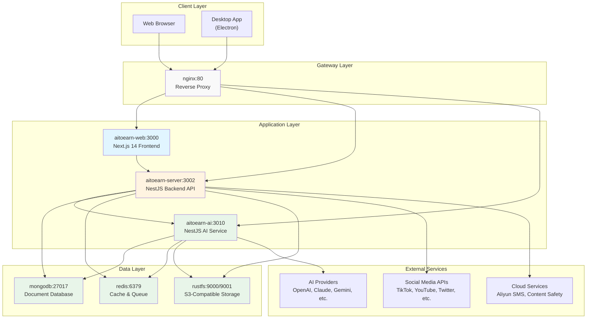
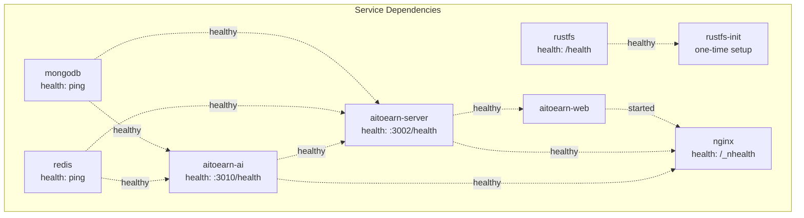
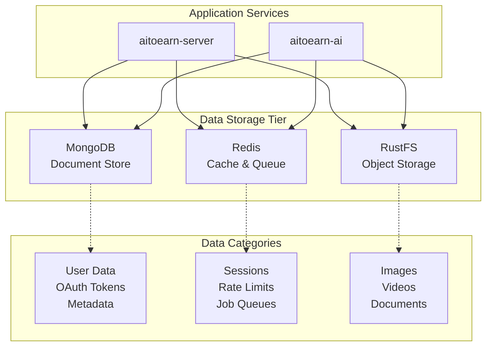
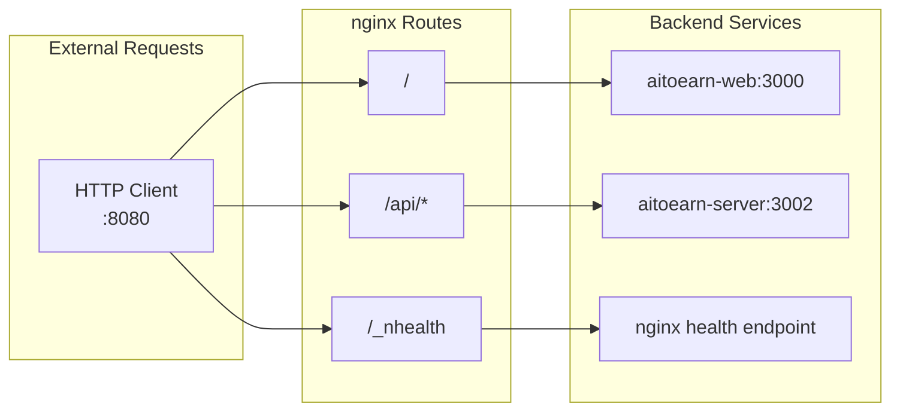
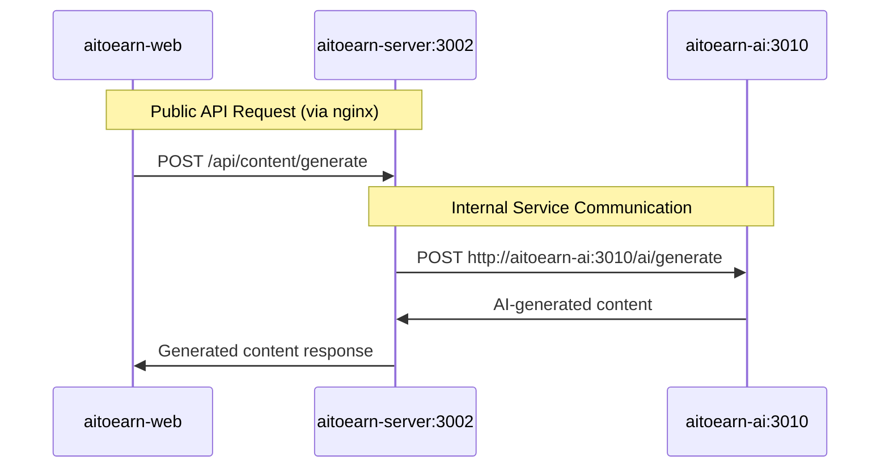
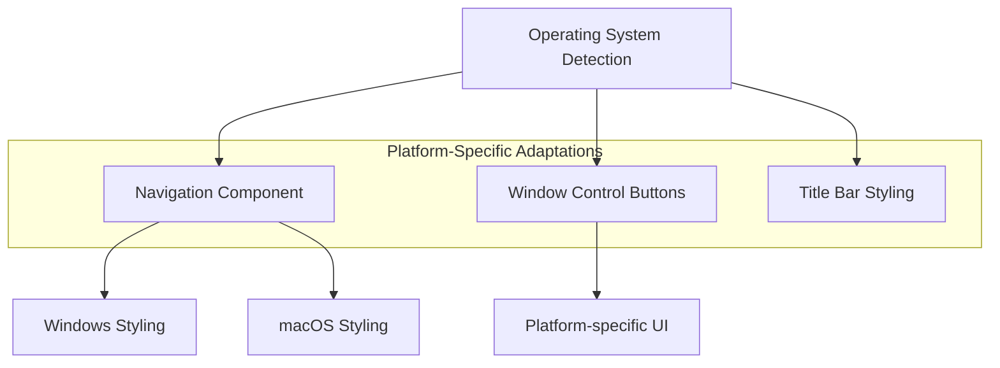

<!-- source: DeepWiki mcp.deepwiki.com · repo yikart/AiToEarn · page 2 System Architecture · fetched 2026-10-30 -->

# System Architecture

<details>
<summary>Relevant source files</summary>

The following files were used as context for generating this wiki page:

- [DOCKER_DEPLOYMENT_CN.md](DOCKER_DEPLOYMENT_CN.md)
- [DOCKER_DEPLOYMENT_EN.md](DOCKER_DEPLOYMENT_EN.md)
- [README.md](README.md)
- [README_CN.md](README_CN.md)
- [docker-compose.yml](docker-compose.yml)
- [presentation/agent_0.png](presentation/agent_0.png)
- [presentation/display-1.5.2png.png](presentation/display-1.5.2png.png)
- [wechat.jpg](wechat.jpg)

</details>


AiToEarn is a full-stack AI-powered content marketing system built on a microservices architecture. The platform enables content creators, brands, and businesses to create, publish, engage, and monetize content across 14+ social media platforms with AI automation.

This document provides a high-level overview of the system architecture, including the microservices design, technology stack, and how components interact.

For an introduction to the application's purpose and capabilities, see [Overview](#1).

## Architectural Overview

AiToEarn implements a microservices architecture with three primary application services orchestrated through Docker Compose, fronted by an nginx reverse proxy, and backed by MongoDB for persistence, Redis for caching/queuing, and S3-compatible object storage (RustFS) for media assets.

### High-Level System Architecture



Sources: [docker-compose.yml:1-286](), [README.md:158-183]()

### Service Container Architecture

The Docker Compose configuration defines seven interconnected services running on a dedicated bridge network (`aitoearn-network`). Each service has defined health checks and dependency ordering to ensure proper startup sequence.

#### Service Dependency Graph



Sources: [docker-compose.yml:2-286]()

The startup sequence ensures data services are ready before application services begin, and all application services are healthy before nginx begins accepting traffic. The `rustfs-init` container runs once to create the storage bucket and set permissions.

### Network Communication

All services communicate over a dedicated Docker bridge network (`aitoearn-network`) using internal DNS resolution. External access is routed through nginx on port 8080.

#### Port Mapping

| Service | Internal Port | External Port | Purpose |
|---------|--------------|---------------|---------|
| nginx | 80 | 8080 | HTTP gateway |
| aitoearn-web | 3000 | - | Next.js SSR |
| aitoearn-server | 3002 | - | Backend API |
| aitoearn-ai | 3010 | - | AI service API |
| mongodb | 27017 | 27017 | Database (dev access) |
| redis | 6379 | 6379 | Cache (dev access) |
| rustfs | 9000 | 9000 | S3 API |
| rustfs | 9001 | 9001 | Management console |

Sources: [docker-compose.yml:10-11](), [docker-compose.yml:29-30](), [docker-compose.yml:49-51](), [docker-compose.yml:260]()

Services use internal hostnames (e.g., `mongodb`, `redis`, `rustfs.local`) for inter-service communication, while nginx handles all external routing.

## Core Services

AiToEarn's functionality is distributed across three specialized NestJS microservices, each with distinct responsibilities.

### aitoearn-web (Frontend Service)

The web frontend is a Next.js 14 application serving the user interface. It runs in production mode within a Docker container and communicates with backend services through nginx.

**Technology Stack:**
- Next.js 14 with React 18
- TypeScript
- Server-Side Rendering (SSR)

**Environment Configuration:**
- `NEXT_PUBLIC_API_URL`: Public API endpoint for browser-side requests (default: `http://localhost:8080/api`)
- `NODE_ENV`: Set to `production` in Docker deployment
- `NEXT_TELEMETRY_DISABLED`: Telemetry disabled for privacy

Sources: [docker-compose.yml:234-246](), [README.md:66-157]()

### aitoearn-server (Backend API Service)

The main backend service handles core business logic, user management, OAuth flows, platform integrations, and content publishing.

**Responsibilities:**
- User authentication and authorization (JWT)
- OAuth 2.0 flows for 14+ social media platforms
- Multi-platform content publishing
- Engagement automation
- Analytics data collection
- Third-party service integrations (SMS, content safety)

**Configuration:**
```yaml
# Key environment variables
JWT_SECRET: JWT signing key
INTERNAL_TOKEN: Inter-service authentication
APP_DOMAIN: Domain for OAuth callbacks

# Database connections
MONGODB_HOST: mongodb
REDIS_HOST: redis

# AI service communication
AI_URL: http://aitoearn-ai:3010

# Platform OAuth credentials
TIKTOK_CLIENT_ID/SECRET
YOUTUBE_CLIENT_ID/SECRET
TWITTER_CLIENT_ID/SECRET
# ... (14+ platforms)

# Cloud services
ALI_SMS_ACCESS_KEY_ID/SECRET
ALI_GREEN_ACCESS_KEY_ID/SECRET
```

Sources: [docker-compose.yml:136-232](), [DOCKER_DEPLOYMENT_EN.md:251-270]()

### aitoearn-ai (AI Engine Service)

The AI service orchestrates multiple AI providers for content generation, providing a unified interface for text, image, and video generation across different models.

**Responsibilities:**
- AI model selection and routing
- Multi-provider API orchestration (OpenAI, Claude, Gemini, Grok, Doubao, AICSO)
- Content generation (text, images, videos)
- Hotspot analysis and trend detection
- AI-powered content optimization

**Configuration:**
```yaml
# AI Provider APIs
OPENAI_API_KEY/BASE_URL
ANTHROPIC_API_KEY/BASE_URL
GEMINI_KEY_PAIRS: JSON array of Google Cloud credentials
VOLCENGINE_API_KEY/ACCESS_KEY_ID/SECRET_ACCESS_KEY
GROK_API_KEY
AICSO_API_KEY/BASE_URL
AI_PROXY_URL: Optional proxy for AI API access

# Inter-service communication
SERVER_URL: http://aitoearn-server:3002
```

**AI Model Configuration:**
AI model definitions (available models, pricing, capabilities) are hardcoded in the config file at `config/aitoearn-ai.config.js`, which is mounted as a read-only volume.

Sources: [docker-compose.yml:81-134](), [DOCKER_DEPLOYMENT_EN.md:206-249]()

## Data Persistence Layer

AiToEarn implements a three-tier data storage strategy, with each tier optimized for different access patterns and data types.

### Storage Architecture



Sources: [docker-compose.yml:2-64]()

### MongoDB (Document Database)

**Container:** `aitoearn-mongodb` (mongo:latest)
**Port:** 27017 (exposed for development access)

MongoDB stores structured application data including user accounts, OAuth tokens, content metadata, publication records, and analytics data.

**Configuration:**
- Root username: `admin` (configurable via `MONGO_INITDB_ROOT_USERNAME`)
- Root password: `password` (must be changed via `MONGO_INITDB_ROOT_PASSWORD`)
- Database name: `aitoearn` (primary) and statistics database (defaults to same instance)

**Persistence:**
- `mongodb-data` volume: Database files at `/data/db`
- `mongodb-config` volume: Configuration at `/data/configdb`

**Health Check:** `mongosh` ping command every 10s

Sources: [docker-compose.yml:2-21](), [docker-compose.yml:100-103](), [docker-compose.yml:278-281]()

### Redis (Cache and Job Queue)

**Container:** `aitoearn-redis` (redis:latest)
**Port:** 6379 (exposed for development access)

Redis provides high-performance caching for session data, rate limiting, and job queue management for scheduled tasks (e.g., calendar-based content publishing).

**Configuration:**
- Password protection: `--requirepass password` (must be changed in docker-compose.yml)
- Persistence: RDB snapshots to volume

**Persistence:**
- `redis-data` volume: Snapshots at `/data`

**Health Check:** `redis-cli ping` every 10s

Sources: [docker-compose.yml:23-39](), [docker-compose.yml:105-107](), [docker-compose.yml:283]()

### RustFS (Object Storage)

**Container:** `aitoearn-rustfs` (rustfs/rustfs:latest)
**Ports:** 9000 (S3 API), 9001 (web console)

RustFS provides S3-compatible object storage for media assets (images, videos, documents). It runs locally within Docker Compose for development and testing, but can be replaced with AWS S3, Aliyun OSS, or other S3-compatible services in production.

**Configuration:**
- Access Key: `rustfsadmin` (via `RUSTFS_ACCESS_KEY`)
- Secret Key: `rustfsadmin` (via `RUSTFS_SECRET_KEY`)
- Bucket: `aitoearn` (auto-created by `rustfs-init` container)
- Public read access enabled for the bucket

**Management Console:** http://localhost:9001
- Login with access key and secret key

**Persistence:**
- `rustfs-data` volume: Object storage at `/data`

**Health Check:** HTTP GET to `/health` endpoint every 10s

Sources: [docker-compose.yml:41-78](), [docker-compose.yml:285](), [DOCKER_DEPLOYMENT_EN.md:174-203]()

#### Switching to External Storage

For production deployments, update the `assets` configuration in both `config/aitoearn-ai.config.js` and `config/aitoearn-server.config.js` to point to AWS S3, Aliyun OSS, or another S3-compatible service.

Sources: [DOCKER_DEPLOYMENT_EN.md:188-203]()

## Request Routing and API Gateway

### Nginx Reverse Proxy

**Container:** `aitoearn-nginx` (nginx:alpine)
**Port:** 8080 (public-facing)

Nginx serves as the unified gateway for all HTTP traffic, routing requests to the appropriate backend service and serving the Next.js frontend.

#### Routing Configuration



Sources: [docker-compose.yml:248-270](), [README.md:174-180]()

**Configuration File:** Nginx configuration is mounted from `nginx/nginx.conf` as a read-only volume. The file defines:

- **Route `/`**: Proxies to `aitoearn-web:3000` (Next.js frontend)
- **Route `/api/`**: Proxies to `aitoearn-server:3002` (NestJS backend API)
- **Route `/_nhealth`**: Internal health check endpoint for nginx monitoring

Sources: [docker-compose.yml:261-262]()

### Inter-Service Communication

Backend services communicate directly using internal DNS hostnames on the Docker bridge network, bypassing nginx for improved performance.

#### Service-to-Service API Calls



**Authentication:**
- Inter-service requests use `INTERNAL_TOKEN` header for authentication
- JWT tokens validate user requests at the API gateway (aitoearn-server)
- Internal services trust requests authenticated by aitoearn-server

Sources: [docker-compose.yml:109-110](), [docker-compose.yml:112](), [docker-compose.yml:171](), [docker-compose.yml:174]()

## Technical Stack

AiToEarn is built with a modern technology stack as defined in its package.json:

| Layer | Technologies |
|-------|--------------|
| **Frontend** | React, Ant Design, React Router, Zustand, SCSS |
| **Backend** | Electron, Node.js, TypeORM, SQLite |
| **Media Processing** | FFmpeg, Sharp |
| **Build Tools** | Vite, TypeScript, Electron Builder |
| **External Integrations** | Axios, WebView |

Sources: [package.json:32-83]()

## Cross-Platform Support

The application includes platform-specific adjustments for Windows and macOS, particularly in the UI layer:



Sources: [src/layout/Navigation/index.tsx](), [src/layout/Navigation/navigation.module.scss:69-81](), [src/components/WindowControlButtons/windowControlButtons.module.scss]()

The system adapts the navigation bar appearance and window controls based on the platform, ensuring a native-like experience on each operating system.

## Conclusion

AiToEarn's architecture showcases a well-structured Electron application with clear separation of concerns. The use of the Adapter pattern for platform integrations, component-based UI design, and robust IPC communication creates a flexible and maintainable system capable of handling complex social media management tasks across multiple platforms.

The application's structured architecture, with modular components and clear subsystem boundaries, enables efficient development and maintenance while providing a robust platform for social media management across multiple Chinese platforms.

Sources: [electron/main/index.ts](), [src/router/index.tsx](), [package.json]()

---

