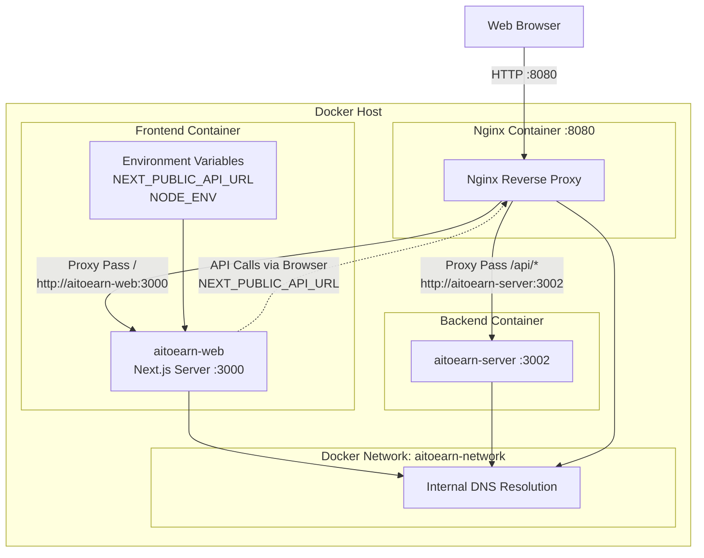
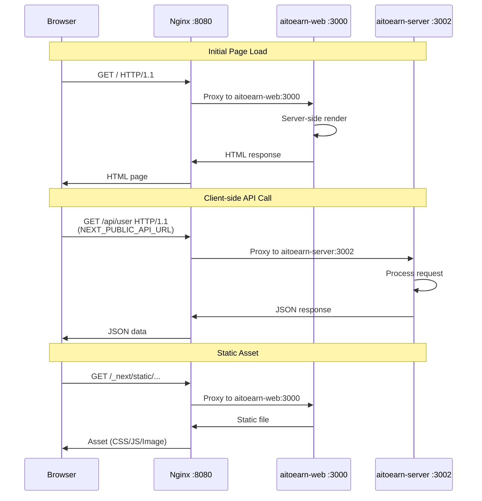
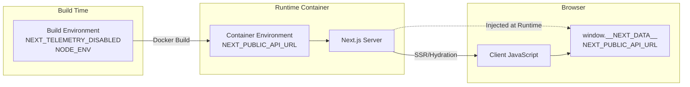
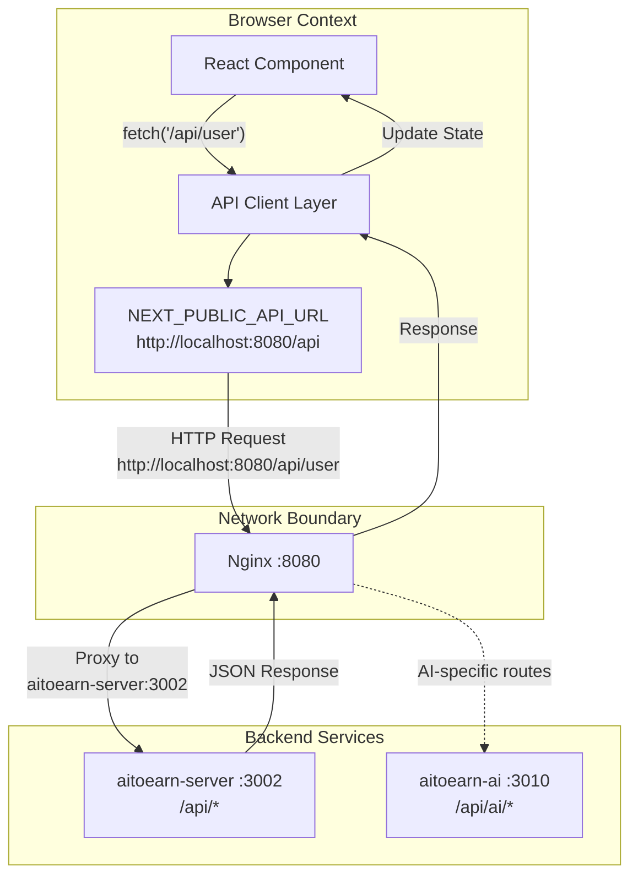
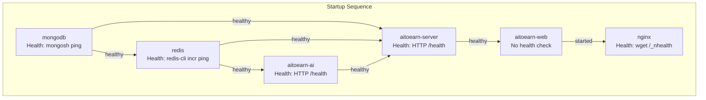
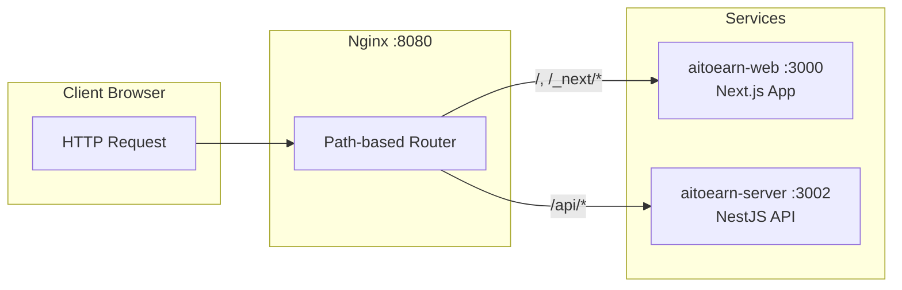
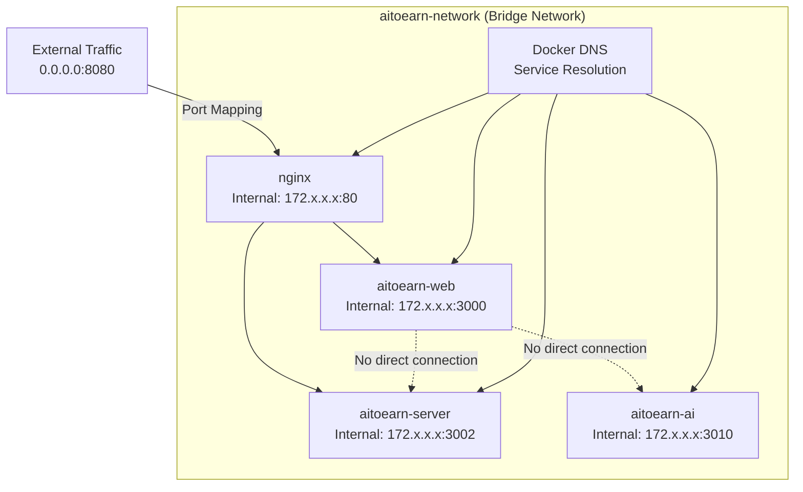

<!-- source: DeepWiki mcp.deepwiki.com · repo yikart/AiToEarn · page 2.3 Frontend Architecture · fetched 2026-10-30 -->

# Frontend Architecture

<details>
<summary>Relevant source files</summary>

The following files were used as context for generating this wiki page:

- [DOCKER_DEPLOYMENT_CN.md](DOCKER_DEPLOYMENT_CN.md)
- [DOCKER_DEPLOYMENT_EN.md](DOCKER_DEPLOYMENT_EN.md)
- [README.md](README.md)
- [README_CN.md](README_CN.md)
- [docker-compose.yml](docker-compose.yml)
- [presentation/agent_0.png](presentation/agent_0.png)
- [presentation/display-1.5.2png.png](presentation/display-1.5.2png.png)
- [wechat.jpg](wechat.jpg)

</details>


This document describes the Next.js frontend application architecture for AiToEarn, including its deployment structure, API integration patterns, and how it communicates with backend services through the Nginx reverse proxy.

For information about the complete Docker service orchestration, see [Docker Compose Service Architecture](#2.1). For details on how the frontend interacts with data storage, see [Data Persistence Layer](#2.2). For the Electron desktop application, see [Electron Desktop Application](#2.4).

---

## Technology Stack

The AiToEarn frontend is built with modern web technologies optimized for server-side rendering and client-side interactivity:

| Technology | Version | Purpose |
|------------|---------|---------|
| **Next.js** | 14 | React framework with SSR/SSG capabilities |
| **React** | 18 | UI component library |
| **TypeScript** | - | Type-safe JavaScript |
| **Node.js** | 20.18.x | Runtime environment |

The frontend runs as a standalone Next.js server inside a Docker container, serving both server-rendered pages and static assets.

**Sources:** [README.md:8](), [README_CN.md:7](), [DOCKER_DEPLOYMENT_EN.md:16-18]()

---

## Service Architecture in Docker

The frontend service is deployed as a containerized application that integrates with the broader AiToEarn platform through Docker Compose.

### Frontend Service Deployment



**Docker Compose Configuration:**

The `aitoearn-web` service is defined with minimal configuration, relying on the built image to contain all necessary dependencies:

```yaml
# Key configuration from docker-compose.yml
aitoearn-web:
  image: aitoearn/aitoearn-web:latest
  container_name: aitoearn-web
  restart: unless-stopped
  depends_on:
    aitoearn-server:
      condition: service_healthy
  networks:
    - aitoearn-network
  environment:
    NODE_ENV: production
    NEXT_TELEMETRY_DISABLED: 1
    NEXT_PUBLIC_API_URL: http://localhost:8080/api
```

**Sources:** [docker-compose.yml:234-246](), [DOCKER_DEPLOYMENT_EN.md:28-36]()

---

## Network Communication Pattern

### Request Routing Through Nginx

The frontend is accessed through Nginx, which acts as a unified reverse proxy for all services. This architecture provides:

1. **Single port exposure** - All traffic enters through port 8080
2. **Path-based routing** - Static files and API calls are routed differently
3. **Service isolation** - Frontend runs on internal port 3000, not exposed externally



**Nginx Configuration Pattern:**

The Nginx configuration routes requests based on path patterns:
- `/` → `aitoearn-web:3000` (frontend pages)
- `/api/*` → `aitoearn-server:3002` (backend API)
- `/_next/*` → `aitoearn-web:3000` (Next.js static assets)

**Sources:** [docker-compose.yml:248-270](), [DOCKER_DEPLOYMENT_EN.md:8-26]()

---

## Environment Configuration

### Build-time vs Runtime Configuration

The frontend uses Next.js environment variable patterns to handle configuration at different stages:

| Variable Type | Prefix | Available | Example |
|--------------|--------|-----------|---------|
| **Public (Client-side)** | `NEXT_PUBLIC_*` | Browser + Server | `NEXT_PUBLIC_API_URL` |
| **Server-side only** | No prefix | Server only | `NODE_ENV` |



### Key Environment Variables

**`NEXT_PUBLIC_API_URL`** - The most critical frontend configuration variable:

```yaml
# Default configuration for local development
NEXT_PUBLIC_API_URL: http://localhost:8080/api

# Production configuration example
NEXT_PUBLIC_API_URL: https://your-domain.com/api
```

This variable determines where client-side API calls are directed. It must match the public-facing URL of the Nginx proxy, not the internal service URLs.

**`NODE_ENV`** - Controls Next.js optimization level:
- `production` - Optimized builds, no dev tools
- `development` - Hot reload, verbose errors

**`NEXT_TELEMETRY_DISABLED`** - Disables Next.js telemetry data collection:
```yaml
NEXT_TELEMETRY_DISABLED: 1
```

**Sources:** [docker-compose.yml:243-246](), [DOCKER_DEPLOYMENT_EN.md:148-151]()

---

## API Integration Pattern

### Client-side API Communication

The frontend makes API calls exclusively through the browser using the `NEXT_PUBLIC_API_URL` environment variable. This pattern ensures all API traffic flows through Nginx, maintaining consistent routing and security policies.



### No Server-side Backend Calls

The Next.js server component does **not** make direct internal API calls to `aitoearn-server`. All data fetching happens client-side through the public API endpoint. This architecture:

1. Simplifies authentication (tokens in browser storage)
2. Reduces server-side complexity
3. Leverages Next.js client-side data fetching patterns
4. Maintains clear separation between frontend and backend services

**Sources:** [docker-compose.yml:234-246](), [DOCKER_DEPLOYMENT_EN.md:129-135]()

---

## Container Health and Dependencies

### Service Dependencies

The frontend service has explicit dependency ordering to ensure backend services are ready before accepting traffic:



**Dependency Configuration:**

```yaml
# aitoearn-web depends on backend being healthy
depends_on:
  aitoearn-server:
    condition: service_healthy
```

The frontend service itself **does not have a health check** defined, as Next.js servers are considered ready once the container starts. The Nginx service waits for the web service to be in `running` state before starting.

**Sources:** [docker-compose.yml:238-241](), [docker-compose.yml:252-258](), [docker-compose.yml:16-21](), [docker-compose.yml:34-39](), [docker-compose.yml:129-134](), [docker-compose.yml:227-232]()

---

## Development vs Production Modes

### Production Deployment (Docker)

In production mode via Docker Compose:

1. **Pre-built image** - `aitoearn/aitoearn-web:latest` contains the compiled Next.js application
2. **Production server** - Next.js runs in production mode (`NODE_ENV=production`)
3. **Optimized bundles** - Static assets are pre-optimized during image build
4. **No hot reload** - Code changes require image rebuild

```bash
# Production startup command (inside Docker)
docker compose up -d aitoearn-web
```

### Development Mode (Manual)

For local development without Docker:

```bash
# Install dependencies
pnpm install

# Start development server with hot reload
pnpm run dev
```

In development mode:
- **Hot module replacement** - Code changes reload automatically
- **Verbose errors** - Detailed error messages and stack traces
- **Direct backend access** - Can point `NEXT_PUBLIC_API_URL` to local backend

Development mode is covered in more detail in [Development Mode Setup](#8.1).

**Sources:** [README.md:209-214](), [README_CN.md:196-199](), [docker-compose.yml:234-246]()

---

## Routing and Nginx Integration

### URL Path Handling

The frontend integrates with Nginx through path-based routing rules:

| Path Pattern | Routed To | Purpose |
|--------------|-----------|---------|
| `/` | `aitoearn-web:3000` | Root page / home |
| `/login`, `/dashboard`, etc. | `aitoearn-web:3000` | Application pages |
| `/_next/static/*` | `aitoearn-web:3000` | Next.js static assets (JS, CSS) |
| `/_next/image/*` | `aitoearn-web:3000` | Next.js Image Optimization API |
| `/api/*` | `aitoearn-server:3002` | Backend API calls |



**Nginx Configuration Reference:**

The Nginx configuration file is mounted into the container at:
```yaml
volumes:
  - ./nginx/nginx.conf:/etc/nginx/nginx.conf:ro
```

This read-only mount ensures the Nginx configuration is synchronized with the repository and cannot be modified at runtime.

**Sources:** [docker-compose.yml:261-262](), [README.md:172-180](), [DOCKER_DEPLOYMENT_EN.md:129-135]()

---

## Static Asset Management

### Next.js Asset Pipeline

Next.js handles static assets through several mechanisms:

1. **`/_next/static/` directory** - Hashed, immutable build artifacts
2. **`/public/` directory** - Public static files served at root
3. **Image Optimization API** - `/_next/image/*` for automatic image optimization

All static assets are served through the Next.js server running on port 3000, which is proxied by Nginx. This allows Next.js to:

- Apply cache headers automatically
- Serve optimized images based on device capabilities
- Handle static file compression

### Asset Upload and User-Generated Content

User-uploaded assets (images, videos, documents) are **not** stored or served by the frontend. Instead:

1. Files are uploaded directly to object storage (RustFS/S3)
2. Backend generates signed URLs or public URLs
3. Frontend displays assets via `` tags pointing to storage URLs

For details on object storage configuration, see [Data Persistence Layer](#2.2).

**Sources:** [docker-compose.yml:234-246](), [DOCKER_DEPLOYMENT_EN.md:173-203]()

---

## Network Isolation and Security

### Internal Docker Network

The frontend communicates with other services exclusively through the `aitoearn-network` bridge network:



**Network Configuration:**

```yaml
networks:
  aitoearn-network:
    driver: bridge
    name: aitoearn-network
```

All services join this network, allowing Docker DNS to resolve service names (e.g., `aitoearn-server` resolves to the container's IP). However, the frontend **does not make internal network requests** - all API calls flow through the browser to Nginx.

**Sources:** [docker-compose.yml:272-275](), [docker-compose.yml:241-242]()

---

## Summary

The AiToEarn frontend architecture is characterized by:

1. **Next.js 14** - Modern React framework with SSR capabilities
2. **Docker containerization** - Isolated, reproducible deployments
3. **Nginx proxy integration** - All traffic routed through single entry point
4. **Client-side API calls** - Browser makes requests via `NEXT_PUBLIC_API_URL`
5. **Environment-based configuration** - Different settings for dev/production
6. **Service dependency management** - Waits for backend health before starting

This architecture provides a clear separation between frontend rendering and backend API services, with Nginx acting as the unified gateway that routes requests based on URL paths.

**Sources:** [README.md:1-267](), [docker-compose.yml:234-270](), [DOCKER_DEPLOYMENT_EN.md:1-450]()

---

