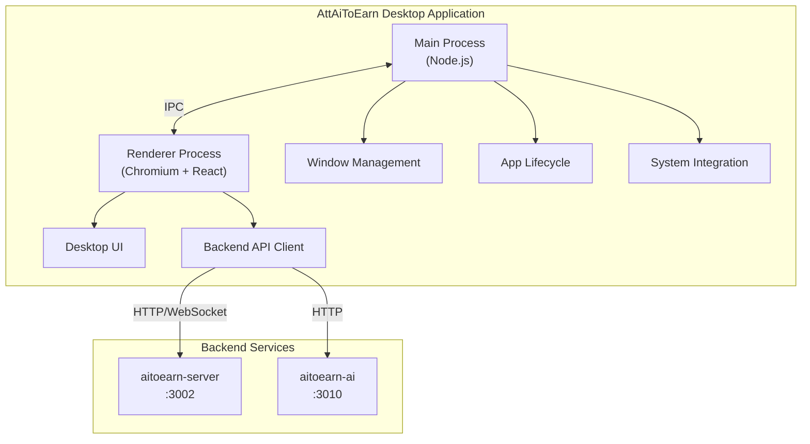

<!-- source: DeepWiki mcp.deepwiki.com · repo yikart/AiToEarn · page 2.4 Electron Desktop Application · fetched 2026-10-30 -->

# Electron Desktop Application

<details>
<summary>Relevant source files</summary>

The following files were used as context for generating this wiki page:

- [DOCKER_DEPLOYMENT_CN.md](DOCKER_DEPLOYMENT_CN.md)
- [DOCKER_DEPLOYMENT_EN.md](DOCKER_DEPLOYMENT_EN.md)
- [README.md](README.md)
- [README_CN.md](README_CN.md)
- [docker-compose.yml](docker-compose.yml)
- [presentation/agent_0.png](presentation/agent_0.png)
- [presentation/display-1.5.2png.png](presentation/display-1.5.2png.png)
- [wechat.jpg](wechat.jpg)

</details>


The AttAiToEarn Electron desktop application provides a native desktop client for the AiToEarn platform. This application is maintained in a separate repository from the main web application and offers desktop-specific features such as system tray integration and native window management.

## Overview

AttAiToEarn is a standalone Electron desktop application located at https://github.com/yikart/AttAiToEarn. It provides the same content creation and publishing functionality as the web interface ([2.3](#2.3)), but packages it as a native desktop application for Windows, macOS, and Linux.

The desktop application follows standard Electron architecture with two primary processes:

- **Main Process**: Node.js runtime that controls the application lifecycle, system integration, and window management
- **Renderer Process**: Chromium-based process that renders the UI using web technologies



Sources: [README.md:220-242]()

## Repository Location

The Electron desktop application is maintained in a separate repository from the main AiToEarn platform:

**Repository**: https://github.com/yikart/AttAiToEarn

This separation allows independent versioning and releases of the desktop client while consuming the same backend services ([2.1](#2.1)) as the web application.

## Building and Running

### Prerequisites

- **Node.js**: Version 20.18.x or compatible
- **npm**: Comes with Node.js
- **Python**: Required for compiling native dependencies (better-sqlite3)
- **node-gyp**: Build tool for native Node.js modules

On Windows, you may need to install Windows Build Tools:
```bash
npm install --global windows-build-tools
```

### Development Mode

To run the desktop application in development mode:

```bash
# Clone the repository
git clone https://github.com/yikart/AttAiToEarn.git

# Enter directory
cd AttAiToEarn

# Install dependencies
npm i

# Compile SQLite native module (requires node-gyp and Python)
npm run rebuild

# Start development mode
npm run dev
```

Sources: [README.md:220-242]()

In development mode, the Electron app typically connects to:
- Local backend at `http://localhost:3002` (aitoearn-server)
- Local AI service at `http://localhost:3010` (aitoearn-ai)

Or to the Docker Compose stack if running:
- Backend API at `http://localhost:8080/api` (via nginx)

### Building for Distribution

The desktop application uses Electron Builder for creating distributable packages:

```bash
# Build for production
npm run build
```

This creates platform-specific installers in the `dist/` directory:
- **Windows**: `.exe` installer
- **macOS**: `.dmg` disk image
- **Linux**: `.AppImage` or `.deb` package

### SQLite Compilation

The desktop application uses `better-sqlite3` for local data storage, which requires native compilation:

```bash
npm run rebuild
```

This step is necessary because:
- `better-sqlite3` contains native C++ code
- Must be compiled against the Electron runtime (not Node.js runtime)
- Requires Python and C++ build tools installed on the system

Sources: [README.md:233-234]()

## Development and Build Pipeline

The application uses Vite for development and Electron Builder for packaging:

```javascript
"scripts": {
  "dev": "chcp 65001 && vite",
  "dev:mac": "vite",
  "build": "tsc && vite build && electron-builder",
  "build:notsc": "vite build && electron-builder"
}
```

Sources: [package.json:18-31]()

### Development Environment

During development:
1. Vite starts a development server for the renderer process
2. Electron loads content from the Vite dev server URL
3. Hot module replacement enables rapid UI changes

```javascript
// Development path configuration
export const VITE_DEV_SERVER_URL = process.env.VITE_DEV_SERVER_URL;

// Conditional content loading
if (VITE_DEV_SERVER_URL) {
  await win.loadURL(VITE_DEV_SERVER_URL);
} else {
  await win.loadFile(indexHtml);
}
```

Sources: [electron/main/index.ts:24-28](), [electron/main/index.ts:92-96]()

### Production Build

For production builds:
1. TypeScript is compiled
2. Vite bundles the renderer process
3. Electron Builder packages the application for distribution

The main entry point for the packaged application is specified in package.json:

```json
{
  "name": "aiToEarn",
  "version": "0.6.0-alpha.4",
  "main": "dist-electron/main/index.js"
}
```

Sources: [package.json:1-4]()

## Conclusion

AiToEarn follows the standard Electron architecture with clear separation between main and renderer processes. The application employs custom window chrome, platform-specific adjustments, and a secure IPC system for communication between processes. The build pipeline supports both development and production environments using modern tooling like Vite and Electron Builder.

---

