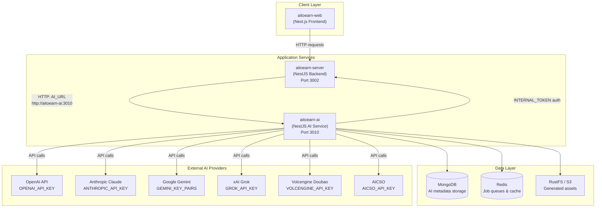
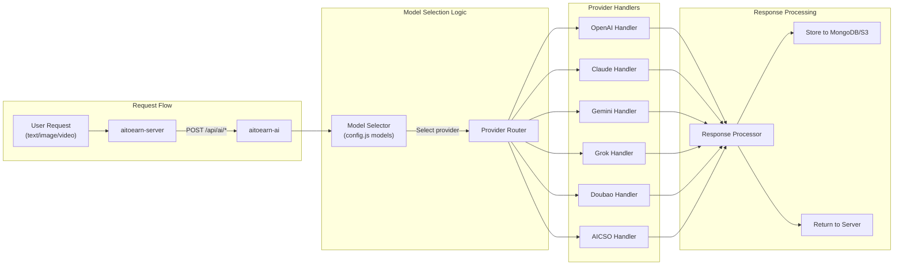
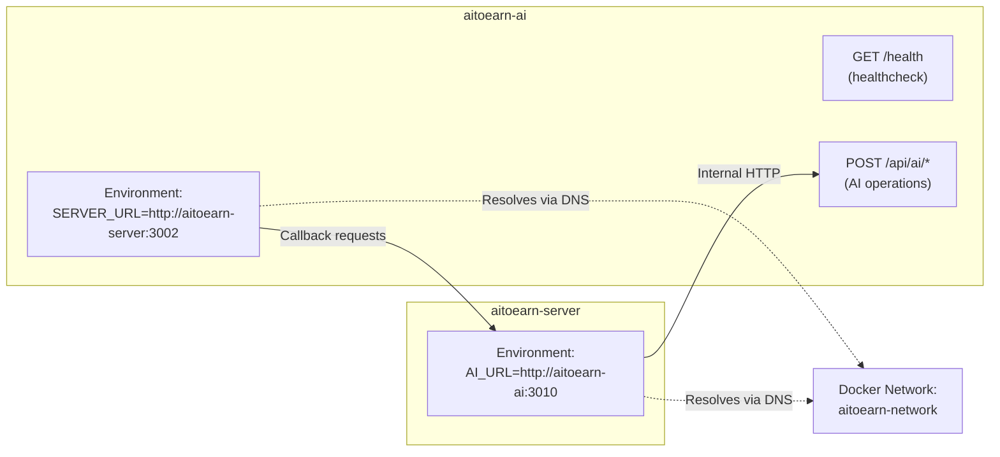
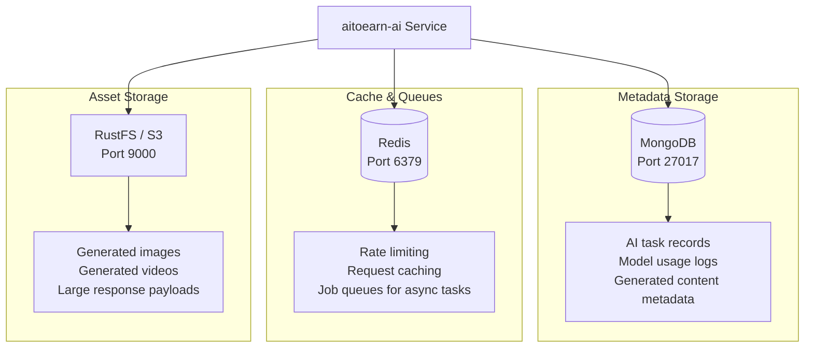

<!-- source: DeepWiki mcp.deepwiki.com · repo yikart/AiToEarn · page 3 AI Integration System · fetched 2026-10-30 -->

# AI Integration System

<details>
<summary>Relevant source files</summary>

The following files were used as context for generating this wiki page:

- [DOCKER_DEPLOYMENT_CN.md](DOCKER_DEPLOYMENT_CN.md)
- [DOCKER_DEPLOYMENT_EN.md](DOCKER_DEPLOYMENT_EN.md)
- [README.md](README.md)
- [README_CN.md](README_CN.md)
- [docker-compose.yml](docker-compose.yml)
- [presentation/agent_0.png](presentation/agent_0.png)
- [presentation/display-1.5.2png.png](presentation/display-1.5.2png.png)
- [wechat.jpg](wechat.jpg)

</details>


## Purpose and Scope

This document provides an overview of AiToEarn's AI integration capabilities, explaining how the platform orchestrates multiple AI service providers to power content generation, analysis, and autonomous agent features. This page covers the high-level architecture, supported AI providers, and the communication patterns between the AI service and the main backend.

For detailed information about the AI service's internal architecture and HTTP routes, see [AI Service Architecture](#3.1). For configuration specifics of individual AI providers and environment variables, see [Multi-Provider Configuration](#3.2). For the autonomous AI agent feature, see [All In Agent](#3.3).

**Sources:** [README.md:1-267](), [docker-compose.yml:81-134]()

## Architecture Overview

The AI integration system is built around a dedicated **aitoearn-ai** microservice that provides a unified interface to multiple AI providers. This service runs as a separate NestJS application, isolating AI operations from the main backend and allowing independent scaling and deployment.



**Service Communication Flow:**

1. **User requests** flow from the web frontend to `aitoearn-server`
2. **aitoearn-server** delegates AI operations to `aitoearn-ai` via internal HTTP calls
3. **aitoearn-ai** selects the appropriate AI provider based on the request and model configuration
4. **AI responses** are processed, stored in MongoDB/S3, and returned to the caller
5. **Generated assets** (images, videos) are stored in object storage (RustFS or S3)

**Sources:** [docker-compose.yml:81-134](), [docker-compose.yml:136-232](), [DOCKER_DEPLOYMENT_EN.md:1-600]()

## Supported AI Providers

AiToEarn integrates with six major AI service providers, each offering different model capabilities. The system is designed to be provider-agnostic, allowing flexible model selection based on task requirements, cost, and availability.

| Provider | Environment Variable | Primary Use Cases | Models |
|----------|---------------------|-------------------|---------|
| **OpenAI** | `OPENAI_API_KEY`<br/>`OPENAI_BASE_URL` | Text generation, chat, embeddings | GPT-4, GPT-3.5, GPT-4 Turbo |
| **Anthropic Claude** | `ANTHROPIC_API_KEY`<br/>`ANTHROPIC_BASE_URL` | Long-form content, analysis | Claude Opus 4.5, Claude Opus 4.6 |
| **Google Gemini** | `GEMINI_KEY_PAIRS`<br/>`GEMINI_LOCATION` | Multimodal tasks, video analysis | Gemini 2.5, Gemini 3.1 |
| **xAI Grok** | `GROK_API_KEY` | Real-time data, social media content | Grok models |
| **Volcengine Doubao** | `VOLCENGINE_API_KEY`<br/>`VOLCENGINE_ACCESS_KEY_ID`<br/>`VOLCENGINE_SECRET_ACCESS_KEY` | Video generation, Chinese content | Doubao models |
| **AICSO** | `AICSO_API_KEY`<br/>`AICSO_BASE_URL` | Specialized AI operations | AICSO models |

**Configuration Location:** All AI provider credentials are configured as environment variables in the `aitoearn-ai` service within [docker-compose.yml:114-128]().

**Proxy Support:** An optional `AI_PROXY_URL` environment variable [docker-compose.yml:128]() allows routing AI API requests through a proxy server for access control, rate limiting, or geographic routing.

**Sources:** [docker-compose.yml:114-128](), [README.md:146-148](), [DOCKER_DEPLOYMENT_EN.md:206-240]()

## AI Provider Orchestration



**Key Components:**

- **Model Selector**: Determines which AI provider and model to use based on task type, user preferences, and model availability. Model definitions are stored in `config/aitoearn-ai.config.js`.

- **Provider Router**: Directs requests to the appropriate provider-specific handler based on the selected model.

- **Provider Handlers**: Implement provider-specific API protocols, authentication, and response parsing.

- **Response Processor**: Normalizes responses from different providers into a consistent format, handles error conditions, and manages storage of generated content.

**Sources:** [docker-compose.yml:81-134](), [DOCKER_DEPLOYMENT_EN.md:285-400]()

## Content Generation Capabilities

The AI integration system powers multiple content generation features across the AiToEarn platform:

```mermaid
graph TB
    subgraph "Text Generation"
        T1["AI Copywriting<br/>Titles & captions"]
        T2["Content Expansion<br/>Abbreviation"]
        T3["Tag Generation<br/>SEO optimization"]
        T4["Comment Generation<br/>Engagement"]
    end
    
    subgraph "Image Generation"
        I1["GPT Image Models"]
        I2["Flux Models"]
        I3["Midjourney Integration"]
    end
    
    subgraph "Video Generation"
        V1["Seedance"]
        V2["Kling"]
        V3["Hailuo"]
        V4["Veo"]
        V5["Sora"]
        V6["Pika"]
        V7["Runway"]
    end
    
    subgraph "AI Agent"
        A1["All In Agent<br/>Autonomous operation"]
        A2["Content Scheduling"]
        A3["Auto Publishing"]
    end
    
    AIService["aitoearn-ai Service"]
    
    AIService --> T1
    AIService --> T2
    AIService --> T3
    AIService --> T4
    AIService --> I1
    AIService --> I2
    AIService --> I3
    AIService --> V1
    AIService --> V2
    AIService --> V3
    AIService --> V4
    AIService --> V5
    AIService --> V6
    AIService --> V7
    AIService --> A1
    AIService --> A2
    AIService --> A3
```



**Core Features:**

1. **AI-Powered Text Generation** [README.md:143-145]()
   - Automatic generation of titles, captions, and descriptions
   - Content expansion and abbreviation
   - Hashtag/tag generation for social media optimization
   - Smart commenting for engagement and traffic attraction

2. **Image Generation** [README.md:147]()
   - Support for GPT-based image models
   - Flux integration for image creation
   - Card and graphic generation for content workflows

3. **Video Generation** [README.md:146]()
   - Integration with multiple video AI models: Seedance, Kling, Hailuo, Veo, Midjourney, Sora, Pika, Runway
   - Video editing and enhancement capabilities

4. **All In Agent** [README.md:72-76]()
   - Autonomous AI agent that can automatically generate and publish content
   - Assists users in operating the AiToEarn platform
   - For details, see [All In Agent](#3.3)

**Sources:** [README.md:141-149](), [README_CN.md:130-138]()

## Service Communication and Authentication

Communication between `aitoearn-server` and `aitoearn-ai` is secured through internal authentication tokens and occurs over the Docker internal network.

**Authentication Mechanism:**

| Component | Environment Variable | Purpose |
|-----------|---------------------|---------|
| **JWT Secret** | `JWT_SECRET` | Signs and verifies JWT tokens for user authentication |
| **Internal Token** | `INTERNAL_TOKEN` | Authenticates inter-service communication between aitoearn-server and aitoearn-ai |

Both services must share the same `JWT_SECRET` and `INTERNAL_TOKEN` values [docker-compose.yml:109-110]() and [docker-compose.yml:173-174]().

**Service Endpoints:**



**Network Configuration:**
- Both services run on the `aitoearn-network` Docker bridge network [docker-compose.yml:272-275]()
- Service discovery uses Docker's internal DNS (service names resolve to container IPs)
- No direct external access to `aitoearn-ai`; all requests proxy through `aitoearn-server` or Nginx

**Health Checks:**
- The `aitoearn-ai` service exposes a `/health` endpoint [docker-compose.yml:130]()
- Docker Compose monitors service health and ensures dependencies are ready before starting dependent services [docker-compose.yml:145-146]()

**Sources:** [docker-compose.yml:109-112](), [docker-compose.yml:171-174](), [docker-compose.yml:129-134](), [DOCKER_DEPLOYMENT_EN.md:153-161]()

## Data Persistence and Storage

The AI service persists data across three storage layers:



**MongoDB Storage** [docker-compose.yml:100-103]():
- Connection configured via `MONGODB_HOST`, `MONGODB_PORT`, `MONGODB_USERNAME`, `MONGODB_PASSWORD`
- Stores AI task metadata, model selection history, and content generation records
- Database name: `aitoearn` (shared with main application)

**Redis Storage** [docker-compose.yml:105-107]():
- Connection configured via `REDIS_HOST`, `REDIS_PORT`, `REDIS_PASSWORD`
- Used for rate limiting AI provider requests
- Caches frequently-used AI responses
- Manages job queues for asynchronous AI tasks (e.g., video generation)

**Object Storage** (configured in `config/aitoearn-ai.config.js`):
- Stores generated binary assets (images, videos)
- Default: RustFS (S3-compatible) [docker-compose.yml:41-63]()
- Configurable to external S3, Aliyun OSS, or other providers
- Access credentials: `RUSTFS_ACCESS_KEY`, `RUSTFS_SECRET_KEY` [docker-compose.yml:47-48]()

**Sources:** [docker-compose.yml:85-93](), [docker-compose.yml:100-107](), [DOCKER_DEPLOYMENT_EN.md:173-203]()

## Configuration Approach

AI provider configuration follows a two-tier approach: environment variables for sensitive credentials and configuration files for model definitions and behavior settings.

**Environment Variables (docker-compose.yml):**

All sensitive API keys and credentials are configured as environment variables in the `aitoearn-ai` service section [docker-compose.yml:95-128]():

```yaml
# Example from docker-compose.yml
environment:
  # OpenAI Configuration
  OPENAI_API_KEY: sk-placeholder
  OPENAI_BASE_URL: https://api.openai.com/v1
  
  # Anthropic Claude Configuration
  ANTHROPIC_API_KEY: sk-placeholder
  ANTHROPIC_BASE_URL: https://api.anthropic.com
  
  # Google Gemini Configuration
  GEMINI_KEY_PAIRS: '[{"projectId":"...","apiKey":"..."}]'
  GEMINI_LOCATION: us-central1
  
  # Additional providers...
```

**Configuration Files (config/):**

Application-level settings are stored in `config/aitoearn-ai.config.js`, mounted as a read-only volume [docker-compose.yml:91]():

| Configuration Aspect | Location | Purpose |
|---------------------|----------|---------|
| Model Definitions | `config/aitoearn-ai.config.js` | Available models, pricing, capabilities |
| Storage Settings | `config/aitoearn-ai.config.js` | S3/RustFS endpoints, bucket names |
| Service Behavior | `config/aitoearn-ai.config.js` | Timeouts, retry logic, rate limits |
| GCS Credentials | `config/gcs-placeholder.json` | Google Cloud service account key (for Gemini) |

**Relay Service Support:**

The deployment guides recommend using an API relay service like [new-api](https://github.com/Calcium-Ion/new-api) or [one-api](https://github.com/songquanpeng/one-api) [DOCKER_DEPLOYMENT_EN.md:206-218](). This approach:

- Consolidates all AI provider access through a single endpoint
- Simplifies credential management
- Enables centralized rate limiting and cost tracking
- Requires only setting `OPENAI_BASE_URL` to the relay service URL and `OPENAI_API_KEY` to the relay service key

For detailed configuration of each AI provider, see [Multi-Provider Configuration](#3.2).

**Sources:** [docker-compose.yml:91-128](), [DOCKER_DEPLOYMENT_EN.md:98-111](), [DOCKER_DEPLOYMENT_EN.md:206-240](), [DOCKER_DEPLOYMENT_CN.md:206-247]()

---

