<!-- source: DeepWiki mcp.deepwiki.com · repo yikart/AiToEarn · page 3.1 AI Service Architecture · fetched 2026-10-30 -->

# AI Service Architecture

<details>
<summary>Relevant source files</summary>

The following files were used as context for generating this wiki page:

- [DOCKER_DEPLOYMENT_CN.md](DOCKER_DEPLOYMENT_CN.md)
- [DOCKER_DEPLOYMENT_EN.md](DOCKER_DEPLOYMENT_EN.md)
- [README.md](README.md)
- [README_CN.md](README_CN.md)
- [docker-compose.yml](docker-compose.yml)
- [presentation/agent_0.png](presentation/agent_0.png)
- [presentation/display-1.5.2png.png](presentation/display-1.5.2png.png)
- [wechat.jpg](wechat.jpg)

</details>


## Purpose and Scope

This document details the architecture of the `aitoearn-ai` NestJS service, which orchestrates AI capabilities for the AiToEarn platform. The service manages multi-provider AI integration, handles text/image/video generation requests, and provides HTTP endpoints for AI operations. 

For specific AI provider configuration details (API keys, model definitions), see [Multi-Provider Configuration](#3.2). For the autonomous AI agent implementation, see [All In Agent](#3.3).

This page covers:
- Service architecture and internal structure
- HTTP API endpoints and request handling
- Communication patterns with `aitoearn-server`
- Model selection and routing logic
- Deployment configuration

## Service Overview

The `aitoearn-ai` service is a standalone NestJS application that serves as the AI orchestration layer for the AiToEarn platform. It runs on port `3010` within the Docker network and is accessed internally by `aitoearn-server`.

### Architecture Position

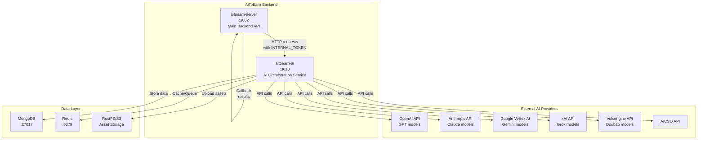

**Sources:** [docker-compose.yml:81-134](), [DOCKER_DEPLOYMENT_EN.md:13-26]()

### Key Characteristics

| Aspect | Details |
|--------|---------|
| **Technology Stack** | NestJS, TypeScript, Node.js |
| **Internal Port** | `3010` (not exposed externally) |
| **Health Check** | `GET /health` |
| **Authentication** | `INTERNAL_TOKEN` for inter-service communication |
| **Configuration** | Environment variables + `/app/config.js` |
| **Container Name** | `aitoearn-ai` |
| **Docker Network** | `aitoearn-network` |

**Sources:** [docker-compose.yml:81-134](), [DOCKER_DEPLOYMENT_EN.md:29-36]()

## Service Architecture

### NestJS Module Structure

The service is organized as a standard NestJS application with modules, controllers, and services handling different aspects of AI functionality.

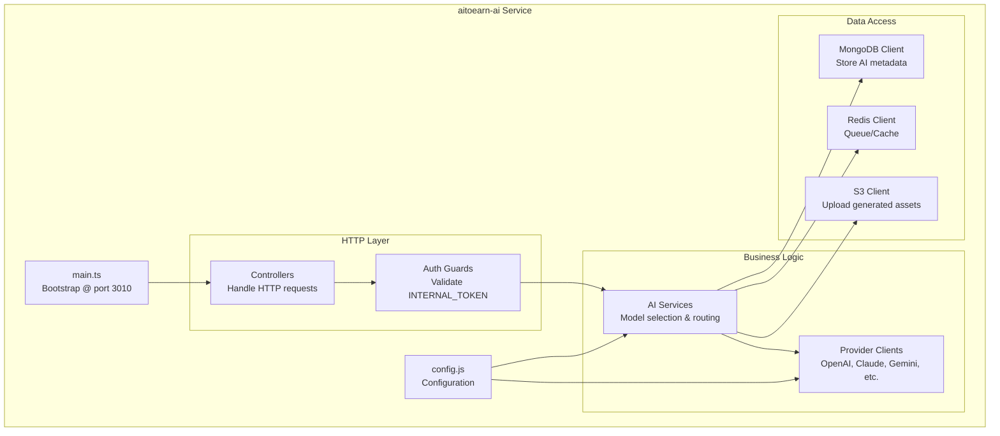

**Sources:** [docker-compose.yml:81-134](), [config/aitoearn-ai.config.js referenced in DOCKER_DEPLOYMENT_EN.md:98-110]()

### Configuration Loading

The service loads configuration from two sources:

1. **Environment Variables**: Set in `docker-compose.yml` environment section
2. **Configuration File**: Mounted at `/app/config.js` containing AI model definitions, storage endpoints, and service settings

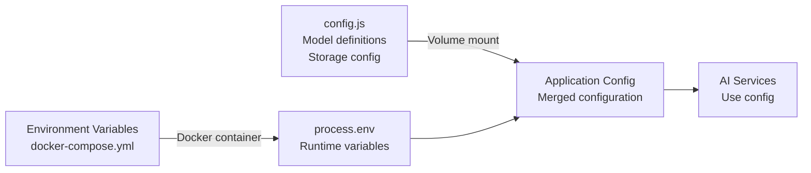

**Sources:** [docker-compose.yml:91-92](), [DOCKER_DEPLOYMENT_CN.md:96-111]()

## HTTP API Endpoints

The `aitoearn-ai` service exposes HTTP endpoints for AI operations. All requests must include the `INTERNAL_TOKEN` for authentication.

### Endpoint Categories

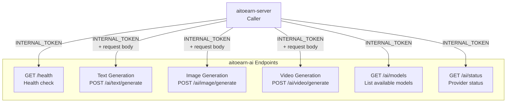

### Request Authentication Flow

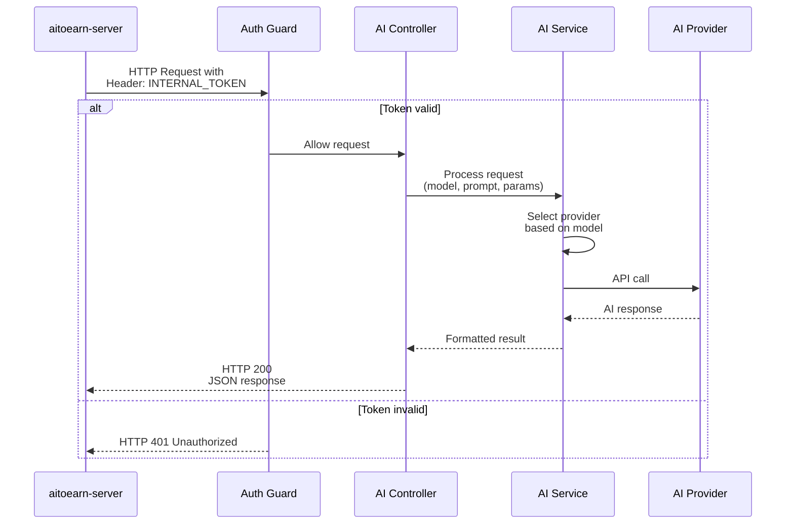

**Sources:** [docker-compose.yml:109-110](), [docker-compose.yml:173-174]()

### Key Endpoint Patterns

| Endpoint | Method | Purpose | Authentication |
|----------|--------|---------|----------------|
| `/health` | GET | Container health check | None (public) |
| `/ai/text/generate` | POST | Generate text using AI models | INTERNAL_TOKEN required |
| `/ai/image/generate` | POST | Generate images | INTERNAL_TOKEN required |
| `/ai/video/generate` | POST | Generate videos | INTERNAL_TOKEN required |
| `/ai/models` | GET | List available models | INTERNAL_TOKEN required |

**Sources:** [docker-compose.yml:130-134]()

## Model Selection and Routing

The AI service implements routing logic to direct requests to the appropriate AI provider based on the requested model.

### Model Selection Flow

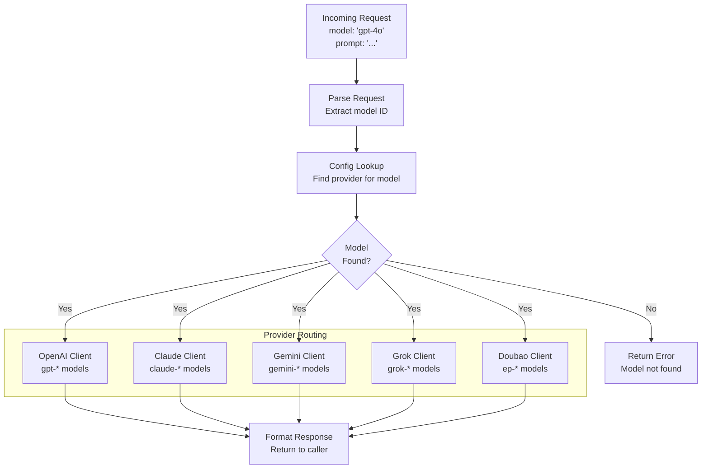

### Provider Configuration

The service reads provider credentials from environment variables:

| Provider | Environment Variables | Base URL Variable |
|----------|----------------------|-------------------|
| OpenAI | `OPENAI_API_KEY` | `OPENAI_BASE_URL` |
| Anthropic (Claude) | `ANTHROPIC_API_KEY` | `ANTHROPIC_BASE_URL` |
| Google (Gemini) | `GEMINI_KEY_PAIRS` (JSON) | N/A (uses Vertex AI) |
| xAI (Grok) | `GROK_API_KEY` | N/A |
| Volcengine (Doubao) | `VOLCENGINE_API_KEY`, `VOLCENGINE_ACCESS_KEY_ID`, `VOLCENGINE_SECRET_ACCESS_KEY` | N/A |
| AICSO | `AICSO_API_KEY` | `AICSO_BASE_URL` |

**Sources:** [docker-compose.yml:114-128](), [DOCKER_DEPLOYMENT_EN.md:222-240]()

## Communication with aitoearn-server

The AI service operates as a backend service that is called by `aitoearn-server`. Communication is synchronous HTTP-based.

### Service-to-Service Communication Pattern

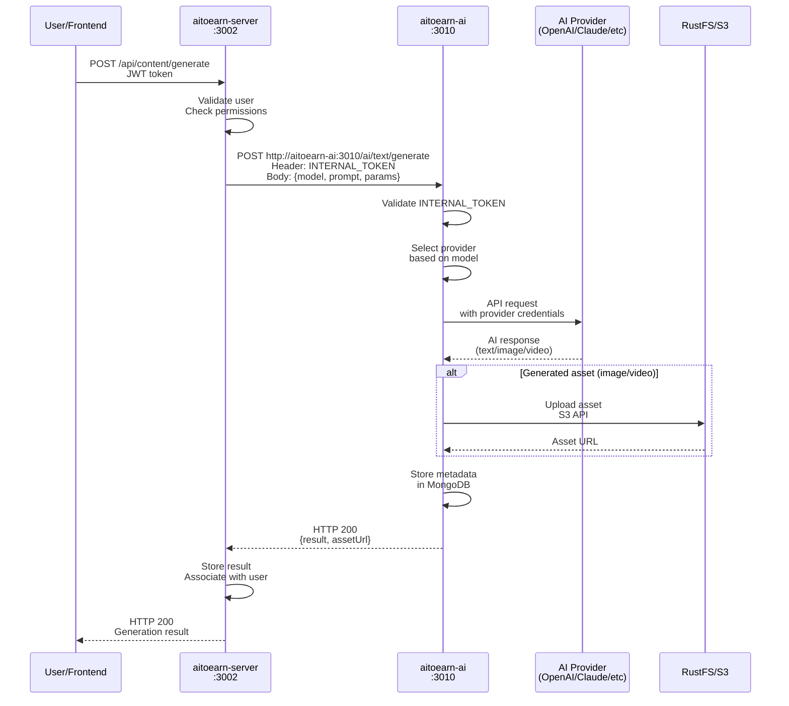

**Sources:** [docker-compose.yml:112](), [docker-compose.yml:171](), [DOCKER_DEPLOYMENT_EN.md:155-161]()

### Internal Service URLs

| Direction | Environment Variable | Value | Purpose |
|-----------|---------------------|-------|---------|
| AI → Server | `SERVER_URL` | `http://aitoearn-server:3002` | Callback/webhook endpoints |
| Server → AI | `AI_URL` | `http://aitoearn-ai:3010` | AI request forwarding |

**Sources:** [docker-compose.yml:112](), [docker-compose.yml:171]()

### Authentication Mechanism

Both services share the same `INTERNAL_TOKEN` for mutual authentication:

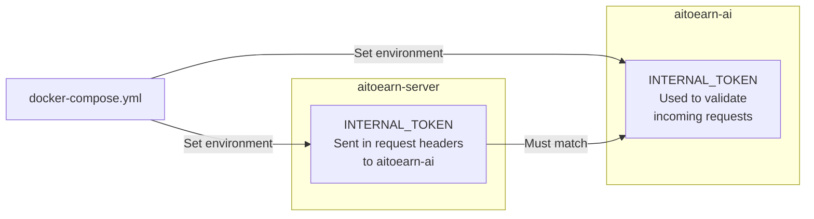

**Sources:** [docker-compose.yml:110](), [docker-compose.yml:174]()

## Data Management

The AI service interacts with three data storage systems:

### Storage Architecture

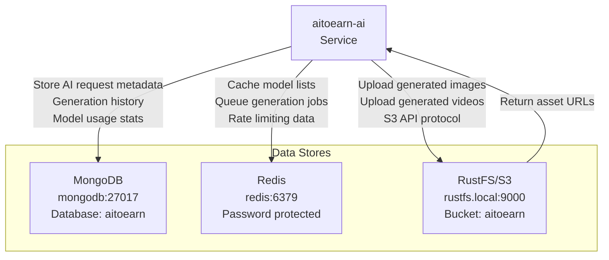

### MongoDB Usage

The AI service uses MongoDB to store:
- AI generation request history
- Model usage statistics
- User quota tracking
- Generation metadata

**Connection details from environment:**
- Host: `MONGODB_HOST=mongodb`
- Port: `MONGODB_PORT=27017`
- Username: `MONGODB_USERNAME=admin`
- Password: `MONGODB_PASSWORD` (configured in compose)
- Database: `aitoearn` (default)

**Sources:** [docker-compose.yml:100-103](), [DOCKER_DEPLOYMENT_EN.md:298-309]()

### Redis Usage

Redis is used for:
- Caching model availability
- Job queue for async operations
- Rate limiting per user/model
- Distributed locks (via Redlock)

**Connection details:**
- Host: `REDIS_HOST=redis`
- Port: `REDIS_PORT=6379`
- Password: `REDIS_PASSWORD` (configured in compose)

**Sources:** [docker-compose.yml:105-107](), [DOCKER_DEPLOYMENT_EN.md:298-309]()

### Asset Storage (RustFS/S3)

Generated images and videos are uploaded to S3-compatible storage:

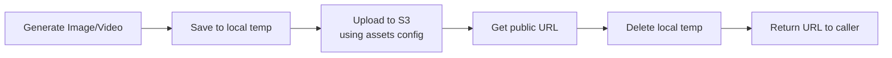

**Storage configuration** is loaded from `config.js` and includes:
- Provider: `s3` or `rustfs`
- Endpoint: `http://rustfs.local:9000` (internal) or external S3
- Bucket: `aitoearn`
- Credentials: `accessKeyId` and `secretAccessKey`

**Sources:** [DOCKER_DEPLOYMENT_EN.md:173-202](), [config/aitoearn-ai.config.js referenced in docker-compose.yml:91]()

## Deployment and Containerization

### Docker Service Definition

The `aitoearn-ai` service is defined in Docker Compose with the following characteristics:

```yaml
# Simplified view of docker-compose.yml
aitoearn-ai:
  image: aitoearn/aitoearn-ai:latest
  container_name: aitoearn-ai
  restart: unless-stopped
  ports: [] # No external ports exposed
  networks:
    - aitoearn-network
  depends_on:
    - mongodb (healthy)
    - redis (healthy)
  volumes:
    - ./config/aitoearn-ai.config.js:/app/config.js:ro
    - ./config/gcs-placeholder.json:/app/config/gcs-placeholder.json:ro
  environment:
    - NODE_ENV=production
    - APP_ENV=production
    - APP_NAME=aitoearn-ai
    # ... MongoDB, Redis, AI provider credentials
```

**Sources:** [docker-compose.yml:81-134]()

### Service Dependencies

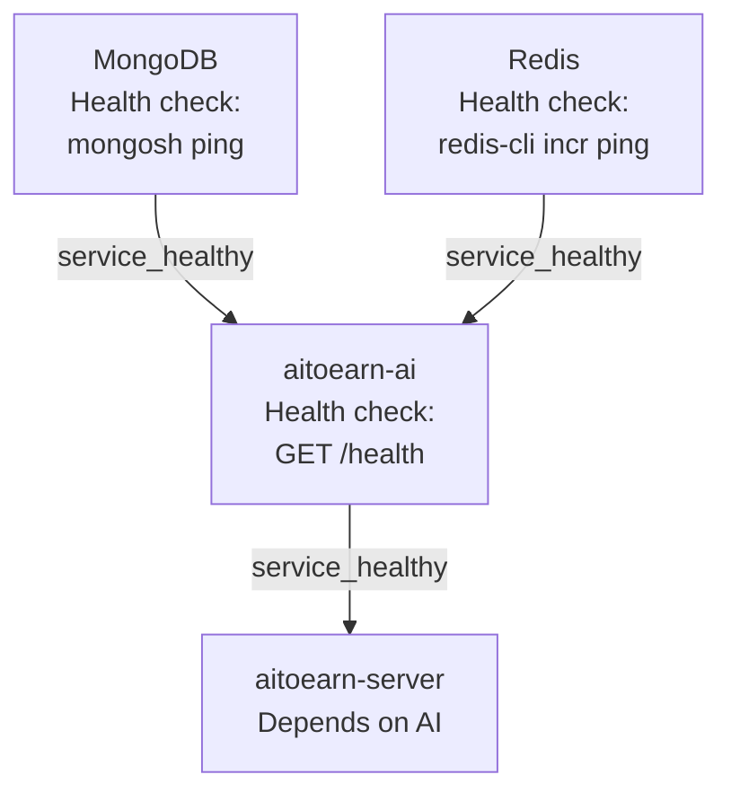

The service will not start until MongoDB and Redis are healthy, ensuring database connections are available on startup.

**Sources:** [docker-compose.yml:86-89](), [docker-compose.yml:145-146]()

### Health Check Configuration

The container health check ensures the service is ready to accept requests:

```yaml
healthcheck:
  test: ["CMD", "node", "-e", 
    "require('http').get('http://localhost:3010/health', 
      (r) => { process.exit(r.statusCode === 200 ? 0 : 1) })"]
  interval: 30s
  timeout: 10s
  retries: 3
  start_period: 60s
```

**Sources:** [docker-compose.yml:129-134]()

### Volume Mounts

| Host Path | Container Path | Mode | Purpose |
|-----------|---------------|------|---------|
| `./config/aitoearn-ai.config.js` | `/app/config.js` | Read-only | AI service configuration |
| `./config/gcs-placeholder.json` | `/app/config/gcs-placeholder.json` | Read-only | Google Cloud credentials |

Configuration files are mounted as read-only volumes. Changes require container restart.

**Sources:** [docker-compose.yml:91-92]()

### Network Configuration

The service communicates on the `aitoearn-network` Docker bridge network:

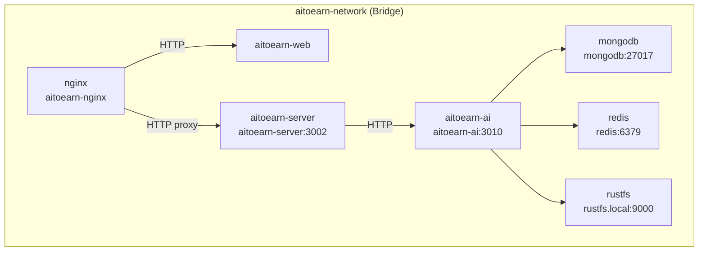

**Internal DNS resolution:**
- `aitoearn-ai` resolves to the AI container
- `mongodb` resolves to the MongoDB container
- `redis` resolves to the Redis container
- `rustfs.local` resolves to the RustFS container

**Sources:** [docker-compose.yml:93-94](), [docker-compose.yml:272-275]()

### Environment Variable Categories

The service requires environment variables in several categories:

| Category | Variables | Purpose |
|----------|-----------|---------|
| **Node.js** | `NODE_ENV`, `APP_ENV`, `APP_NAME` | Runtime environment |
| **Database** | `MONGODB_HOST`, `MONGODB_PORT`, `MONGODB_USERNAME`, `MONGODB_PASSWORD` | MongoDB connection |
| **Cache** | `REDIS_HOST`, `REDIS_PORT`, `REDIS_PASSWORD` | Redis connection |
| **Authentication** | `JWT_SECRET`, `INTERNAL_TOKEN` | Service authentication |
| **OpenAI** | `OPENAI_API_KEY`, `OPENAI_BASE_URL` | OpenAI integration |
| **Anthropic** | `ANTHROPIC_API_KEY`, `ANTHROPIC_BASE_URL` | Claude integration |
| **Google** | `GEMINI_KEY_PAIRS`, `GEMINI_LOCATION` | Gemini integration |
| **Volcengine** | `VOLCENGINE_API_KEY`, `VOLCENGINE_ACCESS_KEY_ID`, `VOLCENGINE_SECRET_ACCESS_KEY`, `VOLCENGINE_VOD_SPACE_NAME` | Doubao integration |
| **xAI** | `GROK_API_KEY` | Grok integration |
| **AICSO** | `AICSO_API_KEY`, `AICSO_BASE_URL` | AICSO integration |
| **Proxy** | `AI_PROXY_URL` | Optional HTTP proxy for AI APIs |
| **Service Communication** | `SERVER_URL` | URL to reach aitoearn-server |

**Sources:** [docker-compose.yml:95-128]()

### Startup Sequence

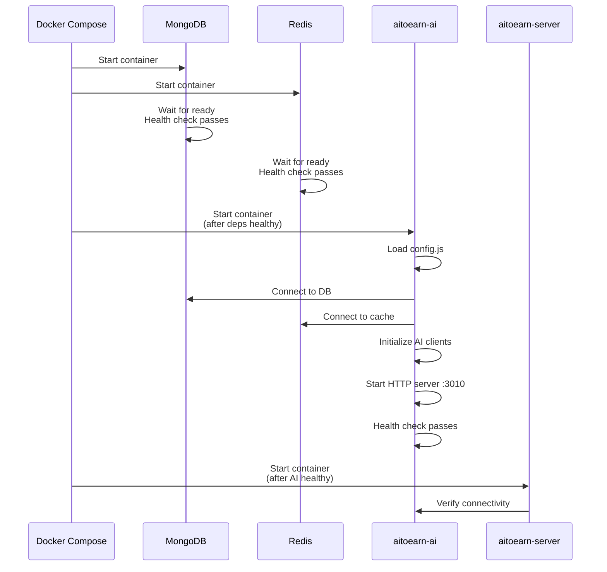

**Sources:** [docker-compose.yml:86-89](), [docker-compose.yml:145-146]()

## Configuration File Structure

The `/app/config.js` file mounted into the container defines:

### Model Definitions

The configuration includes arrays of available models for each provider:

```javascript
// Example structure (not actual code)
{
  aiModels: {
    openai: [
      { id: 'gpt-4o', name: 'GPT-4 Omni', pricing: {...} },
      { id: 'gpt-4-turbo', name: 'GPT-4 Turbo', pricing: {...} },
      // ...
    ],
    claude: [
      { id: 'claude-opus-4.5', name: 'Claude Opus 4.5', pricing: {...} },
      // ...
    ],
    // ... other providers
  }
}
```

### Storage Configuration

Defines how to access the asset storage system:

```javascript
// Example structure
{
  assets: {
    provider: 's3',
    endpoint: 'http://rustfs.local:9000',
    region: 'us-east-1',
    bucketName: 'aitoearn',
    accessKeyId: process.env.RUSTFS_ACCESS_KEY || 'rustfsadmin',
    secretAccessKey: process.env.RUSTFS_SECRET_KEY || 'rustfsadmin',
    cdnEndpoint: null
  }
}
```

**Sources:** [DOCKER_DEPLOYMENT_EN.md:98-110](), [DOCKER_DEPLOYMENT_CN.md:96-111]()

### Service Configuration

Additional settings for logging, database connections, and service behavior are defined in the config file, reading from `process.env` where appropriate.

**Sources:** [config/aitoearn-ai.config.js referenced in DOCKER_DEPLOYMENT_CN.md:286-323]()

---

