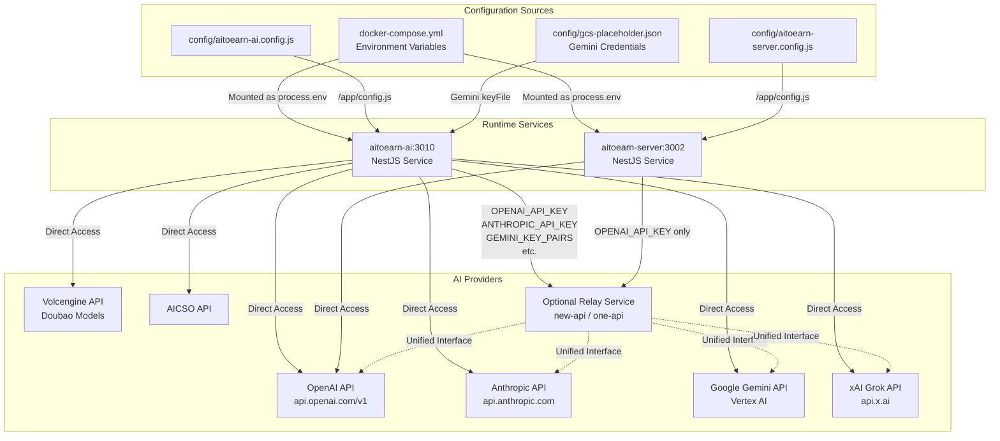
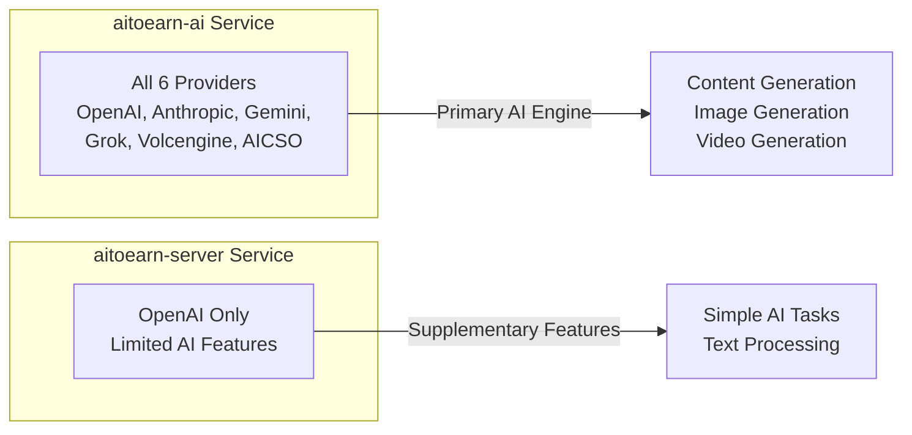
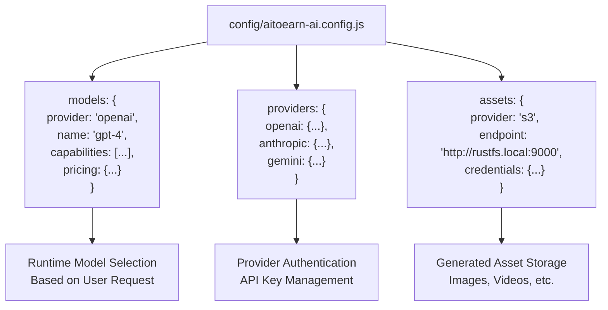
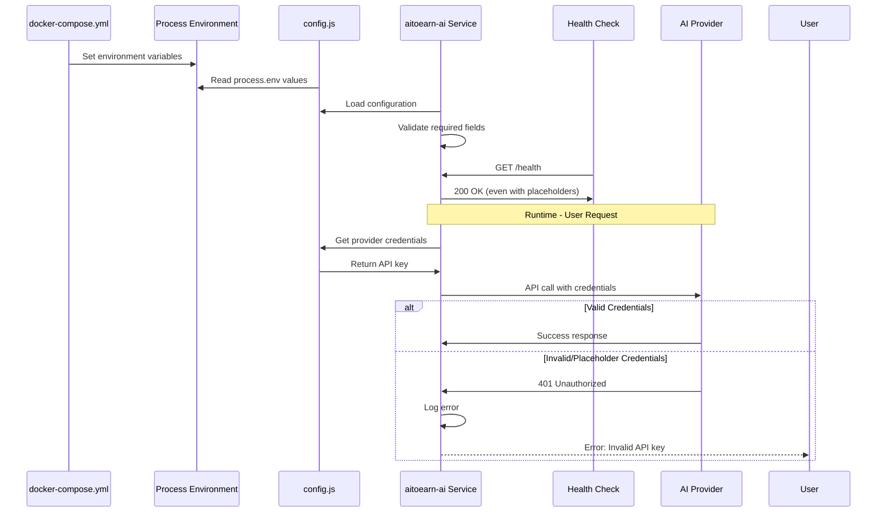

<!-- source: DeepWiki mcp.deepwiki.com · repo yikart/AiToEarn · page 3.2 Multi-Provider Configuration · fetched 2026-10-30 -->

# Multi-Provider Configuration

<details>
<summary>Relevant source files</summary>

The following files were used as context for generating this wiki page:

- [DOCKER_DEPLOYMENT_CN.md](DOCKER_DEPLOYMENT_CN.md)
- [DOCKER_DEPLOYMENT_EN.md](DOCKER_DEPLOYMENT_EN.md)
- [README.md](README.md)
- [README_CN.md](README_CN.md)
- [docker-compose.yml](docker-compose.yml)
- [presentation/agent_0.png](presentation/agent_0.png)
- [presentation/display-1.5.2png.png](presentation/display-1.5.2png.png)
- [wechat.jpg](wechat.jpg)

</details>


## Purpose and Scope

This document explains how to configure multiple AI providers in the AiToEarn platform. It covers environment variable setup, configuration file structure, model definitions, and the recommended use of API relay services to manage multiple AI backends through a unified interface.

For information about the overall AI system architecture and how AI services communicate with the backend, see [AI Service Architecture](#3.1). For details about the autonomous AI agent implementation, see [All In Agent](#3.3).

---

## Overview

AiToEarn supports six AI providers simultaneously, enabling the platform to leverage multiple models for different use cases. The multi-provider architecture consists of:

- **Environment variables** for API credentials and endpoints
- **Configuration files** defining available models, pricing, and capabilities
- **Optional API proxy/relay** for unified model access
- **Service-specific provider usage** (aitoearn-ai vs aitoearn-server)

**Sources:** [README.md:115-119](), [docker-compose.yml:114-128](), [DOCKER_DEPLOYMENT_EN.md:206-247]()

---

## Configuration Architecture



**Diagram: Multi-Provider Configuration Flow**

The configuration flows from `docker-compose.yml` environment variables through mounted config files to the runtime services, which then connect to AI providers either directly or through an optional relay service.

**Sources:** [docker-compose.yml:81-134](), [docker-compose.yml:136-232](), [DOCKER_DEPLOYMENT_EN.md:98-110]()

---

## Supported AI Providers

| Provider | Service | Models | Environment Variables Required |
|----------|---------|--------|-------------------------------|
| **OpenAI** | GPT models | GPT-4, GPT-3.5, etc. | `OPENAI_API_KEY`, `OPENAI_BASE_URL` |
| **Anthropic** | Claude models | Claude Opus 4.5/4.6, Sonnet, etc. | `ANTHROPIC_API_KEY`, `ANTHROPIC_BASE_URL` |
| **Google Gemini** | Gemini models | Gemini 2.5, 3.1 | `GEMINI_KEY_PAIRS`, `GEMINI_LOCATION` |
| **xAI** | Grok models | Grok | `GROK_API_KEY` |
| **Volcengine** | Doubao models | Doubao (豆包) | `VOLCENGINE_API_KEY`, `VOLCENGINE_ACCESS_KEY_ID`, `VOLCENGINE_SECRET_ACCESS_KEY`, `VOLCENGINE_VOD_SPACE_NAME` |
| **AICSO** | AICSO models | Custom models | `AICSO_API_KEY`, `AICSO_BASE_URL` |

**Sources:** [README.md:115-119](), [DOCKER_DEPLOYMENT_EN.md:222-240]()

---

## Environment Variable Configuration

### Core AI Provider Variables

All AI provider credentials are configured as environment variables in the `aitoearn-ai` service within [docker-compose.yml:81-134]().

```yaml
# OpenAI Configuration (used by both aitoearn-ai and aitoearn-server)
OPENAI_API_KEY: sk-placeholder
OPENAI_BASE_URL: https://api.openai.com/v1

# Anthropic Claude Configuration
ANTHROPIC_API_KEY: sk-placeholder
ANTHROPIC_BASE_URL: https://api.anthropic.com

# Volcengine (Doubao) Configuration
VOLCENGINE_API_KEY: ""
VOLCENGINE_ACCESS_KEY_ID: ""
VOLCENGINE_SECRET_ACCESS_KEY: ""
VOLCENGINE_VOD_SPACE_NAME: ""

# xAI Grok Configuration
GROK_API_KEY: ""

# AICSO Configuration
AICSO_API_KEY: ""
AICSO_BASE_URL: ""

# Google Gemini Configuration (JSON array format)
GEMINI_KEY_PAIRS: '[{"projectId":"placeholder","apiKey":"placeholder","keyFile":"/app/config/gcs-placeholder.json","bucket":"placeholder"}]'
GEMINI_LOCATION: us-central1

# Optional AI Proxy
AI_PROXY_URL: ""
```

**Sources:** [docker-compose.yml:114-128](), [DOCKER_DEPLOYMENT_EN.md:222-240]()

### Gemini Key Pairs Format

The `GEMINI_KEY_PAIRS` variable accepts a JSON array of credential objects:

```json
[
  {
    "projectId": "your-gcp-project-id",
    "apiKey": "your-gemini-api-key",
    "keyFile": "/app/config/gcs-placeholder.json",
    "bucket": "your-gcs-bucket"
  }
]
```

Each object represents a separate Google Cloud project with Vertex AI enabled. Multiple projects can be configured for load balancing or quota management.

**Sources:** [DOCKER_DEPLOYMENT_EN.md:242-247](), [docker-compose.yml:126]()

### Service-Specific Provider Usage



**Diagram: Provider Usage by Service**

The `aitoearn-ai` service uses all six AI providers for comprehensive content generation, while `aitoearn-server` only uses OpenAI for simpler tasks.

**Sources:** [docker-compose.yml:114-128](), [docker-compose.yml:179-181]()

---

## API Proxy and Relay Services

### Recommended Approach: Using API Relay

The deployment guides strongly recommend using an API relay service like **new-api** or **one-api** to manage all AI providers through a single endpoint.

**Benefits:**
- Single API key and endpoint for all models
- Centralized quota and billing management
- Load balancing and failover
- Model switching without application reconfiguration

**Popular Relay Services:**
- [new-api](https://github.com/Calcium-Ion/new-api) - Multi-model API relay
- [one-api](https://github.com/songquanpeng/one-api) - OpenAI API management system

**Sources:** [DOCKER_DEPLOYMENT_EN.md:206-211]()

### Relay Service Configuration

After deploying a relay service, configure both the `aitoearn-ai` and `aitoearn-server` services:

```yaml
# In docker-compose.yml for both services
OPENAI_BASE_URL: https://your-new-api-host/v1
OPENAI_API_KEY: sk-your-new-api-key
```

The relay service then handles routing requests to the appropriate underlying provider (OpenAI, Claude, Gemini, etc.) based on the model name in the request.

**Sources:** [DOCKER_DEPLOYMENT_EN.md:213-218]()

### AI Proxy URL

The `AI_PROXY_URL` environment variable provides an additional layer of proxying for direct AI API calls:

```yaml
AI_PROXY_URL: "http://your-proxy-server:port"
```

This is useful for:
- Routing traffic through a corporate proxy
- Adding custom request/response logging
- Implementing regional restrictions

**Sources:** [docker-compose.yml:128](), [DOCKER_DEPLOYMENT_EN.md:239]()

---

## Configuration Files Structure

### Config File Mounting

Configuration files are mounted as read-only volumes into the services:

| File | Mounted To | Purpose |
|------|------------|---------|
| `config/aitoearn-ai.config.js` | `aitoearn-ai:/app/config.js` | AI model definitions, pricing, capabilities |
| `config/aitoearn-server.config.js` | `aitoearn-server:/app/config.js` | Backend configuration including OAuth |
| `config/gcs-placeholder.json` | `aitoearn-ai:/app/config/gcs-placeholder.json` | Google Cloud service account credentials |

**Sources:** [docker-compose.yml:90-92](), [docker-compose.yml:147-148](), [DOCKER_DEPLOYMENT_EN.md:98-110]()

### Model Definitions in config.js

The `config/aitoearn-ai.config.js` file contains model definitions that specify:

- Available models from each provider
- Model capabilities (text, image, video generation)
- Pricing information
- Model-specific parameters



**Diagram: aitoearn-ai.config.js Structure**

**Sources:** [DOCKER_DEPLOYMENT_EN.md:286-362]()

### Environment Variable Integration

Configuration files read environment variables set in `docker-compose.yml`:

```javascript
// Example from config/aitoearn-ai.config.js
module.exports = {
  redis: {
    host: process.env.REDIS_HOST,
    port: parseInt(process.env.REDIS_PORT),
    password: process.env.REDIS_PASSWORD,
  },
  
  auth: {
    secret: process.env.JWT_SECRET,
    internalToken: process.env.INTERNAL_TOKEN,
  },
  
  // AI provider configs read from environment
  openai: {
    apiKey: process.env.OPENAI_API_KEY,
    baseUrl: process.env.OPENAI_BASE_URL,
  },
  
  // Model definitions are hardcoded in config
  models: [
    {
      provider: 'openai',
      name: 'gpt-4',
      // ...
    }
  ]
}
```

**Sources:** [DOCKER_DEPLOYMENT_EN.md:286-362]()

---

## Placeholder vs Production Configuration

### Default Placeholder Values

The default `docker-compose.yml` contains placeholder values that allow the application to start without errors:

```yaml
OPENAI_API_KEY: sk-placeholder
ANTHROPIC_API_KEY: sk-placeholder
GEMINI_KEY_PAIRS: '[{"projectId":"placeholder","apiKey":"placeholder",...}]'
```

**Behavior with placeholders:**
- Services start successfully
- Health checks pass
- AI features return errors at runtime when actually invoked
- Users see error messages indicating missing API keys

**Sources:** [docker-compose.yml:115](), [docker-compose.yml:117](), [DOCKER_DEPLOYMENT_EN.md:220]()

### Production Configuration Steps

1. **Obtain API keys** from each provider's developer portal
2. **Update docker-compose.yml** with real credentials
3. **Configure relay service** (recommended) or use direct provider access
4. **Update config files** if using non-default models
5. **Restart services** to apply changes:

```bash
docker compose down
docker compose up -d
```

**Sources:** [DOCKER_DEPLOYMENT_EN.md:206-247]()

---

## Provider-Specific Configuration Details

### OpenAI Configuration

Used by both `aitoearn-ai` and `aitoearn-server` services.

```yaml
# In aitoearn-ai service
OPENAI_API_KEY: sk-your-key
OPENAI_BASE_URL: https://api.openai.com/v1

# In aitoearn-server service (duplicate required)
OPENAI_API_KEY: sk-your-key
OPENAI_BASE_URL: https://api.openai.com/v1
```

**Why duplicated:** Both services make independent OpenAI API calls for different features.

**Sources:** [docker-compose.yml:115-116](), [docker-compose.yml:180-181]()

### Anthropic (Claude) Configuration

Only used by `aitoearn-ai` service.

```yaml
ANTHROPIC_API_KEY: sk-ant-your-key
ANTHROPIC_BASE_URL: https://api.anthropic.com
```

**Default base URL** is `https://api.anthropic.com` and typically doesn't need modification unless using a proxy.

**Sources:** [docker-compose.yml:117-118]()

### Volcengine (Doubao) Configuration

Requires multiple credentials for full functionality:

```yaml
VOLCENGINE_API_KEY: "your-api-key"
VOLCENGINE_ACCESS_KEY_ID: "your-access-key-id"
VOLCENGINE_SECRET_ACCESS_KEY: "your-secret-access-key"
VOLCENGINE_VOD_SPACE_NAME: "your-vod-space"
```

- **API Key**: For Doubao model API access
- **Access Key ID/Secret**: For Volcengine cloud services
- **VOD Space Name**: For video-on-demand storage

**Sources:** [docker-compose.yml:119-122](), [DOCKER_DEPLOYMENT_EN.md:232]()

### Gemini Configuration

Requires Google Cloud project setup with Vertex AI enabled:

```yaml
GEMINI_KEY_PAIRS: '[{
  "projectId": "your-gcp-project-id",
  "apiKey": "your-gemini-api-key",
  "keyFile": "/app/config/gcs-placeholder.json",
  "bucket": "your-gcs-bucket"
}]'
GEMINI_LOCATION: us-central1
```

**Key file setup:**
1. Create a Google Cloud service account
2. Download the JSON credentials file
3. Replace `config/gcs-placeholder.json` with the real credentials
4. Update the `keyFile` path in `GEMINI_KEY_PAIRS`

**Sources:** [docker-compose.yml:126-127](), [DOCKER_DEPLOYMENT_EN.md:242-247]()

### Grok Configuration

Simplest configuration - only requires API key:

```yaml
GROK_API_KEY: "your-grok-api-key"
```

Obtain from [xAI Developer Console](https://console.x.ai).

**Sources:** [docker-compose.yml:123](), [DOCKER_DEPLOYMENT_EN.md:234]()

### AICSO Configuration

Requires both API key and base URL:

```yaml
AICSO_API_KEY: "your-aicso-key"
AICSO_BASE_URL: "https://api.aicso.com"
```

**Sources:** [docker-compose.yml:124-125](), [DOCKER_DEPLOYMENT_EN.md:235-236]()

---

## Configuration Validation



**Diagram: Configuration Validation Flow**

The system validates configuration at multiple stages:
- **Startup**: Basic format validation
- **Health check**: Service connectivity (passes with placeholders)
- **Runtime**: Actual API call validation (fails with placeholders)

**Sources:** [docker-compose.yml:129-134]()

---

## Troubleshooting

### Common Configuration Issues

| Issue | Symptom | Solution |
|-------|---------|----------|
| **Missing API Key** | Runtime errors: "Invalid API key" | Add real key to `docker-compose.yml`, restart service |
| **Mismatched Passwords** | Service startup fails, health check fails | Ensure MongoDB/Redis passwords match across all services |
| **Invalid GEMINI_KEY_PAIRS** | JSON parse error on startup | Validate JSON syntax, ensure proper escaping |
| **Wrong Base URL** | Connection timeout or 404 errors | Verify provider endpoint, check for typos |
| **Stale Configuration** | Changes not taking effect | Run `docker compose down && docker compose up -d` |

**Sources:** [DOCKER_DEPLOYMENT_EN.md:206-247]()

### Verifying Provider Configuration

Check service logs to verify provider initialization:

```bash
# View aitoearn-ai logs
docker logs aitoearn-ai

# Look for provider initialization messages
# Should see: "OpenAI provider initialized"
# Should see: "Anthropic provider initialized"
# etc.
```

**Sources:** [DOCKER_DEPLOYMENT_EN.md:122-125]()

---

## Related Configuration

- **OAuth Platform Configuration**: See [DOCKER_DEPLOYMENT_EN.md:249-270]() for third-party platform credentials
- **Storage Configuration**: RustFS and S3 setup is documented in [Storage and Database Setup](#7.3)
- **Email Configuration**: SMTP credentials in [DOCKER_DEPLOYMENT_EN.md:275-278]()

**Sources:** [DOCKER_DEPLOYMENT_EN.md:249-281]()

---

