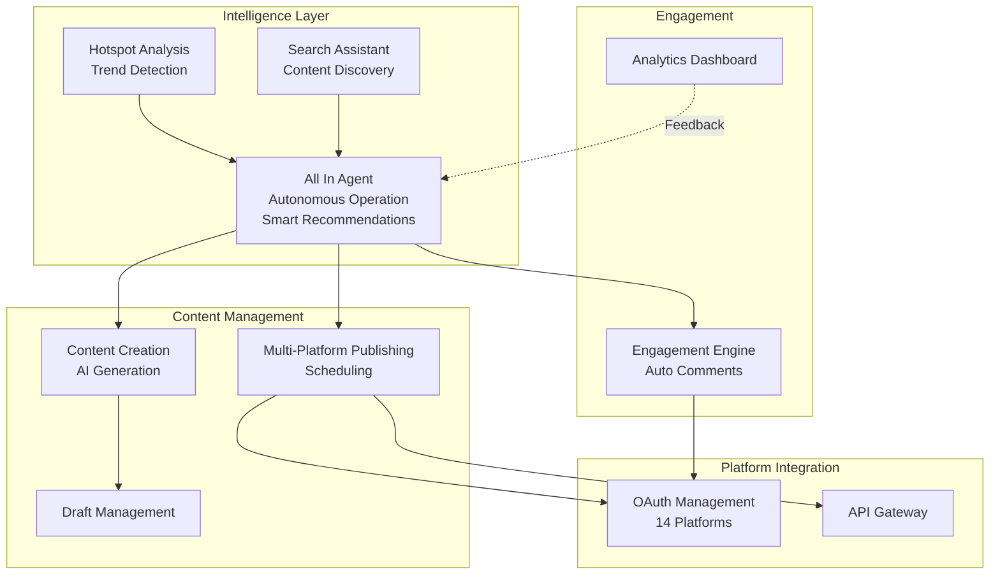
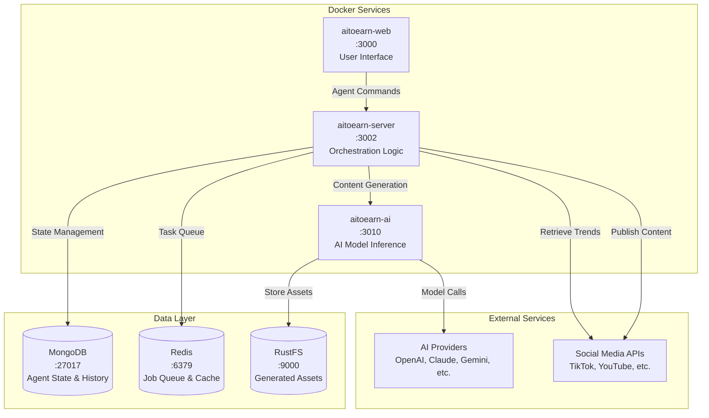
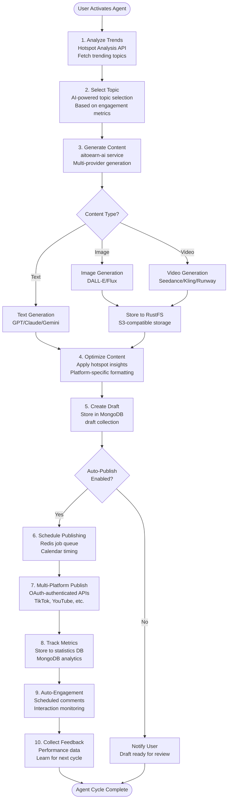
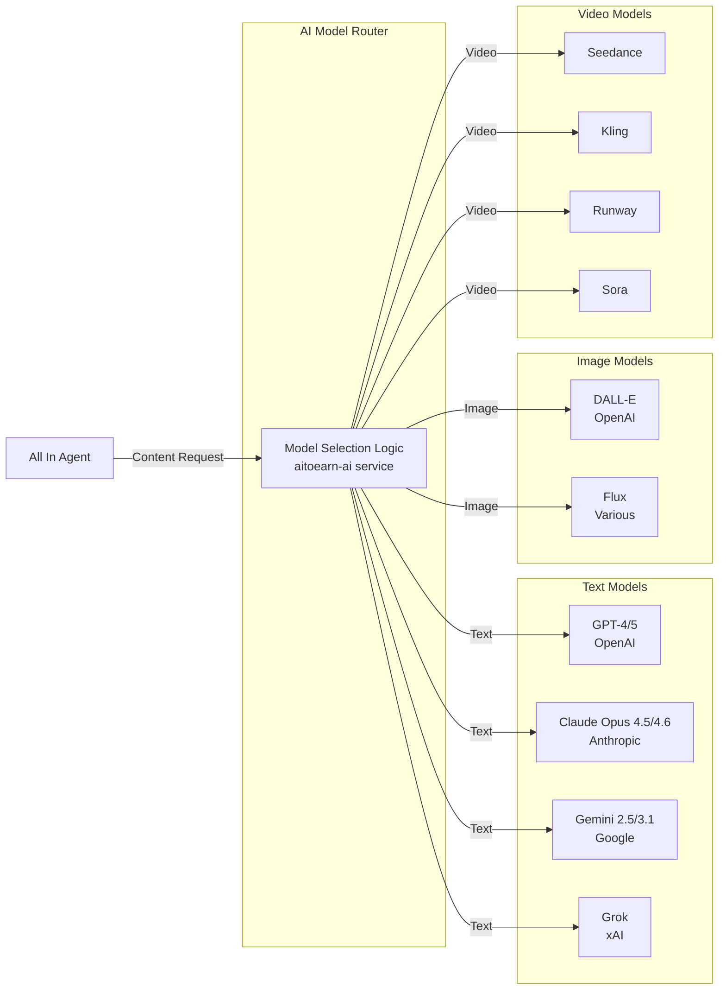
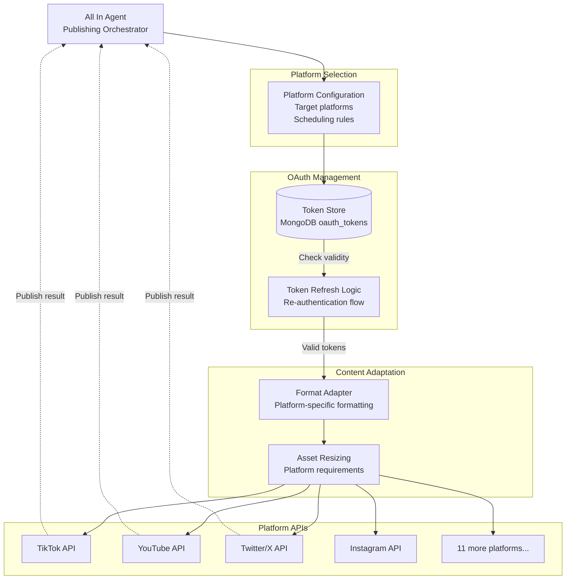
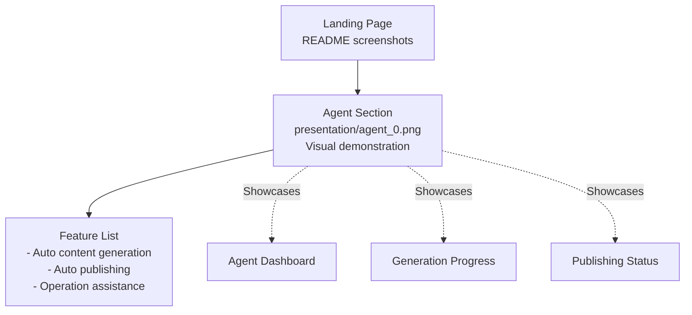

<!-- source: DeepWiki mcp.deepwiki.com · repo yikart/AiToEarn · page 3.3 All In Agent · fetched 2026-10-30 -->

# All In Agent

<details>
<summary>Relevant source files</summary>

The following files were used as context for generating this wiki page:

- [DOCKER_DEPLOYMENT_CN.md](DOCKER_DEPLOYMENT_CN.md)
- [DOCKER_DEPLOYMENT_EN.md](DOCKER_DEPLOYMENT_EN.md)
- [README.md](README.md)
- [README_CN.md](README_CN.md)
- [docker-compose.yml](docker-compose.yml)
- [presentation/agent_0.png](presentation/agent_0.png)
- [presentation/display-1.5.2png.png](presentation/display-1.5.2png.png)
- [wechat.jpg](wechat.jpg)

</details>


## Purpose and Scope

This document describes the **All In Agent**, an autonomous AI agent introduced in AiToEarn v1.4.3 that can automatically generate content, publish to multiple platforms, and assist users in operating the AiToEarn platform. For information about the AI service infrastructure that powers the agent, see [AI Service Architecture](#3.1). For multi-provider AI configuration details, see [Multi-Provider Configuration](#3.2).

The All In Agent represents the highest level of automation in AiToEarn, combining content creation, platform publishing, and operational assistance into a unified intelligent system.

**Sources:** [README.md:33](), [README.md:71-76](), [README_CN.md:32](), [README_CN.md:58-64]()

## Overview

The All In Agent is an autonomous AI-powered system that operates within the AiToEarn platform to:

1. **Automatically generate content** - Creates text, images, and video content using multiple AI providers
2. **Automatically publish content** - Distributes generated content across 14+ social media platforms
3. **Assist platform operation** - Provides intelligent recommendations and automation for user workflows

This feature was introduced in December 2024 (v1.4.3) and represents a significant step toward fully autonomous content marketing operations.

**Key Capabilities:**
- Autonomous content generation without manual intervention
- Multi-platform content distribution with intelligent scheduling
- User workflow assistance and smart recommendations
- Integration with hotspot analysis for trending content
- Coordination across the entire content lifecycle (creation → publishing → engagement)

**Sources:** [README.md:30-33](), [README.md:66-77](), [README_CN.md:28-32]()

## System Architecture

### Position in Overall Architecture

The All In Agent sits at the intersection of multiple functional domains within AiToEarn:



**Agent Decision Flow**

The All In Agent operates through a coordinated workflow:

**Sources:** Based on architectural diagrams provided in system overview

### Service-Level Architecture

The All In Agent functionality is distributed across the AiToEarn microservices architecture:



**Service Responsibilities:**

| Service | Agent Responsibilities |
|---------|----------------------|
| `aitoearn-web` | Agent UI, command input, status display |
| `aitoearn-server` | Agent orchestration, workflow logic, platform publishing |
| `aitoearn-ai` | AI model selection, content generation, asset creation |
| `MongoDB` | Agent configuration, execution history, content drafts |
| `Redis` | Task queuing, scheduled operations, job status |
| `RustFS` | Generated images, videos, documents |

**Sources:** [docker-compose.yml:81-134](), [docker-compose.yml:136-232](), [docker-compose.yml:234-246]()

### Agent Workflow

The All In Agent executes content operations through multiple phases:



**Sources:** Based on content workflow diagram in system overview, [README.md:141-149]()

## Component Interactions

### AI Model Selection

The All In Agent leverages the multi-provider AI system to select optimal models for different content types:



**Model Selection Criteria:**
- **Cost optimization** - Select based on pricing for task complexity
- **Quality requirements** - Higher quality models for final content
- **Speed requirements** - Faster models for drafts and previews
- **Platform requirements** - Platform-specific constraints (video length, format, etc.)

**Sources:** [README.md:141-149](), [docker-compose.yml:114-128]()

### Platform Publishing Integration

The agent coordinates with the OAuth authentication system and platform APIs:



**Publishing Flow:**
1. Agent selects target platforms based on content type and user configuration
2. Retrieves OAuth tokens from MongoDB
3. Validates token expiration, triggers re-auth if needed
4. Adapts content format for each platform (character limits, hashtag styles, etc.)
5. Resizes/converts assets to meet platform requirements
6. Executes parallel publishing to all selected platforms
7. Records publish metadata and results

**Sources:** [docker-compose.yml:183-212](), based on platform integration architecture

## Configuration

### Environment Variables

The All In Agent relies on configuration from multiple services in the Docker Compose stack:

**AI Service Configuration** (`aitoearn-ai` service):

| Variable | Purpose | Default |
|----------|---------|---------|
| `OPENAI_API_KEY` | Access to GPT models for text generation | `sk-placeholder` |
| `OPENAI_BASE_URL` | OpenAI API endpoint or relay service | `https://api.openai.com/v1` |
| `ANTHROPIC_API_KEY` | Access to Claude models | `sk-placeholder` |
| `GEMINI_KEY_PAIRS` | Google Gemini configuration (JSON array) | Placeholder JSON |
| `VOLCENGINE_API_KEY` | Volcengine (Doubao) access | Empty |
| `GROK_API_KEY` | xAI Grok access | Empty |
| `AI_PROXY_URL` | Optional AI API proxy for geo-restricted models | Empty |

**Backend Service Configuration** (`aitoearn-server` service):

| Variable | Purpose | Default |
|----------|---------|---------|
| `INTERNAL_TOKEN` | Authentication between services | `change-this-secret-token` |
| `JWT_SECRET` | User session management | `change-this-jwt-secret` |
| `AI_URL` | URL to aitoearn-ai service | `http://aitoearn-ai:3010` |
| Platform OAuth variables | Credentials for 14+ platforms | Empty (optional) |

**Sources:** [docker-compose.yml:95-128](), [docker-compose.yml:151-227]()

### Recommended Setup for Production

**Using AI Relay Services:**

The agent works best with a relay service like [new-api](https://github.com/Calcium-Ion/new-api) or [one-api](https://github.com/songquanpeng/one-api) to manage multiple AI providers through a single endpoint:

```yaml
# In docker-compose.yml aitoearn-ai service:
OPENAI_BASE_URL: https://your-new-api-host/v1
OPENAI_API_KEY: sk-your-relay-api-key

# All models (GPT, Claude, Gemini, etc.) accessible through relay
```

**OAuth Configuration:**

For the agent to publish autonomously, configure OAuth credentials for target platforms:

```yaml
# Example: TikTok configuration
TIKTOK_CLIENT_ID: "your-client-id"
TIKTOK_CLIENT_SECRET: "your-client-secret"

# Callback URL format: https://{APP_DOMAIN}/api/plat/tiktok/auth/back
```

**Sources:** [DOCKER_DEPLOYMENT_EN.md:206-220](), [DOCKER_DEPLOYMENT_EN.md:251-270]()

### Application Configuration Files

The agent behavior is also controlled through configuration files mounted into containers:

**AI Service Config** (`config/aitoearn-ai.config.js`):
- AI model definitions and pricing
- Model selection preferences
- Asset storage configuration
- Generation parameters

**Server Config** (`config/aitoearn-server.config.js`):
- Platform-specific publishing rules
- OAuth callback URLs
- Content optimization settings
- Scheduling policies

**Sources:** [docker-compose.yml:91-92](), [docker-compose.yml:148]()

## Agent Presentation

The All In Agent feature is prominently displayed in the AiToEarn user interface:



**Visual Assets:**
- Main agent showcase: `presentation/agent_0.png`
- Demonstrates the agent interface and capabilities
- Part of the v1.5.2 display materials

**Sources:** [README.md:71-76](), [presentation/agent_0.png:1](), [presentation/display-1.5.2png.png:1]()

## Technical Limitations

**Note:** The specific implementation details of the All In Agent feature are not visible in the provided codebase files. The information in this document is derived from:

1. **Documentation** - README files describing feature capabilities
2. **Architecture diagrams** - System-level overview of component relationships
3. **Configuration** - Docker Compose and environment variable setup
4. **Inference** - Logical integration with existing AI and publishing systems

For detailed implementation, refer to:
- Agent-specific service modules in `aitoearn-server` and `aitoearn-ai`
- Agent workflow orchestration code
- Agent state management in MongoDB schemas
- Agent UI components in `aitoearn-web`

The agent leverages all the infrastructure described in:
- [AI Service Architecture](#3.1) for content generation
- [Multi-Platform Publishing](#4.3) for content distribution
- [Calendar Timing and Scheduling](#5.2) for automation
- [Hotspot Analysis](#5.3) for trend detection

**Sources:** Analysis based on provided file listing and README documentation

---

