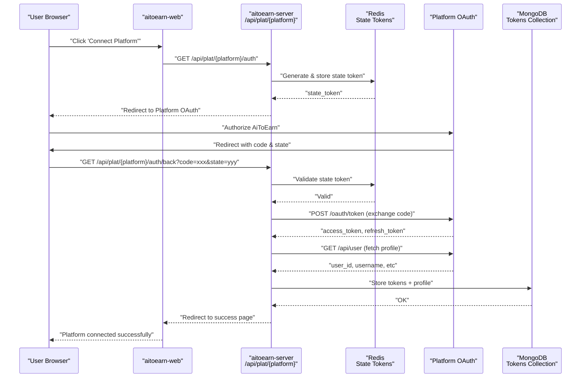
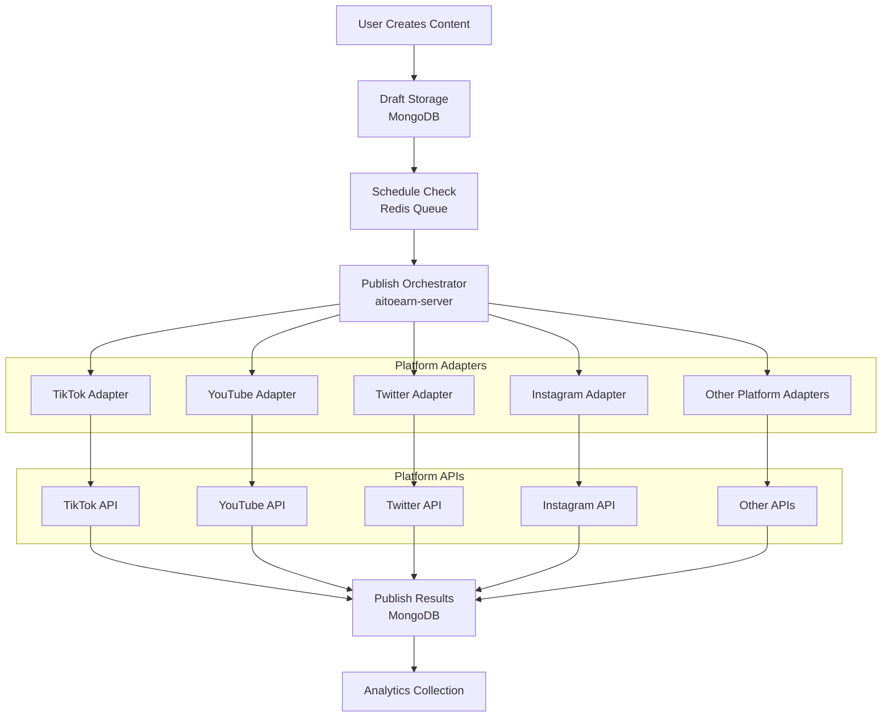
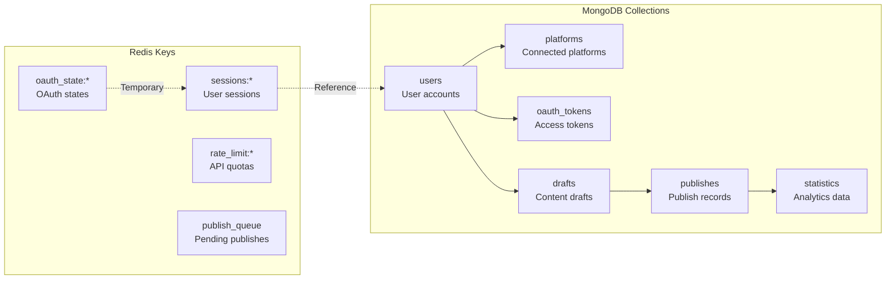

<!-- source: DeepWiki mcp.deepwiki.com · repo yikart/AiToEarn · page 4 Platform Integration System · fetched 2026-10-30 -->

# Platform Integration System

<details>
<summary>Relevant source files</summary>

The following files were used as context for generating this wiki page:

- [DOCKER_DEPLOYMENT_CN.md](DOCKER_DEPLOYMENT_CN.md)
- [DOCKER_DEPLOYMENT_EN.md](DOCKER_DEPLOYMENT_EN.md)
- [README.md](README.md)
- [README_CN.md](README_CN.md)
- [docker-compose.yml](docker-compose.yml)
- [presentation/agent_0.png](presentation/agent_0.png)
- [presentation/display-1.5.2png.png](presentation/display-1.5.2png.png)
- [wechat.jpg](wechat.jpg)

</details>


## Purpose and Scope

The Platform Integration System enables AiToEarn to connect with 14+ social media platforms for multi-channel content distribution, engagement tracking, and analytics collection. This system handles OAuth 2.0 authentication flows, manages access tokens, provides platform-specific API adapters, and coordinates cross-platform publishing operations.

This document provides an overview of the integration architecture. For detailed information on specific aspects:
- OAuth authentication flow mechanics and token management: see [OAuth Authentication Flow](#4.1)
- Platform-specific configuration and API capabilities: see [Supported Platforms](#4.2)  
- Multi-platform content publishing workflows: see [Multi-Platform Publishing](#4.3)

For AI-powered content generation features that work with this system, see [AI Integration System](#3). For content scheduling and calendar features, see [Calendar Timing and Scheduling](#5.2).

## System Architecture

### Integration Overview

The Platform Integration System operates as a middleware layer between AiToEarn's core services and external social media platform APIs. The `aitoearn-server` service manages all platform integrations through a unified interface while maintaining platform-specific adapters.

**Platform Integration Architecture**

```mermaid
graph TB
    subgraph "Client Applications"
        WebUI["aitoearn-web<br/>:3000"]
        DesktopApp["Electron Desktop"]
    end
    
    subgraph "Backend Services"
        Server["aitoearn-server<br/>:3002"]
        AI["aitoearn-ai<br/>:3010"]
    end
    
    subgraph "Data Layer"
        MongoDB[("MongoDB<br/>:27017<br/>OAuth Tokens<br/>User Accounts<br/>Publish History")]
        Redis[("Redis<br/>:6379<br/>Session Cache<br/>Rate Limits")]
    end
    
    subgraph "External Platforms"
        direction LR
        TikTok["TikTok API"]
        YouTube["YouTube API"]
        Twitter["Twitter/X API"]
        Instagram["Instagram API"]
        Facebook["Facebook API"]
        LinkedIn["LinkedIn API"]
        Threads["Threads API"]
        Pinterest["Pinterest API"]
        Bilibili["Bilibili API"]
        Douyin["Douyin API"]
        Kuaishou["Kuaishou API"]
        Xiaohongshu["Xiaohongshu API"]
        WeChat["WeChat Channels"]
        WXPlat["WeChat Official"]
    end
    
    WebUI --> Server
    DesktopApp --> Server
    Server --> MongoDB
    Server --> Redis
    Server --> AI
    
    Server -->|"OAuth Flow<br/>API Calls"| TikTok
    Server -->|"OAuth Flow<br/>API Calls"| YouTube
    Server -->|"OAuth Flow<br/>API Calls"| Twitter
    Server -->|"OAuth Flow<br/>API Calls"| Instagram
    Server -->|"OAuth Flow<br/>API Calls"| Facebook
    Server -->|"OAuth Flow<br/>API Calls"| LinkedIn
    Server -->|"OAuth Flow<br/>API Calls"| Threads
    Server -->|"OAuth Flow<br/>API Calls"| Pinterest
    Server -->|"OAuth Flow<br/>API Calls"| Bilibili
    Server -->|"OAuth Flow<br/>API Calls"| Douyin
    Server -->|"OAuth Flow<br/>API Calls"| Kuaishou
    Server -->|"OAuth Flow<br/>API Calls"| Xiaohongshu
    Server -->|"OAuth Flow<br/>API Calls"| WeChat
    Server -->|"OAuth Flow<br/>API Calls"| WXPlat
```



Sources: [README.md:18-20](), [docker-compose.yml:183-212](), system architecture diagrams provided

### Component Responsibilities

| Component | Responsibility |
|-----------|---------------|
| **aitoearn-server** | OAuth coordination, token management, platform API calls, publish orchestration |
| **MongoDB** | Persistent storage of OAuth tokens, user-platform bindings, publish metadata |
| **Redis** | Session state, OAuth state tokens, rate limiting counters |
| **aitoearn-web** | User interface for platform connection, publish triggers |
| **Platform APIs** | External social media platform endpoints (OAuth, publishing, analytics) |

Sources: [docker-compose.yml:136-232](), [DOCKER_DEPLOYMENT_EN.md:28-36]()

## OAuth Configuration

### Environment Variables

Platform credentials are configured via environment variables in the `aitoearn-server` service. Each platform requires a client ID and client secret obtained from the platform's developer console.

**OAuth Credential Configuration**

| Platform | Environment Variables | Developer Portal |
|----------|---------------------|------------------|
| TikTok | `TIKTOK_CLIENT_ID`, `TIKTOK_CLIENT_SECRET` | https://developers.tiktok.com |
| YouTube | `YOUTUBE_CLIENT_ID`, `YOUTUBE_CLIENT_SECRET` | https://console.cloud.google.com |
| Twitter/X | `TWITTER_CLIENT_ID`, `TWITTER_CLIENT_SECRET` | https://developer.x.com |
| Instagram | `INSTAGRAM_CLIENT_ID`, `INSTAGRAM_CLIENT_SECRET` | https://developers.facebook.com |
| Facebook | `FACEBOOK_CLIENT_ID`, `FACEBOOK_CLIENT_SECRET`, `FACEBOOK_CONFIG_ID` | https://developers.facebook.com |
| LinkedIn | `LINKEDIN_CLIENT_ID`, `LINKEDIN_CLIENT_SECRET` | https://linkedin.com/developers |
| Threads | `THREADS_CLIENT_ID`, `THREADS_CLIENT_SECRET` | https://developers.facebook.com |
| Pinterest | `PINTEREST_CLIENT_ID`, `PINTEREST_CLIENT_SECRET`, `PINTEREST_TEST_AUTHORIZATION` | https://developers.pinterest.com |
| Bilibili | `BILIBILI_CLIENT_ID`, `BILIBILI_CLIENT_SECRET` | https://open.bilibili.com |
| Douyin | `DOYIN_CLIENT_ID`, `DOYIN_CLIENT_SECRET` | https://open.douyin.com |
| Kuaishou | `KWAI_CLIENT_ID`, `KWAI_CLIENT_SECRET` | https://open.kuaishou.com |
| Google (YouTube) | `GOOGLE_CLIENT_ID`, `GOOGLE_CLIENT_SECRET` | https://console.cloud.google.com |
| WeChat Official | `WXPLAT_APP_ID`, `WXPLAT_APP_SECRET`, `WXPLAT_ENCODING_AES_KEY` | https://mp.weixin.qq.com |

Sources: [docker-compose.yml:183-212](), [DOCKER_DEPLOYMENT_CN.md:250-267](), [DOCKER_DEPLOYMENT_EN.md:252-269]()

### Callback URL Structure

OAuth callback URLs follow a consistent pattern across all platforms:

```
https://{APP_DOMAIN}/api/plat/{platform}/auth/back
```

Where:
- `{APP_DOMAIN}`: Configured via the `APP_DOMAIN` environment variable in `aitoearn-server` [docker-compose.yml:155]()
- `{platform}`: Platform identifier (e.g., `tiktok`, `youtube`, `twitter`, `instagram`)

The `APP_DOMAIN` must be accessible from the public internet for OAuth callbacks to function correctly.

Sources: [DOCKER_DEPLOYMENT_CN.md:269](), [DOCKER_DEPLOYMENT_EN.md:271]()

## OAuth Authentication Flow

### High-Level Flow

**OAuth 2.0 Authorization Code Flow**



Sources: [DOCKER_DEPLOYMENT_CN.md:269](), [DOCKER_DEPLOYMENT_EN.md:271]()

### State Token Management

OAuth state tokens are ephemeral security tokens stored in Redis with a short TTL (typically 10-15 minutes). They prevent CSRF attacks by ensuring the callback request originates from a legitimate authorization initiation.

**State Token Lifecycle**:
1. Generated when user initiates OAuth flow
2. Stored in Redis with user session ID
3. Validated on callback
4. Deleted after validation (one-time use)

Sources: [docker-compose.yml:105-107](), [docker-compose.yml:168-169]()

### Token Storage Schema

OAuth tokens are stored in MongoDB with the following conceptual structure:

| Field | Type | Description |
|-------|------|-------------|
| `userId` | ObjectId | Reference to user document |
| `platform` | String | Platform identifier (e.g., "tiktok") |
| `platformUserId` | String | User ID on external platform |
| `platformUsername` | String | Username on external platform |
| `accessToken` | String (encrypted) | OAuth access token |
| `refreshToken` | String (encrypted) | OAuth refresh token |
| `expiresAt` | DateTime | Access token expiration timestamp |
| `scope` | Array | OAuth scopes granted |
| `createdAt` | DateTime | Token creation timestamp |
| `updatedAt` | DateTime | Last token refresh timestamp |

Tokens are encrypted at rest in MongoDB to protect user credentials.

Sources: [docker-compose.yml:100-103](), [docker-compose.yml:157-160](), MongoDB schema implied from architecture

## Platform API Integration

### Unified Platform Interface

The system provides a unified interface for platform operations while maintaining platform-specific implementations. Each platform has dedicated modules for:

- **Authentication**: OAuth flow handling, token refresh
- **Publishing**: Content formatting, API calls, error handling  
- **Fetching**: Retrieve published content metadata, analytics
- **Engagement**: Comments, likes, interactions management

### Rate Limiting

Rate limits are enforced at two levels:

1. **Redis-based Application Limits**: Track API calls per user per platform to stay within platform quotas
2. **Platform-native Limits**: Handle HTTP 429 responses with exponential backoff

Rate limit counters are stored in Redis with keys like:
```
rate_limit:{userId}:{platform}:{endpoint}
```

Sources: [docker-compose.yml:168-169](), Redis usage from architecture

### Error Handling

Platform integration errors are categorized and handled appropriately:

| Error Type | Handling Strategy |
|------------|-------------------|
| OAuth expired | Automatic refresh token flow |
| Rate limit exceeded | Queue request with backoff |
| Platform unavailable | Retry with exponential backoff |
| Invalid content format | Return validation error to user |
| Permission denied | Prompt user to re-authorize |

Failed publish attempts are logged to MongoDB for retry and debugging.

Sources: Architecture patterns from deployment documentation

## Content Publishing Flow

### Multi-Platform Publishing

**Content Distribution Workflow**



Sources: High-level workflow diagram from system overview, [README.md:79-89]()

### Platform-Specific Adaptations

Each platform requires specific content adaptations:

| Platform | Adaptations |
|----------|-------------|
| TikTok | Video aspect ratio (9:16), duration limits, hashtag formatting |
| YouTube | Video metadata (title, description, tags), thumbnail upload, category selection |
| Twitter/X | Character limits (280), media attachment limits, thread support |
| Instagram | Image aspect ratios, caption length, hashtag limits (30 max) |
| Facebook | Link preview optimization, image dimensions, video specs |
| LinkedIn | Professional tone suggestions, document format support |
| Threads | Text-first formatting, parent-child post relationships |
| Pinterest | Image pins, board selection, rich pin metadata |

Platform adapters in `aitoearn-server` handle these transformations automatically.

Sources: [README.md:18-20](), platform requirements from integration architecture

## Data Persistence

### Storage Architecture

**Platform Integration Data Model**



Sources: [docker-compose.yml:157-171](), [DOCKER_DEPLOYMENT_CN.md:161-171](), MongoDB and Redis usage patterns

### Database Configuration

MongoDB connection configuration in `aitoearn-server`:
- **Host**: `mongodb` (Docker internal network)
- **Port**: `27017`
- **Database**: `aitoearn`
- **Credentials**: Configured via `MONGODB_USERNAME` and `MONGODB_PASSWORD` environment variables

Redis connection configuration:
- **Host**: `redis` (Docker internal network)  
- **Port**: `6379`
- **Password**: Configured via `REDIS_PASSWORD` environment variable

Sources: [docker-compose.yml:157-169](), [docker-compose.yml:100-107]()

## Security Considerations

### Token Encryption

OAuth access tokens and refresh tokens are encrypted before storage in MongoDB. The encryption keys are derived from the `JWT_SECRET` environment variable.

### OAuth State Validation

All OAuth callbacks validate the state parameter against Redis storage to prevent CSRF attacks. State tokens are:
- Cryptographically random (32+ bytes)
- Single-use (deleted after validation)
- Time-limited (10-15 minute TTL)
- Bound to user session

### API Key Management

Platform API credentials (client IDs and secrets) are:
- Configured via environment variables only
- Never logged or exposed in responses
- Isolated per deployment environment

Sources: [docker-compose.yml:109](), [docker-compose.yml:173-174](), security best practices from OAuth 2.0 spec

## Monitoring and Debugging

### Health Checks

The `aitoearn-server` service exposes a health endpoint for monitoring platform integration status:

```
GET http://localhost:3002/health
```

This endpoint is used by Docker healthchecks and monitoring systems.

Sources: [docker-compose.yml:227-232]()

### Logging

Platform integration operations are logged with structured logging including:
- User ID and platform identifier
- API endpoint called
- Response status codes
- Error messages and stack traces
- Request/response timing

Log output is controlled by environment variables in the AI and server services.

Sources: [docker-compose.yml:95-98](), [docker-compose.yml:152-154]()

## Related Configuration Files

The following configuration files contain platform-specific settings:

| File | Purpose | Mounted To |
|------|---------|------------|
| `config/aitoearn-server.config.js` | Backend platform configuration, OAuth settings | `aitoearn-server:/app/config.js` |
| `docker-compose.yml` | OAuth credentials, API endpoints | All services |

Sources: [docker-compose.yml:148](), [DOCKER_DEPLOYMENT_CN.md:96-111]()

---

