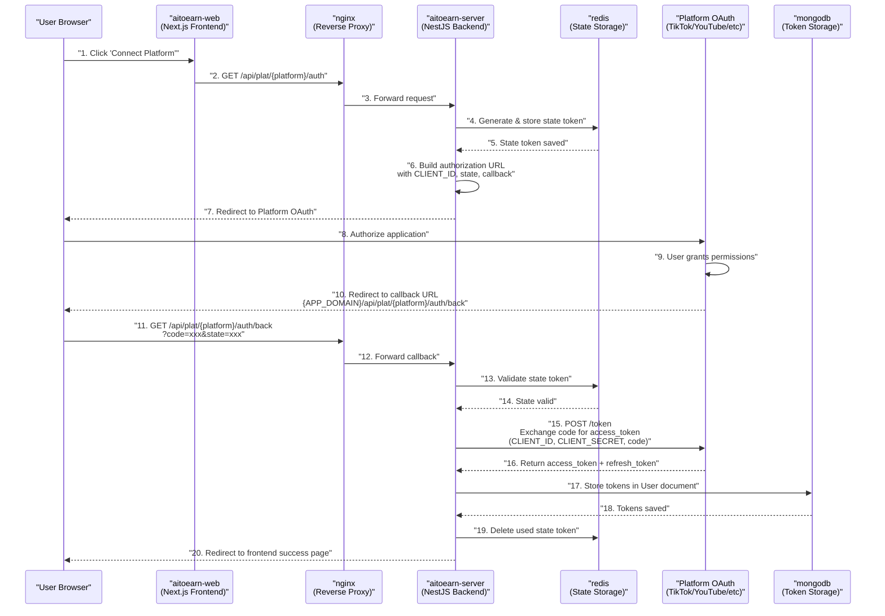
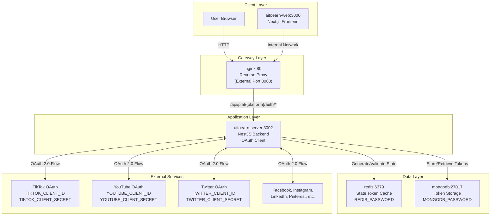
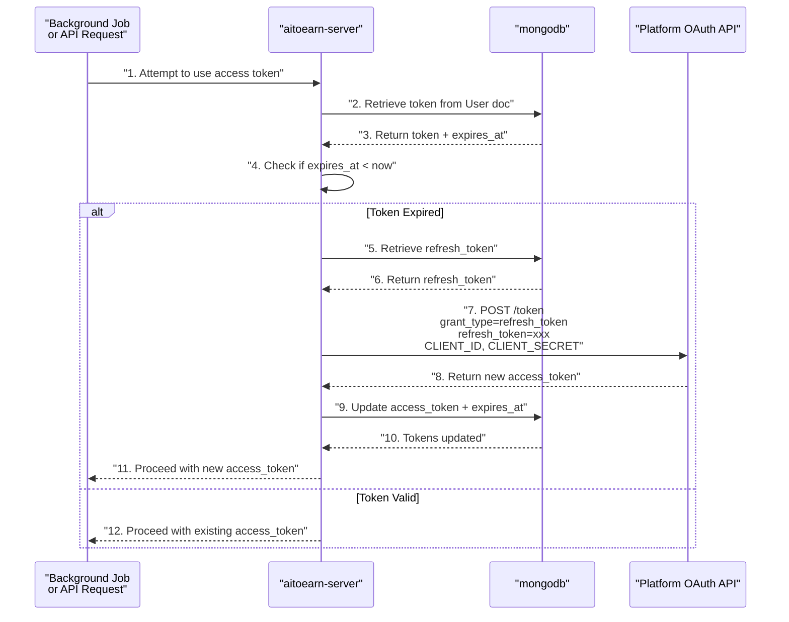
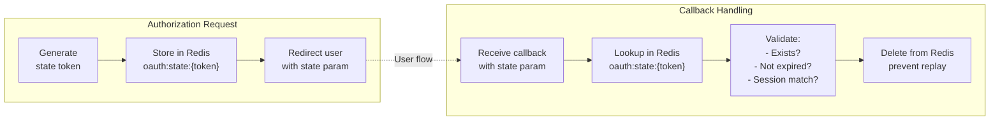
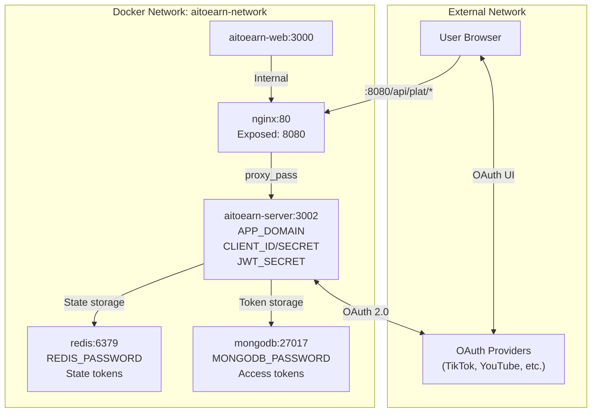

<!-- source: DeepWiki mcp.deepwiki.com · repo yikart/AiToEarn · page 4.1 OAuth Authentication Flow · fetched 2026-10-30 -->

# OAuth Authentication Flow

<details>
<summary>Relevant source files</summary>

The following files were used as context for generating this wiki page:

- [DOCKER_DEPLOYMENT_CN.md](DOCKER_DEPLOYMENT_CN.md)
- [DOCKER_DEPLOYMENT_EN.md](DOCKER_DEPLOYMENT_EN.md)
- [README.md](README.md)
- [README_CN.md](README_CN.md)
- [docker-compose.yml](docker-compose.yml)
- [presentation/agent_0.png](presentation/agent_0.png)
- [presentation/display-1.5.2png.png](presentation/display-1.5.2png.png)
- [wechat.jpg](wechat.jpg)

</details>


## Purpose and Scope

This document details the OAuth 2.0 authentication flow used by AiToEarn to connect and authorize with third-party social media platforms. It covers the complete authorization lifecycle: initiating OAuth requests, handling platform callbacks, exchanging authorization codes for access tokens, securely storing tokens, and managing state tokens to prevent CSRF attacks.

For information about which platforms are supported and their specific API capabilities, see [Supported Platforms](#4.2). For details on using authorized platform connections to publish content, see [Multi-Platform Publishing](#4.3).

**Sources:** [docker-compose.yml:183-212](), [DOCKER_DEPLOYMENT_EN.md:253-270](), [DOCKER_DEPLOYMENT_CN.md:251-268]()

## OAuth 2.0 Flow Overview

AiToEarn implements the standard OAuth 2.0 Authorization Code Grant flow for all supported platforms. The backend service (`aitoearn-server`) acts as the OAuth client, managing the authorization process and securely storing access tokens in MongoDB.

### Complete OAuth Flow Sequence



**Sources:** [docker-compose.yml:136-232](), [DOCKER_DEPLOYMENT_EN.md:269-270]()

## Configuration

### Environment Variables

OAuth credentials for each platform are configured as environment variables in the `aitoearn-server` service. These variables are set in `docker-compose.yml` and must match the credentials registered in each platform's developer console.

| Platform | Environment Variables | Developer Console URL |
|----------|----------------------|----------------------|
| TikTok | `TIKTOK_CLIENT_ID`, `TIKTOK_CLIENT_SECRET` | https://developers.tiktok.com |
| YouTube | `YOUTUBE_CLIENT_ID`, `YOUTUBE_CLIENT_SECRET` | https://console.cloud.google.com/apis/credentials |
| Twitter/X | `TWITTER_CLIENT_ID`, `TWITTER_CLIENT_SECRET` | https://developer.x.com/en/portal |
| Facebook | `FACEBOOK_CLIENT_ID`, `FACEBOOK_CLIENT_SECRET`, `FACEBOOK_CONFIG_ID` | https://developers.facebook.com |
| Instagram | `INSTAGRAM_CLIENT_ID`, `INSTAGRAM_CLIENT_SECRET` | https://developers.facebook.com |
| Threads | `THREADS_CLIENT_ID`, `THREADS_CLIENT_SECRET` | https://developers.facebook.com |
| LinkedIn | `LINKEDIN_CLIENT_ID`, `LINKEDIN_CLIENT_SECRET` | https://www.linkedin.com/developers |
| Pinterest | `PINTEREST_CLIENT_ID`, `PINTEREST_CLIENT_SECRET`, `PINTEREST_TEST_AUTHORIZATION` | https://developers.pinterest.com |
| Bilibili | `BILIBILI_CLIENT_ID`, `BILIBILI_CLIENT_SECRET` | https://open.bilibili.com |
| Kuaishou | `KWAI_CLIENT_ID`, `KWAI_CLIENT_SECRET` | https://open.kuaishou.com |
| Google | `GOOGLE_CLIENT_ID`, `GOOGLE_CLIENT_SECRET` | https://console.cloud.google.com/apis/credentials |
| WeChat Platform | `WXPLAT_APP_ID`, `WXPLAT_APP_SECRET`, `WXPLAT_ENCODING_AES_KEY` | https://mp.weixin.qq.com |
| Douyin | `DOYIN_CLIENT_ID`, `DOYIN_CLIENT_SECRET` | https://open.douyin.com |

**Sources:** [docker-compose.yml:183-212](), [DOCKER_DEPLOYMENT_EN.md:253-268]()

### Callback URL Configuration

All platforms must be configured with the OAuth callback URL in their developer consoles. The callback URL follows this pattern:

```
https://{APP_DOMAIN}/api/plat/{platform}/auth/back
```

Where:
- `{APP_DOMAIN}` is set via the `APP_DOMAIN` environment variable in `aitoearn-server` (default: `localhost`)
- `{platform}` is the platform identifier (e.g., `tiktok`, `youtube`, `twitter`, `facebook`, `instagram`, `linkedin`, `pinterest`, `bilibili`, `kwai`, `google`, `wxplat`, `doyin`)

**Example callback URLs:**
- TikTok: `https://yourdomain.com/api/plat/tiktok/auth/back`
- YouTube: `https://yourdomain.com/api/plat/youtube/auth/back`
- Twitter: `https://yourdomain.com/api/plat/twitter/auth/back`

The `nginx` service routes all `/api/*` requests to `aitoearn-server:3002` via the internal Docker network `aitoearn-network`.

**Sources:** [docker-compose.yml:155](), [docker-compose.yml:248-270](), [DOCKER_DEPLOYMENT_EN.md:269-270]()

## System Components Involved in OAuth



**Sources:** [docker-compose.yml:1-286](), [docker-compose.yml:248-270]()

## Authorization Request Flow

### Step 1: User Initiates Connection

When a user wants to connect a social media platform account:

1. User clicks "Connect [Platform]" button in the frontend (`aitoearn-web`)
2. Frontend sends a GET request to `/api/plat/{platform}/auth`
3. Request is routed through `nginx:80` → `aitoearn-server:3002`

### Step 2: State Token Generation

The backend generates a cryptographically secure random state token to prevent CSRF attacks:

1. `aitoearn-server` generates a unique state token (typically a UUID or random string)
2. State token is stored in `redis` with an expiration time (typically 10-15 minutes)
3. State token is associated with the current user session

**Redis storage pattern:**
```
Key: oauth:state:{state_token}
Value: {user_id, platform, timestamp}
TTL: 900 seconds (15 minutes)
```

**Sources:** [docker-compose.yml:23-39](), [docker-compose.yml:105-107]()

### Step 3: Building the Authorization URL

The backend constructs the OAuth authorization URL with the following parameters:

```
https://platform-oauth-endpoint.com/authorize?
  client_id={CLIENT_ID}
  &redirect_uri={APP_DOMAIN}/api/plat/{platform}/auth/back
  &response_type=code
  &scope={requested_scopes}
  &state={state_token}
```

**Required parameters:**
- `client_id`: Platform-specific client ID from environment variables (e.g., `TIKTOK_CLIENT_ID`)
- `redirect_uri`: Callback URL registered with the platform
- `response_type`: Always `code` for Authorization Code Grant
- `scope`: Platform-specific permissions (e.g., `user.info.basic`, `video.upload`)
- `state`: CSRF protection token stored in Redis

### Step 4: User Redirection

The backend responds with an HTTP 302 redirect, sending the user's browser to the platform's OAuth authorization page.

**Sources:** [docker-compose.yml:183-212]()

## Callback Handling

### Step 1: Platform Redirects to Callback URL

After the user authorizes the application on the platform, the platform redirects the user back to:

```
{APP_DOMAIN}/api/plat/{platform}/auth/back?code={authorization_code}&state={state_token}
```

This request flows through:
1. User browser → `nginx:8080`
2. `nginx` → `aitoearn-server:3002` (via internal network `aitoearn-network`)

**Sources:** [docker-compose.yml:248-270](), [docker-compose.yml:272-275]()

### Step 2: State Token Validation

The backend validates the state token to prevent CSRF attacks:

1. Extract `state` parameter from the callback URL
2. Look up the state token in `redis` using key `oauth:state:{state_token}`
3. Verify the state token exists and has not expired
4. Verify the state token is associated with the current user session
5. Delete the state token from `redis` to prevent replay attacks

**Validation checks:**
- State token exists in Redis
- State token matches the user's session
- State token has not expired (TTL)
- Platform matches the stored platform value

If validation fails, the backend returns an error and does not proceed with token exchange.

**Sources:** [docker-compose.yml:23-39](), [docker-compose.yml:105-107]()

### Step 3: Authorization Code Extraction

Once the state is validated, the backend extracts the `code` parameter from the callback URL. This authorization code is a single-use token that will be exchanged for an access token.

**Sources:** [DOCKER_DEPLOYMENT_EN.md:269-270]()

## Token Exchange

### Exchange Request

The backend makes a server-to-server POST request to the platform's token endpoint to exchange the authorization code for an access token:

```
POST https://platform-token-endpoint.com/token
Content-Type: application/x-www-form-urlencoded

grant_type=authorization_code
&code={authorization_code}
&client_id={CLIENT_ID}
&client_secret={CLIENT_SECRET}
&redirect_uri={APP_DOMAIN}/api/plat/{platform}/auth/back
```

**Required parameters:**
- `grant_type`: Always `authorization_code`
- `code`: Authorization code received from callback
- `client_id`: Platform client ID from environment variables
- `client_secret`: Platform client secret from environment variables (e.g., `TIKTOK_CLIENT_SECRET`, `YOUTUBE_CLIENT_SECRET`)
- `redirect_uri`: Same callback URL used in the authorization request

**Sources:** [docker-compose.yml:183-212]()

### Token Response

The platform responds with a JSON payload containing:

```json
{
  "access_token": "platform_access_token_string",
  "token_type": "Bearer",
  "expires_in": 3600,
  "refresh_token": "platform_refresh_token_string",
  "scope": "granted_scope_1 granted_scope_2"
}
```

**Key fields:**
- `access_token`: Used to authenticate API requests to the platform
- `expires_in`: Token lifetime in seconds
- `refresh_token`: Used to obtain new access tokens when the current one expires (not all platforms provide refresh tokens)
- `scope`: Actual permissions granted by the user

**Sources:** [DOCKER_DEPLOYMENT_EN.md:253-268]()

## Token Storage and Management

### MongoDB Storage Schema

Access tokens and refresh tokens are stored in the `mongodb` database within the user's document. The database connection is configured via environment variables:

- `MONGODB_HOST`: `mongodb` (Docker service name)
- `MONGODB_PORT`: `27017`
- `MONGODB_USERNAME`: `admin`
- `MONGODB_PASSWORD`: Set in `docker-compose.yml`

**Typical storage structure:**
```javascript
// User document in mongodb.aitoearn collection
{
  _id: ObjectId("..."),
  email: "user@example.com",
  platforms: {
    tiktok: {
      access_token: "encrypted_access_token",
      refresh_token: "encrypted_refresh_token",
      expires_at: ISODate("2024-12-31T23:59:59Z"),
      scope: "user.info.basic,video.upload",
      platform_user_id: "platform_specific_user_id",
      connected_at: ISODate("2024-01-01T00:00:00Z"),
      updated_at: ISODate("2024-01-15T12:00:00Z")
    },
    youtube: { /* similar structure */ },
    // ... other platforms
  }
}
```

**Sources:** [docker-compose.yml:2-21](), [docker-compose.yml:100-103](), [docker-compose.yml:157-160]()

### Token Encryption

Access tokens and refresh tokens are encrypted before storage in MongoDB using the `JWT_SECRET` configured in the `aitoearn-server` environment. This provides an additional layer of security beyond MongoDB authentication.

**Encryption configuration:**
- `JWT_SECRET`: Used for both JWT signing and token encryption
- Must be identical in both `aitoearn-ai` and `aitoearn-server` services

**Sources:** [docker-compose.yml:109](), [docker-compose.yml:173]()

### Token Refresh Flow



**Sources:** [docker-compose.yml:157-170](), [docker-compose.yml:183-212]()

## State Token Security

### CSRF Prevention

State tokens are the primary defense against Cross-Site Request Forgery (CSRF) attacks in the OAuth flow. The implementation ensures:

1. **Unpredictability**: State tokens are cryptographically random (UUID v4 or equivalent)
2. **Single-Use**: State tokens are deleted from Redis immediately after validation
3. **Time-Limited**: State tokens expire after 15 minutes (configured TTL in Redis)
4. **Session-Bound**: State tokens are tied to the user's authenticated session
5. **Integrity**: State tokens cannot be guessed or forged by attackers

### Redis-Based State Management



**Redis configuration for state storage:**
- `REDIS_HOST`: `redis` (Docker service name)
- `REDIS_PORT`: `6379`
- `REDIS_PASSWORD`: Set in `docker-compose.yml`

**Sources:** [docker-compose.yml:23-39](), [docker-compose.yml:105-107](), [docker-compose.yml:168-169]()

## Platform-Specific Considerations

### Facebook, Instagram, and Threads

These platforms share the same OAuth infrastructure (Meta/Facebook):
- `FACEBOOK_CLIENT_ID`, `FACEBOOK_CLIENT_SECRET`, `FACEBOOK_CONFIG_ID`
- `INSTAGRAM_CLIENT_ID`, `INSTAGRAM_CLIENT_SECRET`
- `THREADS_CLIENT_ID`, `THREADS_CLIENT_SECRET`

All three use Facebook's OAuth endpoints and require configuration in the Facebook Developer Console at https://developers.facebook.com.

**Sources:** [docker-compose.yml:197-202]()

### YouTube and Google

YouTube OAuth is part of Google's OAuth system:
- Uses `YOUTUBE_CLIENT_ID` and `YOUTUBE_CLIENT_SECRET`
- Alternatively can use `GOOGLE_CLIENT_ID` and `GOOGLE_CLIENT_SECRET` for broader Google API access
- Both configured at https://console.cloud.google.com/apis/credentials

**Sources:** [docker-compose.yml:186-187](), [docker-compose.yml:206-207]()

### Pinterest Test Authorization

Pinterest includes an additional `PINTEREST_TEST_AUTHORIZATION` variable for sandbox/testing environments before production approval.

**Sources:** [docker-compose.yml:192]()

### WeChat Platform (WXPLAT)

WeChat uses different terminology and an additional security parameter:
- `WXPLAT_APP_ID` (equivalent to client_id)
- `WXPLAT_APP_SECRET` (equivalent to client_secret)
- `WXPLAT_ENCODING_AES_KEY` (for message encryption/decryption)

**Sources:** [docker-compose.yml:208-210]()

### Chinese Platforms (Douyin, Kuaishou, Bilibili)

These platforms follow standard OAuth 2.0 but use Chinese developer documentation:
- Douyin (抖音): https://open.douyin.com
- Kuaishou (快手): https://open.kuaishou.com
- Bilibili: https://open.bilibili.com

**Sources:** [docker-compose.yml:184-185](), [docker-compose.yml:188-189](), [docker-compose.yml:211-212](), [README.md:18-20]()

## Network Architecture for OAuth Flow



All OAuth-related services communicate within the isolated Docker network `aitoearn-network`, which is created with the `bridge` driver. Only `nginx` exposes port 8080 to the external network.

**Sources:** [docker-compose.yml:248-275](), [docker-compose.yml:272-275]()

## Error Handling and Edge Cases

### Common OAuth Error Scenarios

| Scenario | Detection | Handling |
|----------|-----------|----------|
| Invalid state token | State not found in Redis | Return error, log security event |
| Expired state token | Redis TTL expired | Return error, prompt user to retry |
| State token replay | State already deleted | Return error, log security event |
| Token exchange failure | Platform returns error | Log error, return user-friendly message |
| Invalid client credentials | Platform returns `invalid_client` | Log error, check `CLIENT_ID`/`CLIENT_SECRET` |
| Scope mismatch | Granted scope < requested scope | Store actual scope, may limit functionality |
| Network timeout | Request to platform times out | Retry with exponential backoff |
| MongoDB connection lost | Cannot store tokens | Return error, prompt retry |
| Redis connection lost | Cannot validate state | Return error, prompt retry |

**Sources:** [docker-compose.yml:100-110](), [docker-compose.yml:157-174]()

### Token Expiration Handling

When an access token expires:

1. Backend detects expiration by checking `expires_at` timestamp in MongoDB
2. Retrieves `refresh_token` from MongoDB
3. Attempts to refresh the access token using the platform's refresh endpoint
4. If refresh succeeds, updates MongoDB with new tokens
5. If refresh fails (e.g., refresh token also expired), marks connection as disconnected and prompts user to re-authorize

**Sources:** [docker-compose.yml:157-160]()

## Security Best Practices

### Secrets Management

All OAuth credentials are managed as environment variables in `docker-compose.yml`:

1. **Never commit real credentials** to version control
2. Use placeholder values in the repository (e.g., `sk-placeholder`, empty strings)
3. Set actual credentials during deployment via environment variable override or secrets management service
4. Rotate credentials periodically
5. Use different credentials for development, staging, and production environments

**Sources:** [docker-compose.yml:183-212]()

### Token Protection Measures

| Layer | Protection Mechanism | Implementation |
|-------|---------------------|----------------|
| Transport | HTTPS only | Nginx SSL/TLS termination |
| Storage | Encryption at rest | Tokens encrypted with `JWT_SECRET` before MongoDB storage |
| Access Control | MongoDB authentication | `MONGODB_USERNAME` and `MONGODB_PASSWORD` |
| Network Isolation | Docker internal network | Services communicate via `aitoearn-network` bridge |
| State CSRF Protection | Random state tokens | Generated, stored in Redis, validated on callback |
| Token expiration | Time-based invalidation | `expires_at` timestamp checked before use |

**Sources:** [docker-compose.yml:109](), [docker-compose.yml:173](), [docker-compose.yml:100-103](), [docker-compose.yml:272-275]()

---

