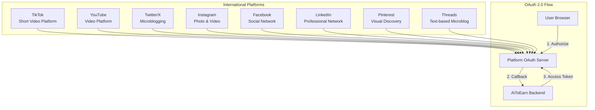
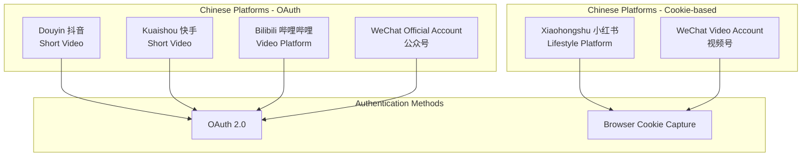
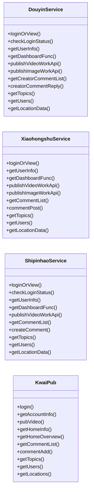
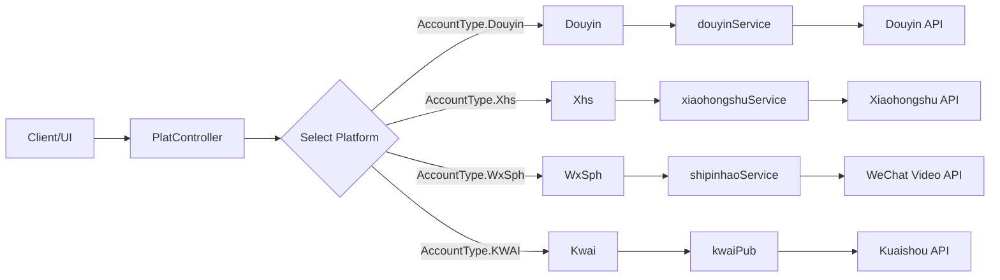

<!-- source: DeepWiki mcp.deepwiki.com · repo yikart/AiToEarn · page 4.2 Supported Platforms · fetched 2026-10-30 -->

# Supported Platforms

<details>
<summary>Relevant source files</summary>

The following files were used as context for generating this wiki page:

- [DOCKER_DEPLOYMENT_CN.md](DOCKER_DEPLOYMENT_CN.md)
- [DOCKER_DEPLOYMENT_EN.md](DOCKER_DEPLOYMENT_EN.md)
- [README.md](README.md)
- [README_CN.md](README_CN.md)
- [docker-compose.yml](docker-compose.yml)
- [presentation/agent_0.png](presentation/agent_0.png)
- [presentation/display-1.5.2png.png](presentation/display-1.5.2png.png)
- [wechat.jpg](wechat.jpg)

</details>


## Overview

AiToEarn supports multi-platform content distribution across 14 major social media platforms, spanning both Chinese and international markets. This page documents the OAuth configuration requirements, API capabilities, and platform-specific considerations for each supported platform.

**Supported Platforms:**

| Platform | Type | OAuth Required | Primary Markets |
|----------|------|----------------|-----------------|
| TikTok | International Short Video | Yes | Global (excluding China) |
| YouTube | International Video | Yes | Global |
| Twitter (X) | International Microblog | Yes | Global |
| Instagram | International Photo/Video | Yes | Global |
| Facebook | International Social Network | Yes | Global |
| LinkedIn | International Professional Network | Yes | Global |
| Pinterest | International Visual Discovery | Yes | Global |
| Threads | International Microblog | Yes | Global |
| Douyin (抖音) | Chinese Short Video | Yes | China |
| Xiaohongshu/RED (小红书) | Chinese Lifestyle | No (Cookie-based) | China |
| Kuaishou (快手) | Chinese Short Video | Yes | China |
| Bilibili (哔哩哔哩) | Chinese Video | Yes | China |
| WeChat Video Account (视频号) | Chinese Short Video | No (Cookie-based) | China |
| WeChat Official Account (公众号) | Chinese Blog/Content | Yes | China |

Sources:
- [README.md:18-20]()
- [docker-compose.yml:184-212]()

## Platform Categories

### International Platforms

International platforms primarily use **OAuth 2.0** for authentication and provide RESTful APIs for content management and analytics.



### Chinese Platforms

Chinese platforms use a mix of **OAuth 2.0** and **cookie-based authentication** depending on the platform's API availability.



Sources:
- [README.md:18-20]()
- [docker-compose.yml:184-212]()

## OAuth Configuration Requirements

### OAuth Callback URL Format

All OAuth-based platforms use callback URLs following this pattern:

```
https://{APP_DOMAIN}/api/plat/{platform}/auth/back
```

Where `{APP_DOMAIN}` is configured via the `APP_DOMAIN` environment variable in `aitoearn-server`, and `{platform}` is the platform identifier (e.g., `tiktok`, `youtube`, `twitter`).

**Example callback URLs:**
- TikTok: `https://yourdomain.com/api/plat/tiktok/auth/back`
- YouTube: `https://yourdomain.com/api/plat/youtube/auth/back`
- Twitter: `https://yourdomain.com/api/plat/twitter/auth/back`

Sources:
- [DOCKER_DEPLOYMENT_EN.md:269]()

### Platform OAuth Configuration Table

The following table lists all OAuth configuration requirements per platform. These are set as environment variables in the `aitoearn-server` service.

| Platform | Environment Variables | Developer Console | Notes |
|----------|----------------------|-------------------|-------|
| **TikTok** | `TIKTOK_CLIENT_ID`<br/>`TIKTOK_CLIENT_SECRET` | https://developers.tiktok.com | Requires app approval for publishing capabilities |
| **YouTube** | `YOUTUBE_CLIENT_ID`<br/>`YOUTUBE_CLIENT_SECRET` | https://console.cloud.google.com/apis/credentials | Also requires `GOOGLE_CLIENT_ID/SECRET` for Google OAuth |
| **Twitter/X** | `TWITTER_CLIENT_ID`<br/>`TWITTER_CLIENT_SECRET` | https://developer.x.com/en/portal | OAuth 2.0 with PKCE |
| **Instagram** | `INSTAGRAM_CLIENT_ID`<br/>`INSTAGRAM_CLIENT_SECRET` | https://developers.facebook.com | Part of Facebook Graph API |
| **Facebook** | `FACEBOOK_CLIENT_ID`<br/>`FACEBOOK_CLIENT_SECRET`<br/>`FACEBOOK_CONFIG_ID` | https://developers.facebook.com | Pages API requires specific permissions |
| **LinkedIn** | `LINKEDIN_CLIENT_ID`<br/>`LINKEDIN_CLIENT_SECRET` | https://www.linkedin.com/developers | Requires Marketing Developer Platform access |
| **Pinterest** | `PINTEREST_CLIENT_ID`<br/>`PINTEREST_CLIENT_SECRET`<br/>`PINTEREST_TEST_AUTHORIZATION` | https://developers.pinterest.com | Test authorization for sandbox testing |
| **Threads** | `THREADS_CLIENT_ID`<br/>`THREADS_CLIENT_SECRET` | https://developers.facebook.com | Uses Facebook developer platform |
| **Douyin** | `DOYIN_CLIENT_ID`<br/>`DOYIN_CLIENT_SECRET` | https://open.douyin.com | Chinese TikTok, separate from international TikTok |
| **Kuaishou** | `KWAI_CLIENT_ID`<br/>`KWAI_CLIENT_SECRET` | https://open.kuaishou.com | Requires China-based business registration |
| **Bilibili** | `BILIBILI_CLIENT_ID`<br/>`BILIBILI_CLIENT_SECRET` | https://open.bilibili.com | Video platform OAuth |
| **WeChat Official** | `WXPLAT_APP_ID`<br/>`WXPLAT_APP_SECRET`<br/>`WXPLAT_ENCODING_AES_KEY` | https://mp.weixin.qq.com | Requires verified WeChat Official Account |
| **Google (General)** | `GOOGLE_CLIENT_ID`<br/>`GOOGLE_CLIENT_SECRET` | https://console.cloud.google.com/apis/credentials | Used for YouTube and other Google services |

Sources:
- [docker-compose.yml:184-212]()
- [DOCKER_DEPLOYMENT_EN.md:253-268]()

### OAuth Flow Diagram

OAuth 2.0 Authentication Flow

```mermaid
sequenceDiagram
    participant User
    participant Frontend["AiToEarn Web Frontend"]
    participant Backend["aitoearn-server"]
    participant Platform["Platform OAuth Server<br/>(TikTok, YouTube, etc.)"]
    participant PlatformAPI["Platform API"]
    
    User->>Frontend: Click "Connect Platform"
    Frontend->>Backend: Initiate OAuth flow
    Backend->>Platform: Redirect to authorization URL
    Platform->>User: Show consent screen
    User->>Platform: Authorize application
    Platform->>Backend: Callback with authorization code
    Backend->>Platform: Exchange code for access token
    Platform-->>Backend: Return access token & refresh token
    Backend->>Backend: Store tokens in MongoDB
    Backend->>PlatformAPI: Fetch user info with token
    PlatformAPI-->>Backend: Return user profile
    Backend-->>Frontend: OAuth success
    Frontend-->>User: Show connected account
```

Sources:
- [docker-compose.yml:136-232]()

## Platform Capabilities Matrix

The following table summarizes the content types and capabilities supported by each platform:

| Platform | Video | Images | Text | Stories | Live | Comments | Analytics | Scheduling |
|----------|-------|--------|------|---------|------|----------|-----------|------------|
| **TikTok** | ✓ | ✓ | ✓ | ✗ | ✗ | ✓ | ✓ | ✓ |
| **YouTube** | ✓ | ✗ | ✓ | ✗ | ✓ | ✓ | ✓ | ✓ |
| **Twitter/X** | ✓ | ✓ | ✓ | ✗ | ✗ | ✓ | ✓ | ✓ |
| **Instagram** | ✓ | ✓ | ✓ | ✓ | ✓ | ✓ | ✓ | ✓ |
| **Facebook** | ✓ | ✓ | ✓ | ✓ | ✓ | ✓ | ✓ | ✓ |
| **LinkedIn** | ✓ | ✓ | ✓ | ✗ | ✗ | ✓ | ✓ | ✓ |
| **Pinterest** | ✗ | ✓ | ✓ | ✗ | ✗ | ✓ | ✓ | ✓ |
| **Threads** | ✗ | ✓ | ✓ | ✗ | ✗ | ✓ | ✓ | ✓ |
| **Douyin** | ✓ | ✓ | ✓ | ✗ | ✗ | ✓ | ✓ | ✓ |
| **Xiaohongshu** | ✓ | ✓ | ✓ | ✗ | ✗ | ✓ | ✓ | ✓ |
| **Kuaishou** | ✓ | ✗ | ✓ | ✗ | ✗ | ✓ | ✓ | ✓ |
| **Bilibili** | ✓ | ✗ | ✓ | ✗ | ✗ | ✓ | ✓ | ✓ |
| **WeChat Video** | ✓ | ✗ | ✓ | ✗ | ✗ | ✓ | ✓ | ✓ |
| **WeChat Official** | ✓ | ✓ | ✓ | ✗ | ✗ | ✓ | ✓ | ✓ |

**Legend:**
- **Video**: Support for video uploads
- **Images**: Support for image/photo uploads
- **Text**: Support for text-only posts
- **Stories**: Support for ephemeral stories/moments
- **Live**: Support for live streaming
- **Comments**: Support for automated commenting and engagement
- **Analytics**: Support for performance metrics and analytics
- **Scheduling**: Support for scheduled/timed publishing

Sources:
- [README.md:18-20]()
- [README.md:79-156]()

## Platform-Specific Details

### TikTok

**Platform Type:** International Short Video  
**OAuth Required:** Yes  
**Developer Portal:** https://developers.tiktok.com

**Configuration:**
```yaml
TIKTOK_CLIENT_ID: your-client-id
TIKTOK_CLIENT_SECRET: your-client-secret
```

**Key Features:**
- Video publishing with music, effects, and filters
- Image carousel posts (photo mode)
- Duet and Stitch capabilities
- Hashtag and mention support
- Publishing to specific audience (public/friends/private)
- Scheduled publishing

**API Capabilities:**
- Content Publishing API
- User Info API
- Video Management API
- Analytics API

**Callback URL:** `https://{APP_DOMAIN}/api/plat/tiktok/auth/back`

Sources:
- [docker-compose.yml:193-194]()
- [DOCKER_DEPLOYMENT_EN.md:254]()

### YouTube

**Platform Type:** International Video Platform  
**OAuth Required:** Yes  
**Developer Portal:** https://console.cloud.google.com/apis/credentials

**Configuration:**
```yaml
GOOGLE_CLIENT_ID: your-google-client-id
GOOGLE_CLIENT_SECRET: your-google-client-secret
YOUTUBE_CLIENT_ID: your-youtube-client-id
YOUTUBE_CLIENT_SECRET: your-youtube-client-secret
```

**Key Features:**
- Long-form video uploads (up to 12 hours for verified accounts)
- YouTube Shorts support
- Video metadata (title, description, tags, category)
- Thumbnail customization
- Playlist management
- Privacy settings (public/unlisted/private)
- Scheduled publishing

**API Capabilities:**
- YouTube Data API v3
- YouTube Analytics API
- Comment management
- Subscription info

**Callback URL:** `https://{APP_DOMAIN}/api/plat/youtube/auth/back`

Sources:
- [docker-compose.yml:186-187]()
- [docker-compose.yml:206-207]()
- [DOCKER_DEPLOYMENT_EN.md:255]()

### Twitter/X

**Platform Type:** International Microblogging  
**OAuth Required:** Yes (OAuth 2.0 with PKCE)  
**Developer Portal:** https://developer.x.com/en/portal

**Configuration:**
```yaml
TWITTER_CLIENT_ID: your-client-id
TWITTER_CLIENT_SECRET: your-client-secret
```

**Key Features:**
- Text posts up to 280 characters (or longer for Premium)
- Image and video attachments
- Thread creation
- Polls
- Hashtag and mention support
- Quote tweets

**API Capabilities:**
- Twitter API v2
- Tweet creation and management
- User timeline
- Engagement metrics
- Media upload

**Callback URL:** `https://{APP_DOMAIN}/api/plat/twitter/auth/back`

Sources:
- [docker-compose.yml:195-196]()
- [DOCKER_DEPLOYMENT_EN.md:256]()

### Instagram

**Platform Type:** International Photo/Video Platform  
**OAuth Required:** Yes  
**Developer Portal:** https://developers.facebook.com

**Configuration:**
```yaml
FACEBOOK_CLIENT_ID: your-facebook-app-id
FACEBOOK_CLIENT_SECRET: your-facebook-app-secret
INSTAGRAM_CLIENT_ID: your-instagram-client-id
INSTAGRAM_CLIENT_SECRET: your-instagram-client-secret
```

**Key Features:**
- Photo posts (single and carousel)
- Video posts (Reels and feed videos)
- Stories
- IGTV
- Shopping tags
- Location tagging
- Hashtag support

**API Capabilities:**
- Instagram Graph API
- Content Publishing API
- Instagram Insights API
- Comment moderation

**Note:** Requires a Facebook Business account and Instagram Business/Creator account.

**Callback URL:** `https://{APP_DOMAIN}/api/plat/instagram/auth/back`

Sources:
- [docker-compose.yml:197-200]()
- [docker-compose.yml:202-203]()
- [DOCKER_DEPLOYMENT_EN.md:257-258]()

### Facebook

**Platform Type:** International Social Network  
**OAuth Required:** Yes  
**Developer Portal:** https://developers.facebook.com

**Configuration:**
```yaml
FACEBOOK_CLIENT_ID: your-app-id
FACEBOOK_CLIENT_SECRET: your-app-secret
FACEBOOK_CONFIG_ID: your-config-id
```

**Key Features:**
- Text, photo, and video posts
- Stories
- Live video
- Events
- Groups posting
- Page management
- Scheduled posts

**API Capabilities:**
- Facebook Graph API
- Pages API
- Publishing API
- Insights API

**Callback URL:** `https://{APP_DOMAIN}/api/plat/facebook/auth/back`

Sources:
- [docker-compose.yml:197-199]()
- [DOCKER_DEPLOYMENT_EN.md:258]()

### LinkedIn

**Platform Type:** International Professional Network  
**OAuth Required:** Yes  
**Developer Portal:** https://www.linkedin.com/developers

**Configuration:**
```yaml
LINKEDIN_CLIENT_ID: your-client-id
LINKEDIN_CLIENT_SECRET: your-client-secret
```

**Key Features:**
- Professional content posting
- Image and video posts
- Document sharing
- Articles
- Company page management
- Hashtag support
- Scheduled publishing

**API Capabilities:**
- LinkedIn Share API
- UGC Post API
- Organization API
- Analytics API

**Note:** Requires Marketing Developer Platform access for advanced features.

**Callback URL:** `https://{APP_DOMAIN}/api/plat/linkedin/auth/back`

Sources:
- [docker-compose.yml:204-205]()
- [DOCKER_DEPLOYMENT_EN.md:259]()

### Pinterest

**Platform Type:** International Visual Discovery  
**OAuth Required:** Yes  
**Developer Portal:** https://developers.pinterest.com

**Configuration:**
```yaml
PINTEREST_CLIENT_ID: your-client-id
PINTEREST_CLIENT_SECRET: your-client-secret
PINTEREST_TEST_AUTHORIZATION: your-test-auth-token
```

**Key Features:**
- Pin creation (images/videos)
- Board management
- Rich pins
- Shopping features
- Idea pins
- Video pins

**API Capabilities:**
- Pinterest API v5
- Pin creation
- Board management
- Analytics

**Callback URL:** `https://{APP_DOMAIN}/api/plat/pinterest/auth/back`

Sources:
- [docker-compose.yml:190-192]()
- [DOCKER_DEPLOYMENT_EN.md:260]()

### Threads

**Platform Type:** International Text-based Microblog  
**OAuth Required:** Yes  
**Developer Portal:** https://developers.facebook.com

**Configuration:**
```yaml
THREADS_CLIENT_ID: your-client-id
THREADS_CLIENT_SECRET: your-client-secret
```

**Key Features:**
- Text posts up to 500 characters
- Image attachments
- Thread creation
- Mention and hashtag support
- Reply management

**API Capabilities:**
- Threads API (via Facebook platform)
- Post creation
- Insights
- Reply management

**Note:** Uses the same Facebook developer platform.

**Callback URL:** `https://{APP_DOMAIN}/api/plat/threads/auth/back`

Sources:
- [docker-compose.yml:200-201]()
- [DOCKER_DEPLOYMENT_EN.md:261]()

### Douyin (抖音)

**Platform Type:** Chinese Short Video  
**OAuth Required:** Yes  
**Developer Portal:** https://open.douyin.com

**Configuration:**
```yaml
DOYIN_CLIENT_ID: your-client-id
DOYIN_CLIENT_SECRET: your-client-secret
```

**Key Features:**
- Short video publishing (15s-10min)
- Image-text posts (carousel)
- Topic/hashtag support
- Location tagging
- @ mentions
- Privacy settings
- Scheduled publishing
- Comment management

**API Capabilities:**
- Video upload and publish
- Creator dashboard
- Analytics
- Comment API

**Note:** This is separate from international TikTok and requires China-based credentials.

**Callback URL:** `https://{APP_DOMAIN}/api/plat/douyin/auth/back`

Sources:
- [docker-compose.yml:211-212]()
- [DOCKER_DEPLOYMENT_EN.md:262]()

### Xiaohongshu / RED (小红书)

**Platform Type:** Chinese Lifestyle Platform  
**OAuth Required:** No (Cookie-based authentication)  
**Official Website:** https://www.xiaohongshu.com

**Authentication Method:** Browser cookie capture

**Key Features:**
- Image-text posts (lifestyle notes)
- Video posts
- Product tagging
- Location tagging
- Topic/hashtag support
- @ mentions
- Comment and like management

**API Capabilities:**
- Custom publishing API (via browser automation)
- Content management
- Comment retrieval
- Analytics

**Note:** Does not provide official OAuth API. Uses cookie-based authentication via browser automation.

Sources:
- [README.md:19]()

### Kuaishou (快手)

**Platform Type:** Chinese Short Video  
**OAuth Required:** Yes  
**Developer Portal:** https://open.kuaishou.com

**Configuration:**
```yaml
KWAI_CLIENT_ID: your-client-id
KWAI_CLIENT_SECRET: your-client-secret
```

**Key Features:**
- Short video publishing
- Live streaming support
- Topic/hashtag support
- Location tagging
- Comment management
- Privacy controls

**API Capabilities:**
- Video upload and publish
- User info
- Analytics
- Comment API

**Note:** Requires China-based business registration.

**Callback URL:** `https://{APP_DOMAIN}/api/plat/kuaishou/auth/back`

Sources:
- [docker-compose.yml:188-189]()
- [DOCKER_DEPLOYMENT_EN.md:263]()

### Bilibili (哔哩哔哩)

**Platform Type:** Chinese Video Platform  
**OAuth Required:** Yes  
**Developer Portal:** https://open.bilibili.com

**Configuration:**
```yaml
BILIBILI_CLIENT_ID: your-client-id
BILIBILI_CLIENT_SECRET: your-client-secret
```

**Key Features:**
- Long-form video uploads
- Multi-part video series
- Video categories
- Tags and topics
- Comment management
- Danmaku (bullet comments)
- Video analytics

**API Capabilities:**
- Video upload
- User info
- Video management
- Analytics

**Callback URL:** `https://{APP_DOMAIN}/api/plat/bilibili/auth/back`

Sources:
- [docker-compose.yml:184-185]()
- [DOCKER_DEPLOYMENT_EN.md:264]()

### WeChat Video Account (视频号)

**Platform Type:** Chinese Short Video  
**OAuth Required:** No (Cookie-based authentication)  
**Official Platform:** WeChat ecosystem

**Authentication Method:** Browser cookie capture via WeChat web interface

**Key Features:**
- Short video publishing
- Image-text posts
- WeChat integration
- Comment management
- Privacy controls

**API Capabilities:**
- Custom publishing API (via browser automation)
- Content management
- Analytics

**Note:** No official public API. Uses cookie-based authentication.

Sources:
- [README.md:19]()

### WeChat Official Account (公众号)

**Platform Type:** Chinese Blog/Content Platform  
**OAuth Required:** Yes  
**Developer Portal:** https://mp.weixin.qq.com

**Configuration:**
```yaml
WXPLAT_APP_ID: your-app-id
WXPLAT_APP_SECRET: your-app-secret
WXPLAT_ENCODING_AES_KEY: your-aes-key
```

**Key Features:**
- Article publishing
- Rich media (images, video, audio)
- Custom menus
- Message management
- User management
- Material library

**API Capabilities:**
- WeChat Official Account API
- Material upload
- Message sending
- User analytics

**Note:** Requires a verified WeChat Official Account.

**Callback URL:** `https://{APP_DOMAIN}/api/plat/wxplat/auth/back`

Sources:
- [docker-compose.yml:208-210]()
- [DOCKER_DEPLOYMENT_EN.md:267]()

## Platform-Specific Service Implementations

Each platform implementation uses a platform-specific service class to handle the low-level API interactions:

### Platform Service Classes



Sources:
- [electron/plat/douyin/index.ts:66-673](electron/plat/douyin/index.ts:66-673)
- [electron/plat/xiaohongshu/index.ts:48-760](electron/plat/xiaohongshu/index.ts:48-760)
- [electron/plat/shipinhao/index.ts:35-345](electron/plat/shipinhao/index.ts:35-345)
- [electron/plat/Kwai/index.ts:34-759](electron/plat/Kwai/index.ts:34-759)

### Authentication Methods

Platform services vary in how they handle authentication:

| Platform | Authentication Method |
|----------|----------------------|
| Douyin | Browser window with cookie capture |
| Xiaohongshu | Browser window with cookie and token capture |
| WeChat Video | Browser window with multiple URL redirections |
| Kuaishou | Browser window with session tokens |

Sources:
- [electron/plat/douyin/index.ts:98-152](electron/plat/douyin/index.ts:98-152)
- [electron/plat/xiaohongshu/index.ts:73-109](electron/plat/xiaohongshu/index.ts:73-109)
- [electron/plat/shipinhao/index.ts:73-109](electron/plat/shipinhao/index.ts:73-109)
- [electron/plat/Kwai/index.ts:274-349](electron/plat/Kwai/index.ts:274-349)

### API Communication Patterns

Each platform service uses slightly different API communication patterns:

- **Douyin**: Uses a combination of direct API requests and Electron browser window capture
- **Xiaohongshu**: Relies on a signature mechanism for API requests
- **WeChat Video Account**: Uses a web-based authentication and API pattern
- **Kuaishou**: Utilizes a custom signing mechanism for API requests

Sources:
- [electron/plat/douyin/index.ts:853-893](electron/plat/douyin/index.ts:853-893)
- [electron/plat/xiaohongshu/index.ts:406-447](electron/plat/xiaohongshu/index.ts:406-447)
- [electron/plat/Kwai/index.ts:224-260](electron/plat/Kwai/index.ts:224-260)

## Platform Controller Usage

The platform implementations are typically accessed through a controller layer that manages platform selection and method delegation:



The account service uses the platform controller to interact with any platform:

```typescript
async getAccountDashboard(account: AccountModel, time?: [string, string]) {
  return await platController.getDashboard(account, time);
}
```

Sources:
- [electron/main/account/service.ts:118-121](electron/main/account/service.ts:118-121)

## Extension Points

The platform implementation architecture is designed to be extensible:

1. New platforms can be added by:
   - Creating a new class that extends `PlatformBase`
   - Implementing a platform-specific service
   - Registering the implementation with the platform controller

2. Existing implementations can be enhanced by:
   - Adding new methods to the platform implementation class
   - Extending the platform service with new API functionality

Sources:
- [electron/main/plat/platforms/douyin/index.ts:674-675](electron/main/plat/platforms/douyin/index.ts:674-675)
- [electron/main/plat/platforms/xhs/index.ts:660-661](electron/main/plat/platforms/xhs/index.ts:660-661)
- [electron/main/plat/platforms/wxSph/index.ts:485-486](electron/main/plat/platforms/wxSph/index.ts:485-486)
- [electron/main/plat/platforms/Kwai/index.ts:579-580](electron/main/plat/platforms/Kwai/index.ts:579-580)

## Limitations and Considerations

When working with platform implementations, consider the following:

1. **Authentication Expiration**: Platform cookies and tokens may expire, requiring re-authentication
2. **API Changes**: Platform APIs may change without notice, requiring implementation updates
3. **Rate Limiting**: Platforms may impose rate limits that affect reliability
4. **Content Moderation**: Posted content may be subject to platform-specific moderation rules

For platform-specific details, refer to the dedicated pages for each platform:
- [Douyin Integration](#3.2.1)
- [Kuaishou Integration](#3.2.2)

---

