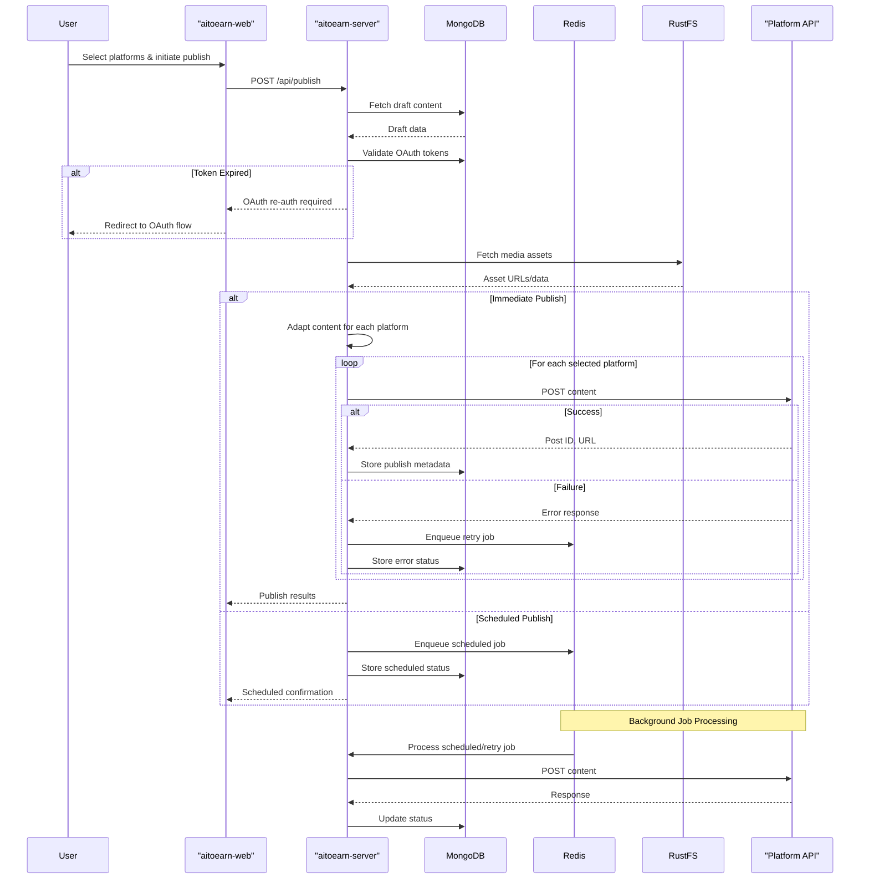
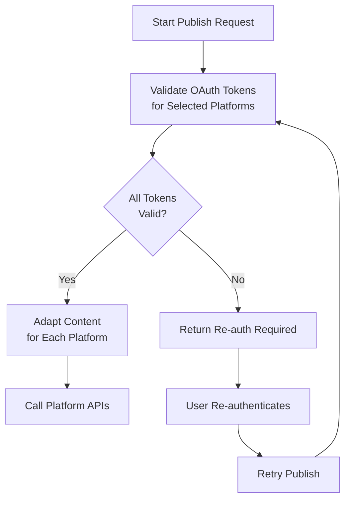
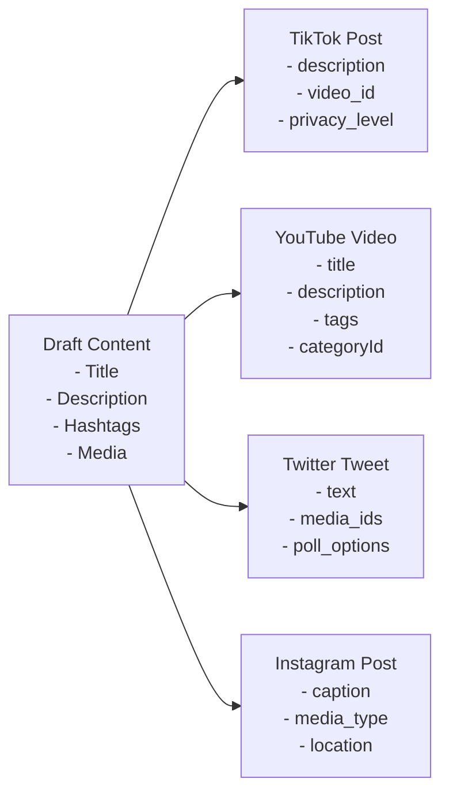
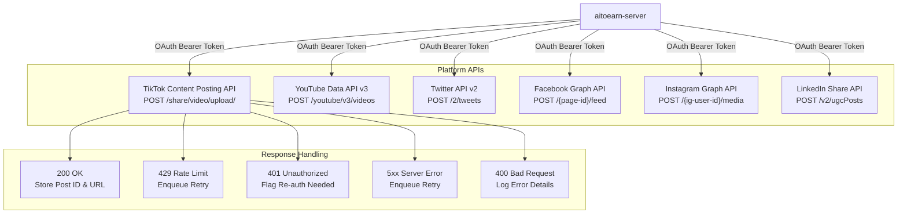
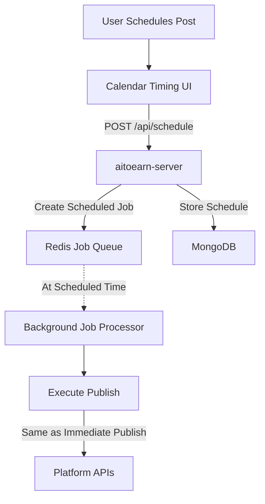
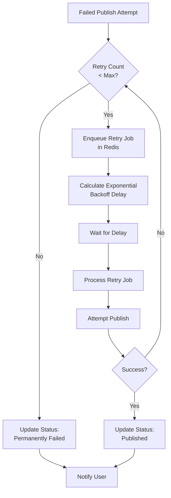
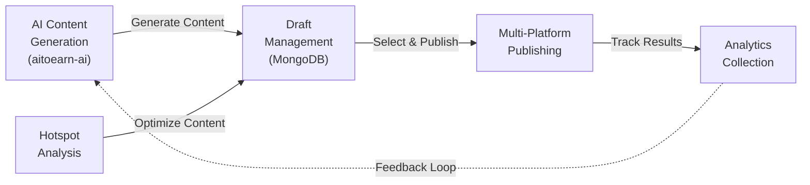

<!-- source: DeepWiki mcp.deepwiki.com · repo yikart/AiToEarn · page 4.3 Multi-Platform Publishing · fetched 2026-10-30 -->

# Multi-Platform Publishing

<details>
<summary>Relevant source files</summary>

The following files were used as context for generating this wiki page:

- [DOCKER_DEPLOYMENT_CN.md](DOCKER_DEPLOYMENT_CN.md)
- [DOCKER_DEPLOYMENT_EN.md](DOCKER_DEPLOYMENT_EN.md)
- [README.md](README.md)
- [README_CN.md](README_CN.md)
- [docker-compose.yml](docker-compose.yml)
- [presentation/agent_0.png](presentation/agent_0.png)
- [presentation/display-1.5.2png.png](presentation/display-1.5.2png.png)
- [wechat.jpg](wechat.jpg)

</details>


This document describes the multi-platform content publishing system that enables one-click distribution of content across 14+ social media platforms. The publishing system handles platform authentication, content adaptation, API integration, scheduling, and error recovery.

For information about OAuth authentication with third-party platforms, see [OAuth Authentication Flow](#4.1). For details on content scheduling, see [Calendar Timing and Scheduling](#5.2). For content creation before publishing, see [Content Creation and AI Generation](#5.1).

---

## Overview

The multi-platform publishing system is a core feature of AiToEarn that allows users to distribute content to multiple social media platforms simultaneously. The system abstracts the complexity of different platform APIs, authentication mechanisms, and content format requirements into a unified publishing workflow.

**Key Capabilities:**
- **One-click distribution**: Publish to multiple platforms from a single interface
- **Scheduled publishing**: Queue content for future publication via the calendar timing system
- **Content adaptation**: Automatically format content according to each platform's requirements
- **OAuth management**: Handle authentication tokens and re-authorization flows
- **Error recovery**: Retry failed publications with exponential backoff
- **Status tracking**: Monitor publication status across all platforms

**Supported Platforms:**

| Platform | Region | Content Types | OAuth Required |
|----------|--------|---------------|----------------|
| TikTok | Global | Video, Images | Yes |
| YouTube | Global | Video | Yes |
| Twitter/X | Global | Text, Images, Video | Yes |
| Instagram | Global | Images, Video, Reels | Yes |
| Facebook | Global | Text, Images, Video | Yes |
| LinkedIn | Global | Text, Images, Articles | Yes |
| Threads | Global | Text, Images | Yes |
| Pinterest | Global | Images, Boards | Yes |
| Douyin (抖音) | China | Video, Images | Yes |
| Bilibili | China | Video | Yes |
| Kuaishou (快手) | China | Video | Yes |
| WeChat Channels (视频号) | China | Video | Yes |
| WeChat Official Accounts | China | Articles, Images | Yes |
| Xiaohongshu (小红书) | China | Images, Text, Video | Yes |

Sources: [README.md:18-20](), [README.md:81](), [docker-compose.yml:184-212](), [DOCKER_DEPLOYMENT_EN.md:252-268]()

---

## System Architecture

### Service Components

The multi-platform publishing system spans multiple services in the AiToEarn architecture:

```mermaid
graph TB
    subgraph "Frontend Layer"
        WebUI["aitoearn-web<br/>Next.js Frontend"]
    end
    
    subgraph "Backend Services"
        Server["aitoearn-server<br/>NestJS API<br/>:3002"]
        AI["aitoearn-ai<br/>NestJS AI Service<br/>:3010"]
    end
    
    subgraph "Data Layer"
        MongoDB[("MongoDB<br/>:27017<br/>- Draft Storage<br/>- OAuth Tokens<br/>- Publish Metadata")]
        Redis[("Redis<br/>:6379<br/>- Job Queue<br/>- Retry Queue<br/>- Rate Limiting")]
        RustFS[("RustFS<br/>:9000<br/>Asset Storage")]
    end
    
    subgraph "External Platforms"
        TikTok["TikTok API"]
        YouTube["YouTube API"]
        Twitter["Twitter/X API"]
        Instagram["Instagram API"]
        LinkedIn["LinkedIn API"]
        Facebook["Facebook API"]
        Douyin["Douyin API"]
        Bilibili["Bilibili API"]
        Others["Other Platform APIs"]
    end
    
    WebUI -->|"1. Publish Request"| Server
    Server -->|"2. Content Generation (Optional)"| AI
    Server -->|"3. Read Draft"| MongoDB
    Server -->|"4. Fetch Assets"| RustFS
    Server -->|"5. Queue Jobs"| Redis
    Server -->|"6. OAuth Validation"| MongoDB
    Server -.->|"7. API Calls"| TikTok
    Server -.->|"7. API Calls"| YouTube
    Server -.->|"7. API Calls"| Twitter
    Server -.->|"7. API Calls"| Instagram
    Server -.->|"7. API Calls"| LinkedIn
    Server -.->|"7. API Calls"| Facebook
    Server -.->|"7. API Calls"| Douyin
    Server -.->|"7. API Calls"| Bilibili
    Server -.->|"7. API Calls"| Others
    Server -->|"8. Store Results"| MongoDB
    Server -->|"9. Update Queue"| Redis
```



**Component Responsibilities:**

- **aitoearn-web**: User interface for selecting platforms, previewing content, and initiating publication
- **aitoearn-server**: Core publishing orchestration, OAuth token management, platform API integration
- **MongoDB**: Persistent storage for drafts, OAuth tokens (encrypted), and publication metadata
- **Redis**: Job queue for scheduled publications, retry queue for failed attempts, rate limiting counters
- **RustFS**: S3-compatible storage for media assets (images, videos) to be uploaded to platforms

Sources: [docker-compose.yml:2-286](), High-level architecture diagrams

---

### Publishing Data Flow



Sources: High-level workflow diagram, [docker-compose.yml:136-232]()

---

## Publishing Workflow

### 1. Content Preparation

Before publishing, content must exist as a **draft** in the system. Drafts are stored in MongoDB and contain:

- **Text content**: Title, description, captions, hashtags
- **Media references**: Pointers to assets in RustFS (images, videos)
- **Platform-specific metadata**: Custom fields for different platforms
- **Scheduling information**: Publish time if scheduled

Drafts can be created through:
- Manual content creation in the web interface
- AI-powered generation (via `aitoearn-ai` service)
- Import from other platforms
- Template-based creation

Sources: [README.md:82-85](), [README_CN.md:69-70](), High-level data flow diagram

---

### 2. Platform Selection

Users select which platforms to publish to through the web interface. The system supports:

- **Individual platform selection**: Choose specific platforms from the list
- **Platform groups**: Pre-configured groups (e.g., "All Western Platforms", "All Chinese Platforms")
- **Previous selections**: Remember last used platform combination

The interface shows platform status indicators:
- ✓ Connected (OAuth token valid)
- ⚠ Re-authentication required (token expired)
- ✗ Not connected

Sources: [README.md:79-85]()

---

### 3. OAuth Token Validation

Before publishing, the `aitoearn-server` validates OAuth tokens for selected platforms:



**Token Storage:**
- OAuth tokens are stored in MongoDB (encrypted)
- Token expiration times are tracked
- Refresh tokens are used to renew access tokens when possible

**OAuth Configuration:**
OAuth credentials for each platform are configured via environment variables in `docker-compose.yml`:

| Platform | Environment Variables | Callback URL |
|----------|----------------------|--------------|
| TikTok | `TIKTOK_CLIENT_ID`, `TIKTOK_CLIENT_SECRET` | `https://{APP_DOMAIN}/api/plat/tiktok/auth/back` |
| YouTube | `YOUTUBE_CLIENT_ID`, `YOUTUBE_CLIENT_SECRET` | `https://{APP_DOMAIN}/api/plat/youtube/auth/back` |
| Twitter/X | `TWITTER_CLIENT_ID`, `TWITTER_CLIENT_SECRET` | `https://{APP_DOMAIN}/api/plat/twitter/auth/back` |
| Facebook | `FACEBOOK_CLIENT_ID`, `FACEBOOK_CLIENT_SECRET`, `FACEBOOK_CONFIG_ID` | `https://{APP_DOMAIN}/api/plat/facebook/auth/back` |
| Instagram | `INSTAGRAM_CLIENT_ID`, `INSTAGRAM_CLIENT_SECRET` | `https://{APP_DOMAIN}/api/plat/instagram/auth/back` |
| LinkedIn | `LINKEDIN_CLIENT_ID`, `LINKEDIN_CLIENT_SECRET` | `https://{APP_DOMAIN}/api/plat/linkedin/auth/back` |
| Douyin | `DOYIN_CLIENT_ID`, `DOYIN_CLIENT_SECRET` | `https://{APP_DOMAIN}/api/plat/douyin/auth/back` |

The `APP_DOMAIN` environment variable must be set to the public domain for OAuth callbacks to work correctly.

Sources: [docker-compose.yml:184-212](), [DOCKER_DEPLOYMENT_EN.md:252-270](), [DOCKER_DEPLOYMENT_CN.md:252-270]()

---

### 4. Content Adaptation

Each platform has different requirements for content format, media specifications, and metadata. The publishing system adapts content automatically:

**Text Adaptation:**
- **Character limits**: Truncate or split content (Twitter: 280 chars, LinkedIn: 3000 chars)
- **Hashtag formatting**: Platform-specific hashtag rules
- **Mention syntax**: Different platforms use different mention formats
- **Link handling**: Some platforms require URL shortening

**Media Adaptation:**
- **Video encoding**: Re-encode videos to meet platform requirements (codec, resolution, bitrate)
- **Image resizing**: Resize images to optimal dimensions for each platform
- **Aspect ratio**: Adjust for platform-specific aspect ratios (1:1, 16:9, 9:16)
- **File size limits**: Compress media to meet platform limits

**Metadata Mapping:**


Sources: [README.md:79-85](), High-level data flow diagram

---

### 5. API Calls and Publishing

The `aitoearn-server` makes HTTP requests to each platform's API:



**API Integration Points:**

Each platform has its own API implementation within `aitoearn-server`. While specific code files are not provided, the integration follows this pattern:

- **Request construction**: Build platform-specific request payload
- **Authentication**: Attach OAuth bearer token from MongoDB
- **Media upload**: Upload assets from RustFS to platform's media endpoints
- **Post creation**: Submit post/video/tweet with media references
- **Response parsing**: Extract post ID, URL, and status

**Rate Limiting:**

The system implements rate limiting using Redis counters to avoid exceeding platform API limits:

- Track requests per platform per time window
- Apply backoff when approaching limits
- Queue excess requests for later processing

Sources: [docker-compose.yml:105-107](), [DOCKER_DEPLOYMENT_EN.md:154-161]()

---

### 6. Status Tracking and Storage

After publishing, metadata is stored in MongoDB:

**Publication Record Structure:**
```javascript
{
  draftId: ObjectId,
  platform: 'tiktok',
  status: 'published' | 'failed' | 'scheduled' | 'processing',
  publishedAt: ISODate,
  platformPostId: '7123456789',
  platformUrl: 'https://tiktok.com/@user/video/7123456789',
  errorMessage: null,
  retryCount: 0,
  scheduledFor: null,
  metadata: {
    views: 0,
    likes: 0,
    comments: 0,
    shares: 0
  }
}
```

This data feeds into the Analytics Dashboard (see [Analytics Dashboard](#6.2)).

Sources: High-level data flow diagram, [docker-compose.yml:157-165]()

---

## Scheduled Publishing

The multi-platform publishing system integrates with the Calendar Timing system (see [Calendar Timing and Scheduling](#5.2)) to support scheduled content distribution.

### Scheduling Workflow



**Scheduled Job Structure in Redis:**
```javascript
{
  jobId: 'schedule:draft:abc123:1234567890',
  type: 'scheduled_publish',
  draftId: 'abc123',
  platforms: ['tiktok', 'youtube', 'twitter'],
  scheduledTime: 1234567890,
  retryAttempts: 0,
  status: 'pending'
}
```

**Calendar Timing Features:**
- **Drag-and-drop scheduling**: Visual interface for scheduling posts
- **Multi-platform coordination**: Schedule same content to different platforms at different times
- **Timezone handling**: Support for different user timezones
- **Conflict detection**: Warn about multiple posts scheduled too close together

Sources: [README.md:85-89](), [DOCKER_DEPLOYMENT_EN.md:154-161]()

---

## Error Handling and Retry Mechanism

### Failure Scenarios

The publishing system handles various failure scenarios:

| Failure Type | Detection | Action |
|--------------|-----------|--------|
| **OAuth Token Expired** | 401 Unauthorized response | Flag for re-authentication, don't retry |
| **Rate Limit Exceeded** | 429 Too Many Requests | Exponential backoff retry |
| **Platform Server Error** | 5xx response | Immediate retry up to 3 times |
| **Network Timeout** | Request timeout | Exponential backoff retry |
| **Invalid Content** | 400 Bad Request | Log error, notify user, don't retry |
| **Media Upload Failure** | Upload endpoint error | Retry upload, then retry post |

### Retry Queue System



**Retry Configuration:**
- **Max retry attempts**: 5
- **Backoff calculation**: `delay = base_delay * (2 ^ attempt_count)`
- **Base delay**: 60 seconds
- **Max delay**: 1 hour

**Retry Job Storage in Redis:**
```javascript
// Redis key: retry:publish:{draftId}:{platform}
{
  draftId: 'abc123',
  platform: 'tiktok',
  attemptCount: 2,
  lastError: 'Rate limit exceeded',
  nextRetryAt: 1234567890,
  originalScheduledTime: 1234560000
}
```

Sources: High-level data flow diagram, [docker-compose.yml:23-39]()

---

## Platform-Specific Considerations

### Video Platforms (TikTok, YouTube, Douyin, Bilibili)

**Video Upload Process:**
1. Download video from RustFS
2. Validate video codec, resolution, duration
3. Upload to platform's media endpoint (chunk upload for large files)
4. Poll for processing status
5. Create post with processed video ID

**Platform Requirements:**

| Platform | Max Size | Duration | Aspect Ratio | Codec |
|----------|----------|----------|--------------|-------|
| TikTok | 287.6 MB | 15s-10min | 9:16 (vertical) | H.264 |
| YouTube | 256 GB | No limit | Any | H.264, VP9 |
| Douyin | 300 MB | 15s-15min | 9:16 (vertical) | H.264 |
| Bilibili | 8 GB | No limit | 16:9 (horizontal) | H.264 |

Sources: [README.md:18-20]()

---

### Image Platforms (Instagram, Pinterest, Xiaohongshu)

**Image Upload Process:**
1. Fetch image from RustFS
2. Resize/crop to platform specifications
3. Upload to platform's media endpoint
4. Create post with uploaded image ID

**Platform Requirements:**

| Platform | Max Size | Dimensions | Format | Multiple Images |
|----------|----------|------------|--------|-----------------|
| Instagram | 30 MB | 1080x1080 (square) | JPG, PNG | Up to 10 (carousel) |
| Pinterest | 32 MB | 2:3 ratio recommended | JPG, PNG | 1 per Pin |
| Xiaohongshu | 20 MB | 3:4 ratio recommended | JPG | Up to 9 per post |

Sources: [README.md:81]()

---

### Text Platforms (Twitter/X, LinkedIn, Threads)

**Text Post Process:**
1. Format text content with hashtags and mentions
2. Upload media (if any) to media endpoint
3. Create tweet/post with media IDs
4. Handle thread creation for long content

**Platform Requirements:**

| Platform | Text Limit | Hashtag Limit | Media Limit |
|----------|------------|---------------|-------------|
| Twitter/X | 280 chars | 2-3 recommended | 4 images or 1 video |
| LinkedIn | 3000 chars | 3-5 recommended | 9 images or 1 video |
| Threads | 500 chars | No limit | 10 images or 1 video |

Sources: [README.md:81]()

---

### Chinese Platforms (WeChat Channels, WeChat Official Accounts)

**WeChat Official Accounts:**
- Uses different OAuth flow (WXPLAT_APP_ID, WXPLAT_APP_SECRET)
- Requires article HTML formatting
- Supports rich media embeds
- Special AES key for message encryption: WXPLAT_ENCODING_AES_KEY

**WeChat Channels (视频号):**
- Video-only platform
- Tight integration with WeChat ecosystem
- Requires real-name verification

Configuration in `docker-compose.yml`:
```yaml
WXPLAT_APP_ID: ""
WXPLAT_APP_SECRET: ""
WXPLAT_ENCODING_AES_KEY: ""
```

Sources: [docker-compose.yml:208-210](), [DOCKER_DEPLOYMENT_EN.md:266]()

---

## Integration with Other Systems

### Content Creation Pipeline



**Integration Points:**

1. **AI Generation** (see [Content Creation and AI Generation](#5.1)):
   - `aitoearn-ai` generates draft content
   - Draft saved to MongoDB
   - User selects platforms for publishing

2. **Hotspot Analysis** (see [Hotspot Analysis and Trending Content](#5.3)):
   - Trending topics inform content creation
   - AI optimizes content for better engagement
   - Published to platforms most likely to amplify

3. **Calendar Timing** (see [Calendar Timing and Scheduling](#5.2)):
   - Visual interface for scheduling posts
   - Redis job queue manages scheduled publications
   - Supports complex multi-platform schedules

4. **Analytics Dashboard** (see [Analytics Dashboard](#6.2)):
   - Collects post performance data from platforms
   - Stores in statistics database
   - Displays cross-platform metrics

Sources: High-level functional domain diagram

---

## Configuration Reference

### Environment Variables

The following environment variables in `docker-compose.yml` control multi-platform publishing:

**OAuth Credentials (aitoearn-server service):**

```yaml
# Western Platforms
TIKTOK_CLIENT_ID: ""
TIKTOK_CLIENT_SECRET: ""
YOUTUBE_CLIENT_ID: ""
YOUTUBE_CLIENT_SECRET: ""
TWITTER_CLIENT_ID: ""
TWITTER_CLIENT_SECRET: ""
FACEBOOK_CLIENT_ID: ""
FACEBOOK_CLIENT_SECRET: ""
FACEBOOK_CONFIG_ID: ""
INSTAGRAM_CLIENT_ID: ""
INSTAGRAM_CLIENT_SECRET: ""
LINKEDIN_CLIENT_ID: ""
LINKEDIN_CLIENT_SECRET: ""
THREADS_CLIENT_ID: ""
THREADS_CLIENT_SECRET: ""
PINTEREST_CLIENT_ID: ""
PINTEREST_CLIENT_SECRET: ""
PINTEREST_TEST_AUTHORIZATION: ""

# Chinese Platforms
DOYIN_CLIENT_ID: ""
DOYIN_CLIENT_SECRET: ""
BILIBILI_CLIENT_ID: ""
BILIBILI_CLIENT_SECRET: ""
KWAI_CLIENT_ID: ""
KWAI_CLIENT_SECRET: ""
WXPLAT_APP_ID: ""
WXPLAT_APP_SECRET: ""
WXPLAT_ENCODING_AES_KEY: ""
```

**Domain Configuration:**
```yaml
APP_DOMAIN: localhost  # Change to your public domain for OAuth callbacks
```

OAuth callback URLs follow the pattern: `https://{APP_DOMAIN}/api/plat/{platform}/auth/back`

Sources: [docker-compose.yml:183-212](), [DOCKER_DEPLOYMENT_EN.md:140-151](), [DOCKER_DEPLOYMENT_CN.md:64-91]()

---

### Service Configuration Files

**config/aitoearn-server.config.js:**

This file contains platform-specific configuration including:
- OAuth redirect URIs
- API endpoints for each platform
- Rate limiting configurations
- Media upload specifications

The config file reads from environment variables set in `docker-compose.yml`.

Sources: [docker-compose.yml:148](), [DOCKER_DEPLOYMENT_EN.md:96-110]()

---

## Deployment Considerations

### Production Deployment

When deploying the multi-platform publishing system in production:

1. **Set APP_DOMAIN**: Configure the public domain for OAuth callbacks
   ```yaml
   APP_DOMAIN: your-domain.com
   ```

2. **Configure OAuth Credentials**: Obtain and set credentials for each platform you want to support

3. **Storage Setup**: Ensure RustFS or S3-compatible storage is properly configured for media assets

4. **Rate Limiting**: Monitor Redis for rate limit counters and adjust publishing schedules if needed

5. **Error Monitoring**: Set up logging and alerting for failed publications

6. **Database Backups**: Regular backups of MongoDB to preserve OAuth tokens and publication history

Sources: [DOCKER_DEPLOYMENT_EN.md:54-135](), [DOCKER_DEPLOYMENT_CN.md:54-177]()

---

### Scaling Considerations

For high-volume publishing scenarios:

**Horizontal Scaling:**
- Multiple `aitoearn-server` instances can process publishing jobs in parallel
- Redis job queue provides distributed coordination
- MongoDB replica set for read scaling

**Rate Limiting Strategies:**
- Per-platform rate limit counters in Redis
- Automatic backoff when approaching limits
- Priority queue for important posts

**Media Processing:**
- Consider dedicated video encoding service
- CDN for RustFS asset delivery
- Pre-processing media during draft creation

Sources: High-level deployment architecture diagram, [docker-compose.yml:136-232]()

---

## Summary

The multi-platform publishing system is the core distribution mechanism of AiToEarn, enabling creators to amplify their reach across 14+ social media platforms with minimal effort. By abstracting OAuth authentication, content adaptation, API integration, and error handling into a unified workflow, the system dramatically simplifies the complexity of multi-platform content marketing.

**Key Features:**
- OAuth-based authentication with automatic token management
- Platform-specific content adaptation (text, images, videos)
- Scheduled publishing via calendar timing integration
- Robust error handling with exponential backoff retry
- Real-time status tracking and analytics integration

**Architecture:**
- `aitoearn-server`: Orchestrates publishing workflow and platform API calls
- MongoDB: Stores drafts, OAuth tokens, and publication metadata
- Redis: Job queue for scheduling and retry management
- RustFS: S3-compatible storage for media assets

For detailed OAuth flow implementation, see [OAuth Authentication Flow](#4.1). For scheduling configuration, see [Calendar Timing and Scheduling](#5.2).

Sources: [README.md:14-20](), [README.md:79-89](), High-level system diagrams

---

