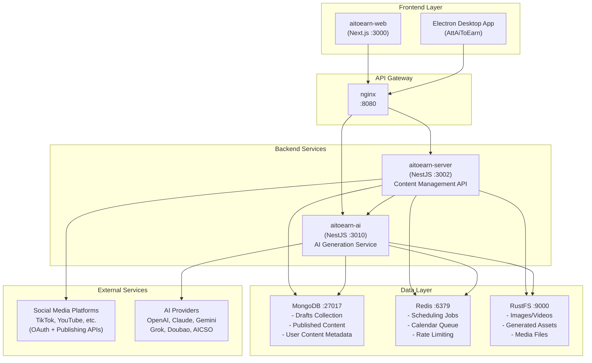
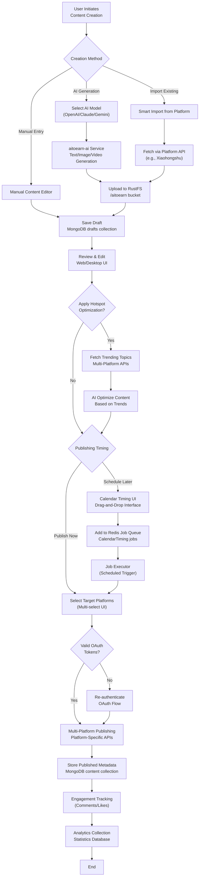
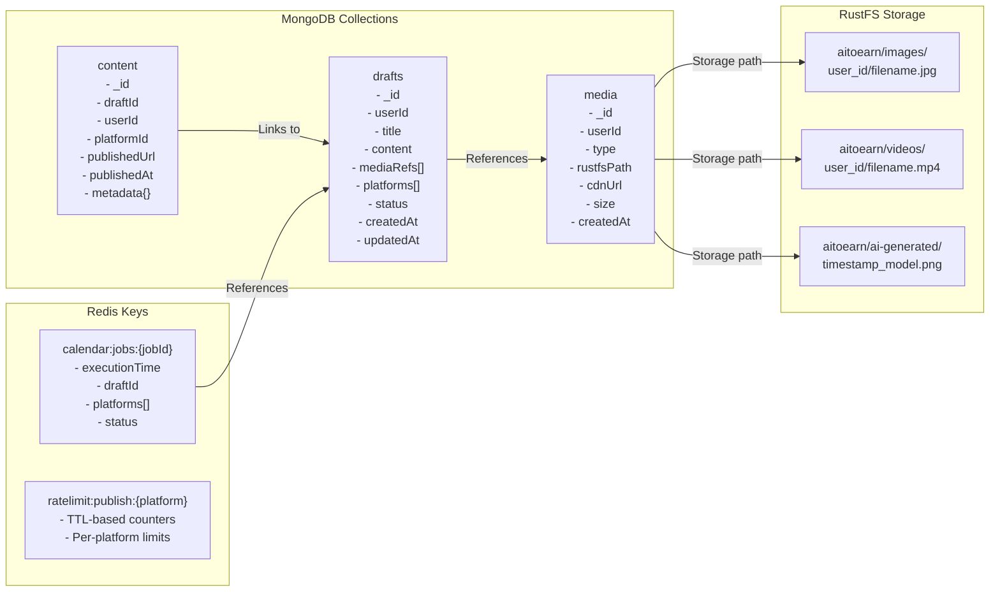

<!-- source: DeepWiki mcp.deepwiki.com · repo yikart/AiToEarn · page 5 Content Management Features · fetched 2026-10-30 -->

# Content Management Features

<details>
<summary>Relevant source files</summary>

The following files were used as context for generating this wiki page:

- [DOCKER_DEPLOYMENT_CN.md](DOCKER_DEPLOYMENT_CN.md)
- [DOCKER_DEPLOYMENT_EN.md](DOCKER_DEPLOYMENT_EN.md)
- [README.md](README.md)
- [README_CN.md](README_CN.md)
- [docker-compose.yml](docker-compose.yml)
- [presentation/agent_0.png](presentation/agent_0.png)
- [presentation/display-1.5.2png.png](presentation/display-1.5.2png.png)
- [wechat.jpg](wechat.jpg)

</details>


## Overview

The Content Management system in AiToEarn provides a comprehensive workflow for creating, organizing, scheduling, and distributing content across multiple social media platforms. This module handles the entire content lifecycle from initial creation (whether manual or AI-generated) through draft management, timing/scheduling, trend analysis, and final multi-platform publication.

This page provides an overview of content management capabilities. For detailed information on specific subsystems:
- **Content creation and AI-powered generation**: See [Content Creation and AI Generation](#5.1)
- **Scheduling and calendar-based timing**: See [Calendar Timing and Scheduling](#5.2)
- **Trending content discovery and optimization**: See [Hotspot Analysis and Trending Content](#5.3)
- **Multi-platform publishing workflows**: See [Multi-Platform Publishing](#4.3)
- **Analytics and performance tracking**: See [Analytics Dashboard](#6.2)

**Sources:** [README.md:66-149]()

## Core Capabilities

AiToEarn's content management system provides four primary capabilities:

| Capability | Description | Key Technologies |
|------------|-------------|------------------|
| **Content Creation** | Manual editing and AI-powered generation of text, images, and video content | AI service (OpenAI, Claude, Gemini, etc.), MongoDB for drafts |
| **Smart Scheduling** | Calendar-based content planning with drag-and-drop interface and automated timing | Redis job queue, calendar UI components |
| **Trend Discovery** | Real-time hotspot analysis and viral content detection across platforms | Platform APIs, trend detection algorithms |
| **Multi-Platform Distribution** | One-click publishing to 14+ social media platforms with content adaptation | OAuth integration, platform-specific APIs |

The system supports simultaneous content creation and distribution to: Douyin, Xiaohongshu (Rednote), WeChat Channels, Kuaishou, Bilibili, WeChat Official Accounts, TikTok, YouTube, Facebook, Instagram, Threads, Twitter (X), Pinterest, and LinkedIn.

**Sources:** [README.md:18-21](), [README.md:79-89]()

## System Architecture

### Content Management Service Layer



**Content Management Service Architecture**

This diagram shows how content management functionality is distributed across the AiToEarn services. The `aitoearn-server` handles content CRUD operations, scheduling, and platform publishing, while `aitoearn-ai` processes AI generation requests. Draft content and metadata are stored in MongoDB, scheduling jobs are managed via Redis queues, and media assets reside in RustFS (S3-compatible storage).

**Sources:** [docker-compose.yml:81-134](), [docker-compose.yml:136-232](), [DOCKER_DEPLOYMENT_EN.md:6-36]()

## Content Lifecycle Workflow



**Complete Content Lifecycle from Creation to Analytics**

This workflow diagram illustrates the full journey of content through the AiToEarn system. Content can originate from AI generation (via `aitoearn-ai`), manual creation, or imported from existing platforms. All content passes through draft storage in MongoDB before entering the scheduling system (Redis-based job queue) or direct publishing. The calendar timing system allows users to plan content distribution, while hotspot analysis can optimize content based on current trends.

**Sources:** [README.md:79-89](), [README.md:91-100](), [README.md:141-148]()

## Key Components

### 1. Draft Management System

The draft management system stores all content in MongoDB before publication. Drafts include:
- Content text, title, and descriptions
- References to media assets stored in RustFS (`rustfs/aitoearn` bucket)
- Platform-specific formatting metadata
- Version history for collaborative editing
- User ownership and permissions

MongoDB collections used:
- `drafts` - Unpublished content
- `content` - Published content metadata
- `media` - Asset references and metadata

**Sources:** [docker-compose.yml:2-21](), [DOCKER_DEPLOYMENT_EN.md:308]()

### 2. AI-Powered Content Generation

The `aitoearn-ai` service orchestrates multiple AI providers for content generation:

| Provider | Environment Variable | Supported Models | Use Cases |
|----------|---------------------|------------------|-----------|
| OpenAI | `OPENAI_API_KEY` | GPT-4, GPT-5 | Text generation, copywriting |
| Anthropic | `ANTHROPIC_API_KEY` | Claude Opus 4.5/4.6 | Long-form content, analysis |
| Google | `GEMINI_KEY_PAIRS` | Gemini 2.5/3.1 | Multi-modal generation |
| xAI | `GROK_API_KEY` | Grok | Real-time content |
| Volcengine | `VOLCENGINE_API_KEY` | Doubao | Chinese language content |
| AICSO | `AICSO_API_KEY` | Custom models | Specialized generation |

AI generation requests flow through: User → `aitoearn-web` → `nginx` → `aitoearn-server` → `aitoearn-ai` → AI Provider API

For detailed AI configuration and model selection, see [AI Service Architecture](#3.1) and [Multi-Provider Configuration](#3.2).

**Sources:** [docker-compose.yml:114-128](), [DOCKER_DEPLOYMENT_EN.md:222-247]()

### 3. Calendar Timing System

The scheduling system uses Redis as a job queue to manage future publications:

**Key Components:**
- **CalendarTiming UI** - Drag-and-drop interface for planning content (see [Calendar Timing and Scheduling](#5.2))
- **Redis Job Queue** - Stores scheduled publication jobs with timestamps
- **Job Executor** - Background worker that processes scheduled jobs at specified times
- **CalendarTimingItem** - Individual scheduled content items with platform targets
- **RecordCore** - Core scheduling logic and state management

When users schedule content via the calendar UI, a job is created in Redis with:
- Scheduled execution time
- Target platform(s)
- Content draft ID reference
- Publishing parameters (hashtags, mentions, etc.)

The job executor polls Redis for jobs where `executionTime <= currentTime` and triggers the multi-platform publishing workflow.

**Sources:** [docker-compose.yml:23-39](), [README.md:85-89]()

### 4. Hotspot Analysis Engine

The hotspot analysis system monitors trending topics across platforms to optimize content:

**Capabilities:**
- **Case Library** - Collection of high-performing posts (10,000+ likes) for inspiration
- **Trend Radar** - Real-time detection of viral topics across platforms
- **Content Optimization** - AI-based suggestions to align content with current trends

The system fetches trending data from platform APIs (TikTok Discover, YouTube Trending, Twitter Trends, etc.) and uses AI to analyze patterns. When users opt to optimize content for trends, the system:

1. Queries trending topics from target platforms
2. Analyzes current trends using AI (OpenAI/Claude)
3. Suggests content modifications (hashtags, keywords, timing)
4. Updates draft with optimized version

For detailed information on trend detection algorithms and integration points, see [Hotspot Analysis and Trending Content](#5.3).

**Sources:** [README.md:91-100]()

### 5. Multi-Platform Publishing

The publishing system adapts content for each platform's requirements:

**Platform Integration Points:**
- OAuth authentication flow for 14+ platforms (see [OAuth Authentication Flow](#4.1))
- Platform-specific content formatters (character limits, media requirements)
- Batch publishing engine for simultaneous distribution
- Retry logic with exponential backoff for failed publishes
- Webhook handlers for post-publish status updates

OAuth credentials are configured via environment variables in `aitoearn-server`:

```
TIKTOK_CLIENT_ID/SECRET
YOUTUBE_CLIENT_ID/SECRET
FACEBOOK_CLIENT_ID/SECRET
INSTAGRAM_CLIENT_ID/SECRET
TWITTER_CLIENT_ID/SECRET
LINKEDIN_CLIENT_ID/SECRET
[and 8 more platforms]
```

OAuth callback URL format: `https://{APP_DOMAIN}/api/plat/{platform}/auth/back`

For detailed publishing workflows and platform-specific adaptations, see [Multi-Platform Publishing](#4.3).

**Sources:** [docker-compose.yml:183-212](), [DOCKER_DEPLOYMENT_EN.md:253-270]()

## Data Storage Architecture

### Content Data Model



**Content Data Storage Schema**

This diagram shows how content data is organized across the three storage systems. MongoDB stores structured metadata and relationships, Redis manages time-sensitive scheduling data and rate limiting, and RustFS holds the actual media files. Each draft can reference multiple media assets, and published content maintains references back to the original draft for tracking and analytics.

**Sources:** [docker-compose.yml:2-21](), [docker-compose.yml:41-79](), [DOCKER_DEPLOYMENT_EN.md:173-202]()

### Storage Configuration

The content management system uses a three-tier storage strategy:

| Storage Layer | Technology | Purpose | Configuration Location |
|---------------|-----------|---------|------------------------|
| **Document Storage** | MongoDB | Drafts, metadata, user content | `MONGODB_HOST/PORT/USERNAME/PASSWORD` in `docker-compose.yml` |
| **Job Queue & Cache** | Redis | Scheduled jobs, rate limiting, sessions | `REDIS_HOST/PORT/PASSWORD` in `docker-compose.yml` |
| **Asset Storage** | RustFS (S3-compatible) | Images, videos, AI-generated media | `assets` config in `config/aitoearn-ai.config.js` and `config/aitoearn-server.config.js` |

RustFS configuration (default):
- Endpoint: `http://rustfs.local:9000` (internal) or `http://localhost:9000` (external)
- Bucket: `aitoearn`
- Access Key: `rustfsadmin`
- Secret Key: `rustfsadmin`
- Console: http://localhost:9001

For production deployments, RustFS can be replaced with AWS S3, Aliyun OSS, or other S3-compatible services by updating the `assets` configuration in both config files.

**Sources:** [docker-compose.yml:41-79](), [DOCKER_DEPLOYMENT_EN.md:173-202]()

## Integration Points

### Frontend → Backend Communication

Content management operations flow through the following route structure:

1. **Web UI** (`aitoearn-web:3000`) → **Nginx** (`:8080`) → **Server API** (`aitoearn-server:3002`)
2. **Desktop App** → **Nginx** → **Server API**

The `NEXT_PUBLIC_API_URL` environment variable (default: `http://localhost:8080/api`) configures the frontend API endpoint.

### Backend → AI Service Communication

AI generation requests:

**Server** (`http://aitoearn-server:3002`) → **AI Service** (`http://aitoearn-ai:3010`)

Configured via `AI_URL` in `aitoearn-server` and `SERVER_URL` in `aitoearn-ai`.

Authentication between services uses `INTERNAL_TOKEN` for request verification.

**Sources:** [docker-compose.yml:234-246](), [docker-compose.yml:155-174]()

## Content Management API Endpoints

While the complete API documentation is beyond the scope of this overview, key endpoint patterns include:

| Endpoint Pattern | Method | Purpose | Service |
|-----------------|--------|---------|---------|
| `/api/content/drafts` | GET, POST | List and create drafts | aitoearn-server |
| `/api/content/drafts/{id}` | GET, PUT, DELETE | Retrieve, update, delete draft | aitoearn-server |
| `/api/content/schedule` | POST | Schedule content for later | aitoearn-server |
| `/api/content/publish` | POST | Publish to platforms immediately | aitoearn-server |
| `/api/ai/generate/text` | POST | AI text generation | aitoearn-ai |
| `/api/ai/generate/image` | POST | AI image generation | aitoearn-ai |
| `/api/hotspot/trends` | GET | Fetch trending topics | aitoearn-server |
| `/api/plat/{platform}/auth` | GET | Initiate OAuth flow | aitoearn-server |

All API routes are proxied through Nginx on port 8080, with requests to `/api/*` forwarded to the appropriate backend service.

**Sources:** [DOCKER_DEPLOYMENT_EN.md:129-135]()

## Summary

The AiToEarn content management system provides an integrated workflow for:

1. **Creating** content through manual editing, AI generation, or platform imports
2. **Storing** drafts and media in MongoDB and RustFS
3. **Optimizing** content using hotspot/trend analysis
4. **Scheduling** publications via Redis-based job queues and calendar UI
5. **Publishing** to 14+ platforms with OAuth integration
6. **Tracking** performance through engagement and analytics

For implementation details on specific subsystems:
- Content creation workflows and AI integration: [Content Creation and AI Generation](#5.1)
- Calendar UI components and scheduling logic: [Calendar Timing and Scheduling](#5.2)
- Trend detection and optimization algorithms: [Hotspot Analysis and Trending Content](#5.3)

**Sources:** [README.md:66-157](), [DOCKER_DEPLOYMENT_EN.md:6-36]()

---

