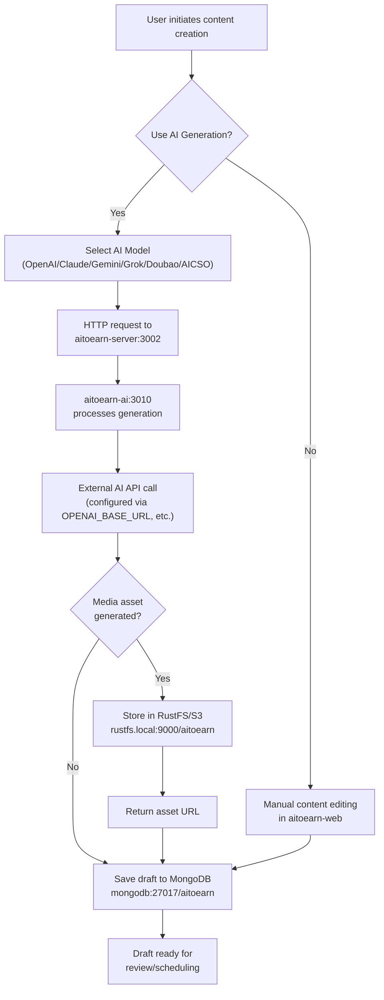
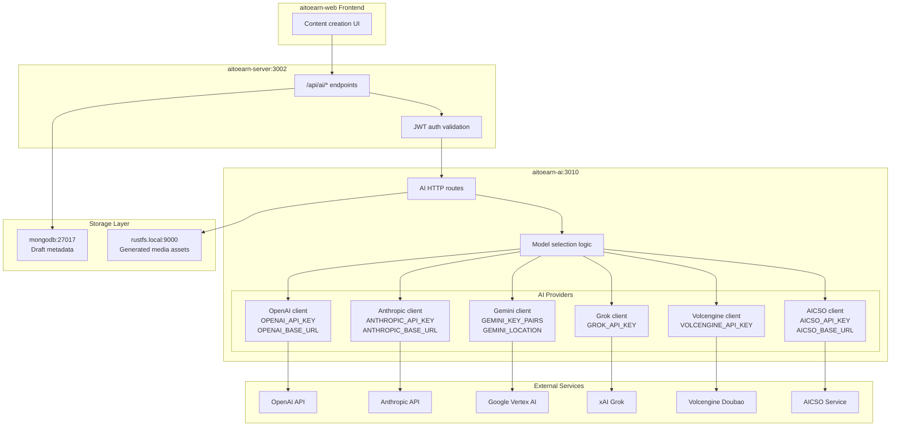
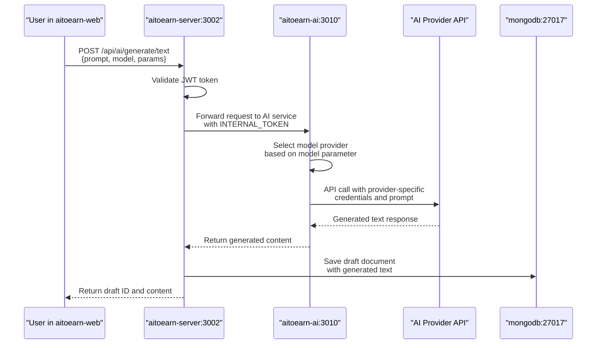
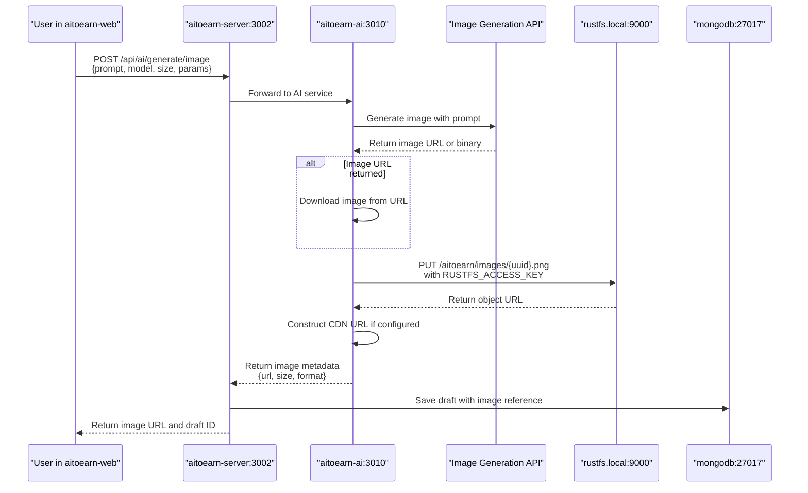
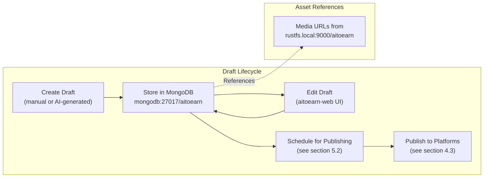
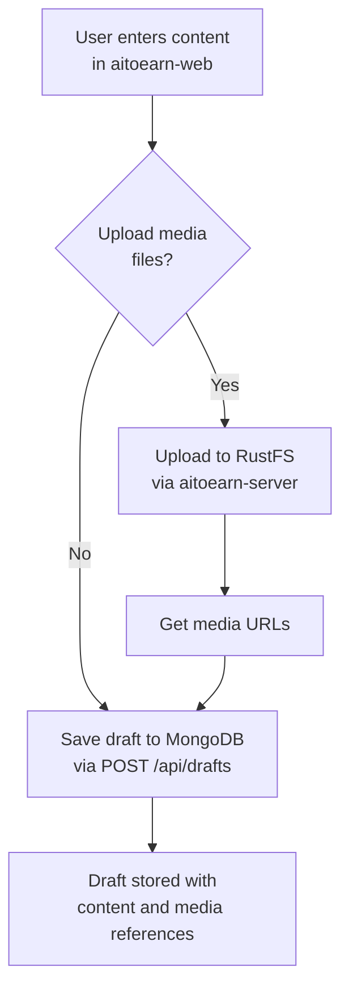
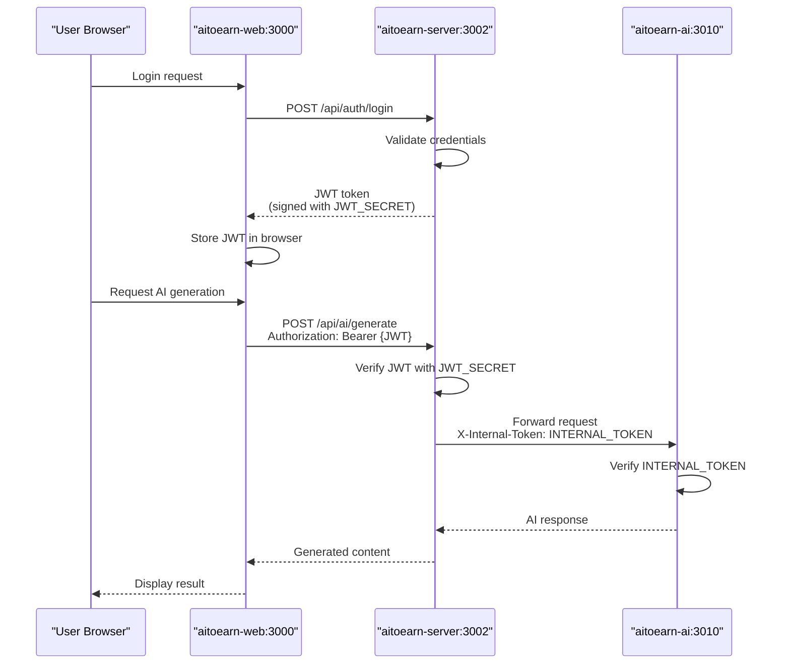

<!-- source: DeepWiki mcp.deepwiki.com · repo yikart/AiToEarn · page 5.1 Content Creation and AI Generation · fetched 2026-10-30 -->

# Content Creation and AI Generation

<details>
<summary>Relevant source files</summary>

The following files were used as context for generating this wiki page:

- [DOCKER_DEPLOYMENT_CN.md](DOCKER_DEPLOYMENT_CN.md)
- [DOCKER_DEPLOYMENT_EN.md](DOCKER_DEPLOYMENT_EN.md)
- [README.md](README.md)
- [README_CN.md](README_CN.md)
- [docker-compose.yml](docker-compose.yml)
- [presentation/agent_0.png](presentation/agent_0.png)
- [presentation/display-1.5.2png.png](presentation/display-1.5.2png.png)
- [wechat.jpg](wechat.jpg)

</details>


## Purpose and Scope

This document describes the content creation workflow in AiToEarn, focusing on how users generate content using AI-powered tools and manual editing capabilities. It covers the AI generation architecture, multi-provider model selection, asset storage, and draft management systems.

For information about scheduling and publishing created content, see [Calendar Timing and Scheduling](#5.2). For discovering trending content to inspire creation, see [Hotspot Analysis and Trending Content](#5.3).

---

## Content Creation Workflow Overview

The content creation process in AiToEarn supports both AI-assisted generation and manual editing. Content flows through multiple services before being stored as drafts in MongoDB, with generated media assets stored in S3-compatible object storage.



**Sources:** [docker-compose.yml:81-134](), [docker-compose.yml:136-232](), [README.md:141-149]()

---

## AI Service Architecture

The AI generation capabilities are powered by the `aitoearn-ai` service, which orchestrates requests to multiple AI providers based on user-selected models. The service acts as a unified interface for text, image, and video generation.



**Sources:** [docker-compose.yml:81-134](), [docker-compose.yml:114-128](), [DOCKER_DEPLOYMENT_EN.md:206-223]()

---

## AI Provider Configuration

AI providers are configured through environment variables in the `aitoearn-ai` service. The application supports multiple providers simultaneously, allowing users to select the best model for their specific content generation needs.

### Configuration Variables by Provider

| Provider | Environment Variables | Purpose |
|----------|----------------------|---------|
| **OpenAI** | `OPENAI_API_KEY`<br/>`OPENAI_BASE_URL` | GPT models for text/image generation. Also used by `aitoearn-server`. Default base URL: `https://api.openai.com/v1` |
| **Anthropic** | `ANTHROPIC_API_KEY`<br/>`ANTHROPIC_BASE_URL` | Claude models for text generation. Default base URL: `https://api.anthropic.com` |
| **Google Gemini** | `GEMINI_KEY_PAIRS`<br/>`GEMINI_LOCATION`<br/>`gcs-placeholder.json` | Gemini models for multimodal generation. Key pairs in JSON array format with GCS credentials |
| **xAI Grok** | `GROK_API_KEY` | Grok models for text generation |
| **Volcengine Doubao** | `VOLCENGINE_API_KEY`<br/>`VOLCENGINE_ACCESS_KEY_ID`<br/>`VOLCENGINE_SECRET_ACCESS_KEY`<br/>`VOLCENGINE_VOD_SPACE_NAME` | Doubao models and video-on-demand storage |
| **AICSO** | `AICSO_API_KEY`<br/>`AICSO_BASE_URL` | AICSO service integration |

**Sources:** [docker-compose.yml:114-128](), [DOCKER_DEPLOYMENT_EN.md:222-247]()

### Recommended Setup: API Relay Services

For production deployments, it is recommended to use an API relay service like [new-api](https://github.com/Calcium-Ion/new-api) or [one-api](https://github.com/songquanpeng/one-api) to centralize API key management and provide unified access to multiple AI providers through a single endpoint.

Configuration with relay service:
```yaml
# In docker-compose.yml aitoearn-ai service
OPENAI_BASE_URL: https://your-new-api-host/v1
OPENAI_API_KEY: sk-your-unified-key
```

The relay service handles routing to the appropriate AI provider based on the requested model.

**Sources:** [DOCKER_DEPLOYMENT_EN.md:206-220]()

### AI Model Definitions

Specific AI models available for selection (including pricing, capabilities, and provider mappings) are defined in the application configuration file mounted at `/app/config.js` inside the `aitoearn-ai` container.

**Sources:** [docker-compose.yml:91](), [DOCKER_DEPLOYMENT_EN.md:246-247]()

---

## Text Generation

Text generation capabilities allow users to create content copy, titles, descriptions, and hashtags using large language models. The system supports both streaming and non-streaming responses.

### Supported Text Generation Features

- **Post copy generation**: Full-length social media post text
- **Title generation**: Catchy headlines and titles
- **Description generation**: Meta descriptions and summaries
- **Hashtag generation**: Relevant hashtags for social media platforms
- **Content expansion**: Expand brief notes into full content
- **Content abbreviation**: Shorten long-form content

**Sources:** [README.md:141-149](), [README_CN.md:130-137]()

### Text Generation Flow



**Sources:** [docker-compose.yml:109-112](), [docker-compose.yml:173-174]()

---

## Image Generation

Image generation uses AI models like DALL-E (OpenAI), Flux, and Midjourney integrations to create visual content based on text prompts. Generated images are stored in RustFS/S3-compatible object storage.

### Supported Image Models

According to the README, supported AI image models include:
- **GPT (DALL-E)**: OpenAI's image generation
- **Flux**: Advanced image generation model

**Sources:** [README.md:147](), [README_CN.md:136]()

### Image Generation and Storage Flow



**Sources:** [docker-compose.yml:41-79](), [DOCKER_DEPLOYMENT_EN.md:175-202]()

### Object Storage Configuration

Generated images and videos are stored in RustFS, an S3-compatible object storage service included in the Docker Compose setup.

**RustFS Configuration:**
- **Service**: `rustfs` container at `rustfs.local:9000`
- **Bucket**: `aitoearn` (auto-created by `rustfs-init` service)
- **Access**: Configured via `RUSTFS_ACCESS_KEY` and `RUSTFS_SECRET_KEY`
- **Console**: Accessible at `http://localhost:9001`
- **Default credentials**: `rustfsadmin` / `rustfsadmin`

The asset storage configuration is defined in both `config/aitoearn-ai.config.js` and `config/aitoearn-server.config.js` with the following structure:

```javascript
assets: {
  provider: 's3',
  region: 'us-east-1',
  bucketName: 'aitoearn',
  endpoint: 'http://rustfs.local:9000',
  accessKeyId: process.env.RUSTFS_ACCESS_KEY || 'rustfsadmin',
  secretAccessKey: process.env.RUSTFS_SECRET_KEY || 'rustfsadmin',
  cdnEndpoint: process.env.CDN_ENDPOINT || '',
}
```

**Sources:** [docker-compose.yml:41-79](), [docker-compose.yml:65-79](), [DOCKER_DEPLOYMENT_EN.md:175-188]()

---

## Video Generation

Video generation capabilities allow users to create video content using AI models. The README mentions support for multiple video generation models.

### Supported Video Models

According to the README, supported AI video models include:
- **Seedance**
- **Kling**
- **Hailuo** (海螺)
- **Veo** (Google)
- **Midjourney** (video features)
- **Sora** (OpenAI)
- **Pika**
- **Runway**

**Sources:** [README.md:146](), [README_CN.md:135]()

### Video Storage Integration

Videos are stored using the same RustFS/S3 infrastructure as images. For Volcengine Doubao integration, video-on-demand (VOD) storage is configured via:

- `VOLCENGINE_VOD_SPACE_NAME`: VOD space name for Volcengine video storage

**Sources:** [docker-compose.yml:122](), [DOCKER_DEPLOYMENT_EN.md:232]()

---

## Draft Management

Content drafts are stored in MongoDB, allowing users to save, edit, and manage content before publishing. The draft system supports versioning and metadata storage.

### Draft Storage Schema

Drafts are stored in the MongoDB database at `mongodb:27017/aitoearn`. The exact schema is defined in the application code, but typically includes:

- **Content metadata**: Title, description, tags
- **Platform configurations**: Target platforms for publishing
- **Media references**: URLs to images/videos in RustFS
- **AI generation metadata**: Model used, prompts, generation parameters
- **Timestamps**: Creation and modification times
- **User ownership**: User ID and permissions

### Draft Data Flow



**Sources:** [docker-compose.yml:2-21](), [docker-compose.yml:100-103](), [docker-compose.yml:157-160]()

### MongoDB Configuration

The MongoDB instance is configured in the Docker Compose setup:

- **Service name**: `mongodb`
- **Container name**: `aitoearn-mongodb`
- **Port**: `27017` (exposed to host and internal network)
- **Database name**: `aitoearn`
- **Authentication**: Username `admin`, password configurable via `MONGO_INITDB_ROOT_PASSWORD`
- **Data persistence**: Volumes `mongodb-data` and `mongodb-config`
- **Health check**: Mongosh ping command every 10 seconds

**Sources:** [docker-compose.yml:2-21](), [DOCKER_DEPLOYMENT_EN.md:143-146]()

---

## Manual Content Creation

In addition to AI-generated content, users can create content manually through the `aitoearn-web` frontend interface. This workflow bypasses the AI service and allows direct editing of text, upload of media files, and configuration of publishing parameters.

### Manual Creation Flow



Manual uploads follow the same asset storage patterns as AI-generated media, ensuring consistency in how media is referenced and accessed.

**Sources:** [docker-compose.yml:234-246]()

---

## Service Communication and Authentication

The content creation workflow involves secure communication between multiple services. Authentication and authorization are handled through JWT tokens for user requests and internal tokens for service-to-service communication.

### Authentication Flow



**Configuration:**
- `JWT_SECRET`: Must be identical in both `aitoearn-ai` and `aitoearn-server` services
- `INTERNAL_TOKEN`: Must be identical in both services for inter-service authentication
- `JWT_SECRET` is used to sign/verify user authentication tokens
- `INTERNAL_TOKEN` is used to authenticate service-to-service requests

**Sources:** [docker-compose.yml:109-110](), [docker-compose.yml:173-174](), [DOCKER_DEPLOYMENT_EN.md:148-149]()

---

## Content Creation API Endpoints

The content creation functionality is exposed through HTTP endpoints in the `aitoearn-server` service. These endpoints handle both manual content creation and AI-assisted generation requests.

### Key API Routes

| Endpoint Pattern | Service | Purpose |
|-----------------|---------|---------|
| `POST /api/ai/*` | aitoearn-server:3002 | Forward AI generation requests to aitoearn-ai |
| `POST /api/drafts` | aitoearn-server:3002 | Create or update content drafts |
| `GET /api/drafts` | aitoearn-server:3002 | Retrieve user's draft list |
| `GET /api/drafts/:id` | aitoearn-server:3002 | Retrieve specific draft |
| `DELETE /api/drafts/:id` | aitoearn-server:3002 | Delete draft |
| Internal: `http://aitoearn-ai:3010/*` | aitoearn-ai:3010 | AI service HTTP routes |

All API endpoints are accessed through Nginx reverse proxy at `http://localhost:8080/api/*` which routes to `aitoearn-server:3002`.

**Sources:** [docker-compose.yml:248-270](), [docker-compose.yml:112]()

---

## Health Checks and Monitoring

Both the AI and server services implement health check endpoints to ensure the content creation pipeline is functioning correctly.

### Health Check Configuration

**aitoearn-ai health check:**
```yaml
test: ["CMD", "node", "-e", "require('http').get('http://localhost:3010/health', (r) => { process.exit(r.statusCode === 200 ? 0 : 1) })"]
interval: 30s
timeout: 10s
retries: 3
start_period: 60s
```

**aitoearn-server health check:**
```yaml
test: ["CMD", "node", "-e", "require('http').get('http://localhost:3002/health', (r) => { process.exit(r.statusCode === 200 ? 0 : 1) })"]
interval: 30s
timeout: 10s
retries: 3
start_period: 60s
```

Health checks verify that HTTP services are responding on their designated ports. The `start_period` allows services time to initialize before health checks affect container status.

**Sources:** [docker-compose.yml:129-134](), [docker-compose.yml:227-232]()

---

## Summary

The content creation and AI generation system in AiToEarn provides:

1. **Multi-provider AI integration**: Support for 6+ AI providers (OpenAI, Claude, Gemini, Grok, Doubao, AICSO) through a unified interface
2. **Multiple generation types**: Text, image, and video content generation
3. **Flexible storage**: S3-compatible object storage (RustFS) for media assets, MongoDB for draft metadata
4. **Manual and AI-assisted workflows**: Users can create content manually or use AI assistance
5. **Draft management**: MongoDB-based draft storage with versioning and metadata
6. **Secure inter-service communication**: JWT for user authentication, internal tokens for service-to-service calls
7. **Scalable architecture**: Separate services for web frontend, API backend, and AI processing

This architecture enables creators to generate high-quality content efficiently while maintaining flexibility in model selection and deployment configuration.

---

