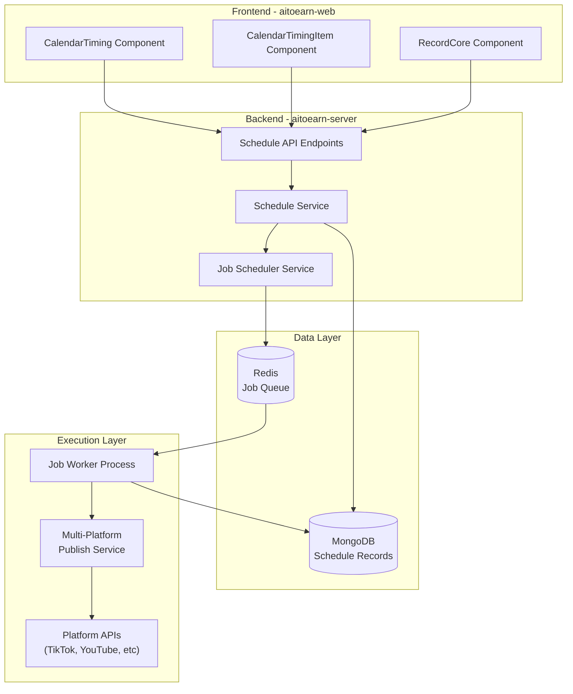
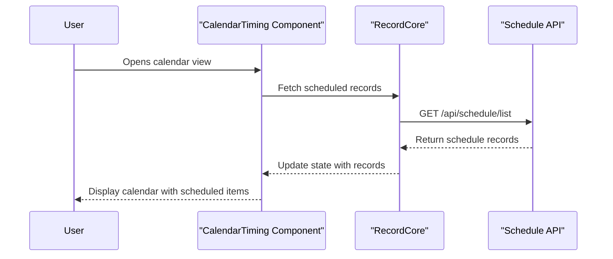
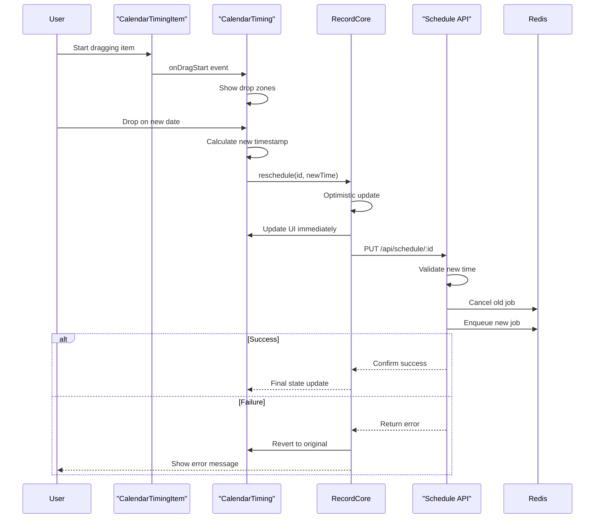
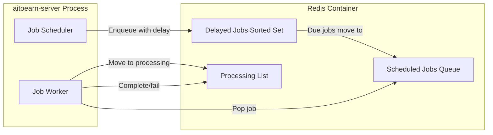
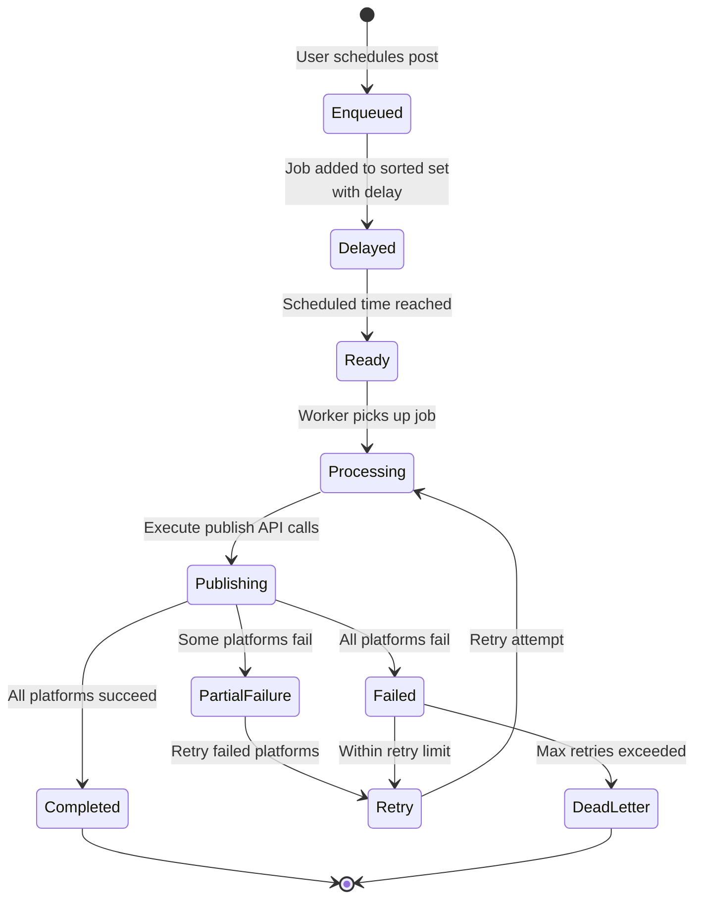
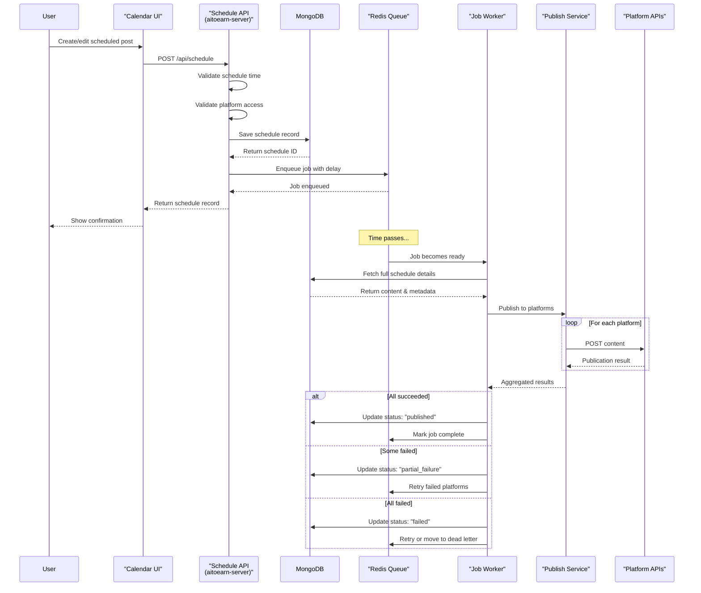
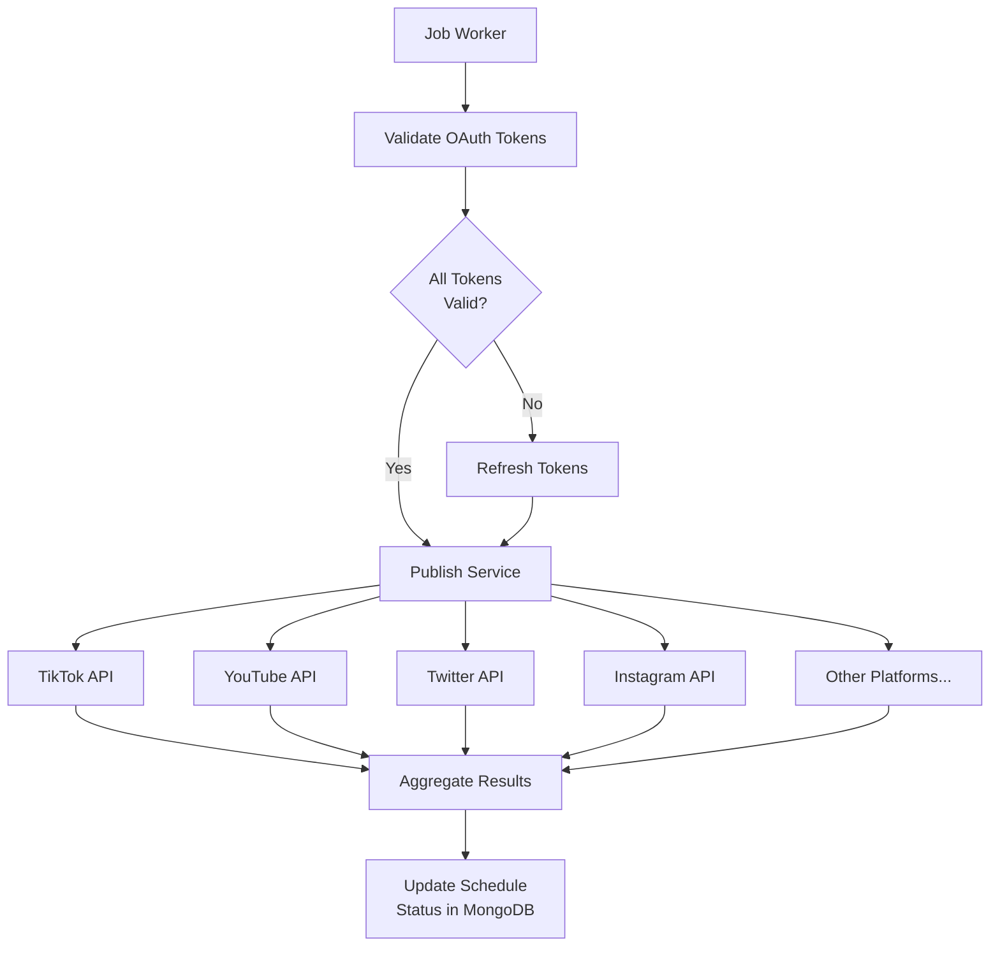

<!-- source: DeepWiki mcp.deepwiki.com · repo yikart/AiToEarn · page 5.2 Calendar Timing and Scheduling · fetched 2026-10-30 -->

# Calendar Timing and Scheduling

<details>
<summary>Relevant source files</summary>

The following files were used as context for generating this wiki page:

- [.gitignore](.gitignore)
- [DOCKER_DEPLOYMENT_CN.md](DOCKER_DEPLOYMENT_CN.md)
- [DOCKER_DEPLOYMENT_EN.md](DOCKER_DEPLOYMENT_EN.md)
- [README.md](README.md)
- [README_CN.md](README_CN.md)
- [docker-compose.yml](docker-compose.yml)
- [presentation/agent_0.png](presentation/agent_0.png)
- [presentation/display-1.5.2png.png](presentation/display-1.5.2png.png)
- [wechat.jpg](wechat.jpg)

</details>


## Purpose and Scope

This document describes the calendar-based content scheduling system in AiToEarn, which allows users to plan and coordinate multi-platform content distribution across time. The system provides a visual calendar interface for scheduling posts, manages scheduled jobs using Redis queues, and automates the publishing process at specified times.

For information about the content creation process that precedes scheduling, see [Content Creation and AI Generation](#5.1). For details about the actual multi-platform publishing mechanics, see [Multi-Platform Publishing](#4.3). For analytics and tracking of published content, see [Analytics Dashboard](#6.2).

---

## System Overview

The Calendar Timing and Scheduling system enables users to:

- **Visualize planned content** on a calendar interface across multiple platforms
- **Schedule posts** for future publication at specific dates and times
- **Drag and drop** scheduled items to reschedule them visually
- **Manage recurring** or one-time publication schedules
- **Queue jobs** in Redis for reliable execution
- **Automatically publish** content to connected platforms at the scheduled time

The system integrates three key architectural layers:

1. **Frontend UI Layer**: React-based calendar components for visual scheduling
2. **Backend API Layer**: NestJS services in `aitoearn-server` that manage schedule records
3. **Job Queue Layer**: Redis-backed job processing that executes scheduled publications

Sources: [README.md:85-86](), [README_CN.md:71](), [docker-compose.yml:23-39]()

---

## Architecture Components

### High-Level Architecture



**Sources**: [docker-compose.yml:23-39](), [docker-compose.yml:136-232](), System Architecture Overview

### Component Responsibilities

| Component | Service | Responsibility |
|-----------|---------|----------------|
| **CalendarTiming** | aitoearn-web | Main calendar view component, renders monthly/weekly calendar grid |
| **CalendarTimingItem** | aitoearn-web | Individual scheduled post item, displays on calendar, handles drag events |
| **RecordCore** | aitoearn-web | Core data management for schedule records, handles CRUD operations |
| **Schedule API** | aitoearn-server | REST endpoints for creating, updating, deleting scheduled posts |
| **Schedule Service** | aitoearn-server | Business logic for managing schedule records in MongoDB |
| **Job Scheduler** | aitoearn-server | Enqueues jobs to Redis with appropriate delay/timing |
| **Job Worker** | aitoearn-server | Processes jobs from Redis queue, triggers publication |
| **Publish Service** | aitoearn-server | Handles actual API calls to social media platforms |

**Sources**: Table of Contents (Page 5.2 description), [docker-compose.yml:234-270]()

---

## UI Components

### CalendarTiming Component

The `CalendarTiming` component is the primary user interface for viewing and managing scheduled content. It provides:

- **Calendar Grid Rendering**: Monthly or weekly view of scheduled posts
- **Date Navigation**: Controls to move between months/weeks
- **Visual Post Indicators**: Shows scheduled items on their respective dates
- **Drag-and-Drop Support**: Enables rescheduling by dragging items between dates
- **Multi-Platform Display**: Color-codes or icons to indicate target platforms

**Typical User Workflow**:



**Sources**: Table of Contents (Page 5.2 description)

### CalendarTimingItem Component

`CalendarTimingItem` represents an individual scheduled post within the calendar. Key features:

- **Post Summary Display**: Shows title, platforms, thumbnail
- **Status Indicators**: Visual cues for draft, scheduled, published, failed states
- **Drag Source**: Implements drag-and-drop source interface
- **Click Actions**: Opens detail view or edit modal
- **Context Menu**: Quick actions (reschedule, cancel, duplicate)

**Component Props** (typical structure):

| Prop | Type | Description |
|------|------|-------------|
| `scheduleId` | string | Unique identifier for the scheduled post |
| `title` | string | Post title/caption |
| `platforms` | string[] | Target platforms (e.g., ["tiktok", "youtube"]) |
| `scheduledTime` | Date | When to publish |
| `status` | enum | "draft", "scheduled", "publishing", "published", "failed" |
| `thumbnailUrl` | string | Preview image |
| `onDragStart` | function | Drag event handler |
| `onDragEnd` | function | Drag completion handler |

**Sources**: Table of Contents (Page 5.2 description)

### RecordCore Component

`RecordCore` serves as the data management layer for the calendar UI components. It acts as a bridge between the UI and backend API:

- **State Management**: Maintains local state of all schedule records
- **API Integration**: Handles HTTP requests to schedule endpoints
- **Cache Management**: Optimizes performance by caching fetched records
- **Real-time Updates**: May use WebSocket or polling for live updates
- **Optimistic UI**: Updates UI immediately while confirming with backend

**Core Methods** (conceptual):

```typescript
// Conceptual interface - actual implementation may vary
interface RecordCore {
  fetchSchedules(dateRange: DateRange): Promise<ScheduleRecord[]>
  createSchedule(record: ScheduleInput): Promise<ScheduleRecord>
  updateSchedule(id: string, updates: Partial<ScheduleInput>): Promise<ScheduleRecord>
  deleteSchedule(id: string): Promise<void>
  reschedule(id: string, newTime: Date): Promise<ScheduleRecord>
}
```

**Sources**: Table of Contents (Page 5.2 description)

---

## Drag-and-Drop Functionality

### Interaction Flow

The drag-and-drop feature enables intuitive rescheduling by allowing users to drag `CalendarTimingItem` components to new dates:



### Implementation Considerations

1. **Drag Source**: `CalendarTimingItem` implements drag source interface (likely HTML5 Drag and Drop API or a library like `react-dnd`)
2. **Drop Targets**: Each date cell in `CalendarTiming` acts as a drop target
3. **Visual Feedback**: Shows preview/ghost image during drag, highlights valid drop zones
4. **Validation**: Backend validates new time is in the future and platform-appropriate
5. **Job Rescheduling**: Old Redis job is cancelled, new job is enqueued with updated delay

**Sources**: Table of Contents (Page 5.2 description)

---

## Redis Job Queue Integration

### Queue Architecture

AiToEarn uses Redis as a reliable job queue for scheduled publishing. Redis is configured in the deployment stack and accessible to `aitoearn-server`:

**Redis Configuration**:
- **Host**: `redis` (Docker network name) or `localhost:6379` (development)
- **Password**: Configured via `REDIS_PASSWORD` environment variable
- **Database**: Typically uses database 0 for main queue
- **Persistence**: Redis data persisted via Docker volume `redis-data`



**Sources**: [docker-compose.yml:23-39](), [docker-compose.yml:105-107](), [docker-compose.yml:165-169]()

### Job Structure

Each scheduled publication is represented as a job in Redis with the following structure (conceptual):

```typescript
// Conceptual job structure
interface ScheduleJob {
  id: string                    // Unique job ID
  type: "scheduled_publish"     // Job type
  scheduleId: string            // Reference to MongoDB schedule record
  userId: string                // User who created the schedule
  content: {
    title: string
    body: string
    mediaUrls: string[]
    platforms: string[]         // ["tiktok", "youtube", etc.]
  }
  scheduledTime: number         // Unix timestamp (milliseconds)
  retry: {
    attempts: number            // Retry count
    maxAttempts: number         // Max retry limit (e.g., 3)
    backoff: number             // Backoff delay in ms
  }
  createdAt: number
  status: "pending" | "processing" | "completed" | "failed"
}
```

### Job Lifecycle



**Sources**: [docker-compose.yml:23-39]()

### Job Enqueuing Process

When a user schedules a post, the following occurs:

1. **API Request**: Frontend calls `POST /api/schedule` with post content and scheduled time
2. **Validation**: Backend validates time is in future, platforms are connected
3. **Database Record**: Schedule record saved to MongoDB with status "scheduled"
4. **Delay Calculation**: Calculate delay in milliseconds: `scheduledTime - now()`
5. **Redis Enqueue**: Job added to Redis with calculated delay
6. **Response**: API returns schedule record to frontend

**Job Enqueue Example** (pseudocode):

```javascript
// In Schedule Service (aitoearn-server)
async createSchedule(userId, scheduleData) {
  // Save to MongoDB
  const schedule = await this.scheduleRepository.create({
    userId,
    ...scheduleData,
    status: 'scheduled'
  });
  
  // Calculate delay
  const delay = scheduleData.scheduledTime - Date.now();
  
  // Enqueue to Redis
  await this.jobScheduler.enqueue({
    type: 'scheduled_publish',
    scheduleId: schedule.id,
    userId,
    content: scheduleData.content,
    scheduledTime: scheduleData.scheduledTime
  }, { delay });
  
  return schedule;
}
```

**Sources**: [docker-compose.yml:136-232]()

---

## Scheduling Workflow

### Complete Scheduling Flow



**Sources**: [README.md:85-86](), [docker-compose.yml:136-232]()

### Schedule Management Operations

| Operation | Endpoint | Effect on Redis Queue |
|-----------|----------|----------------------|
| **Create Schedule** | POST /api/schedule | New job enqueued with delay |
| **Update Time** | PUT /api/schedule/:id | Old job cancelled, new job enqueued |
| **Update Content** | PATCH /api/schedule/:id | Job data updated in queue |
| **Cancel Schedule** | DELETE /api/schedule/:id | Job removed from queue |
| **Publish Now** | POST /api/schedule/:id/publish-now | Job moved to ready queue immediately |

**Sources**: Based on common REST patterns for scheduling systems

---

## Publishing Process

### Job Worker Processing

The Job Worker runs continuously in the `aitoearn-server` process, monitoring Redis for ready jobs:

1. **Job Polling**: Worker checks Redis queue for jobs at scheduled time
2. **Job Lock**: Acquires lock on job to prevent duplicate processing
3. **Data Retrieval**: Fetches full content and metadata from MongoDB
4. **Platform Publishing**: Calls Multi-Platform Publish Service
5. **Result Handling**: Updates MongoDB with results, manages retries
6. **Job Completion**: Removes job from queue or schedules retry

### Multi-Platform Publishing

When a scheduled job executes, the Publish Service handles platform-specific publishing:



**Publishing Steps**:

1. **OAuth Validation**: Verify tokens for all target platforms are valid
2. **Token Refresh**: Refresh expired tokens if needed (see [OAuth Authentication Flow](#4.1))
3. **Content Adaptation**: Format content for each platform's requirements
4. **API Calls**: Execute platform-specific API calls in parallel
5. **Error Handling**: Capture errors per platform
6. **Result Aggregation**: Compile success/failure status for each platform
7. **Database Update**: Save publication results to MongoDB

**Sources**: [README.md:79-85](), System Architecture Overview

### Retry Logic

Failed publications are automatically retried with exponential backoff:

| Attempt | Delay | Max Attempts |
|---------|-------|--------------|
| 1st retry | 5 minutes | - |
| 2nd retry | 15 minutes | - |
| 3rd retry | 1 hour | Final attempt |

After max retries, the job moves to a dead letter queue and the schedule status is marked as "failed". Users are notified via the UI.

**Sources**: Common job queue patterns

---

## Data Models

### Schedule Record (MongoDB)

```typescript
// Conceptual MongoDB schema
interface ScheduleRecord {
  _id: ObjectId
  userId: ObjectId              // Reference to User
  draftId?: ObjectId            // Optional reference to Draft
  
  title: string
  content: {
    text: string
    mediaUrls: string[]
    hashtags: string[]
  }
  
  platforms: Array<{
    platform: string            // "tiktok", "youtube", etc.
    accountId: ObjectId
    platformSpecificData: any   // Platform-specific fields
  }>
  
  scheduledTime: Date
  timezone: string              // User's timezone
  
  status: "draft" | "scheduled" | "publishing" | "published" | "partial_failure" | "failed"
  
  publishResults: Array<{
    platform: string
    status: "success" | "failed"
    publishedUrl?: string
    error?: string
    publishedAt?: Date
  }>
  
  redisJobId: string            // Reference to Redis job
  
  createdAt: Date
  updatedAt: Date
  publishedAt?: Date
}
```

**Sources**: Inferred from system architecture and common content management patterns

### Configuration Options

Users can configure scheduling behavior:

- **Timezone**: Schedule posts in user's local timezone
- **Retry Settings**: Enable/disable auto-retry, set max retry count
- **Notifications**: Email/in-app alerts for successful/failed publications
- **Platform Priority**: Order of platform publication attempts
- **Fallback Actions**: Behavior when platform is down (skip vs. retry)

**Sources**: Common scheduling system features

---

## Integration Points

The Calendar Timing and Scheduling system integrates with:

1. **Content Creation** ([#5.1](#5.1)): Scheduled content originates from drafts
2. **OAuth Authentication** ([#4.1](#4.1)): Requires valid platform tokens for publishing
3. **Multi-Platform Publishing** ([#4.3](#4.3)): Executes actual API calls to platforms
4. **Analytics Dashboard** ([#6.2](#6.2)): Tracks performance of scheduled vs. immediate posts
5. **Engagement Engine** ([#6.1](#6.1)): May trigger automated engagement after publication

**Sources**: Table of Contents, System Architecture Overview

---

## Deployment Considerations

### Redis Configuration

Redis must be properly configured for reliable job scheduling:

**Docker Compose Setup**:
```yaml
# From docker-compose.yml
redis:
  image: redis:latest
  container_name: aitoearn-redis
  command: redis-server --requirepass password
  ports:
    - "6379:6379"
  volumes:
    - redis-data:/data
```

**Key Settings**:
- **Persistence**: Enabled via volume mount to prevent job loss on restart
- **Password**: Set via `--requirepass` flag and `REDIS_PASSWORD` env var
- **Memory Policy**: Should configure `maxmemory-policy` for production
- **Eviction**: Use `noeviction` or `allkeys-lru` depending on requirements

**Sources**: [docker-compose.yml:23-39]()

### Health Checks and Monitoring

The system should monitor:

1. **Redis Availability**: Health check endpoint to verify Redis connection
2. **Job Queue Length**: Alert if queue grows unusually large
3. **Job Processing Rate**: Track jobs processed per minute
4. **Failed Job Count**: Monitor dead letter queue size
5. **Worker Status**: Ensure job workers are running and processing
6. **MongoDB Connection**: Verify schedule record persistence

**Health Check Example**:
```typescript
// Conceptual health check endpoint
GET /api/schedule/health
Response: {
  redis: { status: "connected", queueLength: 42 },
  mongodb: { status: "connected" },
  worker: { status: "running", lastProcessed: "2024-01-15T10:30:00Z" }
}
```

**Sources**: [docker-compose.yml:34-39](), [docker-compose.yml:227-232]()

---

## Performance Optimization

### Caching Strategy

To minimize database load, the system caches:

- **User Schedule Lists**: Cache user's upcoming schedules for 5-10 minutes
- **Platform Tokens**: Cache OAuth tokens in Redis with TTL matching expiry
- **Job Metadata**: Store lightweight job data in Redis to avoid MongoDB lookups

### Scalability Considerations

For high-volume deployments:

1. **Horizontal Scaling**: Run multiple job worker instances
2. **Job Distribution**: Use Redis' built-in job distribution across workers
3. **Database Sharding**: Shard schedule records by userId if needed
4. **Queue Partitioning**: Separate queues for different priorities or platforms
5. **Rate Limiting**: Respect platform API rate limits in Publish Service

**Sources**: Common scaling patterns for job queue systems

---

**Document Sources**: [README.md:85-86](), [README_CN.md:71](), [docker-compose.yml:23-39](), [docker-compose.yml:136-232](), [docker-compose.yml:234-270](), Table of Contents (Page 5.2), System Architecture Overview

---

