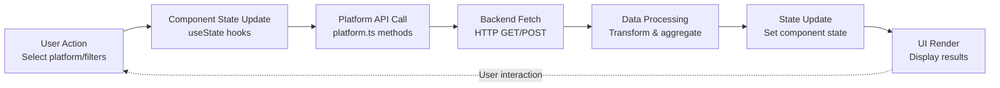
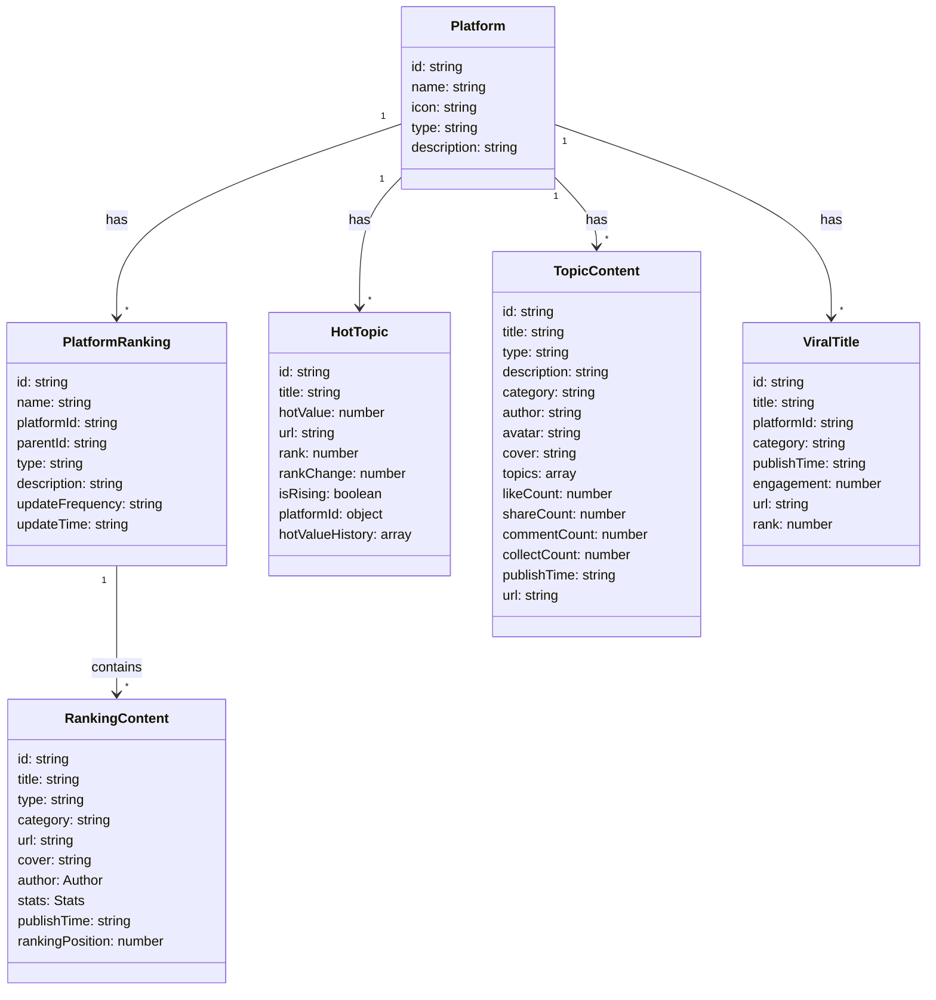
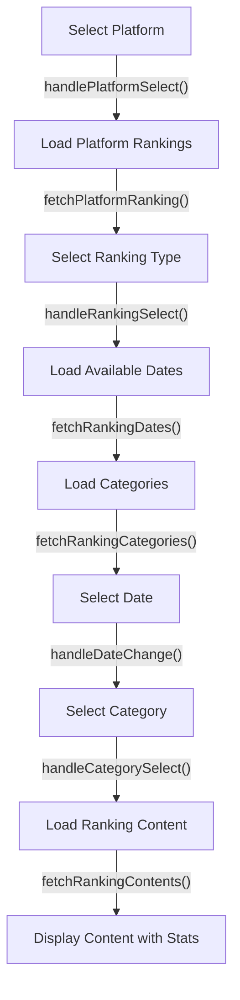
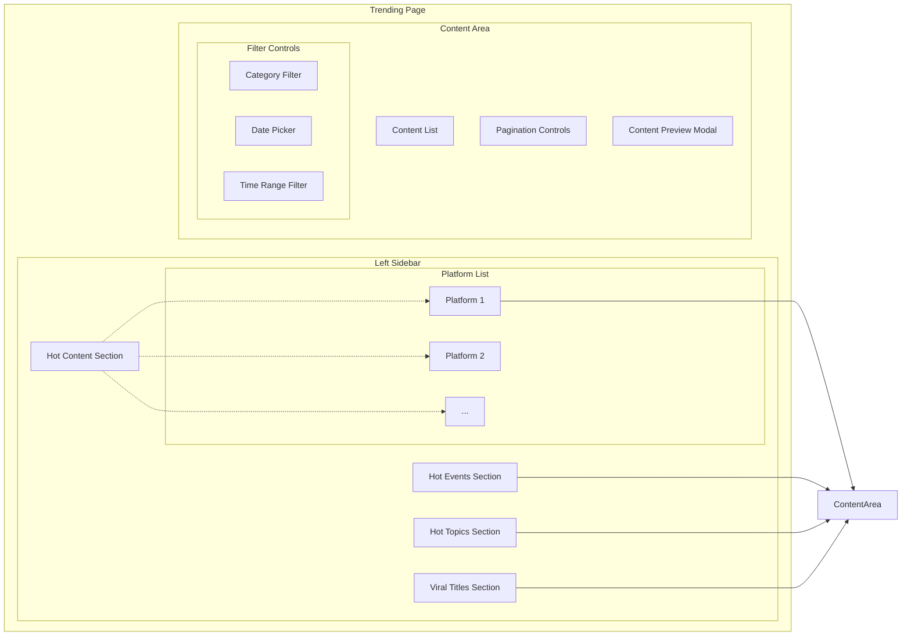

<!-- source: DeepWiki mcp.deepwiki.com · repo yikart/AiToEarn · page 5.3 Hotspot Analysis and Trending Content · fetched 2026-10-30 -->

# Hotspot Analysis and Trending Content

Relevant source files

The following files were used as context for generating this wiki page:

- [DOCKER_DEPLOYMENT_CN.md](DOCKER_DEPLOYMENT_CN.md)
- [DOCKER_DEPLOYMENT_EN.md](DOCKER_DEPLOYMENT_EN.md)
- [README.md](README.md)
- [README_CN.md](README_CN.md)
- [docker-compose.yml](docker-compose.yml)
- [presentation/agent_0.png](presentation/agent_0.png)
- [presentation/display-1.5.2png.png](presentation/display-1.5.2png.png)
- [wechat.jpg](wechat.jpg)

## Purpose and Scope

The Hotspot Analysis and Trending Content system provides both content discovery and optimization capabilities across major social media platforms. This system serves two primary functions:

1. **Hotspot Analysis**: Detects trending topics, emerging themes, and viral patterns across platforms to identify content opportunities and optimize engagement strategies.

2. **Trending Content Discovery**: Monitors trending rankings, hot topics, viral titles, and popular content from platforms including Douyin (Chinese TikTok), Xiaohongshu (RED), WeChat Video Account, Kuaishou, and international platforms.

The system helps content creators:
- Identify trending topics and viral patterns before they peak
- Analyze successful content strategies from high-performing posts
- Optimize content titles, topics, and themes for better engagement
- Track cross-platform trends to maximize multi-channel distribution
- Reduce creator anxiety by providing data-driven content inspiration

The trending content feature is primarily implemented in [src/views/trending/index.tsx]() with backend API support from [src/api/platform.ts]().

Sources: [README.md:90-100](). [src/views/trending/index.tsx:1-2547](). [src/api/platform.ts:1-358]()

## System Architecture

### Component Architecture

The hotspot analysis and trending content feature is implemented as a React component (`src/views/trending/index.tsx`) that interfaces with the Platform API module (`src/api/platform.ts`) to fetch trending data from backend services.

**High-Level Component Flow**

```mermaid
graph TB
    TrendingIndex["trending/index.tsx<br/>Main Component"]
    
    subgraph "UI_Components[UI Layer]"
        Sidebar["Sidebar Navigation<br/>Section toggles<br/>Platform selection"]
        FilterControls["Filter Controls<br/>Category/Date/Type filters"]
        ContentDisplay["Content Display<br/>Grid/Table/List views"]
        PaginationComp["Pagination<br/>Page navigation"]
        PreviewModal["Content Preview Modal"]
    end
    
    subgraph "State_Management[State Management]"
        PlatformState["Platform States<br/>platforms, selectedPlatform"]
        RankingState["Ranking States<br/>rankingList, rankingContents"]
        FilterState["Filter States<br/>categories, dates, timeRange"]
        TopicState["Topic States<br/>topicContents, hotTopics"]
        ViralState["Viral Title States<br/>viralTitleData"]
    end
    
    subgraph "API_Layer[API Layer - platform.ts]"
        GetPlatformList["getPlatformList()"]
        GetPlatformRanking["getPlatformRanking()"]
        GetRankingContents["getRankingContents()"]
        GetAllHotTopics["getAllHotTopics()"]
        GetAllTopics["getAllTopics()"]
        FindViralTitles["findTopByPlatformAndCategories()"]
    end
    
    subgraph "Backend_Services[Backend Services]"
        RankingAPI["/ranking API<br/>Platform rankings<br/>Content lists"]
        HotTopicsAPI["/hot-topics API<br/>Trending topics<br/>Heat metrics"]
        TopicsAPI["/topics API<br/>Topic content<br/>Engagement data"]
        ViralTitlesAPI["/viral-titles API<br/>Top titles<br/>Category analytics"]
    end
    
    TrendingIndex --> Sidebar
    TrendingIndex --> FilterControls
    TrendingIndex --> ContentDisplay
    TrendingIndex --> PaginationComp
    TrendingIndex --> PreviewModal
    
    TrendingIndex --> PlatformState
    TrendingIndex --> RankingState
    TrendingIndex --> FilterState
    TrendingIndex --> TopicState
    TrendingIndex --> ViralState
    
    TrendingIndex -->|"API calls"| GetPlatformList
    TrendingIndex -->|"API calls"| GetPlatformRanking
    TrendingIndex -->|"API calls"| GetRankingContents
    TrendingIndex -->|"API calls"| GetAllHotTopics
    TrendingIndex -->|"API calls"| GetAllTopics
    TrendingIndex -->|"API calls"| FindViralTitles
    
    GetPlatformList --> RankingAPI
    GetPlatformRanking --> RankingAPI
    GetRankingContents --> RankingAPI
    GetAllHotTopics --> HotTopicsAPI
    GetAllTopics --> TopicsAPI
    FindViralTitles --> ViralTitlesAPI
```

Sources: [src/views/trending/index.tsx:1-2547](). [src/api/platform.ts:127-358]()

### Data Flow for Hotspot Analysis

The hotspot analysis workflow follows a typical pattern: user selects filters → component fetches data → API calls backend → data is processed and displayed with analytics.

**Hotspot Analysis Data Flow**

Sources: [src/views/trending/index.tsx:337-863](). [src/api/platform.ts:127-358]()

## Data Models

The Trending Content system works with several key data models:

Sources: [src/views/trending/index.tsx:31-135](). [src/api/platform.ts:11-126]()

## Content Discovery Sections

The Trending Content feature is organized into several major sections, each providing different views of trending content:

### 1. Hot Content (热门内容)

This section displays platform-specific rankings of popular content. Users can:

- Select from available platforms (Douyin, Xiaohongshu, etc.)
- Choose from different ranking types for each platform
- Filter content by category
- View historical rankings by date
- See detailed metrics (views, likes, comments, etc.)

Sources: [src/views/trending/index.tsx:347-394](). [src/views/trending/index.tsx:427-542](). [src/views/trending/index.tsx:543-594]().

### 2. Hot Events (热点事件)

This section displays trending topics and events across multiple platforms, showing:

- Real-time popularity metrics
- Heat trends (increasing or decreasing)
- Visual trend graphs
- Cross-platform comparison

The system fetches hot topics data from all platforms and displays them in a grid layout, allowing users to compare trending topics across different platforms simultaneously.

Sources: [src/views/trending/index.tsx:997-1015](). [src/views/trending/index.tsx:1972-2162]().

### 3. Hot Topics (热门专题)

This section displays popular content organized by topic categories, allowing users to:

- Filter by content type (videos, articles, etc.)
- Filter by platform
- Filter by time range
- View detailed engagement metrics

The content is displayed in a table format with comprehensive metrics including likes, shares, comments, and collection counts.

Sources: [src/views/trending/index.tsx:794-863](). [src/views/trending/index.tsx:2163-2458]().

### 4. Viral Titles (爆款标题)

This section focuses specifically on trending content titles, organized by category:

- Filter by platform
- Filter by time range (7 days, 30 days, 90 days)
- Browse by content category
- View engagement metrics for each title

The system presents viral titles in a categorized view, with the option to see more titles within each category.

Sources: [src/views/trending/index.tsx:637-722](). [src/views/trending/index.tsx:1731-1971]().

## User Interface Components

The Trending Content UI is divided into two main sections:

Sources: [src/views/trending/index.tsx:1504-1548](). [src/views/trending/index.tsx:1730-2547]().

### Left Sidebar

The left sidebar serves as the primary navigation for the different trending content sections. It includes:

1. Hot Content section with platform list
2. Hot Events section
3. Hot Topics section
4. Viral Titles section

Each section can be expanded or collapsed, and selecting a section or platform loads the corresponding content in the main content area.

Sources: [src/views/trending/index.tsx:1508-1727]().

### Content Area

The content area is dynamically updated based on the selected sidebar section. It includes:

1. Filter controls specific to the selected content type
2. Content list with detailed metrics
3. Pagination controls
4. Content preview modal for viewing selected items

The layout and components displayed in the content area vary depending on the selected content type, providing a contextual interface for each section.

Sources: [src/views/trending/index.tsx:1730-2547]().

## Data Fetching and State Management

The Trending Content system uses React hooks for state management, with separate states for each content type and selection. The component makes API calls to fetch data based on user selections.

### Key State Groups

| State Group | Purpose | Key State Variables |
|-------------|---------|---------------------|
| Platform States | Manage platform selection | `platforms`, `selectedPlatform` |
| Ranking States | Manage ranking selection and data | `rankingList`, `selectedRanking`, `rankingContents` |
| Filter States | Manage content filters | `categories`, `selectedCategory`, `selectedDate` |
| Pagination States | Manage content pagination | `pagination`, `currentPage` |
| Section States | Track expanded/collapsed sections | `contentExpanded`, `hotEventExpanded`, `topicExpanded`, `viralTitleExpanded` |
| Topic States | Manage topic data and filters | `topicContents`, `selectedMsgType`, `selectedTimeRange` |
| Viral Title States | Manage viral title data and filters | `viralTitleData`, `selectedViralPlatform`, `selectedViralCategory` |

Sources: [src/views/trending/index.tsx:210-336]().

### API Integration

The Trending Component interfaces with the Platform API to fetch trending data. Key API methods include:

| API Method | Purpose | Endpoint |
|------------|---------|----------|
| `getPlatformList` | Get available platforms | `/hotinfo/platform` |
| `getPlatformRanking` | Get platform rankings | `/ranking/platform` |
| `getRankingContents` | Get ranking content items | `/ranking/{rankingId}/contents` |
| `getRankingLabel` | Get ranking categories | `/ranking/label/{rankingId}` |
| `getRankingDates` | Get available dates for rankings | `/ranking/hotinfo/{rankingId}/dates` |
| `getAllHotTopics` | Get hot topics across platforms | `/hot-topics/all` |
| `getAllTopics` | Get topic content with filters | `/topics` |
| `findPlatformsWithData` | Get platforms with viral title data | `/viral-titles/platforms` |
| `findTopByPlatformAndCategories` | Get top viral titles by category | `/viral-titles/platforms/{platformId}/top-by-categories` |

Sources: [src/api/platform.ts:127-302]().

## Error Handling and Edge Cases

The Trending Content system implements several error handling strategies:

1. **Loading States**: Each content type has its own loading state (e.g., `rankingLoading`, `topicLoading`) to show loading indicators during API calls.

2. **Error Recovery**: API calls are wrapped in try-catch blocks to handle errors and provide fallback states.

3. **Empty State Handling**: When no data is available, appropriate "no data" messages are displayed.

4. **Image Error Handling**: The system handles image loading errors by providing fallback displays.

Sources: [src/views/trending/index.tsx:339-346](). [src/views/trending/index.tsx:346-369]().

## Usage Examples

The Trending Content system helps users in several key scenarios:

1. **Content Research**: Identify trending content in specific niches to understand what resonates with audiences.

2. **Competitor Analysis**: Monitor hot content from competitors to benchmark performance.

3. **Title Optimization**: Review viral titles to improve content naming strategies.

4. **Topic Discovery**: Identify emerging trends and topics for timely content creation.

5. **Cross-Platform Insights**: Compare trending content across different platforms to optimize multi-platform strategies.

---

