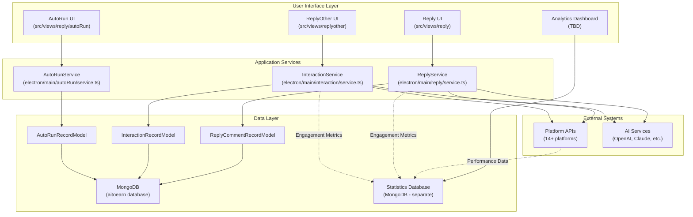
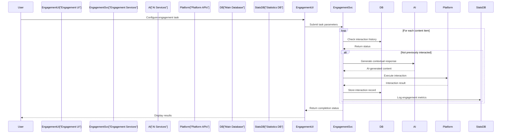
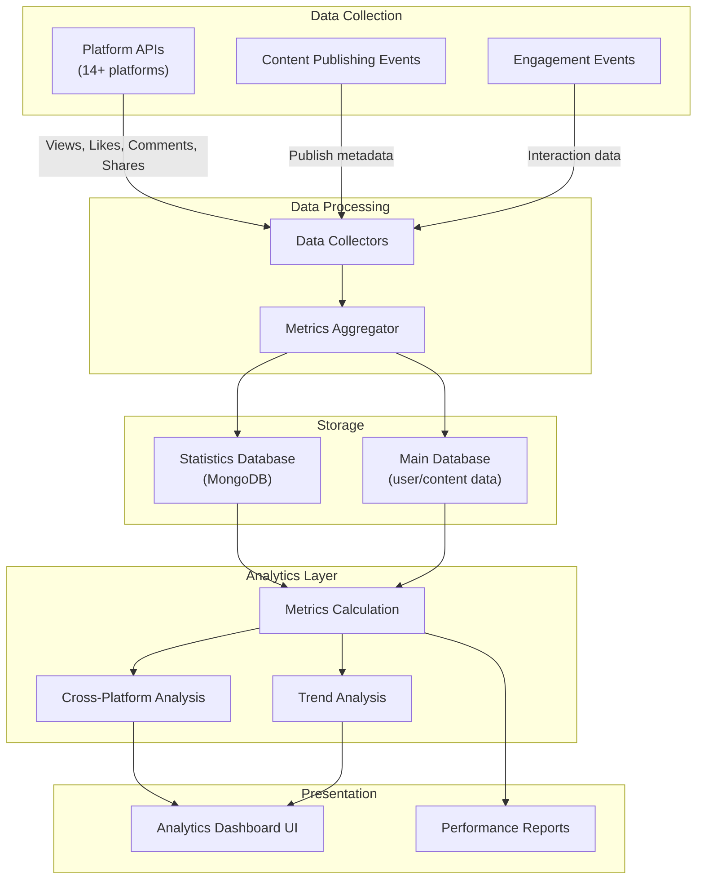

<!-- source: DeepWiki mcp.deepwiki.com · repo yikart/AiToEarn · page 6 Engagement and Analytics · fetched 2026-10-30 -->

# Engagement and Analytics

<details>
<summary>Relevant source files</summary>

The following files were used as context for generating this wiki page:

- [DOCKER_DEPLOYMENT_CN.md](DOCKER_DEPLOYMENT_CN.md)
- [DOCKER_DEPLOYMENT_EN.md](DOCKER_DEPLOYMENT_EN.md)
- [README.md](README.md)
- [README_CN.md](README_CN.md)
- [docker-compose.yml](docker-compose.yml)
- [presentation/agent_0.png](presentation/agent_0.png)
- [presentation/display-1.5.2png.png](presentation/display-1.5.2png.png)
- [wechat.jpg](wechat.jpg)

</details>


## Overview

The Engagement and Analytics subsystem provides comprehensive tools for managing social media interactions and tracking content performance across multiple platforms. This system consists of two main components:

1. **Engagement Engine**: Automates interactions with content (comments, likes, collections) using AI-generated responses
2. **Analytics Dashboard**: Tracks performance metrics and provides insights across all connected platforms

Together, these capabilities enable users to maintain active social media presence while gaining data-driven insights into content effectiveness. The engagement system helps build audience relationships through automated interactions, while the analytics system measures the impact of published content and engagement activities.

For detailed information on each component:
- See [Engagement Engine](#6.1) for automation features
- See [Analytics Dashboard](#6.2) for performance tracking

Sources: [README.md:124-140](), [docker-compose.yml:162-165]()
</thinking>

## Engagement and Analytics System Architecture



The system architecture separates engagement operations from analytics data collection. Engagement services handle automated interactions and store their execution history in the main database, while performance metrics from platform APIs are collected into a dedicated statistics database for analysis.

Sources: [docker-compose.yml:162-171](), [electron/main/reply/controller.ts:23-386](), [electron/main/interaction/controller.ts:22-179]()

## Engagement System Components

The engagement system automates social media interactions across platforms to maintain audience relationships and grow social presence. It consists of three main subsystems:

### Core Subsystems

| Subsystem | Purpose | Key Components |
|-----------|---------|----------------|
| **Comment Reply System** | Automates responses to comments on user's own content | `ReplyService`, `ReplyController`, `ReplyCommentRecordModel` |
| **Interaction Service** | Manages automated interactions with others' content (likes, comments, collections) | `InteractionService`, `InteractionController`, `InteractionRecordModel` |
| **AutoRun System** | Schedules automated operations based on configurable time cycles | `AutoRunService`, `AutoRunController`, `AutoRunModel` |

### Engagement Workflow



The engagement workflow demonstrates how automated interactions are executed, tracked, and measured. Each interaction is recorded in the main database to prevent duplicates, while engagement metrics are sent to the statistics database for analytics.

For detailed information on engagement automation features, see [Engagement Engine](#6.1).

Sources: [electron/main/reply/service.ts:112-276](), [electron/main/interaction/service.ts:111-325](), [docker-compose.yml:162-171]()

## Analytics System Components

The analytics system collects, processes, and visualizes performance data from all connected social media platforms. It provides insights into content effectiveness, audience engagement, and cross-platform comparison.

### Analytics Architecture



### Statistics Database Configuration

The statistics database is configured separately from the main application database to handle high-volume analytics data independently. This separation allows for optimized query performance and data retention policies specific to analytics needs.

| Configuration Variable | Purpose | Default |
|----------------------|---------|---------|
| `STATISTICS_DB_HOST` | Statistics database hostname | `mongodb` |
| `STATISTICS_DB_PORT` | Database port | `27017` |
| `STATISTICS_DB_USERNAME` | Database username | `admin` |
| `STATISTICS_DB_PASSWORD` | Database password | `password` |

In production deployments, the statistics database can be hosted on a separate MongoDB instance with different performance characteristics and backup schedules than the main database.

Sources: [docker-compose.yml:162-171](), [DOCKER_DEPLOYMENT_EN.md:162-171](), [README.md:134-140]()

### Key Analytics Metrics

The analytics system tracks multiple performance indicators:

| Metric Category | Tracked Metrics | Purpose |
|----------------|-----------------|---------|
| **Content Performance** | Views, Likes, Comments, Shares, Completion Rate | Measure individual content effectiveness |
| **Engagement Metrics** | Reply Rate, Comment Sentiment, Interaction Speed | Understand audience engagement quality |
| **Cross-Platform Comparison** | Platform-specific performance, Best-performing channels | Optimize content distribution strategy |
| **Growth Metrics** | Follower Growth, Engagement Rate Trends | Track long-term account growth |
| **Monetization Tracking** | Revenue, Campaign Performance | Monitor monetization effectiveness |

### Analytics Features

The README highlights several key analytics capabilities:

1. **Cross-Platform Comparison**: Compare content performance across all connected platforms to identify which channels work best for specific content types
2. **Traffic Flow Analysis**: Track how platform-specific algorithms affect content visibility
3. **End-to-End Monitoring**: Full funnel tracking from content creation through publishing to audience engagement
4. **Path to Growth**: Data-driven insights for building audience to significant milestones (e.g., 1M+ followers)

For detailed information on the analytics dashboard implementation, see [Analytics Dashboard](#6.2).

Sources: [README.md:134-140](), [README_CN.md:124-128]()

## Data Models

The Automated Engagement System uses several database models to store configuration and track execution:

### AutoRunModel

Stores configuration for scheduled tasks:

```
- id: number                  // Primary key
- userId: string              // User ID
- accountId: number           // Platform account ID
- data: string                // JSON string with task data
- runCount: number            // Execution count
- status: AutoRunStatus       // DOING, PAUSE, DELETE
- type: AutoRunType           // Task type (ReplyComment)
- cycleType: string           // Schedule pattern
```

Sources: [electron/db/models/autoRun.ts:22-66]()

### AutoRunRecordModel

Tracks execution history of scheduled tasks:

```
- id: number                  // Primary key
- autoRunId: number           // Reference to AutoRunModel
- userId: string              // User ID
- status: AutoRunRecordStatus // DOING, FAIL, SUCCESS
- type: AutoRunType           // Task type
- cycleType: string           // Schedule pattern
- record: string              // Optional execution notes
```

Sources: [electron/db/models/autoRunRecord.ts:19-55]()

### ReplyCommentRecordModel and InteractionRecordModel

Store history of interactions to prevent duplicates and provide analytics:

```
- userId: string              // User ID
- accountId: number           // Platform account ID
- type: AccountType           // Platform type
- commentId/worksId: string   // Content identifier
- commentContent: string      // Original comment text
- replyContent: string        // Response text
```

Sources: [electron/main/reply/service.ts:50-67](), [electron/main/interaction/service.ts:43-66]()

## Security and Rate Limiting

To prevent platform detection of automation and potential account restrictions, the system implements several safety measures:

1. **Queue System**: Uses `PQueue` to limit concurrent operations
2. **Execution Delay**: Adds random delays between operations
3. **Interaction Tracking**: Prevents duplicate interactions
4. **Cache Mechanism**: Ensures only one process runs at a time
5. **Error Handling**: Gracefully manages platform API failures

Sources: [electron/main/reply/service.ts:29-34](), [electron/main/interaction/service.ts:29-34](), [electron/main/reply/service.ts:244]()

---

