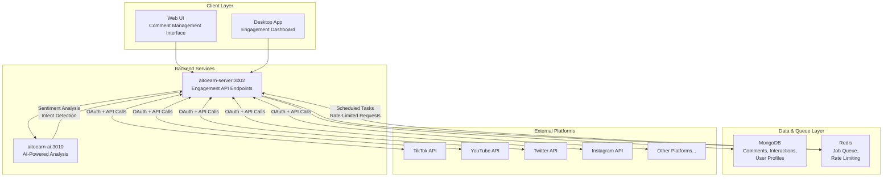
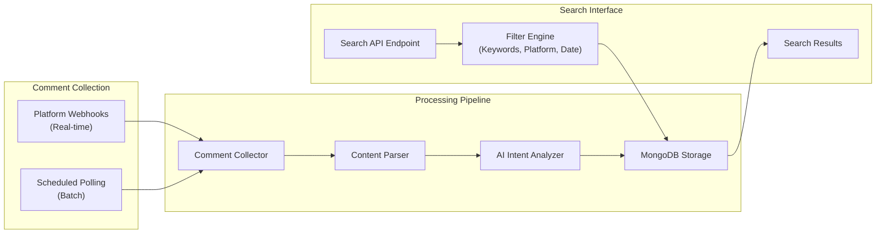
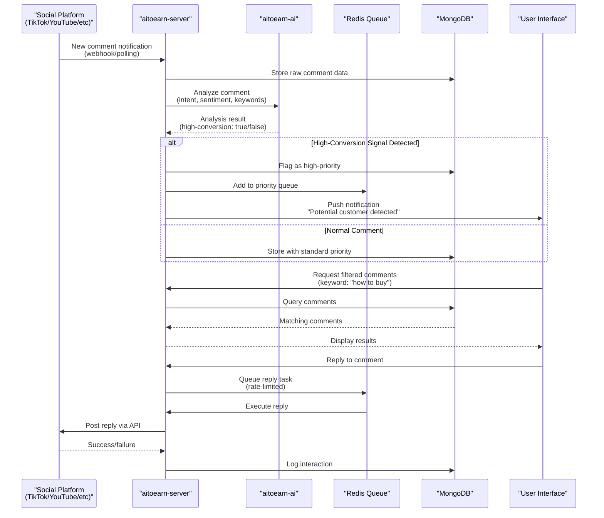
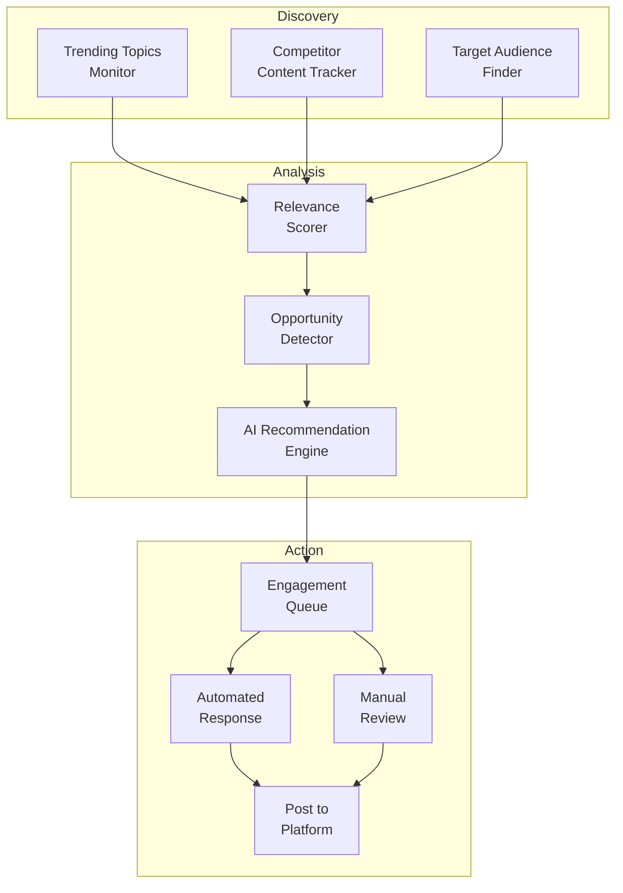
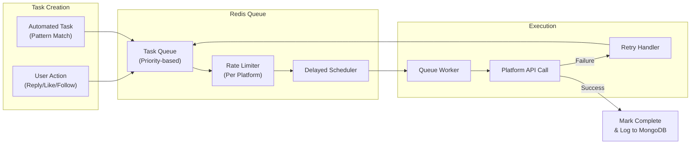

<!-- source: DeepWiki mcp.deepwiki.com · repo yikart/AiToEarn · page 6.1 Engagement Engine · fetched 2026-10-30 -->

# Engagement Engine

<details>
<summary>Relevant source files</summary>

The following files were used as context for generating this wiki page:

- [DOCKER_DEPLOYMENT_CN.md](DOCKER_DEPLOYMENT_CN.md)
- [DOCKER_DEPLOYMENT_EN.md](DOCKER_DEPLOYMENT_EN.md)
- [README.md](README.md)
- [README_CN.md](README_CN.md)
- [docker-compose.yml](docker-compose.yml)
- [presentation/agent_0.png](presentation/agent_0.png)
- [presentation/display-1.5.2png.png](presentation/display-1.5.2png.png)
- [wechat.jpg](wechat.jpg)

</details>


The Engagement Engine is AiToEarn's automated system for managing comments, interactions, and community building across multiple social media platforms. It enables users to proactively engage with trending conversations, detect high-conversion opportunities through smart comment search, and manage all interactions from a unified interface, turning passive content operations into active traffic growth.

For content creation and publishing workflows, see [Content Creation and AI Generation](#5.1). For analytics and performance tracking, see [Analytics Dashboard](#6.2). For platform OAuth integration details, see [OAuth Authentication Flow](#4.1).

---

## Overview

The Engagement Engine provides automated and semi-automated tools for:

- **Unified Interaction Management**: Single interface to manage comments, replies, and messages across all connected platforms
- **Smart Comment Search**: Detection of high-conversion signals (e.g., "link please", "how to buy") in comments across platforms
- **Proactive Engagement**: Automated joining of trending conversations and targeted community building
- **Comment Filtering**: Advanced filtering to identify potential customers and engagement opportunities
- **Auto-Reply Capabilities**: Configurable automated responses to common queries and engagement patterns

The system transforms content operations from reactive (responding to notifications) to proactive (actively finding and engaging with target audiences).

Sources: [README.md:14-145]()

---

## Architecture Overview

### Position in System Architecture



**Engagement Engine Position in System Architecture**

The Engagement Engine operates as a set of modules within the `aitoearn-server` service, coordinating with the AI service for intelligent analysis and external platform APIs for interaction execution.

Sources: [README.md:66-145](), High-level system diagrams provided in context

---

## Core Components

### Comment Collection and Search

The system continuously collects comments, mentions, and interactions from connected platforms through their APIs. The **Comment Search** feature enables users to:

- Search for specific keywords or phrases across all platforms
- Filter by platform, date range, engagement metrics, and sentiment
- Detect high-conversion signals like "link please", "how to buy", "DM me"
- Monitor brand mentions and product inquiries in real-time



**Comment Collection and Search Pipeline**

Sources: [README.md:115-122]()

---

### Interaction Management

The unified interaction dashboard consolidates all engagement activities:

| Component | Function | Data Source |
|-----------|----------|-------------|
| **Comment Inbox** | Centralized view of all comments requiring response | MongoDB comments collection |
| **Reply Queue** | Prioritized list of pending replies | Redis job queue |
| **Engagement History** | Historical record of all interactions | MongoDB interactions collection |
| **User Profiles** | Aggregated user interaction data across platforms | MongoDB users collection |
| **Analytics View** | Engagement metrics and conversion tracking | Statistics database |

Sources: [README.md:124-132](), [docker-compose.yml:136-232]()

---

## Comment Detection and Analysis Workflow



**Comment Detection, Analysis, and Response Flow**

The workflow demonstrates how comments are captured, analyzed by AI for intent and conversion potential, stored with appropriate priority, and surfaced to users for engagement.

Sources: [README.md:115-132](), [docker-compose.yml:100-134]()

---

## Automated Engagement Features

### Auto-Reply System

The auto-reply system enables semi-automated responses to common queries:

1. **Pattern Matching**: Configurable rules match comment patterns to response templates
2. **AI-Generated Responses**: Dynamic reply generation based on comment context
3. **Approval Workflow**: Optional human approval before posting
4. **Rate Limiting**: Redis-based rate limiting prevents platform spam detection

Configuration is managed through the `aitoearn-server` service environment and stored in MongoDB.

### Proactive Engagement

The system can proactively find and engage with content:

- **Trending Topic Monitoring**: Tracks trending hashtags and topics relevant to user's niche
- **Competitor Monitoring**: Identifies conversations happening on competitor content
- **Target Audience Identification**: Finds users matching demographic/interest profiles
- **Engagement Suggestions**: AI recommends specific posts/comments for engagement



**Proactive Engagement Discovery and Execution Pipeline**

Sources: [README.md:124-132]()

---

## Platform Integration

### Multi-Platform Comment APIs

The Engagement Engine integrates with comment/interaction APIs across 14+ platforms:

| Platform | API Features Used | OAuth Config |
|----------|-------------------|--------------|
| **TikTok** | Comments API, Mentions, DMs | `TIKTOK_CLIENT_ID/SECRET` |
| **YouTube** | Comments API, Community Posts | `YOUTUBE_CLIENT_ID/SECRET` |
| **Twitter/X** | Mentions, Replies, DMs | `TWITTER_CLIENT_ID/SECRET` |
| **Instagram** | Comments, DMs, Mentions | `INSTAGRAM_CLIENT_ID/SECRET` |
| **Facebook** | Comments, Post Interactions | `FACEBOOK_CLIENT_ID/SECRET` |
| **LinkedIn** | Comments, Messages | `LINKEDIN_CLIENT_ID/SECRET` |
| **Threads** | Replies, Mentions | `THREADS_CLIENT_ID/SECRET` |
| **Douyin** | Comments, Private Messages | `DOYIN_CLIENT_ID/SECRET` |
| **Bilibili** | Comments, Danmaku, DMs | `BILIBILI_CLIENT_ID/SECRET` |
| **Kuaishou** | Comments, Interactions | `KWAI_CLIENT_ID/SECRET` |

Each platform integration requires OAuth authentication (see [OAuth Authentication Flow](#4.1)) and handles platform-specific API limitations through Redis-based rate limiting.

Sources: [docker-compose.yml:184-212](), [DOCKER_DEPLOYMENT_EN.md:250-269]()

---

## Data Storage

### MongoDB Collections

The Engagement Engine uses several MongoDB collections:

| Collection | Purpose | Key Fields |
|------------|---------|------------|
| `comments` | Stores all collected comments | `platformId`, `postId`, `userId`, `text`, `timestamp`, `priority`, `aiAnalysis` |
| `interactions` | Records all engagement actions | `type`, `platformId`, `targetUserId`, `content`, `timestamp`, `status` |
| `engagement_rules` | Auto-reply rules and patterns | `pattern`, `responseTemplate`, `platforms`, `enabled` |
| `user_profiles` | Cross-platform user data | `platformAccounts`, `engagementHistory`, `conversionScore` |
| `engagement_queue` | Pending engagement tasks | `task`, `priority`, `scheduledTime`, `status` |

Database connection configuration is managed through environment variables in the `aitoearn-server` service:

- `MONGODB_HOST`: MongoDB hostname (default: `mongodb`)
- `MONGODB_PORT`: MongoDB port (default: `27017`)
- `MONGODB_USERNAME`: Database username
- `MONGODB_PASSWORD`: Database password

Sources: [docker-compose.yml:100-112](), [docker-compose.yml:157-165]()

---

## Job Queue and Rate Limiting

### Redis-Based Task Queue

All engagement actions (replies, likes, follows) are queued through Redis to ensure:

1. **Rate Limiting**: Prevents exceeding platform API limits
2. **Prioritization**: High-conversion opportunities processed first
3. **Retry Logic**: Failed operations are automatically retried
4. **Scheduled Execution**: Delay actions to appear more natural



**Redis Job Queue and Execution Flow**

Redis connection is configured via:
- `REDIS_HOST`: Redis hostname (default: `redis`)
- `REDIS_PORT`: Redis port (default: `6379`)
- `REDIS_PASSWORD`: Redis authentication password

Sources: [docker-compose.yml:105-107](), [docker-compose.yml:167-169]()

---

## AI-Powered Analysis

### Intent Detection and Sentiment Analysis

The `aitoearn-ai` service provides intelligent analysis of comments and interactions:

**AI Analysis Capabilities:**

1. **Intent Classification**: Identifies user intent (question, complaint, purchase inquiry, spam)
2. **Sentiment Analysis**: Determines emotional tone (positive, negative, neutral)
3. **Conversion Scoring**: Assigns likelihood score for conversion opportunity
4. **Entity Extraction**: Identifies mentioned products, competitors, or topics
5. **Response Suggestion**: Generates contextually appropriate reply suggestions

The AI service is accessed via internal API calls from `aitoearn-server` to `aitoearn-ai`:

- **Service URL**: `AI_URL=http://aitoearn-ai:3010` (configured in `aitoearn-server`)
- **Authentication**: Uses `INTERNAL_TOKEN` for service-to-service authentication
- **AI Models**: Leverages configured AI providers (OpenAI, Claude, Gemini, etc.)

Sources: [docker-compose.yml:81-134](), [DOCKER_DEPLOYMENT_EN.md:206-247]()

---

## Configuration

### Environment Variables

Key engagement-related configuration in `docker-compose.yml`:

| Variable | Service | Purpose | Default |
|----------|---------|---------|---------|
| `MONGODB_HOST` | aitoearn-server | Comment storage database | `mongodb` |
| `REDIS_HOST` | aitoearn-server | Task queue and rate limiter | `redis` |
| `AI_URL` | aitoearn-server | AI analysis service endpoint | `http://aitoearn-ai:3010` |
| `INTERNAL_TOKEN` | aitoearn-server, aitoearn-ai | Inter-service authentication | (must be set) |
| Platform OAuth credentials | aitoearn-server | API access for each platform | (see [OAuth Authentication Flow](#4.1)) |

### Rate Limiting Configuration

Platform-specific rate limits are typically configured in `config/aitoearn-server.config.js`:

```javascript
// Example rate limit structure (logical inference from architecture)
platformRateLimits: {
  tiktok: { requests: 100, window: 3600 },      // 100 requests per hour
  youtube: { requests: 10000, window: 86400 },  // 10k requests per day
  twitter: { requests: 300, window: 900 },      // 300 requests per 15 min
  // ... other platforms
}
```

Sources: [docker-compose.yml:136-227](), [DOCKER_DEPLOYMENT_EN.md:96-111]()

---

## Usage Workflow

### Typical User Flow

1. **Connect Platforms**: User authenticates platforms via OAuth (see [OAuth Authentication Flow](#4.1))
2. **Configure Rules**: Set up auto-reply patterns, keywords to monitor, and engagement targets
3. **Monitor Inbox**: View unified comment inbox with AI-powered priority flagging
4. **Search & Filter**: Use Comment Search to find specific opportunities (e.g., "looking to buy")
5. **Engage**: Reply directly or approve auto-generated responses
6. **Track Results**: View engagement analytics and conversion metrics (see [Analytics Dashboard](#6.2))

### API Endpoints (Logical Structure)

Based on the architecture, the Engagement Engine likely exposes endpoints such as:

- `GET /api/comments` - Retrieve comments with filtering
- `GET /api/comments/search` - Search comments by keyword
- `POST /api/comments/:id/reply` - Post a reply to a comment
- `GET /api/engagement/queue` - View pending engagement tasks
- `POST /api/engagement/rules` - Configure auto-reply rules
- `GET /api/engagement/analytics` - Retrieve engagement metrics

All endpoints are accessed through the Nginx reverse proxy at `http://localhost:8080/api/...`

Sources: [docker-compose.yml:248-270](), [README.md:115-132]()

---

## Integration with Other Systems

The Engagement Engine integrates with:

- **Content Publishing System** ([Multi-Platform Publishing](#4.3)): Links published content to engagement tracking
- **Hotspot Analysis** ([Hotspot Analysis and Trending Content](#5.3)): Uses trending data to guide proactive engagement
- **Analytics Dashboard** ([Analytics Dashboard](#6.2)): Feeds engagement data into performance analytics
- **All In Agent** ([All In Agent](#3.3)): AI agent can automate engagement based on learned patterns

Sources: [README.md:66-156](), High-level system diagrams

---

