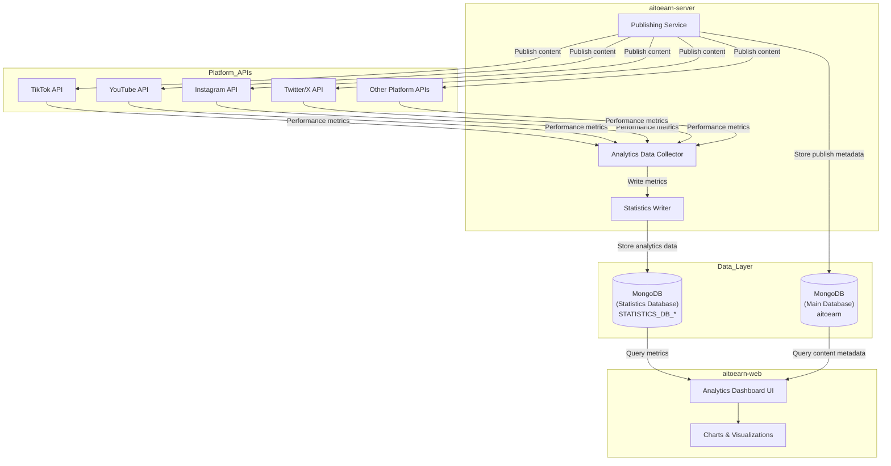
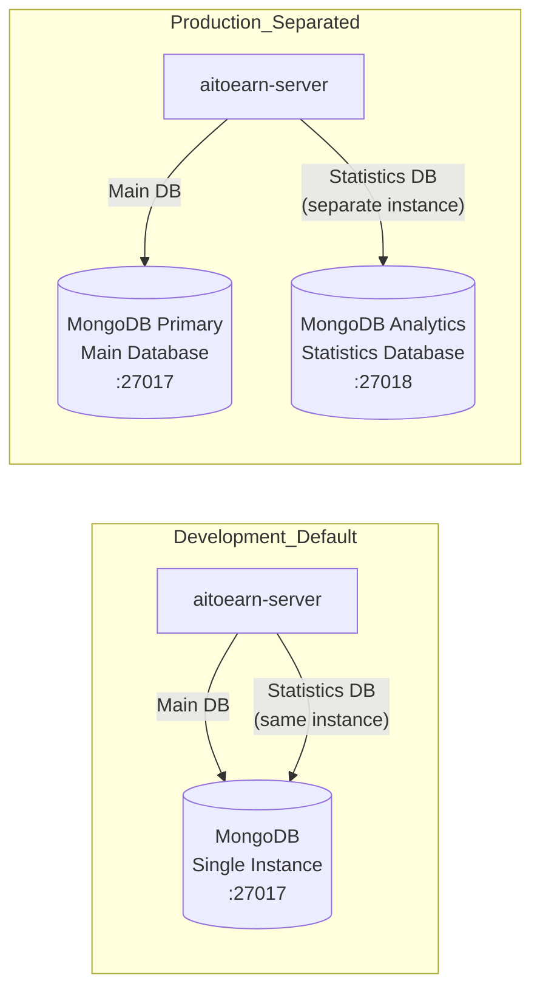
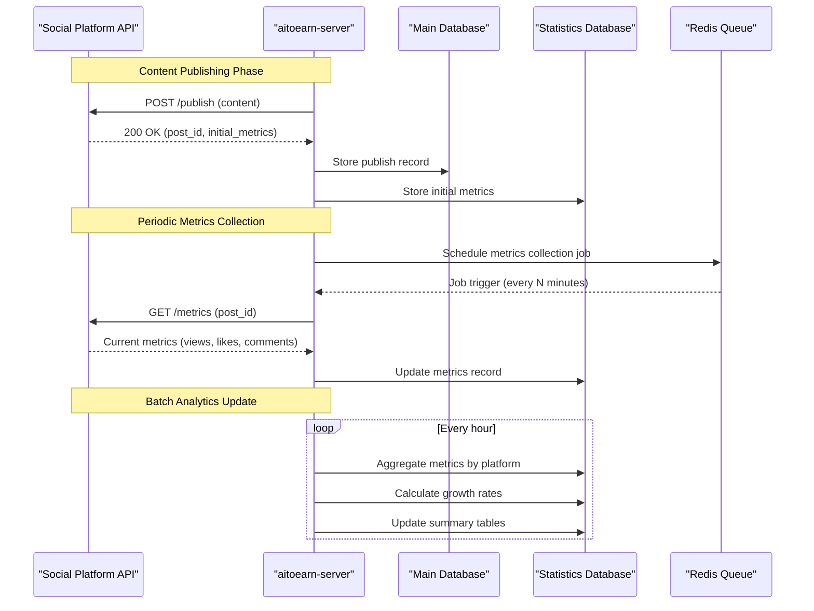
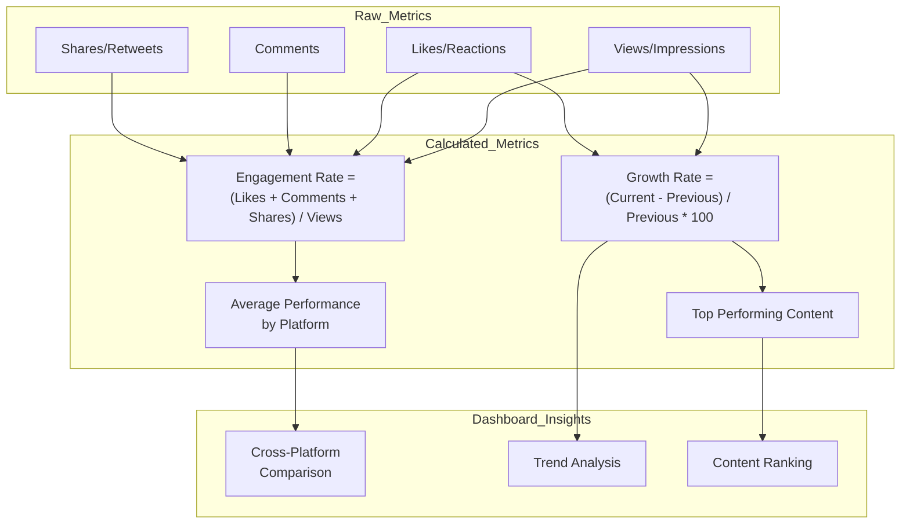
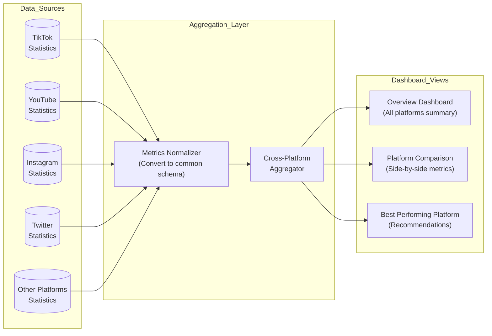
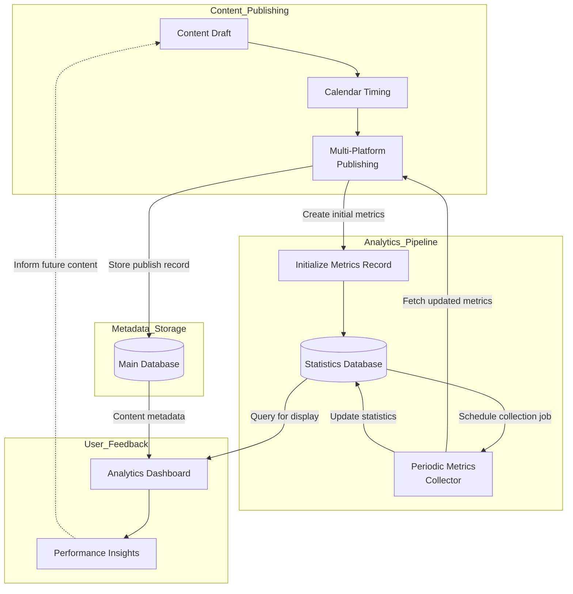

<!-- source: DeepWiki mcp.deepwiki.com · repo yikart/AiToEarn · page 6.2 Analytics Dashboard · fetched 2026-10-30 -->

# Analytics Dashboard

<details>
<summary>Relevant source files</summary>

The following files were used as context for generating this wiki page:

- [DOCKER_DEPLOYMENT_CN.md](DOCKER_DEPLOYMENT_CN.md)
- [DOCKER_DEPLOYMENT_EN.md](DOCKER_DEPLOYMENT_EN.md)
- [README.md](README.md)
- [README_CN.md](README_CN.md)
- [docker-compose.yml](docker-compose.yml)
- [presentation/agent_0.png](presentation/agent_0.png)
- [presentation/display-1.5.2png.png](presentation/display-1.5.2png.png)
- [wechat.jpg](wechat.jpg)

</details>


## Purpose and Scope

The Analytics Dashboard provides comprehensive performance tracking and insights for content distributed across multiple social media platforms. It collects, aggregates, and displays metrics to help users understand content performance, optimize publishing strategies, and monitor growth trajectories.

This page covers the analytics data collection infrastructure, statistics database configuration, and how performance metrics are tracked across platforms. For information about content engagement automation, see [Engagement Engine](#6.1). For details about content publishing workflows, see [Multi-Platform Publishing](#4.3).

---

## System Architecture

The analytics system uses a dedicated statistics database to store performance metrics collected from published content across all connected platforms. This separation allows for optimized query performance and independent scaling of analytics workloads.

### Analytics Data Flow



**Sources:** [docker-compose.yml:136-232](), [DOCKER_DEPLOYMENT_EN.md:162-171](), [README.md:134-139]()

---

## Statistics Database Configuration

The analytics system uses a separate database connection for statistics data, allowing independent configuration, scaling, and backup strategies optimized for time-series data and analytical queries.

### Database Connection Settings

The statistics database is configured via environment variables in the `aitoearn-server` service:

| Environment Variable | Purpose | Default Value |
|---------------------|---------|---------------|
| `STATISTICS_DB_HOST` | Statistics database host | `mongodb` |
| `STATISTICS_DB_PORT` | Statistics database port | `27017` |
| `STATISTICS_DB_USERNAME` | Database authentication username | `admin` |
| `STATISTICS_DB_PASSWORD` | Database authentication password | `password` |

**Sources:** [docker-compose.yml:162-171](), [DOCKER_DEPLOYMENT_EN.md:162-171]()

### Default vs. Production Configuration



By default, both the main database and statistics database point to the same MongoDB instance. For production deployments with high analytics query loads, these can be separated to:

- **Isolate workloads**: Analytics queries don't impact operational database performance
- **Optimize indexing**: Statistics database can use time-series indexes
- **Scale independently**: Analytics database can be scaled horizontally for read replicas
- **Separate backup policies**: Time-series data may have different retention requirements

**Sources:** [docker-compose.yml:136-171](), [DOCKER_DEPLOYMENT_EN.md:162-171](), [DOCKER_DEPLOYMENT_CN.md:162-171]()

---

## Data Collection Pipeline

### Metrics Collection Flow



**Sources:** [docker-compose.yml:23-39](), [README.md:79-89]()

### Collection Strategies

The analytics system employs multiple collection strategies based on platform capabilities and data freshness requirements:

1. **Real-time Collection**: Immediate metrics captured during publish operations
2. **Scheduled Polling**: Periodic API calls to fetch updated metrics (via Redis job queue)
3. **Webhook Events**: Platform-initiated updates for significant events (where supported)
4. **Batch Aggregation**: Hourly/daily rollups for dashboard performance

**Sources:** [docker-compose.yml:23-39](), [DOCKER_DEPLOYMENT_EN.md:280-281]()

---

## Performance Metrics Tracked

### Core Metrics by Platform

The analytics system tracks platform-specific metrics aligned with each platform's API capabilities:

| Platform | Metrics Tracked |
|----------|----------------|
| TikTok | Views, Likes, Comments, Shares, Play Time, Completion Rate |
| YouTube | Views, Likes, Comments, Shares, Watch Time, Subscribers Gained |
| Instagram | Likes, Comments, Saves, Reach, Impressions, Profile Visits |
| Twitter/X | Views, Likes, Retweets, Replies, Impressions, Engagement Rate |
| Facebook | Reactions, Comments, Shares, Reach, Video Views, Click-throughs |
| LinkedIn | Impressions, Clicks, Likes, Comments, Shares, Engagement Rate |
| Pinterest | Impressions, Saves, Pin Clicks, Outbound Clicks |
| Threads | Likes, Replies, Reposts, Quotes |

**Sources:** [README.md:18-21](), [docker-compose.yml:183-212]()

### Calculated Metrics



**Sources:** [README.md:134-139]()

---

## Cross-Platform Analytics

### Platform Comparison Views

The analytics dashboard provides cross-platform insights that help users understand which platforms are performing best for their content:



**Key Features:**

- **Normalized Metrics**: Different platform metrics are converted to comparable formats (e.g., "likes" vs "reactions" vs "favorites")
- **Performance Scores**: Weighted engagement scores allow fair comparison across platforms with different user bases
- **Traffic Distribution**: Identify which platforms are blocked or restricted and adjust content strategy
- **Growth Tracking**: Monitor follower/subscriber growth across all platforms from a single view

**Sources:** [README.md:134-139]()

---

## Database Schema Considerations

### Statistics Data Model

While the actual schema implementation is in the codebase, the statistics database typically stores:

**Time-Series Metrics Collections:**
- `platform_metrics`: Raw metrics collected from each platform API
- `content_performance`: Aggregated performance data per content piece
- `daily_summaries`: Daily rollups for historical trend analysis
- `platform_comparisons`: Pre-calculated cross-platform comparison data

**Indexing Strategy:**
- Compound indexes on `(user_id, platform, timestamp)` for user-specific queries
- Time-series indexes for efficient range queries on date ranges
- Platform-specific indexes for filtering by content type

**Data Retention:**
- Raw metrics: 90 days rolling window
- Daily summaries: 2 years
- Monthly aggregates: Permanent

**Sources:** [docker-compose.yml:162-171](), [DOCKER_DEPLOYMENT_EN.md:162-171]()

---

## Integration with Content Publishing

### Publish-to-Analytics Flow



This closed-loop system enables data-driven content creation:

1. **Publish Phase**: Content is distributed to platforms, initial metrics recorded
2. **Collection Phase**: Periodic updates gather performance data over time
3. **Analysis Phase**: Aggregated metrics reveal patterns and trends
4. **Optimization Phase**: Insights inform future content strategy

**Sources:** [docker-compose.yml:136-232](), [README.md:14-16](), [README.md:134-139]()

---

## Configuration Reference

### Environment Variables

All analytics-related configuration is set via environment variables in `docker-compose.yml`:

```yaml
# aitoearn-server service
STATISTICS_DB_HOST: mongodb
STATISTICS_DB_PORT: 27017
STATISTICS_DB_USERNAME: admin
STATISTICS_DB_PASSWORD: password
```

**Deployment Scenarios:**

| Scenario | Configuration | Purpose |
|----------|--------------|---------|
| **Development** | Point to same MongoDB | Simple setup, single database instance |
| **Staging** | Point to same MongoDB, separate DB name | Test with production-like data |
| **Production (Small)** | Same instance, separate credentials | Logical separation with credential isolation |
| **Production (Large)** | Separate MongoDB instance | Physical separation for performance and scaling |

**Sources:** [docker-compose.yml:162-171](), [DOCKER_DEPLOYMENT_EN.md:162-171]()

### Separating Statistics Database

To configure a separate MongoDB instance for statistics in production:

1. Deploy a dedicated MongoDB instance (e.g., on port 27018)
2. Update `docker-compose.yml`:
   ```yaml
   STATISTICS_DB_HOST: stats-mongodb.example.com
   STATISTICS_DB_PORT: 27018
   STATISTICS_DB_USERNAME: stats_admin
   STATISTICS_DB_PASSWORD: secure_stats_password
   ```
3. Ensure network connectivity between `aitoearn-server` and the statistics MongoDB
4. Configure appropriate indexes and retention policies on the statistics database

**Sources:** [DOCKER_DEPLOYMENT_EN.md:162-171](), [DOCKER_DEPLOYMENT_CN.md:162-171]()

---

## Performance and Scaling Considerations

### Query Optimization

Analytics queries can be resource-intensive. The separate database configuration enables:

- **Read Replicas**: Deploy MongoDB read replicas for analytics queries
- **Query Caching**: Redis caching layer for frequently accessed dashboard data
- **Materialized Views**: Pre-calculated aggregations for common query patterns
- **Data Partitioning**: Time-based partitioning for efficient historical queries

### High-Volume Deployments

For platforms with high publishing volumes:

1. **Batch Collection**: Group multiple content metrics into single API calls where supported
2. **Rate Limiting**: Respect platform API limits with Redis-based rate limiting
3. **Queue Management**: Use Redis Bull queues for asynchronous metrics collection
4. **Database Sharding**: Shard statistics database by user_id or timestamp ranges

**Sources:** [docker-compose.yml:23-39](), [DOCKER_DEPLOYMENT_EN.md:162-171]()

---

## Monitoring and Observability

The analytics system itself should be monitored to ensure reliable data collection:

- **Collection Success Rate**: Track percentage of successful metrics fetches
- **API Error Rates**: Monitor platform API failures and rate limit hits
- **Data Freshness**: Alert on stale data (metrics not updated in expected timeframe)
- **Database Performance**: Monitor query latency and index efficiency
- **Queue Health**: Track Redis job queue depth and processing rates

**Sources:** [docker-compose.yml:227-232](), [docker-compose.yml:265-270]()

---

## Related Systems

- **[Engagement Engine](#6.1)**: Uses analytics data to inform automated engagement strategies
- **[Multi-Platform Publishing](#4.3)**: Publishes content that generates analytics data
- **[Calendar Timing and Scheduling](#5.2)**: Uses historical analytics to optimize posting times
- **[Hotspot Analysis and Trending Content](#5.3)**: Cross-references platform analytics with trend data

**Sources:** [README.md:1-267]()

---

