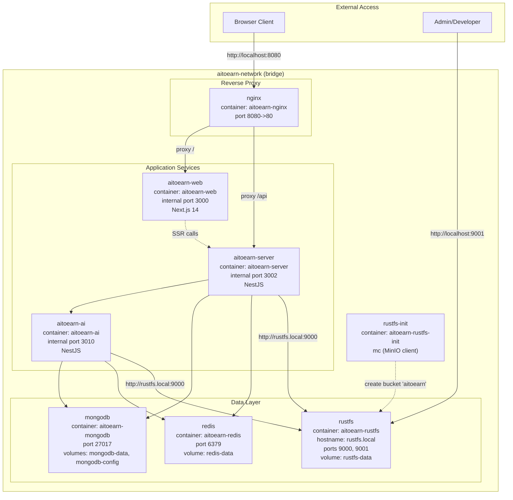
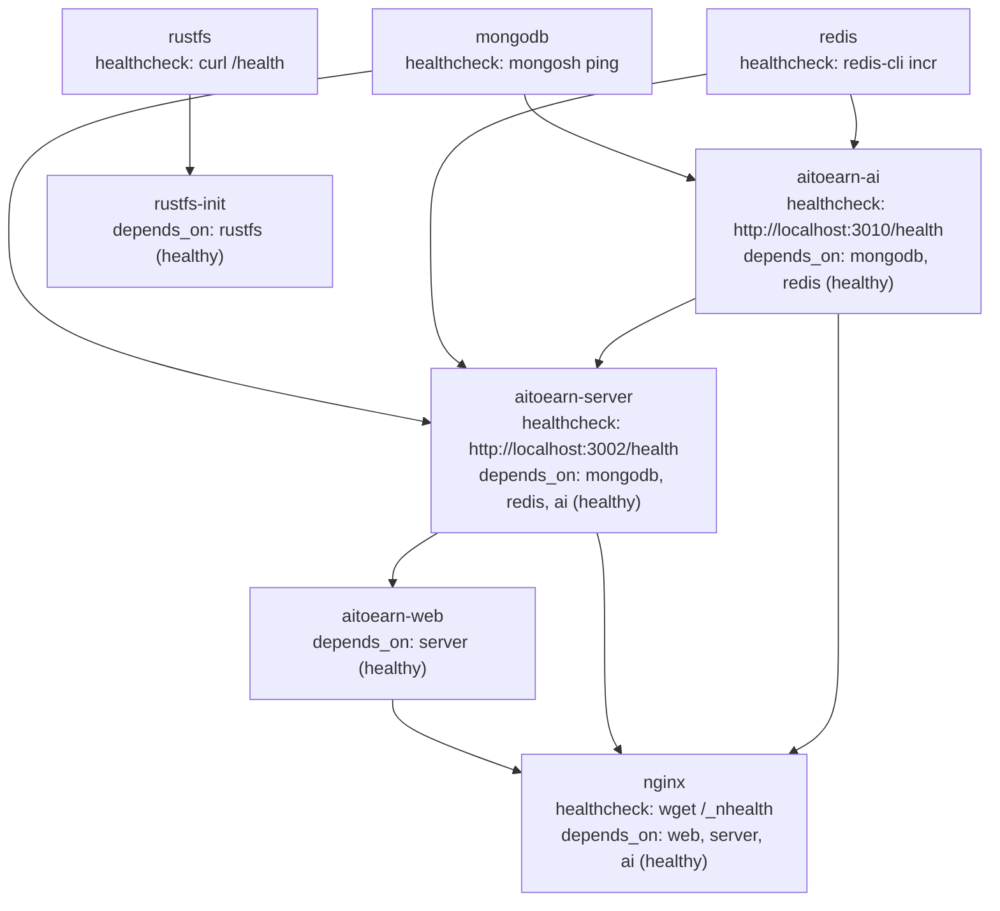
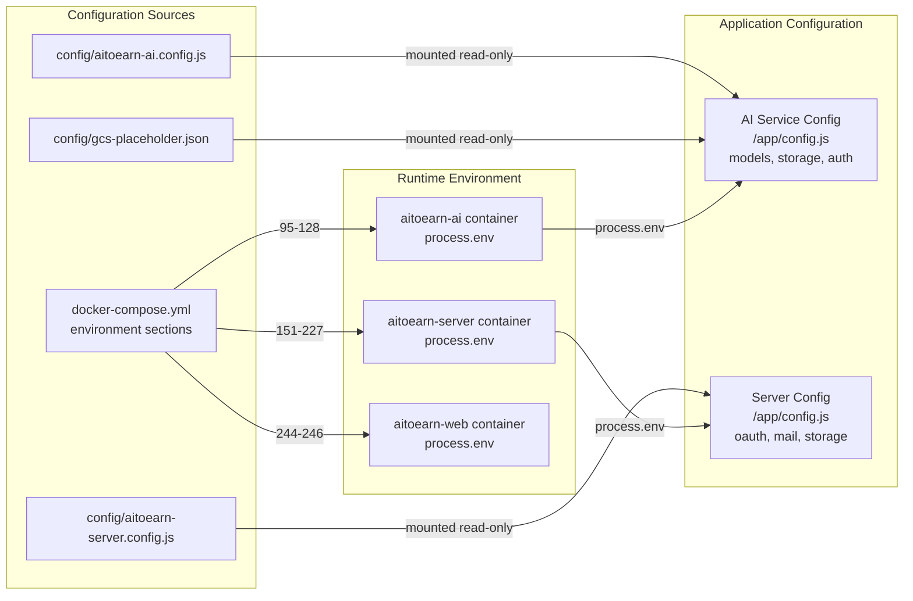
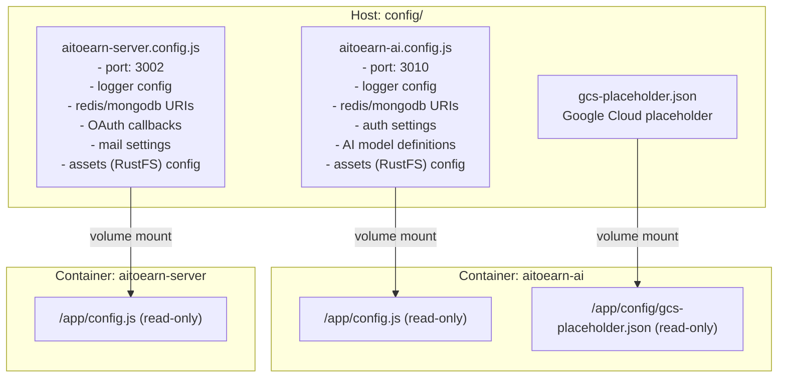
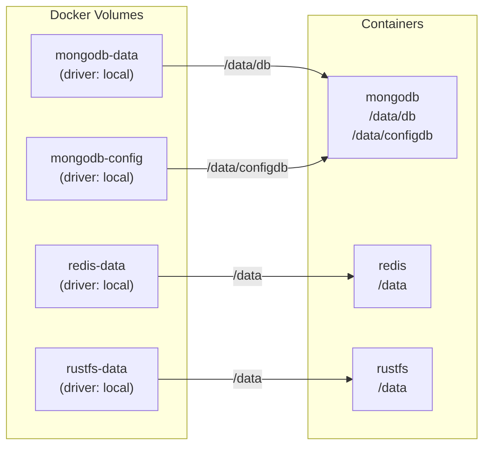
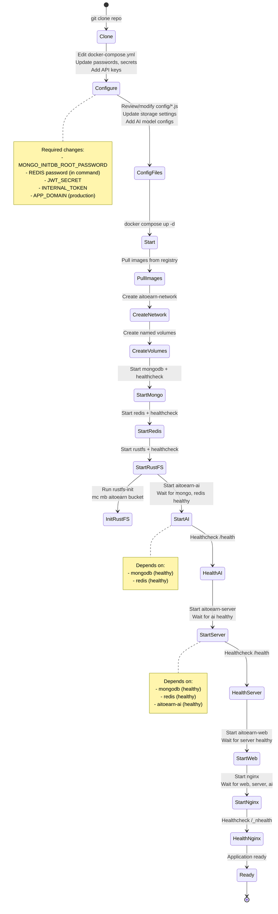

<!-- source: DeepWiki mcp.deepwiki.com · repo yikart/AiToEarn · page 7 Deployment and Configuration · fetched 2026-10-30 -->

# Deployment and Configuration

<details>
<summary>Relevant source files</summary>

The following files were used as context for generating this wiki page:

- [DOCKER_DEPLOYMENT_CN.md](DOCKER_DEPLOYMENT_CN.md)
- [DOCKER_DEPLOYMENT_EN.md](DOCKER_DEPLOYMENT_EN.md)
- [README.md](README.md)
- [README_CN.md](README_CN.md)
- [docker-compose.yml](docker-compose.yml)
- [presentation/agent_0.png](presentation/agent_0.png)
- [presentation/display-1.5.2png.png](presentation/display-1.5.2png.png)
- [wechat.jpg](wechat.jpg)

</details>


This document provides a comprehensive overview of deploying and configuring the AiToEarn platform. It covers the Docker-based deployment architecture, configuration management strategies, and key considerations for both development and production environments.

For step-by-step deployment instructions, see [Docker Deployment Guide](#7.1). For detailed environment variable reference, see [Environment Configuration](#7.2). For database and storage setup details, see [Storage and Database Setup](#7.3).

## Deployment Overview

AiToEarn is designed to be deployed as a containerized application using Docker Compose. The platform consists of seven primary services orchestrated through a single `docker-compose.yml` file, providing a complete deployment with minimal configuration required.

The deployment supports two primary modes:
- **Docker Compose deployment** (recommended): All services run in containers with automated dependency management
- **Development mode**: Backend and frontend run manually outside Docker, connecting to containerized databases

Sources: [README.md:158-189](), [docker-compose.yml:1-286]()

## Docker Compose Service Architecture

The following diagram illustrates the complete service topology as defined in `docker-compose.yml`, including container names, internal ports, and network relationships:



Sources: [docker-compose.yml:1-275](), [DOCKER_DEPLOYMENT_EN.md:6-36]()

### Service Dependency Chain

The startup order and health check dependencies ensure proper initialization:



Sources: [docker-compose.yml:16-21](), [docker-compose.yml:34-39](), [docker-compose.yml:58-63](), [docker-compose.yml:129-134](), [docker-compose.yml:227-232]()

## Configuration Architecture

AiToEarn employs a two-tier configuration strategy combining environment variables with application-specific config files.

### Configuration Flow Diagram



Sources: [docker-compose.yml:81-134](), [docker-compose.yml:136-232](), [DOCKER_DEPLOYMENT_EN.md:98-110]()

### Environment Variable Categories

The configuration is organized into distinct functional categories:

| Category | Variables | Services | Purpose |
|----------|-----------|----------|---------|
| **Database** | `MONGODB_HOST`, `MONGODB_PORT`, `MONGODB_USERNAME`, `MONGODB_PASSWORD` | aitoearn-ai, aitoearn-server | MongoDB connection |
| **Cache/Queue** | `REDIS_HOST`, `REDIS_PORT`, `REDIS_PASSWORD` | aitoearn-ai, aitoearn-server | Redis connection |
| **Authentication** | `JWT_SECRET`, `INTERNAL_TOKEN` | aitoearn-ai, aitoearn-server | JWT signing and inter-service auth |
| **Inter-Service** | `SERVER_URL`, `AI_URL` | aitoearn-ai, aitoearn-server | Service-to-service URLs |
| **AI Providers** | `OPENAI_API_KEY`, `ANTHROPIC_API_KEY`, `GEMINI_KEY_PAIRS`, etc. | aitoearn-ai | AI service credentials |
| **OAuth** | `TIKTOK_CLIENT_ID`, `GOOGLE_CLIENT_ID`, `FACEBOOK_CLIENT_ID`, etc. | aitoearn-server | Platform OAuth credentials |
| **Cloud Services** | `ALI_SMS_ACCESS_KEY_ID`, `ALI_GREEN_ACCESS_KEY_ID` | aitoearn-server | Aliyun services |
| **Object Storage** | `RUSTFS_ACCESS_KEY`, `RUSTFS_SECRET_KEY` | rustfs | S3-compatible storage |
| **Frontend** | `NEXT_PUBLIC_API_URL` | aitoearn-web | Browser-facing API endpoint |

Sources: [docker-compose.yml:95-228](), [DOCKER_DEPLOYMENT_EN.md:138-281]()

### Configuration File Structure

The `config/` directory contains JavaScript configuration modules that are mounted into containers:



Sources: [docker-compose.yml:90-92](), [docker-compose.yml:147-148](), [DOCKER_DEPLOYMENT_EN.md:98-110]()

## Network and Port Mapping

The `aitoearn-network` bridge network enables service discovery via container names:

| Service | Container Name | Internal Port | External Port | Access Method |
|---------|----------------|---------------|---------------|---------------|
| nginx | `aitoearn-nginx` | 80 | 8080 | `localhost:8080` |
| aitoearn-web | `aitoearn-web` | 3000 | - | via nginx proxy |
| aitoearn-server | `aitoearn-server` | 3002 | - | via nginx proxy (`/api`) |
| aitoearn-ai | `aitoearn-ai` | 3010 | - | internal only |
| mongodb | `aitoearn-mongodb` | 27017 | 27017 | `localhost:27017` |
| redis | `aitoearn-redis` | 6379 | 6379 | `localhost:6379` |
| rustfs | `aitoearn-rustfs` | 9000, 9001 | 9000, 9001 | `localhost:9000` (API), `localhost:9001` (console) |

**Internal service communication examples:**
- `aitoearn-ai` calls `aitoearn-server` via `http://aitoearn-server:3002` ([docker-compose.yml:112]())
- `aitoearn-server` calls `aitoearn-ai` via `http://aitoearn-ai:3010` ([docker-compose.yml:171]())
- Both services access RustFS via `http://rustfs.local:9000` ([docker-compose.yml:44](), [docker-compose.yml:55-57]())

Sources: [docker-compose.yml:9-10](), [docker-compose.yml:28-29](), [docker-compose.yml:49-51](), [docker-compose.yml:259-260](), [docker-compose.yml:272-275]()

## Volume Persistence

Data persistence is managed through named Docker volumes:



All volumes use the `local` driver and persist data on the Docker host filesystem. Data survives container restarts and recreations but is lost if volumes are explicitly deleted with `docker compose down -v`.

Sources: [docker-compose.yml:11-13](), [docker-compose.yml:30-31](), [docker-compose.yml:52-53](), [docker-compose.yml:277-285]()

## Deployment Workflow

The standard deployment process follows this sequence:



Sources: [README.md:163-167](), [docker-compose.yml:85-134](), [docker-compose.yml:140-232]()

## Production Deployment Considerations

### Required Configuration Changes

For production deployment, the following changes are mandatory:

| Configuration | Location | Default | Production Requirement |
|---------------|----------|---------|------------------------|
| `MONGO_INITDB_ROOT_PASSWORD` | [docker-compose.yml:8]() | `password` | Strong random password (32+ chars) |
| `redis --requirepass` | [docker-compose.yml:27]() | `password` | Strong random password (32+ chars) |
| `JWT_SECRET` | [docker-compose.yml:109](), [docker-compose.yml:173]() | `change-this-jwt-secret` | Random secret (use `openssl rand -hex 32`) |
| `INTERNAL_TOKEN` | [docker-compose.yml:110](), [docker-compose.yml:174]() | `change-this-secret-token` | Random token (use `openssl rand -hex 32`) |
| `APP_DOMAIN` | [docker-compose.yml:155]() | `localhost` | Production domain (e.g., `aitoearn.com`) |
| `NEXT_PUBLIC_API_URL` | [docker-compose.yml:246]() | `http://localhost:8080/api` | Public API URL (e.g., `https://aitoearn.com/api`) |
| `RUSTFS_ACCESS_KEY` / `RUSTFS_SECRET_KEY` | [docker-compose.yml:47-48]() | `rustfsadmin` | Strong credentials or switch to AWS S3/Aliyun OSS |

**Critical:** All password/secret changes must be synchronized across all services that reference them. For example, `MONGODB_PASSWORD` appears in three services: `mongodb`, `aitoearn-ai`, and `aitoearn-server`.

Sources: [DOCKER_DEPLOYMENT_EN.md:66-95](), [DOCKER_DEPLOYMENT_CN.md:64-95]()

### OAuth Callback URL Configuration

When `APP_DOMAIN` is changed from `localhost`, OAuth callback URLs must be registered with each platform using the format:

```
https://{APP_DOMAIN}/api/plat/{platform}/auth/back
```

Where `{platform}` is one of: `bilibili`, `google`, `kwai`, `pinterest`, `tiktok`, `twitter`, `facebook`, `threads`, `instagram`, `linkedin`, `youtube`, `wxplat`, `doyin`.

The callback URLs are generated dynamically in the server configuration based on the `APP_DOMAIN` environment variable.

Sources: [DOCKER_DEPLOYMENT_EN.md:269](), [docker-compose.yml:155]()

### External Storage Configuration

For production with AWS S3 or Aliyun OSS, modify the `assets` configuration in both config files:

- [config/aitoearn-ai.config.js]() - Update the `assets` object with provider, region, bucket, endpoint, credentials
- [config/aitoearn-server.config.js]() - Update the `assets` object (must match AI service config)

The configuration should specify:
- `provider`: `'s3'` or `'oss'`
- `region`: AWS region or OSS region
- `bucketName`: Bucket name
- `endpoint`: Service endpoint URL
- `accessKeyId`: Access key
- `secretAccessKey`: Secret key
- `cdnEndpoint`: Optional CDN URL for public access

Sources: [DOCKER_DEPLOYMENT_EN.md:189-202](), [DOCKER_DEPLOYMENT_CN.md:189-202]()

### Statistics Database Separation

By default, the statistics database shares the main MongoDB instance. For production workloads, separate the statistics database by updating:

```yaml
# In aitoearn-server service environment
STATISTICS_DB_HOST: separate-mongo-host
STATISTICS_DB_PORT: 27017
STATISTICS_DB_USERNAME: stats_user
STATISTICS_DB_PASSWORD: stats_password
```

Sources: [docker-compose.yml:162-165](), [DOCKER_DEPLOYMENT_EN.md:162-171]()

### AI Provider Configuration

The recommended approach for AI services is to use a relay/proxy service like [new-api](https://github.com/Calcium-Ion/new-api) or [one-api](https://github.com/songquanpeng/one-api) to consolidate all AI model access through a single endpoint:

```yaml
# In both aitoearn-ai and aitoearn-server services
OPENAI_BASE_URL: https://your-relay-service.com/v1
OPENAI_API_KEY: sk-your-relay-key
```

This approach:
- Simplifies credential management (one key instead of many)
- Provides unified rate limiting and monitoring
- Enables model fallback and load balancing
- Supports multiple AI providers (OpenAI, Claude, Gemini, etc.) through a single interface

Without a relay service, each provider requires separate configuration:
- `OPENAI_API_KEY`, `OPENAI_BASE_URL` ([docker-compose.yml:115-116]())
- `ANTHROPIC_API_KEY`, `ANTHROPIC_BASE_URL` ([docker-compose.yml:117-118]())
- `VOLCENGINE_API_KEY`, `VOLCENGINE_ACCESS_KEY_ID`, `VOLCENGINE_SECRET_ACCESS_KEY` ([docker-compose.yml:119-122]())
- `GROK_API_KEY` ([docker-compose.yml:123]())
- `GEMINI_KEY_PAIRS` as JSON array ([docker-compose.yml:126]())

Sources: [DOCKER_DEPLOYMENT_EN.md:206-247](), [DOCKER_DEPLOYMENT_CN.md:206-247]()

## Health Checks and Monitoring

Each service implements health checks to ensure proper startup ordering and runtime monitoring:

| Service | Health Check | Interval | Timeout | Retries | Start Period |
|---------|--------------|----------|---------|---------|--------------|
| `mongodb` | `mongosh ping` | 10s | 5s | 5 | 40s |
| `redis` | `redis-cli incr ping` | 10s | 3s | 5 | 30s |
| `rustfs` | `curl /health` | 10s | 5s | 5 | 30s |
| `aitoearn-ai` | `http://localhost:3010/health` | 30s | 10s | 3 | 60s |
| `aitoearn-server` | `http://localhost:3002/health` | 30s | 10s | 3 | 60s |
| `nginx` | `wget /_nhealth` | 10s | 5s | 3 | 10s |

Application services expose `/health` endpoints that return HTTP 200 when ready. The nginx service includes a custom health check endpoint at `/_nhealth`.

Check service health status:
```bash
docker compose ps
docker inspect aitoearn-server --format='{{.State.Health.Status}}'
```

Sources: [docker-compose.yml:16-21](), [docker-compose.yml:34-39](), [docker-compose.yml:58-63](), [docker-compose.yml:129-134](), [docker-compose.yml:227-232](), [docker-compose.yml:265-270]()

## Development Mode Deployment

For local development with hot-reload capabilities, services can run outside Docker while using containerized databases:

### Backend Development

```bash
cd project/aitoearn-backend
pnpm install

# Terminal 1: Start AI service
npx nx serve aitoearn-ai

# Terminal 2: Start main server
npx nx serve aitoearn-server
```

The backend services will connect to MongoDB and Redis running in Docker using the exposed ports (27017, 6379). Configuration is read from local config files instead of container-mounted volumes.

Sources: [README.md:199-206](), [README_CN.md:184-191]()

### Frontend Development

```bash
# In repository root
pnpm install
pnpm run dev
```

The Next.js development server runs on port 3000 with hot module replacement. It proxies API requests to the backend services (either containerized or running locally).

Sources: [README.md:210-213](), [README_CN.md:196-199]()

### Mixed Mode Configuration

When running some services in Docker and others locally:

1. Keep MongoDB, Redis, and RustFS running in Docker: `docker compose up -d mongodb redis rustfs rustfs-init`
2. Update local config files to point to `localhost:27017`, `localhost:6379`, `localhost:9000`
3. Run backend/frontend services locally with environment variables matching the Docker configuration

This mode is useful for debugging specific services while maintaining infrastructure stability.

## Common Operations

### View Logs

```bash
# All services
docker compose logs

# Specific service with follow
docker compose logs -f aitoearn-server

# Last 100 lines
docker compose logs --tail=100 aitoearn-ai
```

### Restart Services

```bash
# Restart specific service
docker compose restart aitoearn-server

# Restart after config changes
docker compose up -d --force-recreate aitoearn-server
```

### Update Configuration

After modifying `docker-compose.yml` environment variables or `config/*.js` files:

```bash
# Recreate affected services
docker compose up -d --force-recreate aitoearn-ai aitoearn-server

# Or restart everything
docker compose down
docker compose up -d
```

### Data Backup

```bash
# MongoDB backup
docker exec aitoearn-mongodb mongodump --out /data/backup --authenticationDatabase admin -u admin -p password

# Redis backup (RDB snapshot)
docker exec aitoearn-redis redis-cli --pass password SAVE

# RustFS backup (copy volume)
docker run --rm -v rustfs-data:/data -v $(pwd):/backup alpine tar czf /backup/rustfs-backup.tar.gz /data
```

### Stop and Remove

```bash
# Stop all services (preserves volumes)
docker compose down

# Stop and remove all data (WARNING: deletes all volumes)
docker compose down -v
```

Sources: [README.md:163-167]()

## Related Documentation

- **[Docker Deployment Guide](#7.1)**: Step-by-step deployment instructions with detailed command explanations
- **[Environment Configuration](#7.2)**: Complete reference for all environment variables and their purposes
- **[Storage and Database Setup](#7.3)**: MongoDB configuration, Redis setup, and object storage options including backup strategies

For information about the system architecture, see [System Architecture](#2). For Docker Compose service details, see [Docker Compose Service Architecture](#2.1).

---

