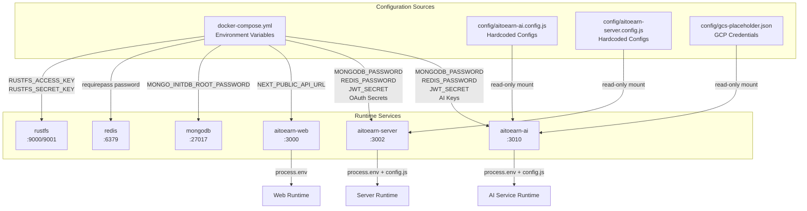
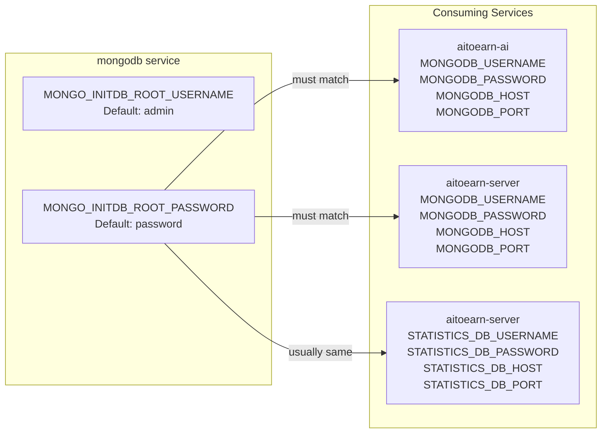
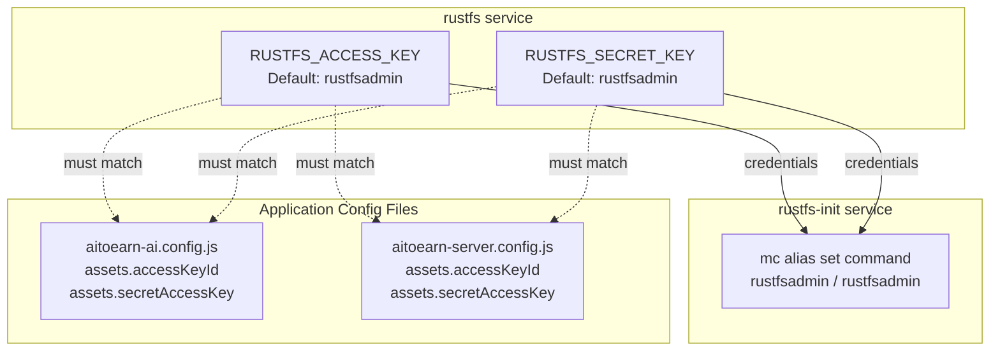
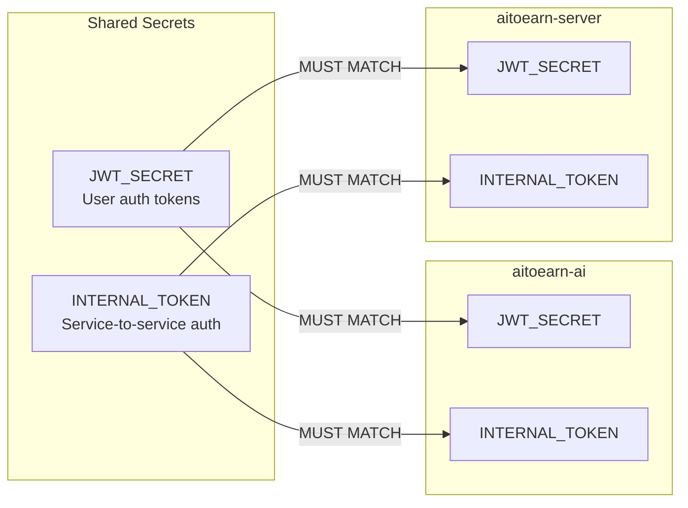
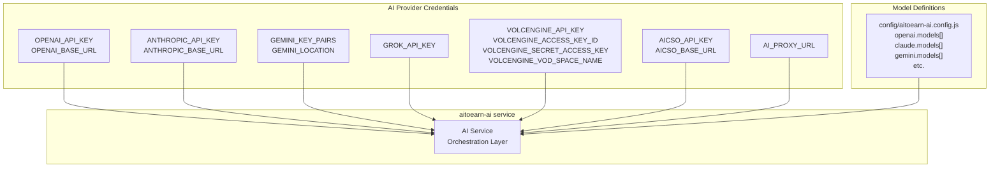
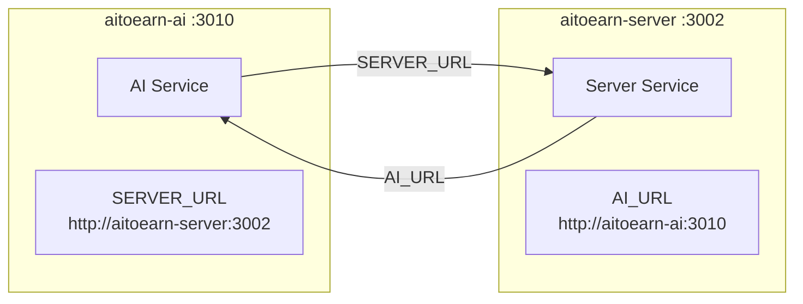
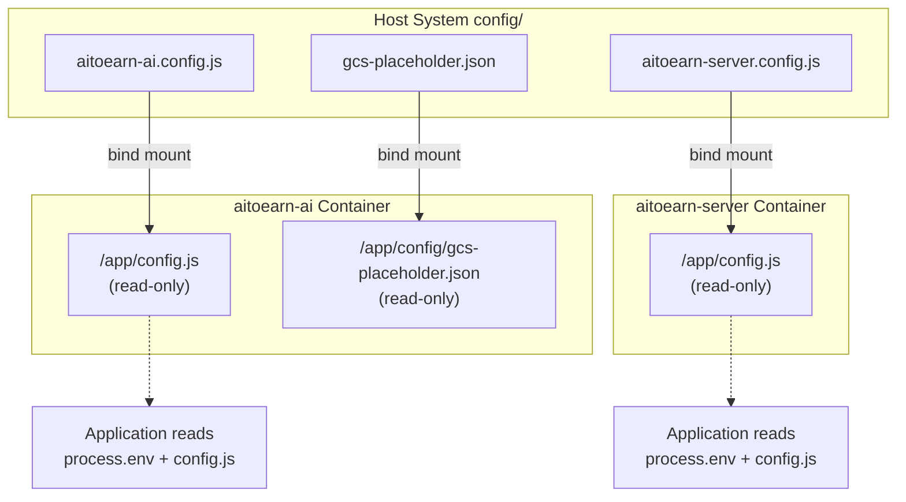

<!-- source: DeepWiki mcp.deepwiki.com · repo yikart/AiToEarn · page 7.2 Environment Configuration · fetched 2026-10-30 -->

# Environment Configuration

<details>
<summary>Relevant source files</summary>

The following files were used as context for generating this wiki page:

- [DOCKER_DEPLOYMENT_CN.md](DOCKER_DEPLOYMENT_CN.md)
- [DOCKER_DEPLOYMENT_EN.md](DOCKER_DEPLOYMENT_EN.md)
- [README.md](README.md)
- [README_CN.md](README_CN.md)
- [docker-compose.yml](docker-compose.yml)
- [presentation/agent_0.png](presentation/agent_0.png)
- [presentation/display-1.5.2png.png](presentation/display-1.5.2png.png)
- [wechat.jpg](wechat.jpg)

</details>


This document provides a comprehensive reference for all environment variables used across the AiToEarn platform services. Environment configuration is the primary mechanism for deploying and customizing AiToEarn installations, controlling database connections, API integrations, authentication secrets, and external service credentials.

For deployment procedures using these environment variables, see [Docker Deployment Guide](#7.1). For database and storage setup details, see [Storage and Database Setup](#7.3). For development mode configuration without Docker, see [Development Mode Setup](#8.1).

## Configuration Architecture Overview

The AiToEarn platform uses a layered configuration architecture where environment variables defined in `docker-compose.yml` flow through to individual services, which may combine them with hardcoded configuration in JavaScript config files.

### Configuration Flow Diagram



**Sources:** [docker-compose.yml:1-286](), [DOCKER_DEPLOYMENT_EN.md:1-500]()

### Configuration Layer Responsibilities

| Layer | File/Location | Purpose | Modification Method |
|-------|---------------|---------|---------------------|
| **Environment Variables** | `docker-compose.yml` `environment` sections | Runtime secrets, credentials, service URLs | Edit docker-compose.yml, restart containers |
| **Application Config** | `config/aitoearn-ai.config.js`<br/>`config/aitoearn-server.config.js` | Service-specific settings, model definitions, storage endpoints | Edit config files, restart containers |
| **Credential Files** | `config/gcs-placeholder.json` | Google Cloud service account keys | Replace file, restart containers |
| **Nginx Config** | `nginx/nginx.conf` | Routing rules, upstream definitions | Edit nginx.conf, restart nginx container |

**Sources:** [docker-compose.yml:91-92](), [docker-compose.yml:148](), [docker-compose.yml:262]()

## Database and Cache Services Configuration

### MongoDB Configuration

MongoDB serves as the primary document database and statistics database for the platform.

#### MongoDB Environment Variables



**MongoDB Service Environment Variables** ([docker-compose.yml:2-21]()):

| Variable | Default | Description |
|----------|---------|-------------|
| `MONGO_INITDB_ROOT_USERNAME` | `admin` | MongoDB root user |
| `MONGO_INITDB_ROOT_PASSWORD` | `password` | MongoDB root password - **MUST CHANGE** |

**Consumer Service Variables** (aitoearn-ai: [docker-compose.yml:100-103](), aitoearn-server: [docker-compose.yml:157-160]()):

| Variable | Service | Default | Description |
|----------|---------|---------|-------------|
| `MONGODB_HOST` | aitoearn-ai, aitoearn-server | `mongodb` | MongoDB container hostname |
| `MONGODB_PORT` | aitoearn-ai, aitoearn-server | `27017` | MongoDB port |
| `MONGODB_USERNAME` | aitoearn-ai, aitoearn-server | `admin` | MongoDB username |
| `MONGODB_PASSWORD` | aitoearn-ai, aitoearn-server | `password` | MongoDB password - must match root password |

**Statistics Database Variables** ([docker-compose.yml:162-165]()):

| Variable | Service | Default | Description |
|----------|---------|---------|-------------|
| `STATISTICS_DB_HOST` | aitoearn-server | `mongodb` | Statistics DB host (can be separate instance) |
| `STATISTICS_DB_PORT` | aitoearn-server | `27017` | Statistics DB port |
| `STATISTICS_DB_USERNAME` | aitoearn-server | `admin` | Statistics DB username |
| `STATISTICS_DB_PASSWORD` | aitoearn-server | `password` | Statistics DB password |

**Sources:** [docker-compose.yml:2-21](), [docker-compose.yml:100-103](), [docker-compose.yml:157-165]()

### Redis Configuration

Redis provides caching, session storage, and job queue functionality.

#### Redis Environment Variables

**Redis Service** ([docker-compose.yml:23-39]()):

| Variable | Default | Description |
|----------|---------|-------------|
| `command` | `redis-server --requirepass password` | Redis startup command with password |

The password is embedded in the command line. To change it, modify both the command and all consumer service `REDIS_PASSWORD` variables.

**Consumer Service Variables** ([docker-compose.yml:105-107](), [docker-compose.yml:167-169]()):

| Variable | Service | Default | Description |
|----------|---------|---------|-------------|
| `REDIS_HOST` | aitoearn-ai, aitoearn-server | `redis` | Redis container hostname |
| `REDIS_PORT` | aitoearn-ai, aitoearn-server | `6379` | Redis port |
| `REDIS_PASSWORD` | aitoearn-ai, aitoearn-server | `password` | Redis password - must match command |

**Sources:** [docker-compose.yml:23-39](), [docker-compose.yml:105-107](), [docker-compose.yml:167-169]()

## Object Storage Configuration (RustFS)

RustFS provides S3-compatible object storage for media assets, generated content, and user uploads.

### RustFS Service Environment Variables



**RustFS Service Variables** ([docker-compose.yml:41-63]()):

| Variable | Default | Description |
|----------|---------|-------------|
| `RUSTFS_ACCESS_KEY` | `rustfsadmin` | S3-compatible access key ID |
| `RUSTFS_SECRET_KEY` | `rustfsadmin` | S3-compatible secret access key |

**RustFS Initialization** ([docker-compose.yml:65-79]()):

The `rustfs-init` service uses `minio/mc` to create the initial bucket. Credentials in the `entrypoint` command must match `RUSTFS_ACCESS_KEY` and `RUSTFS_SECRET_KEY`.

**Application Configuration Files:**

RustFS credentials are **not** passed as environment variables to `aitoearn-ai` or `aitoearn-server`. Instead, they are hardcoded in the config files that are mounted as read-only volumes. To change credentials:

1. Update `RUSTFS_ACCESS_KEY` and `RUSTFS_SECRET_KEY` in [docker-compose.yml:47-48]()
2. Update credentials in [docker-compose.yml:75]() `mc alias set` command
3. Edit `config/aitoearn-ai.config.js` assets configuration (search for `accessKeyId` and `secretAccessKey`)
4. Edit `config/aitoearn-server.config.js` assets configuration (search for `accessKeyId` and `secretAccessKey`)

**Sources:** [docker-compose.yml:41-79](), [DOCKER_DEPLOYMENT_EN.md:173-188]()

## Authentication and Security Configuration

### JWT and Internal Authentication

These variables control user authentication tokens and inter-service communication.



**Authentication Variables** ([docker-compose.yml:109-110](), [docker-compose.yml:173-174]()):

| Variable | Services | Default | Description |
|----------|----------|---------|-------------|
| `JWT_SECRET` | aitoearn-ai, aitoearn-server | `change-this-jwt-secret` | JWT signing secret - **MUST MATCH** across services |
| `INTERNAL_TOKEN` | aitoearn-ai, aitoearn-server | `change-this-secret-token` | Bearer token for service-to-service calls - **MUST MATCH** |

**Critical:** Both `JWT_SECRET` and `INTERNAL_TOKEN` must have identical values in `aitoearn-ai` and `aitoearn-server` services. Mismatched values will cause authentication failures.

Generate secure random values:
```bash
openssl rand -hex 32  # For JWT_SECRET
openssl rand -hex 32  # For INTERNAL_TOKEN
```

**Sources:** [docker-compose.yml:109-110](), [docker-compose.yml:173-174](), [DOCKER_DEPLOYMENT_EN.md:142-151]()

### Application Domain Configuration

**Domain Variables** ([docker-compose.yml:155](), [docker-compose.yml:246]()):

| Variable | Service | Default | Description |
|----------|---------|---------|-------------|
| `APP_DOMAIN` | aitoearn-server | `localhost` | Public domain for OAuth callbacks |
| `NEXT_PUBLIC_API_URL` | aitoearn-web | `http://localhost:8080/api` | Browser-facing API URL |

`APP_DOMAIN` is used to construct OAuth callback URLs in the format:
```
https://{APP_DOMAIN}/api/plat/{platform}/auth/back
```

For production deployments, set `APP_DOMAIN` to your public domain (e.g., `aitoearn.example.com`) and `NEXT_PUBLIC_API_URL` to `https://aitoearn.example.com/api`.

**Sources:** [docker-compose.yml:155](), [docker-compose.yml:246](), [DOCKER_DEPLOYMENT_EN.md:269]()

## AI Service Configuration

AiToEarn integrates multiple AI providers for content generation, image creation, and video generation. All AI provider credentials are configured in the `aitoearn-ai` service, with some also duplicated in `aitoearn-server` for direct usage.

### AI Provider Environment Variables



**Primary AI Providers** ([docker-compose.yml:114-128]()):

| Variable | Service | Default | Description |
|----------|---------|---------|-------------|
| `OPENAI_API_KEY` | aitoearn-ai, aitoearn-server | `sk-placeholder` | OpenAI API key or relay service key |
| `OPENAI_BASE_URL` | aitoearn-ai, aitoearn-server | `https://api.openai.com/v1` | OpenAI API endpoint or relay service URL |
| `ANTHROPIC_API_KEY` | aitoearn-ai | `sk-placeholder` | Anthropic (Claude) API key |
| `ANTHROPIC_BASE_URL` | aitoearn-ai | `https://api.anthropic.com` | Anthropic API endpoint |
| `GROK_API_KEY` | aitoearn-ai | `""` | xAI Grok API key |
| `AICSO_API_KEY` | aitoearn-ai | `""` | AICSO service API key |
| `AICSO_BASE_URL` | aitoearn-ai | `""` | AICSO service endpoint |
| `AI_PROXY_URL` | aitoearn-ai | `""` | Optional proxy for AI API requests |

**Volcengine (Doubao) Configuration** ([docker-compose.yml:119-122]()):

| Variable | Service | Description |
|----------|---------|-------------|
| `VOLCENGINE_API_KEY` | aitoearn-ai | Volcengine API key |
| `VOLCENGINE_ACCESS_KEY_ID` | aitoearn-ai | Volcengine access key ID |
| `VOLCENGINE_SECRET_ACCESS_KEY` | aitoearn-ai | Volcengine secret access key |
| `VOLCENGINE_VOD_SPACE_NAME` | aitoearn-ai | Volcengine VOD space name for video storage |

**Google Gemini Configuration** ([docker-compose.yml:126-127]()):

| Variable | Service | Description |
|----------|---------|-------------|
| `GEMINI_KEY_PAIRS` | aitoearn-ai | JSON array of Gemini project configurations |
| `GEMINI_LOCATION` | aitoearn-ai | GCP region for Vertex AI (default: `us-central1`) |

`GEMINI_KEY_PAIRS` format:
```json
[{
  "projectId": "your-gcp-project-id",
  "apiKey": "your-gemini-api-key", 
  "keyFile": "/app/config/gcs-placeholder.json",
  "bucket": "your-gcs-bucket"
}]
```

The `keyFile` path references the mounted GCS credentials file at [docker-compose.yml:92]().

**Sources:** [docker-compose.yml:114-128](), [docker-compose.yml:180-181](), [DOCKER_DEPLOYMENT_EN.md:206-247]()

### Using AI Relay Services (Recommended)

Instead of configuring individual AI providers, you can use a relay service like [new-api](https://github.com/Calcium-Ion/new-api) or [one-api](https://github.com/songquanpeng/one-api) to manage all AI models through a single endpoint.

**Configuration for Relay Service:**

```yaml
# In both aitoearn-ai and aitoearn-server services
OPENAI_BASE_URL: https://your-relay-service.com/v1
OPENAI_API_KEY: sk-your-relay-service-key
```

With a relay service, all other AI provider variables can remain as placeholders, since the relay handles routing to different models.

**Sources:** [DOCKER_DEPLOYMENT_EN.md:206-220]()

## OAuth Platform Integration Configuration

AiToEarn supports OAuth authentication with 14+ social media platforms. All OAuth credentials are configured in the `aitoearn-server` service.

### OAuth Credential Variables

```mermaid
graph TB
    subgraph "OAuth Platforms"
        TT["TikTok<br/>TIKTOK_CLIENT_ID<br/>TIKTOK_CLIENT_SECRET"]
        YT["YouTube<br/>YOUTUBE_CLIENT_ID<br/>YOUTUBE_CLIENT_SECRET"]
        TW["Twitter/X<br/>TWITTER_CLIENT_ID<br/>TWITTER_CLIENT_SECRET"]
        FB["Facebook<br/>FACEBOOK_CLIENT_ID<br/>FACEBOOK_CLIENT_SECRET<br/>FACEBOOK_CONFIG_ID"]
        INST["Instagram<br/>INSTAGRAM_CLIENT_ID<br/>INSTAGRAM_CLIENT_SECRET"]
        THR["Threads<br/>THREADS_CLIENT_ID<br/>THREADS_CLIENT_SECRET"]
        LINK["LinkedIn<br/>LINKEDIN_CLIENT_ID<br/>LINKEDIN_CLIENT_SECRET"]
        PIN["Pinterest<br/>PINTEREST_CLIENT_ID<br/>PINTEREST_CLIENT_SECRET<br/>PINTEREST_TEST_AUTHORIZATION"]
        BILI["Bilibili<br/>BILIBILI_CLIENT_ID<br/>BILIBILI_CLIENT_SECRET"]
        KWAI["Kuaishou<br/>KWAI_CLIENT_ID<br/>KWAI_CLIENT_SECRET"]
        DY["Douyin<br/>DOYIN_CLIENT_ID<br/>DOYIN_CLIENT_SECRET"]
        WX["WeChat Platform<br/>WXPLAT_APP_ID<br/>WXPLAT_APP_SECRET<br/>WXPLAT_ENCODING_AES_KEY"]
        GOOG["Google<br/>GOOGLE_CLIENT_ID<br/>GOOGLE_CLIENT_SECRET"]
    end
    
    subgraph "aitoearn-server"
        OAUTH["OAuth Controllers<br/>/api/plat/{platform}/auth"]
    end
    
    subgraph "OAuth Callback"
        CALLBACK["Callback URL:<br/>https://{APP_DOMAIN}/api/plat/{platform}/auth/back"]
    end
    
    TT --> OAUTH
    YT --> OAUTH
    TW --> OAUTH
    FB --> OAUTH
    INST --> OAUTH
    THR --> OAUTH
    LINK --> OAUTH
    PIN --> OAUTH
    BILI --> OAUTH
    KWAI --> OAUTH
    DY --> OAUTH
    WX --> OAUTH
    GOOG --> OAUTH
    
    OAUTH --> CALLBACK
```



**OAuth Platform Variables** ([docker-compose.yml:183-212]()):

| Platform | Variables | Developer Portal |
|----------|-----------|------------------|
| **TikTok** | `TIKTOK_CLIENT_ID`<br/>`TIKTOK_CLIENT_SECRET` | https://developers.tiktok.com |
| **YouTube** | `YOUTUBE_CLIENT_ID`<br/>`YOUTUBE_CLIENT_SECRET` | https://console.cloud.google.com/apis/credentials |
| **Twitter/X** | `TWITTER_CLIENT_ID`<br/>`TWITTER_CLIENT_SECRET` | https://developer.x.com/en/portal |
| **Facebook** | `FACEBOOK_CLIENT_ID`<br/>`FACEBOOK_CLIENT_SECRET`<br/>`FACEBOOK_CONFIG_ID` | https://developers.facebook.com |
| **Instagram** | `INSTAGRAM_CLIENT_ID`<br/>`INSTAGRAM_CLIENT_SECRET` | https://developers.facebook.com |
| **Threads** | `THREADS_CLIENT_ID`<br/>`THREADS_CLIENT_SECRET` | https://developers.facebook.com |
| **LinkedIn** | `LINKEDIN_CLIENT_ID`<br/>`LINKEDIN_CLIENT_SECRET` | https://www.linkedin.com/developers |
| **Pinterest** | `PINTEREST_CLIENT_ID`<br/>`PINTEREST_CLIENT_SECRET`<br/>`PINTEREST_TEST_AUTHORIZATION` | https://developers.pinterest.com |
| **Bilibili** | `BILIBILI_CLIENT_ID`<br/>`BILIBILI_CLIENT_SECRET` | https://open.bilibili.com |
| **Kuaishou** | `KWAI_CLIENT_ID`<br/>`KWAI_CLIENT_SECRET` | https://open.kuaishou.com |
| **Douyin** | `DOYIN_CLIENT_ID`<br/>`DOYIN_CLIENT_SECRET` | https://open.douyin.com |
| **WeChat Platform** | `WXPLAT_APP_ID`<br/>`WXPLAT_APP_SECRET`<br/>`WXPLAT_ENCODING_AES_KEY` | https://mp.weixin.qq.com |
| **Google** | `GOOGLE_CLIENT_ID`<br/>`GOOGLE_CLIENT_SECRET` | https://console.cloud.google.com/apis/credentials |

All OAuth platforms use the callback URL pattern:
```
https://{APP_DOMAIN}/api/plat/{platform}/auth/back
```

Where `{platform}` is the platform identifier (e.g., `tiktok`, `youtube`, `twitter`, etc.).

**Critical:** When registering OAuth applications with each platform, you must configure the callback URL using your actual `APP_DOMAIN` value. For localhost testing, use `http://localhost:8080/api/plat/{platform}/auth/back`.

**Sources:** [docker-compose.yml:183-212](), [DOCKER_DEPLOYMENT_EN.md:250-272]()

## Additional Service Configuration

### Email Configuration (AWS SES)

**Email Variables** ([docker-compose.yml:176-177]()):

| Variable | Service | Description |
|----------|---------|-------------|
| `MAIL_USER` | aitoearn-server | AWS SES SMTP username |
| `MAIL_PASS` | aitoearn-server | AWS SES SMTP password |

Used for transactional emails (password resets, notifications, etc.). Obtain credentials from AWS Console → SES → SMTP Settings.

**Sources:** [docker-compose.yml:176-177](), [DOCKER_DEPLOYMENT_EN.md:275-281]()

### Aliyun SMS Configuration

**Aliyun SMS Variables** ([docker-compose.yml:214-218]()):

| Variable | Service | Description |
|----------|---------|-------------|
| `ALI_SMS_ACCESS_KEY_ID` | aitoearn-server | Aliyun access key ID |
| `ALI_SMS_ACCESS_KEY_SECRET` | aitoearn-server | Aliyun access key secret |
| `ALI_SMS_SIGN_NAME` | aitoearn-server | SMS signature name |
| `ALI_SMS_TEMPLATE_CODE` | aitoearn-server | SMS template code |

Used for SMS verification codes and notifications. Obtain credentials from https://dysms.console.aliyun.com.

**Sources:** [docker-compose.yml:214-218]()

### Aliyun Content Safety

**Content Safety Variables** ([docker-compose.yml:220-222]()):

| Variable | Service | Description |
|----------|---------|-------------|
| `ALI_GREEN_ACCESS_KEY_ID` | aitoearn-server | Aliyun Green access key ID |
| `ALI_GREEN_ACCESS_KEY_SECRET` | aitoearn-server | Aliyun Green access key secret |

Used for content moderation (text, image, video). Obtain credentials from https://yundun.console.aliyun.com.

**Sources:** [docker-compose.yml:220-222]()

### Internal API Service

**New API Variables** ([docker-compose.yml:224-226]()):

| Variable | Service | Description |
|----------|---------|-------------|
| `NEW_API_URL` | aitoearn-server | Internal API relay service URL |
| `NEW_API_TOKEN` | aitoearn-server | Internal API authentication token |

Optional configuration for internal API management/relay services.

**Sources:** [docker-compose.yml:224-226]()

## Inter-Service Communication Configuration

### Service URL Configuration

These variables define how services communicate within the Docker network.



**Service Communication Variables:**

| Variable | Service | Default | Description |
|----------|---------|---------|-------------|
| `SERVER_URL` | aitoearn-ai | `http://aitoearn-server:3002` | URL for AI service to call Server service |
| `AI_URL` | aitoearn-server | `http://aitoearn-ai:3010` | URL for Server service to call AI service |

These use Docker internal network hostnames and typically do not need modification unless services are deployed separately.

**Sources:** [docker-compose.yml:112](), [docker-compose.yml:171]()

## Configuration File System

In addition to environment variables, AiToEarn uses JavaScript configuration files that are mounted as read-only volumes into containers. These files combine environment variables with hardcoded settings.

### Configuration File Mapping



**Configuration File Volumes** ([docker-compose.yml:90-92](), [docker-compose.yml:147-148]()):

| Host Path | Container Path | Service | Description |
|-----------|----------------|---------|-------------|
| `./config/aitoearn-ai.config.js` | `/app/config.js` | aitoearn-ai | AI service configuration |
| `./config/gcs-placeholder.json` | `/app/config/gcs-placeholder.json` | aitoearn-ai | Google Cloud credentials |
| `./config/aitoearn-server.config.js` | `/app/config.js` | aitoearn-server | Server service configuration |

### Configuration File Contents

**aitoearn-ai.config.js** contains:
- Port and logging configuration
- Redis and MongoDB connection details (from `process.env`)
- AI model definitions (OpenAI models, Claude models, Gemini models, etc.)
- Assets storage configuration (RustFS/S3 credentials and endpoints)
- Authentication settings (JWT secret, internal token from `process.env`)

**aitoearn-server.config.js** contains:
- Port and logging configuration
- Database connections (MongoDB, Statistics DB from `process.env`)
- Assets storage configuration (must match aitoearn-ai.config.js)
- OAuth callback URL patterns (uses `process.env.APP_DOMAIN`)
- Email service configuration
- Aliyun service configuration

**Key Points:**
1. Config files **read** many values from `process.env` (defined in docker-compose.yml)
2. Config files **hardcode** some values (storage endpoints, model lists, pricing)
3. Changes to config files require container restart
4. Files are mounted read-only to prevent accidental modification

**Sources:** [docker-compose.yml:90-92](), [docker-compose.yml:147-148](), [DOCKER_DEPLOYMENT_EN.md:98-111]()

## Environment Variable Dependencies

Several environment variables have cross-service dependencies that must be maintained.

### Critical Matching Requirements

```mermaid
graph TB
    subgraph "Secrets That Must Match"
        JWT_SECRET["JWT_SECRET"]
        INTERNAL_TOKEN["INTERNAL_TOKEN"]
        MONGO_PASS["MongoDB Password"]
        REDIS_PASS["Redis Password"]
    end
    
    subgraph "aitoearn-ai"
        AI_JWT["JWT_SECRET"]
        AI_INT["INTERNAL_TOKEN"]
        AI_MONGO["MONGODB_PASSWORD"]
        AI_REDIS["REDIS_PASSWORD"]
    end
    
    subgraph "aitoearn-server"
        SRV_JWT["JWT_SECRET"]
        SRV_INT["INTERNAL_TOKEN"]
        SRV_MONGO["MONGODB_PASSWORD"]
        SRV_STATS["STATISTICS_DB_PASSWORD"]
        SRV_REDIS["REDIS_PASSWORD"]
    end
    
    subgraph "mongodb service"
        MONGO_ROOT["MONGO_INITDB_ROOT_PASSWORD"]
    end
    
    subgraph "redis service"
        REDIS_CMD["command:<br/>redis-server --requirepass PASSWORD"]
    end
    
    JWT_SECRET -->|"MUST MATCH"| AI_JWT
    JWT_SECRET -->|"MUST MATCH"| SRV_JWT
    INTERNAL_TOKEN -->|"MUST MATCH"| AI_INT
    INTERNAL_TOKEN -->|"MUST MATCH"| SRV_INT
    MONGO_PASS -->|"MUST MATCH"| MONGO_ROOT
    MONGO_PASS -->|"MUST MATCH"| AI_MONGO
    MONGO_PASS -->|"MUST MATCH"| SRV_MONGO
    MONGO_PASS -->|"usually same"| SRV_STATS
    REDIS_PASS -->|"MUST MATCH"| REDIS_CMD
    REDIS_PASS -->|"MUST MATCH"| AI_REDIS
    REDIS_PASS -->|"MUST MATCH"| SRV_REDIS
```



**Dependency Table:**

| Variable Group | Services | Match Requirement |
|----------------|----------|-------------------|
| **JWT_SECRET** | aitoearn-ai, aitoearn-server | Must be identical |
| **INTERNAL_TOKEN** | aitoearn-ai, aitoearn-server | Must be identical |
| **MongoDB Password** | mongodb, aitoearn-ai, aitoearn-server | Must match `MONGO_INITDB_ROOT_PASSWORD` |
| **Statistics DB Password** | aitoearn-server | Usually same as MongoDB password (can differ if using separate DB) |
| **Redis Password** | redis command, aitoearn-ai, aitoearn-server | Must match `--requirepass` value in redis command |
| **RustFS Credentials** | rustfs, rustfs-init, config files | Must match across service environment, init script, and both config.js files |

**Sources:** [docker-compose.yml:8](), [docker-compose.yml:27](), [docker-compose.yml:47-48](), [docker-compose.yml:102](), [docker-compose.yml:107](), [docker-compose.yml:109-110](), [docker-compose.yml:159](), [docker-compose.yml:165](), [docker-compose.yml:169](), [docker-compose.yml:173-174]()

## Security Best Practices

### Password and Secret Management

**Critical Actions for Production:**

1. **Change All Default Passwords** - Never use the default values in production:
   - `MONGO_INITDB_ROOT_PASSWORD`: Change from `password`
   - Redis `--requirepass`: Change from `password`
   - `JWT_SECRET`: Change from `change-this-jwt-secret`
   - `INTERNAL_TOKEN`: Change from `change-this-secret-token`
   - `RUSTFS_ACCESS_KEY` / `RUSTFS_SECRET_KEY`: Change from `rustfsadmin`

2. **Generate Secure Random Values:**
   ```bash
   # Generate 32-byte hex strings for secrets
   openssl rand -hex 32
   ```

3. **Synchronized Updates** - When changing a password/secret:
   - Identify all locations where it appears (use the dependency table)
   - Update all occurrences simultaneously
   - Restart all affected containers

4. **Secret Rotation** - To rotate secrets:
   - Update environment variable in docker-compose.yml
   - Run `docker compose up -d` to restart affected services
   - For config file changes, restart is also required

**Sources:** [DOCKER_DEPLOYMENT_EN.md:66-94](), [DOCKER_DEPLOYMENT_CN.md:66-94]()

### Environment Variable Validation

Before starting services, validate that:

1. All passwords match across services
2. `JWT_SECRET` and `INTERNAL_TOKEN` are identical in aitoearn-ai and aitoearn-server
3. `APP_DOMAIN` is set correctly for production
4. OAuth credentials are present for platforms you intend to use
5. At least one AI provider has valid credentials (or relay service is configured)

**Health Check Endpoints:**

After deployment, verify services are healthy:
- http://localhost:8080/_nhealth - Nginx health
- http://localhost:8080/api/health - Server health (if endpoint exists)

**Sources:** [docker-compose.yml:129-134](), [docker-compose.yml:227-232](), [docker-compose.yml:265-270]()

---

This document provides a complete reference for configuring AiToEarn's environment variables. For deployment procedures, see [Docker Deployment Guide](#7.1). For detailed storage setup, see [Storage and Database Setup](#7.3).

---

