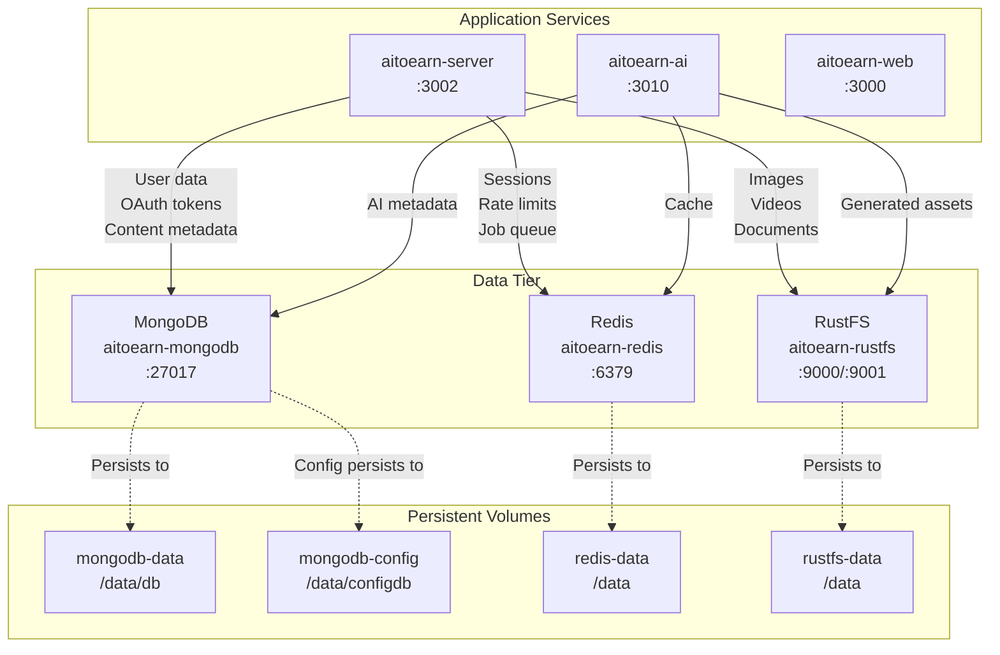
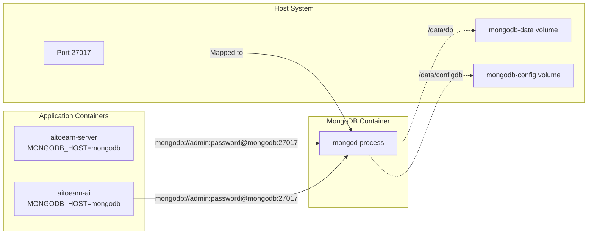
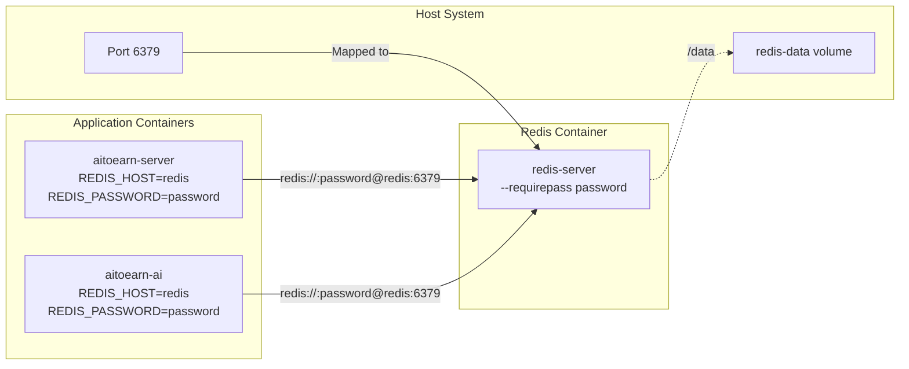
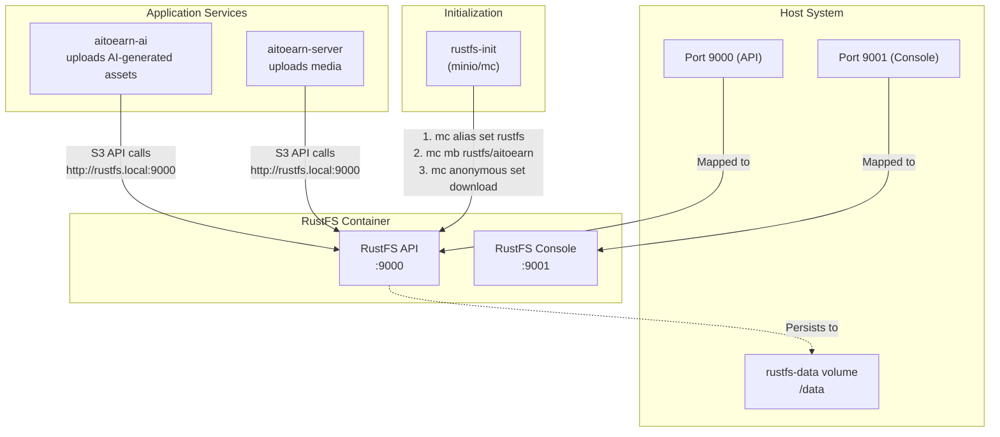
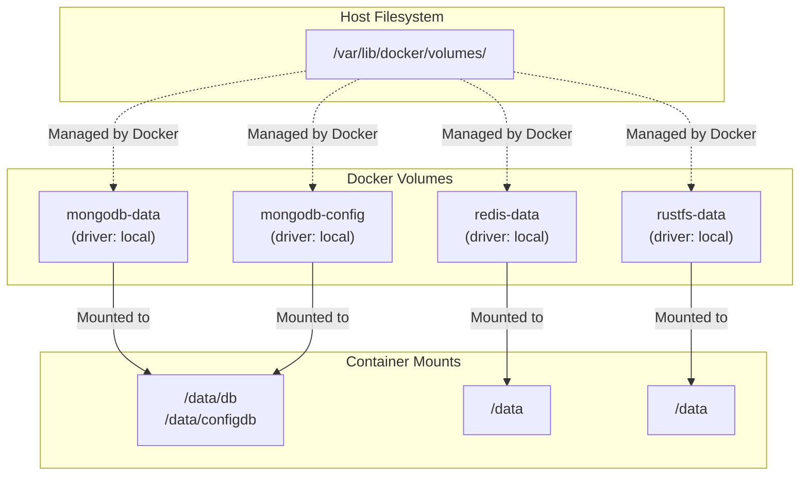

<!-- source: DeepWiki mcp.deepwiki.com · repo yikart/AiToEarn · page 7.3 Storage and Database Setup · fetched 2026-10-30 -->

# Storage and Database Setup

<details>
<summary>Relevant source files</summary>

The following files were used as context for generating this wiki page:

- [DOCKER_DEPLOYMENT_CN.md](DOCKER_DEPLOYMENT_CN.md)
- [DOCKER_DEPLOYMENT_EN.md](DOCKER_DEPLOYMENT_EN.md)
- [README.md](README.md)
- [README_CN.md](README_CN.md)
- [docker-compose.yml](docker-compose.yml)
- [presentation/agent_0.png](presentation/agent_0.png)
- [presentation/display-1.5.2png.png](presentation/display-1.5.2png.png)
- [wechat.jpg](wechat.jpg)

</details>


This page provides a comprehensive guide to configuring and managing the three-tier data storage system used by AiToEarn: MongoDB for document storage, Redis for caching and job queuing, and S3-compatible object storage (RustFS) for media assets.

For general deployment instructions, see [Docker Deployment Guide](#7.1). For environment variable reference, see [Environment Configuration](#7.2).

## Storage Architecture Overview

AiToEarn employs a three-tier data persistence strategy to optimize for different data types and access patterns:



**Sources:** [docker-compose.yml:1-286]()

| Storage System | Purpose | Data Types | Access Pattern |
|----------------|---------|------------|----------------|
| **MongoDB** | Primary database | User accounts, OAuth tokens, content metadata, drafts, analytics | Random access, ACID transactions |
| **Redis** | Cache & queue | Sessions, rate limiting, scheduled jobs, temporary data | High-speed read/write, TTL-based expiry |
| **RustFS/S3** | Object storage | Images, videos, documents, AI-generated media | Large file storage, CDN delivery |

**Sources:** [README.md:158-183](), [DOCKER_DEPLOYMENT_EN.md:6-36]()

## MongoDB Configuration

### Container Setup

MongoDB runs as the `aitoearn-mongodb` container using the official `mongo:latest` image.



**Sources:** [docker-compose.yml:2-21]()

### Database Configuration

**Default Credentials** (must be changed for production):
- Username: `admin` (set via `MONGO_INITDB_ROOT_USERNAME`)
- Password: `password` (set via `MONGO_INITDB_ROOT_PASSWORD`)

**Connection Configuration:**

The following environment variables must be synchronized across all services that connect to MongoDB:

```yaml
# In docker-compose.yml mongodb service
MONGO_INITDB_ROOT_USERNAME: admin
MONGO_INITDB_ROOT_PASSWORD: your-secure-password

# In aitoearn-server service
MONGODB_HOST: mongodb
MONGODB_PORT: 27017
MONGODB_USERNAME: admin
MONGODB_PASSWORD: your-secure-password

# In aitoearn-ai service
MONGODB_HOST: mongodb
MONGODB_PORT: 27017
MONGODB_USERNAME: admin
MONGODB_PASSWORD: your-secure-password
```

**Sources:** [docker-compose.yml:6-8](), [docker-compose.yml:100-103](), [docker-compose.yml:157-160]()

### Database Names

| Database | Service | Purpose |
|----------|---------|---------|
| `aitoearn` | aitoearn-server, aitoearn-ai | Primary application database |
| Statistics DB | aitoearn-server | Analytics and metrics (defaults to same MongoDB instance) |

The statistics database connection is configured separately to allow for future separation:

```yaml
# In aitoearn-server service
STATISTICS_DB_HOST: mongodb
STATISTICS_DB_PORT: 27017
STATISTICS_DB_USERNAME: admin
STATISTICS_DB_PASSWORD: password
```

**Sources:** [docker-compose.yml:162-165]()

### Health Check

MongoDB includes a health check that verifies the database is responsive:

```yaml
healthcheck:
  test: echo 'db.runCommand("ping").ok' | mongosh localhost:27017/test --quiet
  interval: 10s
  timeout: 5s
  retries: 5
  start_period: 40s
```

This health check is used by dependent services (`aitoearn-server` and `aitoearn-ai`) to ensure MongoDB is ready before they start.

**Sources:** [docker-compose.yml:16-21]()

### Volume Management

MongoDB uses two persistent volumes:

| Volume Name | Mount Point | Purpose | Typical Size |
|-------------|-------------|---------|--------------|
| `mongodb-data` | `/data/db` | Database files, indexes | 10GB+ (grows with data) |
| `mongodb-config` | `/data/configdb` | MongoDB configuration | <100MB |

**Volume Declaration:**
```yaml
volumes:
  mongodb-data:
    driver: local
  mongodb-config:
    driver: local
```

**Sources:** [docker-compose.yml:12-13](), [docker-compose.yml:278-281]()

### Backup and Restore

**Manual Backup:**

```bash
# Backup to host filesystem
docker exec aitoearn-mongodb mongodump \
  --username admin \
  --password your-password \
  --authenticationDatabase admin \
  --out /data/backup

# Copy backup from container to host
docker cp aitoearn-mongodb:/data/backup ./mongodb-backup-$(date +%Y%m%d)
```

**Restore from Backup:**

```bash
# Copy backup to container
docker cp ./mongodb-backup-20250101 aitoearn-mongodb:/data/restore

# Restore
docker exec aitoearn-mongodb mongorestore \
  --username admin \
  --password your-password \
  --authenticationDatabase admin \
  /data/restore
```

**Automated Backup Strategy:**

For production, configure automated backups using MongoDB tools or external backup solutions:
- Schedule daily `mongodump` via cron
- Use MongoDB Atlas for managed backups
- Implement point-in-time recovery with replica sets and oplog

**Sources:** [DOCKER_DEPLOYMENT_EN.md:173-232]()

## Redis Configuration

### Container Setup

Redis runs as the `aitoearn-redis` container using the official `redis:latest` image with password authentication enabled.



**Sources:** [docker-compose.yml:23-39]()

### Redis Configuration

**Authentication:**
```yaml
# In docker-compose.yml redis service
command: redis-server --requirepass your-secure-password

# In application services
REDIS_HOST: redis
REDIS_PORT: 6379
REDIS_PASSWORD: your-secure-password
```

**Sources:** [docker-compose.yml:27](), [docker-compose.yml:105-107](), [docker-compose.yml:168-170]()

### Redis Usage Patterns

Redis is used for multiple purposes across the application:

| Use Case | Service | Key Pattern | TTL |
|----------|---------|-------------|-----|
| User sessions | aitoearn-server | `session:*` | 7 days (default) |
| Rate limiting | aitoearn-server | `ratelimit:*` | 1 hour (typical) |
| Job queue | aitoearn-server | `bull:*` | Until processed |
| AI response cache | aitoearn-ai | `ai:cache:*` | Variable |
| Distributed locks | aitoearn-ai, aitoearn-server | `redlock:*` | Short-lived |

**Sources:** [DOCKER_DEPLOYMENT_EN.md:306-309]()

### Health Check

Redis includes a health check using `redis-cli`:

```yaml
healthcheck:
  test: ["CMD", "redis-cli", "--raw", "incr", "ping"]
  interval: 10s
  timeout: 3s
  retries: 5
  start_period: 30s
```

**Sources:** [docker-compose.yml:34-39]()

### Volume Management

Redis uses a single persistent volume for data:

```yaml
volumes:
  - redis-data:/data

# Volume declaration
volumes:
  redis-data:
    driver: local
```

**Data Persistence:** Redis is configured to persist data using RDB snapshots and AOF (Append-Only File) depending on the Redis configuration. The default `redis:latest` image enables RDB snapshots.

**Sources:** [docker-compose.yml:31](), [docker-compose.yml:283]()

### Backup and Restore

**Manual Backup:**

```bash
# Trigger a background save
docker exec aitoearn-redis redis-cli -a your-password BGSAVE

# Wait for save to complete
docker exec aitoearn-redis redis-cli -a your-password LASTSAVE

# Copy the RDB file
docker cp aitoearn-redis:/data/dump.rdb ./redis-backup-$(date +%Y%m%d).rdb
```

**Restore from Backup:**

```bash
# Stop Redis
docker compose stop redis

# Replace the RDB file
docker cp ./redis-backup-20250101.rdb aitoearn-redis:/data/dump.rdb

# Start Redis
docker compose start redis
```

**Sources:** [DOCKER_DEPLOYMENT_EN.md:173-232]()

## Object Storage Configuration (RustFS)

### RustFS Architecture

RustFS is an S3-compatible object storage system included in the Docker Compose setup. It provides out-of-the-box storage for images, videos, and other media files.



**Sources:** [docker-compose.yml:41-79]()

### RustFS Service Configuration

**Container Definition:**
```yaml
rustfs:
  image: rustfs/rustfs:latest
  container_name: aitoearn-rustfs
  hostname: rustfs.local
  environment:
    RUSTFS_ACCESS_KEY: rustfsadmin
    RUSTFS_SECRET_KEY: rustfsadmin
  ports:
    - "9000:9000"  # API
    - "9001:9001"  # Console
  volumes:
    - rustfs-data:/data
```

**Sources:** [docker-compose.yml:41-63]()

### Bucket Initialization

The `rustfs-init` container automatically creates and configures the `aitoearn` bucket on first startup:

```yaml
rustfs-init:
  image: minio/mc:latest
  entrypoint: >
    /bin/sh -c "
    mc alias set rustfs http://rustfs.local:9000 rustfsadmin rustfsadmin;
    mc mb rustfs/aitoearn --ignore-existing;
    mc anonymous set download rustfs/aitoearn;
    exit 0;
    "
```

This initialization:
1. Configures the MinIO client (`mc`) to connect to RustFS
2. Creates the `aitoearn` bucket (if it doesn't exist)
3. Sets the bucket to allow anonymous download access

**Sources:** [docker-compose.yml:65-79]()

### Application Configuration

Both `aitoearn-server` and `aitoearn-ai` must be configured to use RustFS. This configuration is stored in the config files, not environment variables:

**In `config/aitoearn-ai.config.js` and `config/aitoearn-server.config.js`:**

```javascript
assets: {
  provider: 's3',
  region: 'us-east-1',
  bucketName: 'aitoearn',
  endpoint: 'http://rustfs.local:9000',
  accessKeyId: 'rustfsadmin',
  secretAccessKey: 'rustfsadmin',
  cdnEndpoint: '',
  forcePathStyle: true,
}
```

**Sources:** [DOCKER_DEPLOYMENT_EN.md:173-202]()

### Accessing the RustFS Console

The RustFS console provides a web UI for managing buckets and objects:

- **URL:** http://localhost:9001
- **Username:** `rustfsadmin`
- **Password:** `rustfsadmin`

**Sources:** [docker-compose.yml:50-51](), [DOCKER_DEPLOYMENT_CN.md:176-181]()

### Changing RustFS Credentials

To change RustFS credentials, update **all three locations**:

1. **RustFS service environment variables:**
```yaml
# docker-compose.yml
rustfs:
  environment:
    RUSTFS_ACCESS_KEY: new-access-key
    RUSTFS_SECRET_KEY: new-secret-key
```

2. **Initialization script:**
```yaml
# docker-compose.yml
rustfs-init:
  entrypoint: >
    /bin/sh -c "
    mc alias set rustfs http://rustfs.local:9000 new-access-key new-secret-key;
    ...
```

3. **Application config files:**
```javascript
// config/aitoearn-ai.config.js and config/aitoearn-server.config.js
assets: {
  accessKeyId: 'new-access-key',
  secretAccessKey: 'new-secret-key',
  ...
}
```

**Sources:** [DOCKER_DEPLOYMENT_CN.md:183-187]()

### Switching to External S3/OSS

For production deployments, you may want to use AWS S3, Aliyun OSS, or other cloud storage providers instead of RustFS.

**Configuration Example (AWS S3):**

```javascript
// In config/aitoearn-ai.config.js and config/aitoearn-server.config.js
assets: {
  provider: 's3',
  region: 'ap-southeast-1',
  bucketName: 'your-bucket-name',
  endpoint: 'https://s3.ap-southeast-1.amazonaws.com',
  accessKeyId: 'AWS_ACCESS_KEY_ID',
  secretAccessKey: 'AWS_SECRET_ACCESS_KEY',
  cdnEndpoint: 'https://your-cloudfront-domain.com',
  forcePathStyle: false,
}
```

**Configuration Example (Aliyun OSS):**

```javascript
assets: {
  provider: 's3',
  region: 'oss-cn-hangzhou',
  bucketName: 'your-bucket-name',
  endpoint: 'https://oss-cn-hangzhou.aliyuncs.com',
  accessKeyId: 'ALIYUN_ACCESS_KEY_ID',
  secretAccessKey: 'ALIYUN_ACCESS_KEY_SECRET',
  cdnEndpoint: 'https://your-cdn-domain.com',
  forcePathStyle: false,
}
```

When using external storage, you can remove or comment out the `rustfs` and `rustfs-init` services from `docker-compose.yml`.

**Sources:** [DOCKER_DEPLOYMENT_CN.md:189-201]()

### Volume Management

RustFS uses a single volume for all stored objects:

```yaml
volumes:
  - rustfs-data:/data

# Volume declaration
volumes:
  rustfs-data:
    driver: local
```

**Sources:** [docker-compose.yml:53](), [docker-compose.yml:284-285]()

### Backup and Restore

**Using MinIO Client (mc):**

```bash
# Install mc client
docker run --rm -it --entrypoint=/bin/sh minio/mc

# Configure alias
docker exec aitoearn-rustfs mc alias set local http://localhost:9000 rustfsadmin rustfsadmin

# Mirror bucket to local directory
docker exec aitoearn-rustfs mc mirror local/aitoearn /backup/aitoearn

# Restore from backup
docker exec aitoearn-rustfs mc mirror /backup/aitoearn local/aitoearn
```

**Using Docker Volume Backup:**

```bash
# Backup entire volume
docker run --rm \
  -v aitoearn_rustfs-data:/data \
  -v $(pwd):/backup \
  alpine tar czf /backup/rustfs-backup-$(date +%Y%m%d).tar.gz -C /data .

# Restore volume
docker run --rm \
  -v aitoearn_rustfs-data:/data \
  -v $(pwd):/backup \
  alpine tar xzf /backup/rustfs-backup-20250101.tar.gz -C /data
```

**Sources:** [DOCKER_DEPLOYMENT_EN.md:173-232]()

## Volume Management and Persistence

### Docker Volume Overview

All persistent data in AiToEarn is stored in named Docker volumes, which survive container recreation and updates.



**Sources:** [docker-compose.yml:277-285]()

### Volume Declaration

All volumes are declared at the bottom of `docker-compose.yml`:

```yaml
volumes:
  mongodb-data:
    driver: local
  mongodb-config:
    driver: local
  redis-data:
    driver: local
  rustfs-data:
    driver: local
```

**Sources:** [docker-compose.yml:277-285]()

### Volume Inspection

**List volumes:**
```bash
docker volume ls | grep aitoearn
```

**Inspect a volume:**
```bash
docker volume inspect aitoearn_mongodb-data
```

**Check volume size:**
```bash
docker system df -v
```

**Sources:** [docker-compose.yml:277-285]()

### Volume Backup Strategy

**Complete System Backup:**

```bash
#!/bin/bash
BACKUP_DIR="./backups/$(date +%Y%m%d-%H%M%S)"
mkdir -p $BACKUP_DIR

# Stop services (optional, for consistency)
docker compose stop

# Backup all volumes
for vol in mongodb-data mongodb-config redis-data rustfs-data; do
  docker run --rm \
    -v aitoearn_${vol}:/data \
    -v $(pwd)/$BACKUP_DIR:/backup \
    alpine tar czf /backup/${vol}.tar.gz -C /data .
done

# Restart services
docker compose start
```

**Restore from Backup:**

```bash
#!/bin/bash
BACKUP_DIR="./backups/20250101-120000"

# Stop services
docker compose down

# Restore all volumes
for vol in mongodb-data mongodb-config redis-data rustfs-data; do
  docker run --rm \
    -v aitoearn_${vol}:/data \
    -v $(pwd)/$BACKUP_DIR:/backup \
    alpine tar xzf /backup/${vol}.tar.gz -C /data
done

# Start services
docker compose up -d
```

**Sources:** [DOCKER_DEPLOYMENT_EN.md:173-232]()

### Volume Migration

**Moving volumes to a new host:**

```bash
# On source host
docker compose down
docker run --rm \
  -v aitoearn_mongodb-data:/data \
  alpine tar czf - -C /data . > mongodb-data.tar.gz

# Transfer file to destination host (scp, rsync, etc.)

# On destination host
docker volume create aitoearn_mongodb-data
docker run --rm \
  -v aitoearn_mongodb-data:/data \
  alpine tar xzf - -C /data < mongodb-data.tar.gz
```

Repeat for all volumes, then deploy the application on the new host.

**Sources:** [docker-compose.yml:277-285]()

## Scaling Considerations

### MongoDB Scaling

**Vertical Scaling:**
- Increase container resource limits in `docker-compose.yml`
- Add more storage to the host system
- Optimize MongoDB indexes and queries

**Horizontal Scaling (Replica Sets):**

For production high-availability, deploy MongoDB as a replica set:

```yaml
mongodb-primary:
  image: mongo:latest
  command: mongod --replSet rs0
  
mongodb-secondary1:
  image: mongo:latest
  command: mongod --replSet rs0
  
mongodb-secondary2:
  image: mongo:latest
  command: mongod --replSet rs0
```

Then initialize the replica set inside a container:

```javascript
rs.initiate({
  _id: "rs0",
  members: [
    { _id: 0, host: "mongodb-primary:27017" },
    { _id: 1, host: "mongodb-secondary1:27017" },
    { _id: 2, host: "mongodb-secondary2:27017" }
  ]
})
```

**Sources:** [docker-compose.yml:2-21]()

### Redis Scaling

**Vertical Scaling:**
- Increase memory allocation
- Enable RDB/AOF optimization
- Use Redis Cluster for horizontal scaling

**Redis Sentinel (High Availability):**

```yaml
redis-master:
  image: redis:latest
  command: redis-server --requirepass password
  
redis-replica:
  image: redis:latest
  command: redis-server --requirepass password --slaveof redis-master 6379
  
redis-sentinel:
  image: redis:latest
  command: redis-sentinel /etc/sentinel.conf
```

**Sources:** [docker-compose.yml:23-39]()

### Object Storage Scaling

**RustFS Limitations:**
- Single-node deployment
- Not recommended for high-traffic production

**Production Alternatives:**
- **AWS S3:** Unlimited scalability, global CDN integration
- **Aliyun OSS:** China-optimized, competitive pricing
- **MinIO Cluster:** Self-hosted S3-compatible with distributed mode
- **Google Cloud Storage:** Integrated with Gemini AI services

**Migration Path:**
1. Deploy external S3/OSS bucket
2. Update config files with new credentials
3. Migrate existing assets using `mc mirror` or `aws s3 sync`
4. Update application configuration
5. Remove RustFS services from `docker-compose.yml`

**Sources:** [DOCKER_DEPLOYMENT_CN.md:189-201]()

## Production Best Practices

### Security

**Database Security:**
- Change all default passwords immediately
- Use strong, randomly generated passwords (`openssl rand -hex 32`)
- Enable MongoDB authentication and authorization
- Restrict MongoDB/Redis ports to internal network only
- Use TLS/SSL for database connections in production

**Object Storage Security:**
- Use IAM roles instead of access keys when possible
- Implement bucket policies to restrict access
- Enable versioning for important buckets
- Configure CORS policies appropriately
- Use CDN with signed URLs for private content

**Sources:** [DOCKER_DEPLOYMENT_CN.md:62-95]()

### Monitoring

**Health Checks:**
All storage services include health checks that can be monitored:

```bash
# Check service health
docker compose ps

# View health check logs
docker inspect --format='{{json .State.Health}}' aitoearn-mongodb | jq
```

**Metrics Collection:**
- MongoDB: Use MongoDB Cloud Manager or Prometheus exporter
- Redis: Use redis_exporter for Prometheus
- RustFS/S3: Monitor via CloudWatch (AWS) or provider dashboards

**Sources:** [docker-compose.yml:16-21](), [docker-compose.yml:34-39](), [docker-compose.yml:58-63]()

### Backup Automation

**Automated Backup Schedule:**

```bash
# Add to crontab
# Daily backup at 2 AM
0 2 * * * /path/to/aitoearn/scripts/backup-all.sh

# Weekly full backup (Sunday 3 AM)
0 3 * * 0 /path/to/aitoearn/scripts/backup-full.sh

# Cleanup old backups (keep 30 days)
0 4 * * * find /backups -type f -mtime +30 -delete
```

**Backup Verification:**
- Regularly test restore procedures
- Verify backup integrity with checksums
- Monitor backup sizes for anomalies
- Maintain off-site backup copies

**Sources:** [DOCKER_DEPLOYMENT_EN.md:173-232]()

### Performance Tuning

**MongoDB:**
- Create indexes for frequently queried fields
- Use projection to limit returned fields
- Enable connection pooling
- Monitor slow queries with profiling
- Consider read replicas for analytics

**Redis:**
- Configure maxmemory policy (e.g., `allkeys-lru`)
- Use pipelining for batch operations
- Monitor memory usage and eviction stats
- Consider Redis Cluster for large datasets

**Object Storage:**
- Enable CDN caching for static assets
- Use multipart uploads for large files
- Implement client-side compression
- Optimize image/video formats before upload
- Use lifecycle policies to archive old data

**Sources:** [docker-compose.yml:1-286]()

## Troubleshooting

### Common Issues

**MongoDB connection refused:**
```bash
# Check if MongoDB is running
docker compose ps mongodb

# Check MongoDB logs
docker compose logs mongodb

# Verify health check
docker inspect --format='{{.State.Health.Status}}' aitoearn-mongodb

# Test connection manually
docker exec -it aitoearn-mongodb mongosh -u admin -p password
```

**Redis authentication failure:**
```bash
# Verify Redis password is consistent
grep REDIS_PASSWORD docker-compose.yml

# Test Redis connection
docker exec -it aitoearn-redis redis-cli -a password ping
```

**RustFS bucket not found:**
```bash
# Check if initialization completed
docker compose logs rustfs-init

# Manually create bucket
docker exec aitoearn-rustfs mc mb rustfs/aitoearn
```

**Volume data loss after restart:**
```bash
# Verify volume exists
docker volume ls | grep aitoearn

# Check volume mount points
docker inspect aitoearn-mongodb | grep -A 10 Mounts
```

**Sources:** [docker-compose.yml:1-286](), [DOCKER_DEPLOYMENT_EN.md:1-445]()

### Recovery Procedures

**Corrupted MongoDB data:**
```bash
# Stop the service
docker compose stop mongodb

# Repair database
docker run --rm \
  -v aitoearn_mongodb-data:/data/db \
  mongo:latest mongod --repair

# Restart service
docker compose start mongodb
```

**Redis persistence failure:**
```bash
# Check Redis logs
docker compose logs redis | grep -i error

# Force a background save
docker exec aitoearn-redis redis-cli -a password BGSAVE

# If AOF is corrupted, rebuild
docker exec aitoearn-redis redis-cli -a password BGREWRITEAOF
```

**Sources:** [docker-compose.yml:1-286]()

---

