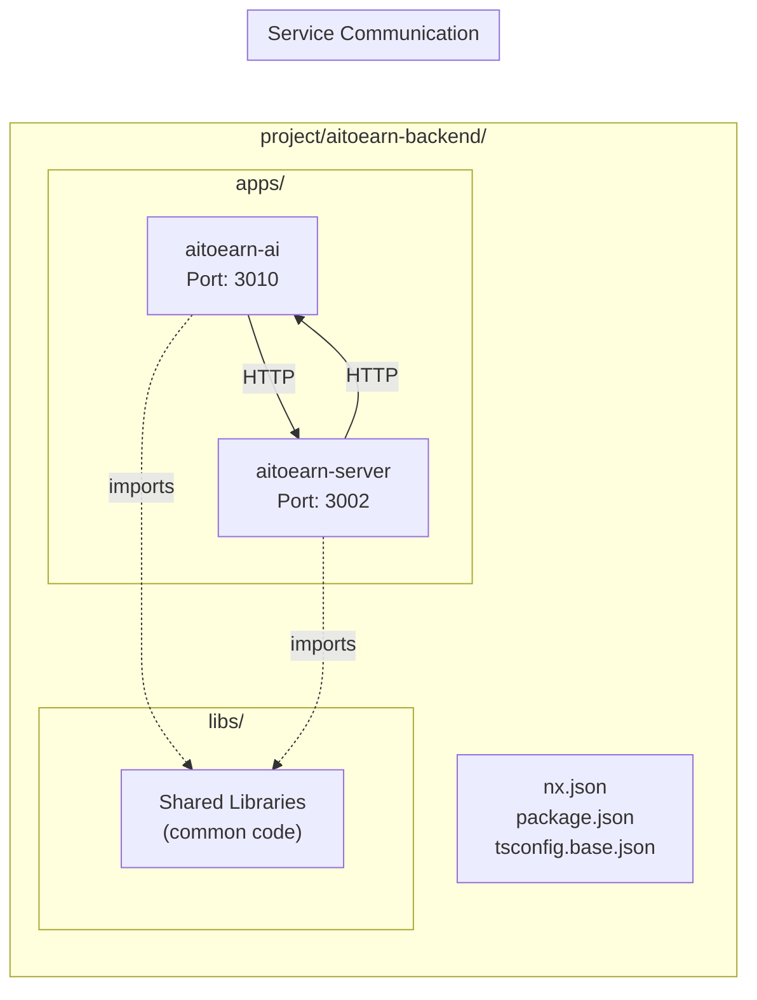
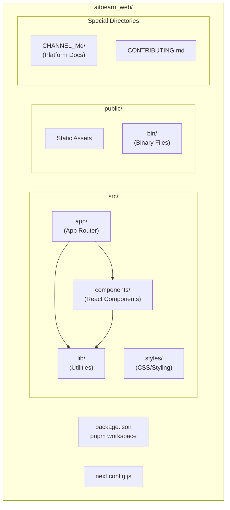
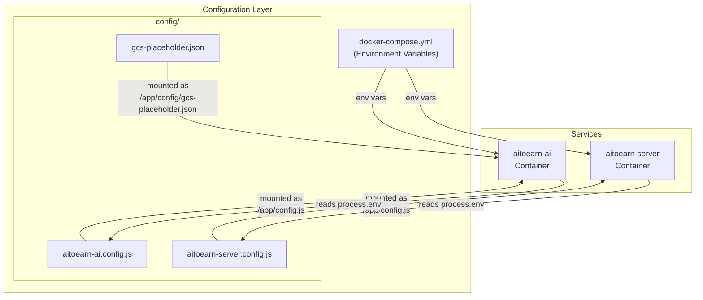
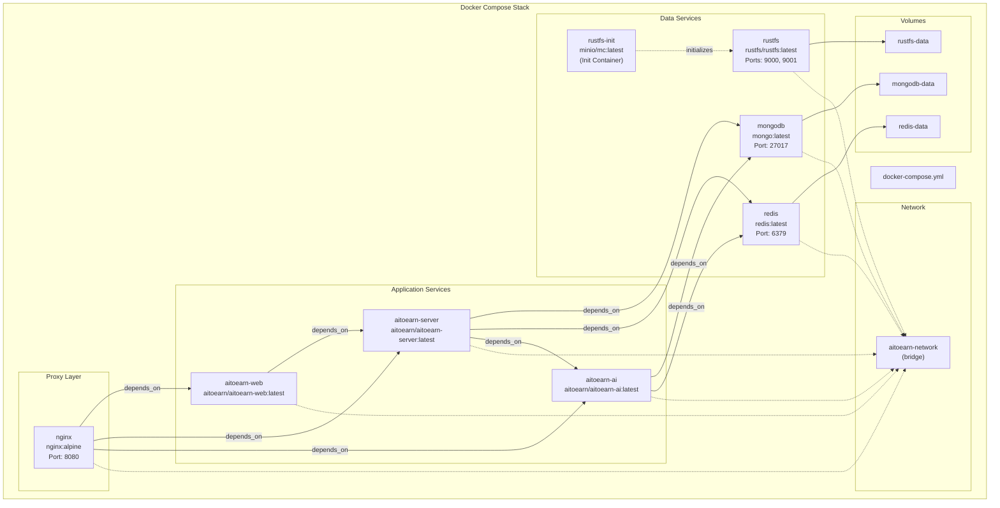

<!-- source: DeepWiki mcp.deepwiki.com · repo yikart/AiToEarn · page 8.2 Project Structure and Conventions · fetched 2026-10-30 -->

# Project Structure and Conventions

<details>
<summary>Relevant source files</summary>

The following files were used as context for generating this wiki page:

- [.gitignore](.gitignore)
- [DOCKER_DEPLOYMENT_CN.md](DOCKER_DEPLOYMENT_CN.md)
- [DOCKER_DEPLOYMENT_EN.md](DOCKER_DEPLOYMENT_EN.md)
- [README.md](README.md)
- [README_CN.md](README_CN.md)
- [docker-compose.yml](docker-compose.yml)
- [presentation/agent_0.png](presentation/agent_0.png)
- [presentation/display-1.5.2png.png](presentation/display-1.5.2png.png)
- [wechat.jpg](wechat.jpg)

</details>


This document describes the organization of the AiToEarn monorepo, including directory structure, naming conventions, module organization patterns, and important configuration files. Understanding this structure is essential for developers who want to contribute to or extend the platform.

For information about setting up a development environment, see [Development Mode Setup](#8.1). For deployment configuration details, see [Environment Configuration](#7.2).

## Repository Organization

AiToEarn uses a **monorepo structure** with separate directories for backend services, frontend application, infrastructure configuration, and deployment files. The repository is organized to support Docker-based deployment while also allowing independent development of each service.

**Key Characteristics:**
- **Backend**: NestJS monorepo in `project/aitoearn-backend/` containing two microservices
- **Frontend**: Next.js application in `aitoearn_web/`
- **Desktop**: Separate repository ([AttAiToEarn](https://github.com/yikart/AttAiToEarn)) for Electron app
- **Configuration**: Centralized config files in `config/` for Docker deployment
- **Infrastructure**: Docker Compose and Nginx configurations at root level

Sources: [README.md:158-216](), [README.md:220-242](), [docker-compose.yml:1-286]()

## Top-Level Directory Structure

```mermaid
graph TB
    root["AiToEarn Repository Root"]
    
    root --> backend["project/aitoearn-backend/<br/>(NestJS Monorepo)"]
    root --> web["aitoearn_web/<br/>(Next.js Frontend)"]
    root --> config["config/<br/>(Service Configs)"]
    root --> nginx_dir["nginx/<br/>(Nginx Config)"]
    root --> presentation["presentation/<br/>(Marketing Materials)"]
    root --> docker["docker-compose.yml"]
    root --> gitignore[".gitignore"]
    root --> readme["README.md / README_CN.md"]
    
    backend --> ai_service["apps/aitoearn-ai/<br/>(AI Service)"]
    backend --> server_service["apps/aitoearn-server/<br/>(Main Backend API)"]
    backend --> shared_libs["libs/<br/>(Shared Libraries)"]
    
    web --> web_src["src/<br/>(Source Code)"]
    web --> web_public["public/<br/>(Static Assets)"]
    web --> web_config["package.json<br/>next.config.js"]
    
    config --> ai_config["aitoearn-ai.config.js"]
    config --> server_config["aitoearn-server.config.js"]
    config --> gcs_config["gcs-placeholder.json"]
    
    nginx_dir --> nginx_conf["nginx.conf"]
    
    presentation --> screenshots["app-screenshot/"]
    presentation --> videos["display-*.png"]
    
    classDef services fill:#e8f5e9,stroke:#4caf50
    classDef config fill:#fff3e0,stroke:#f57c00
    classDef infra fill:#e3f2fd,stroke:#1976d2
    
    class backend,ai_service,server_service,web services
    class config,ai_config,server_config,nginx_dir,nginx_conf config
    class docker,gitignore infra
```



Sources: [README.md:158-242](), [docker-compose.yml:1-286](), [.gitignore:1-48]()

## Backend Services Structure

The backend is organized as a **NestJS monorepo** using Nx for build orchestration. It contains two main applications that share common libraries.



**Build and Run Commands:**
- Build: `npx nx build aitoearn-ai` or `npx nx build aitoearn-server`
- Dev mode: `npx nx serve aitoearn-ai` or `npx nx serve aitoearn-server`
- Both services must be started separately in development mode

**Service Responsibilities:**
- **aitoearn-ai**: AI model orchestration, content generation, multi-provider integration
- **aitoearn-server**: Main business logic, OAuth, database operations, platform publishing

Sources: [README.md:199-207](), [docker-compose.yml:81-134](), [docker-compose.yml:136-232]()

## Frontend Application Structure

The frontend is a **Next.js 14** application using the App Router pattern with React 18 and TypeScript.



**Package Management:**
- Uses `pnpm` for dependency management
- Development: `pnpm run dev`
- Production build: `pnpm run build`

**API Integration:**
- Backend URL configured via `NEXT_PUBLIC_API_URL` environment variable
- Default: `http://localhost:8080/api` (via Nginx proxy)

Sources: [README.md:209-215](), [docker-compose.yml:234-247](), [README_CN.md:195-200]()

## Configuration Management

Configuration is split between **environment variables** (in `docker-compose.yml`) and **application config files** (in `config/` directory).



**Configuration File Mapping:**

| File | Mounted To | Purpose |
|------|------------|---------|
| `config/aitoearn-ai.config.js` | `/app/config.js` in `aitoearn-ai` | AI model definitions, storage config, service URLs |
| `config/aitoearn-server.config.js` | `/app/config.js` in `aitoearn-server` | OAuth callbacks, storage config, email settings |
| `config/gcs-placeholder.json` | `/app/config/gcs-placeholder.json` in `aitoearn-ai` | Google Cloud service account credentials |

**Environment Variable Pattern:**
- Database credentials: `MONGODB_HOST`, `MONGODB_PORT`, `MONGODB_USERNAME`, `MONGODB_PASSWORD`
- Redis credentials: `REDIS_HOST`, `REDIS_PORT`, `REDIS_PASSWORD`
- Service URLs: `SERVER_URL`, `AI_URL`, `NEXT_PUBLIC_API_URL`
- API keys: `OPENAI_API_KEY`, `ANTHROPIC_API_KEY`, etc.

Sources: [docker-compose.yml:91-127](), [docker-compose.yml:148-226](), [DOCKER_DEPLOYMENT_EN.md:98-110]()

## Docker Deployment Structure

All services are orchestrated through **Docker Compose** with a custom bridge network for inter-service communication.



**Container Naming Convention:**
- Database: `aitoearn-mongodb`, `aitoearn-redis`
- Storage: `aitoearn-rustfs`, `aitoearn-rustfs-init`
- Application: `aitoearn-ai`, `aitoearn-server`, `aitoearn-web`
- Proxy: `aitoearn-nginx`

**Network Configuration:**
- Network name: `aitoearn-network`
- Driver: `bridge`
- Internal DNS: Services accessible by container name (e.g., `mongodb`, `redis`, `rustfs.local`)

**Volume Persistence:**
- `mongodb-data`: MongoDB database files (`/data/db`, `/data/configdb`)
- `redis-data`: Redis persistence files (`/data`)
- `rustfs-data`: Object storage data (`/data`)

Sources: [docker-compose.yml:1-286](), [DOCKER_DEPLOYMENT_EN.md:6-36]()

## Nginx Routing Configuration

Nginx acts as a **reverse proxy** routing requests to the appropriate backend service.

```mermaid
graph LR
    client["Client Browser<br/>localhost:8080"]
    
    subgraph "Nginx :80"
        proxy["nginx.conf"]
    end
    
    subgraph "Backend Services"
        web_service["aitoearn-web:3000<br/>(Next.js)"]
        api_service["aitoearn-server:3002<br/>(NestJS API)"]
        ai_api["aitoearn-ai:3010<br/>(AI Service)"]
    end
    
    client -->|":8080"| proxy
    proxy -->|"/" <br/> "/_next"| web_service
    proxy -->|"/api"| api_service
    proxy -->|"/ai-api"| ai_api
    proxy -->|"/_nhealth"| health["Health Check"]
```

**Routing Rules (from nginx.conf):**
- `/` → `aitoearn-web:3000` (Frontend)
- `/api` → `aitoearn-server:3002` (Backend API)
- `/ai-api` → `aitoearn-ai:3010` (AI Service, if exposed)
- `/_nhealth` → Nginx health check endpoint

**Configuration File:**
- Location: `nginx/nginx.conf`
- Mounted to: `/etc/nginx/nginx.conf` in nginx container (read-only)

Sources: [docker-compose.yml:248-270](), [DOCKER_DEPLOYMENT_EN.md:130-135]()

## Git Ignore Patterns

The `.gitignore` file follows standard Node.js patterns with project-specific exclusions.

### Standard Exclusions

**Build Artifacts:**
- `node_modules` - npm dependencies
- `dist` - Production builds
- `dist-ssr` - Server-side rendering builds
- `dist-electron` - Electron build output
- `release` - Release packages
- `*.local` - Local environment files

**Development Files:**
- `.vscode` - VS Code settings (partial)
- `.vscode/.debug.env` - Debug environment (specific)
- `.idea` - JetBrains IDE settings
- `.DS_Store` - macOS metadata
- Editor temp files: `*.suo`, `*.ntvs*`, `*.njsproj`, `*.sln`, `*.sw?`

**Test Output:**
- `/test-results/`
- `/playwright-report/`
- `/playwright/.cache/`

Sources: [.gitignore:1-34]()

### Project-Specific Exclusions

**Database Files:**
```
*.db
```
All SQLite database files are excluded (likely used in Electron app for local data).

**Binary Files:**
```
*.exe
```
Executable files are excluded from version control.

**Binary Directory Exception:**
```
public/bin/*
!public/bin/webkit
!public/bin/*.md
```
- Excludes all files in `public/bin/`
- **Except**: `webkit` subdirectory and `.md` documentation files

**Custom Paths:**
```
sh/*
project/web/.cursor/
```
- `sh/*` - Shell scripts directory (entire directory excluded)
- `project/web/.cursor/` - Cursor AI editor cache

**Lockfile Policy:**
The following lines are commented out, meaning lockfiles **are committed**:
```
# package-lock.json
# pnpm-lock.yaml
# yarn.lock
```
This ensures consistent dependency versions across environments.

Sources: [.gitignore:35-48]()

## Naming Conventions

### Service Names

**Pattern:** `aitoearn-{service-name}`

| Service Type | Container Name | Docker Image | Internal Hostname |
|--------------|----------------|--------------|-------------------|
| AI Service | `aitoearn-ai` | `aitoearn/aitoearn-ai:latest` | `aitoearn-ai` |
| Backend API | `aitoearn-server` | `aitoearn/aitoearn-server:latest` | `aitoearn-server` |
| Frontend | `aitoearn-web` | `aitoearn/aitoearn-web:latest` | `aitoearn-web` |
| Database | `aitoearn-mongodb` | `mongo:latest` | `mongodb` |
| Cache | `aitoearn-redis` | `redis:latest` | `redis` |
| Storage | `aitoearn-rustfs` | `rustfs/rustfs:latest` | `rustfs.local` |
| Proxy | `aitoearn-nginx` | `nginx:alpine` | - |

**Rationale:**
- Container names use full `aitoearn-` prefix for clarity in `docker ps` output
- Internal hostnames omit prefix for brevity in configuration
- RustFS uses `.local` TLD to distinguish as internal service

### Environment Variables

**Pattern by Category:**

| Category | Pattern | Examples |
|----------|---------|----------|
| Database Connection | `{SERVICE}_HOST`, `{SERVICE}_PORT`, `{SERVICE}_USERNAME`, `{SERVICE}_PASSWORD` | `MONGODB_HOST`, `REDIS_PORT` |
| API Keys | `{PROVIDER}_API_KEY` | `OPENAI_API_KEY`, `ANTHROPIC_API_KEY` |
| OAuth Credentials | `{PLATFORM}_CLIENT_ID`, `{PLATFORM}_CLIENT_SECRET` | `TIKTOK_CLIENT_ID`, `GOOGLE_CLIENT_SECRET` |
| Service URLs | `{SERVICE}_URL` | `SERVER_URL`, `AI_URL` |
| Feature Flags | `{FEATURE}_{SETTING}` | `NEXT_TELEMETRY_DISABLED` |

### Configuration Files

**Pattern:** `{service-name}.config.js`

- `aitoearn-ai.config.js` - AI service configuration
- `aitoearn-server.config.js` - Backend service configuration

**Service Account Keys:** `{provider}-{purpose}.json`
- `gcs-placeholder.json` - Google Cloud Service account placeholder

Sources: [docker-compose.yml:1-286](), [DOCKER_DEPLOYMENT_EN.md:140-151]()

## Module Organization Patterns

### NestJS Monorepo Structure

The backend follows **Nx monorepo** conventions with apps and shared libraries:

```
project/aitoearn-backend/
├── apps/
│   ├── aitoearn-ai/          # AI microservice
│   └── aitoearn-server/      # Main API microservice
├── libs/                      # Shared libraries
├── nx.json                    # Nx workspace config
├── package.json               # Root package.json
└── tsconfig.base.json         # Base TypeScript config
```

**Build System:**
- Uses **Nx** for monorepo orchestration
- Command pattern: `npx nx {command} {app-name}`
- Examples:
  - `npx nx serve aitoearn-ai` - Start AI service in dev mode
  - `npx nx build aitoearn-server` - Build server for production

Sources: [README.md:199-207]()

### Configuration File Structure

Config files use a **functional export pattern** that reads from `process.env`:

```javascript
// Typical config.js structure (example pattern)
module.exports = {
  port: parseInt(process.env.PORT) || 3010,
  
  mongodb: {
    uri: `mongodb://${process.env.MONGODB_USERNAME}:${process.env.MONGODB_PASSWORD}@${process.env.MONGODB_HOST}:${process.env.MONGODB_PORT}`,
    dbName: 'aitoearn',
  },
  
  redis: {
    host: process.env.REDIS_HOST,
    port: parseInt(process.env.REDIS_PORT),
    password: process.env.REDIS_PASSWORD,
  },
  
  auth: {
    secret: process.env.JWT_SECRET,
    expiresIn: 604800,
  },
  
  // AI model definitions (hardcoded)
  aiModels: [ /* ... */ ],
  
  // Storage config (hardcoded + env vars)
  assets: {
    provider: 's3',
    endpoint: 'http://rustfs.local:9000',
    accessKeyId: process.env.RUSTFS_ACCESS_KEY || 'rustfsadmin',
    // ...
  },
};
```

**Pattern Rationale:**
- Environment variables for **secrets and environment-specific values**
- Hardcoded configuration for **model lists, routes, and business logic**
- Allows config files to be committed while keeping secrets in env vars

Sources: [DOCKER_DEPLOYMENT_EN.md:98-110](), [docker-compose.yml:91-127]()

### Package Manager Consistency

**Backend Services (NestJS):**
- Uses `pnpm` for package management
- Workspace configuration in `package.json`

**Frontend (Next.js):**
- Uses `pnpm` for package management
- Independent `package.json` in `aitoearn_web/`

**Desktop App (Electron):**
- Separate repository: [AttAiToEarn](https://github.com/yikart/AttAiToEarn)
- Uses `npm` for package management
- Requires `node-gyp` for native dependencies (`better-sqlite3`)

Sources: [README.md:199-242]()

## Volume and Data Persistence

Docker volumes follow a **{service}-data** naming pattern:

| Volume Name | Purpose | Container Mount Point |
|-------------|---------|----------------------|
| `mongodb-data` | MongoDB database files | `/data/db` |
| `mongodb-config` | MongoDB configuration | `/data/configdb` |
| `redis-data` | Redis persistence | `/data` |
| `rustfs-data` | Object storage files | `/data` |

**Local Driver:**
All volumes use the `local` driver, storing data in Docker's volume directory on the host.

**Volume Lifecycle:**
- Created automatically on first `docker compose up`
- Persist across container restarts and recreations
- Removed only with `docker compose down -v` (explicit volume deletion)

**Backup Considerations:**
- MongoDB data at: `$(docker volume inspect aitoearn_mongodb-data -f '{{.Mountpoint}}')`
- RustFS data at: `$(docker volume inspect aitoearn_rustfs-data -f '{{.Mountpoint}}')`

Sources: [docker-compose.yml:277-285]()

## Health Check Patterns

All critical services implement **health check endpoints** for monitoring and orchestration:

### Service Health Checks

| Service | Check Method | Endpoint/Command | Interval |
|---------|--------------|------------------|----------|
| MongoDB | mongosh command | `db.runCommand("ping")` on `localhost:27017/test` | 10s |
| Redis | redis-cli | `redis-cli --raw incr ping` | 10s |
| RustFS | HTTP GET | `http://localhost:9000/health` | 10s |
| aitoearn-ai | Node.js HTTP | `http://localhost:3010/health` | 30s |
| aitoearn-server | Node.js HTTP | `http://localhost:3002/health` | 30s |
| Nginx | wget | `http://localhost/_nhealth` | 10s |

**Dependency Ordering:**
Services use `depends_on` with `condition: service_healthy` to ensure proper startup sequence:

```yaml
aitoearn-ai:
  depends_on:
    mongodb:
      condition: service_healthy
    redis:
      condition: service_healthy

aitoearn-server:
  depends_on:
    mongodb:
      condition: service_healthy
    redis:
      condition: service_healthy
    aitoearn-ai:
      condition: service_healthy
```

This ensures:
1. Data services (MongoDB, Redis) start first
2. AI service waits for data services
3. Server waits for AI service
4. Frontend and Nginx wait for server

Sources: [docker-compose.yml:16-21](), [docker-compose.yml:34-39](), [docker-compose.yml:58-63](), [docker-compose.yml:129-134](), [docker-compose.yml:227-232](), [docker-compose.yml:265-270]()

## Development vs. Production Modes

### Development Mode (Manual)

**Backend Services:**
```bash
cd project/aitoearn-backend
pnpm install
npx nx serve aitoearn-ai      # Terminal 1
npx nx serve aitoearn-server  # Terminal 2
```

**Frontend:**
```bash
cd aitoearn_web
pnpm install
pnpm run dev
```

**Characteristics:**
- Hot reload enabled for all services
- Services run on host machine (not in Docker)
- Must manually start MongoDB/Redis or use Docker for data services only
- Environment variables from local `.env` files

### Production Mode (Docker)

```bash
docker compose up -d
```

**Characteristics:**
- All services in containers
- Environment variables from `docker-compose.yml`
- Config files mounted from `config/` directory
- Nginx handles routing and SSL termination
- Persistent volumes for data
- Health checks and automatic restart policies

**Key Differences:**

| Aspect | Development | Production (Docker) |
|--------|-------------|---------------------|
| Service startup | Manual, independent | Automated, orchestrated |
| Config source | Local files, `.env` | `docker-compose.yml`, mounted configs |
| Hot reload | Yes | No (requires rebuild) |
| Networking | localhost ports | Docker internal network |
| Logs | Terminal output | `docker compose logs` |

Sources: [README.md:193-216](), [DOCKER_DEPLOYMENT_EN.md:53-128]()

## Desktop Application Repository

The Electron desktop application is maintained in a **separate repository** with different build requirements.

**Repository:** https://github.com/yikart/AttAiToEarn

**Setup:**
```bash
git clone https://github.com/yikart/AttAiToEarn.git
cd AttAiToEarn
npm i
npm run rebuild  # Compile native dependencies (better-sqlite3)
npm run dev
```

**Key Dependencies:**
- `better-sqlite3` - Requires native compilation with `node-gyp`
- Python required for node-gyp build process

**Integration:**
- Communicates with backend via same API endpoints as web frontend
- Can be configured to connect to local development server or production deployment

Sources: [README.md:220-242](), [README_CN.md:204-225]()