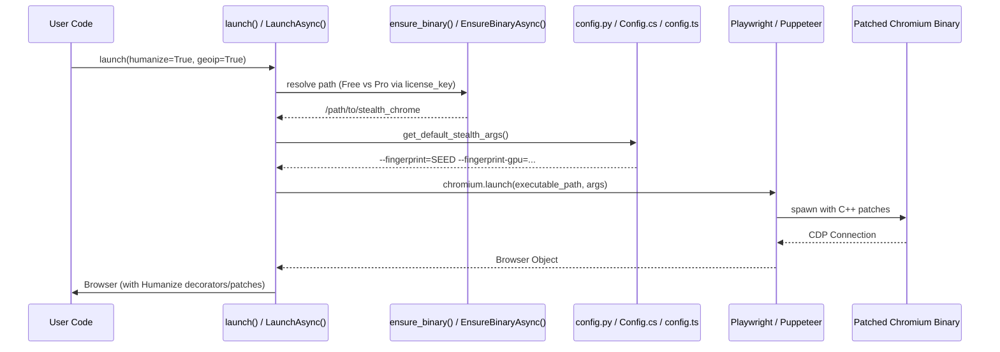

<!-- source: DeepWiki mcp.deepwiki.com · repo CloakHQ/CloakBrowser · page 1 Overview · fetched 2026-10-30 -->

# Overview

Relevant source files

The following files were used as context for generating this wiki page:

- [CHANGELOG.md](CHANGELOG.md)
- [README.md](README.md)
- [cloakbrowser/_version.py](cloakbrowser/_version.py)
- [dotnet/README.md](dotnet/README.md)
- [dotnet/src/CloakBrowser/CloakBrowser.csproj](dotnet/src/CloakBrowser/CloakBrowser.csproj)
- [dotnet/src/CloakBrowser/CloakVersion.cs](dotnet/src/CloakBrowser/CloakVersion.cs)
- [js/package-lock.json](js/package-lock.json)
- [js/package.json](js/package.json)

This page introduces CloakBrowser: what it is, why it exists, its high-level architecture connecting the three language packages (Python, JavaScript, and .NET) to the patched Chromium binary, and the bot-detection services it bypasses.

---

## What Is CloakBrowser

CloakBrowser is a stealth browser automation library distributed as three packages: `cloakbrowser` on PyPI, `cloakbrowser` on npm, and `CloakBrowser` on NuGet [README.md:101-122](). All packages are thin wrappers around a custom-built Chromium binary that has **71+ source-level C++ patches** applied directly to the browser engine [README.md:39-43](), [README.md:153-154]().

The library is a **drop-in replacement** for Playwright (Python, JavaScript, and .NET) and Puppeteer (JavaScript). Users call `launch()` and receive a standard Playwright `Browser` or Puppeteer `Browser` object; the API remains unchanged, allowing for a migration from stock automation frameworks by simply swapping the import [README.md:35-37](), [README.md:135-147]().

Sources: [README.md:35-43](), [README.md:101-122](), [README.md:135-147](), [README.md:153-154]()

---

## Why Source-Level Patches

Existing stealth tools (like `playwright-stealth` or `undetected-chromedriver`) work by injecting JavaScript or tweaking Chrome flags. These techniques are easily detected by modern antibot systems through overwritten `navigator` properties, CDP signal leakage, or proxy signal leaks [README.md:21-23]().

CloakBrowser patches Chromium at the C++ layer before compilation [README.md:21-23](). The binary that ships is a real Chromium build — the fingerprint modifications are present in the renderer and browser processes natively. Detection surfaces see consistent, correlated values (GPU, screen, UA, hardware reporting) that match a real user's browser because it *is* a real browser [README.md:21-23](), [README.md:39-43]().

**Key improvements over standard automation:**
- **Coherent Identities:** Fingerprints are built from real-world hardware values (GPU, display, graphics parameters) so they form a self-consistent device with no internal contradictions [README.md:158-159](), [CHANGELOG.md:11-14]().
- **Proxy Signal Removal:** DNS/connect/SSL timing is zeroed, proxy cache headers are stripped, and `Proxy-Connection` header leaks are removed to prevent detection [README.md:165-166]().
- **WebRTC IP Spoofing:** The `--fingerprint-webrtc-ip=auto` flag resolves proxy exit IPs to spoof WebRTC ICE candidates natively [README.md:167-168]().
- **Automation Signal Masking:** Patches internal CDP and automation signals that reCAPTCHA Enterprise and other advanced systems use to identify remote-controlled browsers [README.md:39-43]().

Sources: [README.md:21-23](), [README.md:39-43](), [README.md:158-168](), [CHANGELOG.md:11-14]()

---

## Free vs. Pro Tier Model

CloakBrowser operates on a tiered binary model. While the wrapper code is open-source (MIT License), the binaries are governed by a separate license [README.md:45-45]().

| Tier | Binary Version | Features |
|---|---|---|
| **Free** | Chromium v146 | 58+ patches. Available for personal and commercial use via GitHub sign-in [README.md:166-167](). |
| **Pro** | Chromium v150+ | 71+ source-level patches. Latest fingerprint updates, highest reCAPTCHA scores (0.9), Windows native GPU passthrough, and expanded locale coverage [README.md:153-159](), [CHANGELOG.md:11-13](). |

The Pro tier requires a `license_key` (`licenseKey` in JS, `LicenseKey` in .NET) passed to `launch()` or set via the `CLOAKBROWSER_LICENSE_KEY` environment variable [README.md:155-155](). The wrappers automatically handle license validation and session counting, raising a `CloakBrowserLicenseError` if limits are exceeded or if the license is invalid [CHANGELOG.md:38-45]().

Sources: [README.md:153-167](), [CHANGELOG.md:11-45]()

---

## System Architecture

The codebase consists of parallel implementations across three languages, all targeting a shared binary ecosystem.

**CloakBrowser: Module and Entity Map**

```mermaid
graph TD
    subgraph "Python Package (PyPI: cloakbrowser)"
        PyInit["cloakbrowser/__init__.py\n(launch / launch_async)"]
        PyDownload["cloakbrowser/download.py\nensure_binary"]
        PyConfig["cloakbrowser/config.py\nget_default_stealth_args"]
        PyHuman["cloakbrowser/human/config.py\nHumanConfig"]
    end

    subgraph "JavaScript Package (npm: cloakbrowser)"
        JSIndex["js/src/index.ts\n(launch / launchContext)"]
        JSPuppeteer["js/src/puppeteer.ts\n(Puppeteer launch)"]
        JSDownload["js/src/download.ts\nensureBinary"]
        JSConfig["js/src/config.ts\ngetEffectiveVersion"]
    end

    subgraph ".NET Package (NuGet: CloakBrowser)"
        NetLauncher["dotnet/src/CloakBrowser/CloakLauncher.cs\nLaunchAsync"]
        NetDownload["dotnet/src/CloakBrowser/Download.cs\nEnsureBinaryAsync"]
        NetConfig["dotnet/src/CloakBrowser/Config.cs\nGetDefaultStealthArgs"]
        NetHuman["dotnet/src/CloakBrowser/Human/HumanConfig.cs\nHumanConfig"]
    end

    subgraph "Binary Layer"
        BinCache["~/.cloakbrowser/\n(Binary & License Cache)"]
        BinExec["Stealth Chromium\n(v146 Free / v150 Pro)"]
        LicenseGate["cloakbrowser.dev\n(License Validation)"]
    end

    PyInit --> PyDownload
    JSIndex --> JSDownload
    NetLauncher --> NetDownload

    PyInit -.-> BinExec
    JSIndex -.-> BinExec
    NetLauncher -.-> BinExec
    
    PyDownload -.-> LicenseGate
    JSDownload -.-> LicenseGate
    NetDownload -.-> LicenseGate
    
    BinExec --> BinCache
```

Sources: [README.md:101-122](), [js/package.json:1-21](), [cloakbrowser/_version.py:1-1](), [dotnet/src/CloakBrowser/CloakVersion.cs:1-8](), [dotnet/README.md:108-146]()

---

## Launch and Resolution Flow

When a user calls `launch()`, the wrapper performs binary resolution and stealth configuration before spawning the process.

**launch() to usable Browser object**

Sources: [README.md:55-95](), [CHANGELOG.md:43-45](), [dotnet/README.md:48-66](), [dotnet/README.md:114-123]()

---

## Stealth Mechanism Summary

- **71+ Source-Level Patches:** Covers canvas, WebGL, audio, fonts, GPU, screen, WebRTC, network timing, and automation signals [README.md:39-43](), [README.md:153-154]().
- **`humanize=True`:** Activates a behavioral layer simulating Bézier mouse curves, per-character typing with mistypes, and realistic scroll patterns across all three languages [README.md:40-40](), [CHANGELOG.md:22-31]().
- **GeoIP Auto-Detection:** Automatically matches browser timezone and locale to the proxy's exit IP using an offline GeoLite2 database [README.md:82-82](), [CHANGELOG.md:37-37]().
- **Native SOCKS5/HTTP Proxy:** Credentials and UDP (QUIC/HTTP3) are handled natively by the binary to prevent proxy-specific header leaks [README.md:165-166]().

Sources: [README.md:39-43](), [README.md:153-166](), [CHANGELOG.md:22-37]()

---

## Bot Detection Results

CloakBrowser is tested against major detection services to ensure high human-scores.

| Detection Service | Stock Playwright | CloakBrowser | Status |
|---|---|---|---|
| **reCAPTCHA v3** | ~0.1 (Bot) | **0.9** (Human) | ✅ Pass [README.md:41-41]() |
| **Cloudflare Turnstile** | Blocked | **Pass** | ✅ Pass [README.md:28-30]() |
| **FingerprintJS** | Detected | **Pass** | ✅ Pass [README.md:42-42]() |
| **BrowserScan** | Detected | **Normal** | ✅ Pass [README.md:42-42]() |

Sources: [README.md:28-30](), [README.md:41-42]()

---

