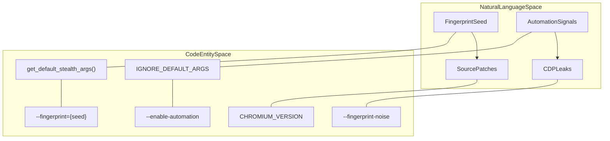
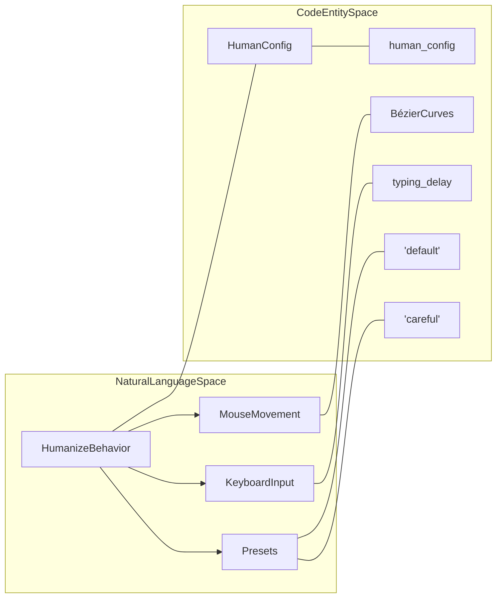

<!-- source: DeepWiki mcp.deepwiki.com · repo CloakHQ/CloakBrowser · page 10 Glossary · fetched 2026-10-30 -->

# Glossary

Relevant source files

The following files were used as context for generating this wiki page:

- [.gitattributes](.gitattributes)
- [BINARY-LICENSE.md](BINARY-LICENSE.md)
- [CHANGELOG.md](CHANGELOG.md)
- [LICENSE](LICENSE)
- [README.md](README.md)
- [cloakbrowser/__main__.py](cloakbrowser/__main__.py)
- [cloakbrowser/browser.py](cloakbrowser/browser.py)
- [cloakbrowser/download.py](cloakbrowser/download.py)
- [cloakbrowser/geoip.py](cloakbrowser/geoip.py)
- [dotnet/README.md](dotnet/README.md)
- [dotnet/src/CloakBrowser.Cli/Program.cs](dotnet/src/CloakBrowser.Cli/Program.cs)
- [dotnet/src/CloakBrowser/CloakBrowser.csproj](dotnet/src/CloakBrowser/CloakBrowser.csproj)
- [dotnet/src/CloakBrowser/CloakVersion.cs](dotnet/src/CloakBrowser/CloakVersion.cs)
- [dotnet/src/CloakBrowser/Diagnostics.cs](dotnet/src/CloakBrowser/Diagnostics.cs)
- [dotnet/src/CloakBrowser/Download.cs](dotnet/src/CloakBrowser/Download.cs)
- [js/package-lock.json](js/package-lock.json)
- [js/src/cli.ts](js/src/cli.ts)
- [js/src/download.ts](js/src/download.ts)
- [js/src/geoip.ts](js/src/geoip.ts)
- [js/src/playwright.ts](js/src/playwright.ts)
- [js/src/puppeteer.ts](js/src/puppeteer.ts)
- [js/tests/geoip.test.ts](js/tests/geoip.test.ts)
- [pyproject.toml](pyproject.toml)
- [tests/test_cli.py](tests/test_cli.py)
- [tests/test_geoip.py](tests/test_geoip.py)

This page provides definitions for codebase-specific terms, technical jargon, and abbreviations used throughout the CloakBrowser project. It serves as a reference for onboarding engineers to understand the underlying mechanics of stealth automation, the binary lifecycle, and the Pro licensing system.

## Stealth & Fingerprinting Terminology

Terms related to the core mission of CloakBrowser: bypassing bot detection by modifying browser identity and behavior.

| Term | Definition | Implementation Detail |
| :--- | :--- | :--- |
| **Source-level Patches** | Modifications made directly to the Chromium C++ source code before compilation. | Unlike JS injection, these cannot be detected by monitoring the DOM or environment globals. [README.md:21-23](), [README.md:39-40]() |
| **Fingerprint Seed** | A random integer (10000-99999) generated at launch to drive deterministic randomization of browser fingerprints. | Generated in `get_default_stealth_args` and passed via `--fingerprint`. [cloakbrowser/config.py:30-31](), [js/src/config.ts:30-31]() |
| **Stealth Args** | Command-line flags passed to the Chromium binary to activate specific C++ patches. | Managed via `get_default_stealth_args()` in Python and `getDefaultStealthArgs()` in JS. [cloakbrowser/config.py:30-31](), [js/src/playwright.ts:13-15]() |
| **Automation Signals** | Browser properties (like `navigator.webdriver`) that reveal the browser is controlled by a script. | CloakBrowser suppresses these by ignoring default Playwright flags like `--enable-automation`. [cloakbrowser/config.py:26-27](), [js/src/playwright.ts:10-11]() |
| **CDP Leaks** | Detection vectors where Chrome DevTools Protocol (CDP) commands produce different internal signals than real hardware. | Mitigated by source-level patches that intercept CDP input events to mimic real user signals. [README.md:39-40](), [CHANGELOG.md:14-16]() |
| **Hardware Identity** | The combination of GPU, RAM, CPU cores, and screen characteristics reported by the browser. | In Pro builds, these are chosen to form a popular, self-consistent device with no internal contradictions. [CHANGELOG.md:11-14](), [README.md:157-159]() |
| **Coherence** | The consistency of browser signals across different APIs (e.g., WebGL reporting the same GPU as the User-Agent). | CloakBrowser ensures coherence across top-level and nested frames. [CHANGELOG.md:14-15](), [CHANGELOG.md:23-24]() |
| **Noise Injection** | The technique of adding subtle, deterministic randomization to canvas, WebGL, and audio data. | Activated via `--fingerprint-noise` and driven by the seed. [README.md:39-40]() |

### Code Entity Mapping: Stealth System
The following diagram connects stealth concepts to the specific functions and flags that implement them.

Title: Stealth System Architecture

**Sources:** [cloakbrowser/config.py:24-43](), [js/src/playwright.ts:8-15](), [CHANGELOG.md:11-24]()

---

## Binary Lifecycle & Licensing Terms

Terms related to how the patched Chromium binary is distributed, verified, and restricted via licensing.

*   **Binary Cache**: The local directory where Chromium binaries are stored. Defaults to `~/.cloakbrowser/`. [cloakbrowser/download.py:38-39](), [js/src/download.ts:27-28]()
*   **Marker Files**: Small files in the cache dir used for state tracking, such as `.latest_version`, `.welcome_shown`, or `.last_update_check`. [cloakbrowser/download.py:67-73](), [cloakbrowser/download.py:126-127](), [js/src/download.ts:41-48]()
*   **Effective Version**: The specific Chromium version string selected for launch, prioritizing auto-updated versions over the hardcoded default. [cloakbrowser/download.py:41-42](), [js/src/download.ts:30-31](), [js/src/cli.ts:137-140]()
*   **Platform Tag**: A string identifying the OS and architecture (e.g., `linux-x64`, `win32`, `darwin-arm64`). [cloakbrowser/download.py:44-45](), [js/src/download.ts:33-34]()
*   **Free vs. Pro Tier**: The Free tier uses an older binary; the Pro tier provides access to v150+ builds with the latest patches. [README.md:41-45](), [CHANGELOG.md:11-13]()
*   **BinaryVerificationError**: An error raised when a downloaded binary fails SHA-256 checksum or Ed25519 signature verification. [js/src/download.ts:61-66](), [cloakbrowser/download.py:52-60]()
*   **Ed25519 Signature**: A cryptographic signature used to verify binary authenticity before extraction. [js/src/download.ts:8-12](), [dotnet/src/CloakBrowser/CloakBrowser.csproj:33-36]()
*   **License Gate**: A check within the Pro binary that exits with specific codes (76-79) if a valid license is not present or session limits are reached. [cloakbrowser/browser.py:51-56](), [CHANGELOG.md:45-47]()
*   **Session Limit**: The maximum number of concurrent browser instances allowed by a license key. [js/src/cli.ts:29-30](), [CHANGELOG.md:45-47]()
*   **License Cache TTL**: The duration for which license validation results are stored locally to allow offline launch. [js/src/download.ts:43-48]()

---

## Subsystem Names

*   **Humanize**: The behavioral layer that simulates human-like mouse curves, keyboard timing, and scroll patterns. [README.md:40-41](), [js/src/playwright.ts:166-170](), [js/src/puppeteer.ts:156-160]()
*   **GeoIP**: Resolves the exit IP of a proxy to determine the correct timezone and locale. [README.md:129-133](), [js/src/geoip.ts:17-19]()
*   **CloakServe**: A specialized CDP server mode for remote browser management. [README.md:164-165]()
*   **CloakTest**: A Docker-based utility to verify stealth passing. [README.md:49-51]()
*   **Doctor**: A diagnostic alias for the `info` command that performs environment probes. [cloakbrowser/__main__.py:5-8](), [js/src/cli.ts:7-10]()

---

## Bot Detection & API Terms

*   **reCAPTCHA / Turnstile / FingerprintJS / BrowserScan / DataDome**: Third-party services CloakBrowser is designed to bypass. [README.md:41-43]()
*   **Persistent Context**: A browser session that saves profile data (cookies, localStorage) to a disk directory. [js/src/playwright.ts:7-12]()
*   **Incognito Detection**: Bot detection techniques that identify private browsing modes; CloakBrowser patches these to appear as normal sessions. [README.md:21-23]()
*   **Storage Quota Normalization**: A patch to ensure `navigator.storage.estimate()` returns values consistent with the spoofed hardware. [CHANGELOG.md:14-15]()
*   **Bézier Curves**: Mathematical paths used for realistic, non-linear mouse movement in the humanize layer. [README.md:168-169]()
*   **Patchright**: A specific backend parameter for the Python package to use an alternative automation driver. [cloakbrowser/browser.py:24-31]()
*   **Decorator Layer**: The architectural pattern used in .NET to wrap Playwright interfaces. [dotnet/src/CloakBrowser/CloakBrowser.csproj:39-43]()
*   **Roslyn Source Generator**: The code generation tool used in .NET to generate humanized wrappers at compile time. [dotnet/src/CloakBrowser/CloakBrowser.csproj:39-43]()
*   **OIDC Trusted Publishing**: The secure release mechanism used for PyPI and npm. [README.md:149-150]()
*   **Widevine CDM**: The Content Decryption Module required for DRM-protected video playback. [js/src/widevine.ts:25-27](), [cloakbrowser/browser.py:43-44]()

### Code Entity Mapping: Humanize Subsystem
This diagram shows how the high-level concept of "Humanize" translates into specific classes and configuration objects in the code.

Title: Humanize Subsystem Mapping

**Sources:** [README.md:40-41](), [js/src/playwright.ts:166-179](), [js/src/puppeteer.ts:156-165]()

---
**Sources:**
- [README.md:21-169]()
- [CHANGELOG.md:11-47]()
- [cloakbrowser/config.py:24-43]()
- [js/src/config.ts:30-169]()
- [js/src/download.ts:27-160]()
- [cloakbrowser/download.py:38-205]()
- [js/src/cli.ts:1-140]()
- [js/src/playwright.ts:7-179]()
- [js/src/puppeteer.ts:7-165]()
- [dotnet/src/CloakBrowser/CloakBrowser.csproj:1-50]()
- [cloakbrowser/browser.py:24-173]()