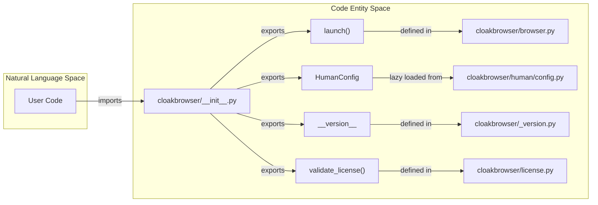

<!-- source: DeepWiki mcp.deepwiki.com · repo CloakHQ/CloakBrowser · page 3 Python Package · fetched 2026-10-30 -->

# Python Package

<details>
<summary>Relevant source files</summary>

The following files were used as context for generating this wiki page:

- [cloakbrowser/__init__.py](cloakbrowser/__init__.py)
- [cloakbrowser/browser.py](cloakbrowser/browser.py)
- [cloakbrowser/config.py](cloakbrowser/config.py)
- [js/src/config.ts](js/src/config.ts)
- [js/src/index.ts](js/src/index.ts)
- [js/src/playwright.ts](js/src/playwright.ts)
- [js/src/puppeteer.ts](js/src/puppeteer.ts)
- [js/src/types.ts](js/src/types.ts)
- [js/tests/launch.test.ts](js/tests/launch.test.ts)

</details>


This page covers the structure, module layout, public API surface, versioning, and runtime dependencies of the `cloakbrowser` Python package. It is an overview document; for detailed function-level reference see [Python API Reference](#3.1), [Python Configuration Module](#3.2), and [Python Binary Management](#3.3).

---

## Purpose

The `cloakbrowser` Python package is a drop-in replacement for Playwright that routes browser automation through a patched Chromium binary. It handles binary lifecycle management (download, cache, auto-update), stealth argument configuration, and Playwright session wiring — all behind a minimal public API.

Sources: [cloakbrowser/__init__.py:1-12](), [cloakbrowser/browser.py:1-13]()

---

## Module Layout

The package lives in the `cloakbrowser/` directory at the repository root. Each module has a single, well-defined responsibility.

**Module structure diagram**

```mermaid
graph TD
    ["init [cloakbrowser/__init__.py]"]
    ["browser [cloakbrowser/browser.py]"]
    ["download [cloakbrowser/download.py]"]
    ["config [cloakbrowser/config.py]"]
    ["human [cloakbrowser/human/]"]
    ["license [cloakbrowser/license.py]"]
    ["version [cloakbrowser/_version.py]"]

    ["init [cloakbrowser/__init__.py]"] --> ["browser [cloakbrowser/browser.py]"]
    ["init [cloakbrowser/__init__.py]"] --> ["download [cloakbrowser/download.py]"]
    ["init [cloakbrowser/__init__.py]"] --> ["config [cloakbrowser/config.py]"]
    ["init [cloakbrowser/__init__.py]"] --> ["human [cloakbrowser/human/]"]
    ["init [cloakbrowser/__init__.py]"] --> ["license [cloakbrowser/license.py]"]
    ["init [cloakbrowser/__init__.py]"] --> ["version [cloakbrowser/_version.py]"]

    ["browser [cloakbrowser/browser.py]"] --> ["download [cloakbrowser/download.py]"]
    ["browser [cloakbrowser/browser.py]"] --> ["config [cloakbrowser/config.py]"]
    ["browser [cloakbrowser/browser.py]"] --> ["license [cloakbrowser/license.py]"]
    ["download [cloakbrowser/download.py]"] --> ["config [cloakbrowser/config.py]"]
    ["license [cloakbrowser/license.py]"] --> ["config [cloakbrowser/config.py]"]
```

Sources: [cloakbrowser/__init__.py:14-18]()

| Module | Primary exports | Role |
|---|---|---|
| `__init__.py` | All public symbols | Re-exports; defines `__all__`; handles lazy loading for `HumanConfig` |
| `browser.py` | `launch`, `launch_async`, `launch_context`, `ProxySettings` | Playwright session setup and browser patching |
| `download.py` | `ensure_binary`, `clear_cache`, `binary_info`, `check_for_update` | Binary lifecycle and download management |
| `config.py` | `CHROMIUM_VERSION`, `get_default_stealth_args`, path helpers | Constants, platform logic, and stealth defaults |
| `license.py` | `validate_license`, `CloakBrowserLicenseError`, `LicenseInfo` | License resolution, server validation, and Pro tier exit code mapping |
| `human/` | `HumanConfig`, `resolve_config` | Behavioral layer for human-like interactions |
| `_version.py` | `__version__` | Single-source version string |

Sources: [cloakbrowser/__init__.py:14-54]()

---

## Public API Surface

`__init__.py` is the primary entry point for user code. It imports from internal modules and declares `__all__` explicitly. Notably, it uses `__getattr__` to lazily load the `HumanConfig` components to avoid unnecessary imports if the behavioral layer is not used.

**API surface diagram**



Sources: [cloakbrowser/__init__.py:14-54]()

The complete `__all__` list as declared in `__init__.py`:

```python
__all__ = [
    "launch",
    "launch_async",
    "launch_context",
    "launch_context_async",
    "launch_persistent_context",
    "launch_persistent_context_async",
    "ensure_binary",
    "clear_cache",
    "binary_info",
    "check_for_update",
    "CHROMIUM_VERSION",
    "get_default_stealth_args",
    "build_args",
    "maybe_resolve_geoip",
    "ProxySettings",
    "validate_license",
    "LicenseInfo",
    "CloakBrowserLicenseError",
    "HumanConfig",
    "resolve_human_config",
    "__version__",
]
```

Sources: [cloakbrowser/__init__.py:32-54]()

---

## Versioning

The package version is stored as a plain string in `_version.py`. This ensures the version is consistent across `pip show cloakbrowser`, `cloakbrowser.__version__`, and the built distribution metadata.

- Single source of truth: [cloakbrowser/_version.py:1-1]()
- Re-exported in `__init__.py` as `__version__`: [cloakbrowser/__init__.py:18-18]()

Sources: [cloakbrowser/_version.py:1-1]()

---

## Runtime Dependencies

The package relies on several key libraries to function:

| Dependency | Role |
|---|---|
| `playwright` | Core automation framework; `launch()` delegates to it. |
| `httpx` | HTTP client for binary downloads, license validation, and update checks. |
| `mmdb-lib` | (Optional) Required for `geoip=True` auto-detection. |

Sources: [cloakbrowser/browser.py:3-4](), [js/package.json:60-65]()

Python version support: `>=3.9` is required due to type hinting and dependency constraints.

---

## Licensing and Pro Tier

The Python package includes a dedicated `license.py` module to handle CloakBrowser Pro features. It maps specific Chromium exit codes (76-79) to human-readable `CloakBrowserLicenseError` messages, such as session limits or invalid keys.

- **Resolution Priority:** Explicit parameter > `CLOAKBROWSER_LICENSE_KEY` env var > `~/.cloakbrowser/license.key` file.
- **Caching:** Validated licenses are cached locally for 24 hours to minimize API calls.
- **Guard Logic:** The package uses `_install_license_guard` to intercept post-launch license denials and surface them as `CloakBrowserLicenseError` instead of generic `TargetClosedError`.

Sources: [cloakbrowser/browser.py:123-161](), [cloakbrowser/browser.py:33-41](), [cloakbrowser/__init__.py:17-17]()

---

## Typical Import Pattern

The simplest usage pattern involves importing `launch` directly from the top-level package:

```python
from cloakbrowser import launch

# Launches patched Chromium and returns a Playwright Browser object
browser = launch()
page = browser.new_page()
page.goto("https://protected-site.com")
browser.close()
```

Sources: [cloakbrowser/__init__.py:5-11]()

---

## Related Pages

- [Python API Reference](#3.1) — Full parameter-level documentation for `launch()`, `launch_context()`, and utility functions.
- [Python Configuration Module](#3.2) — `config.py` internals: platform detection, stealth argument generation, and path resolution.
- [Python Binary Management](#3.3) — `download.py` internals: download flow, extraction, and auto-update logic.
- [JavaScript Package](#4) — The parallel npm package with equivalent functionality.

---

