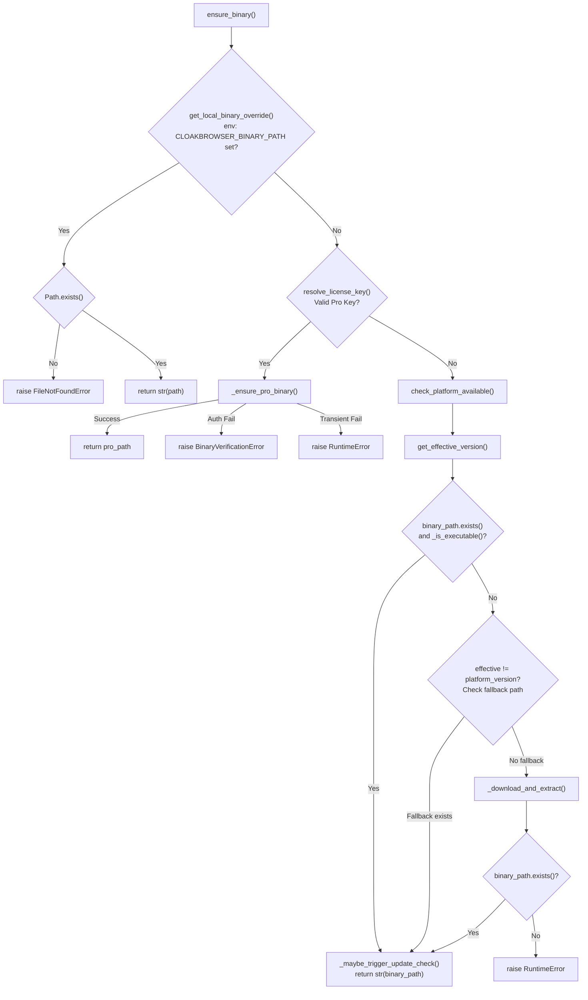
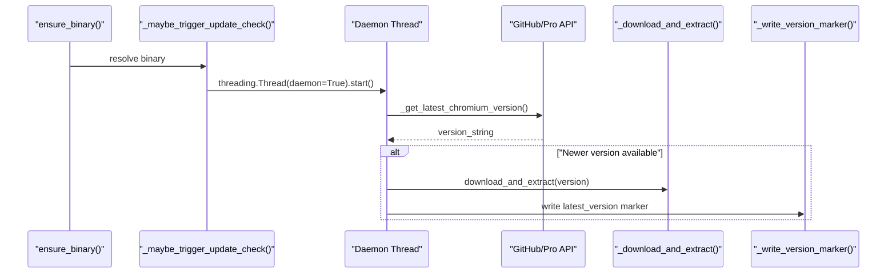

<!-- source: DeepWiki mcp.deepwiki.com · repo CloakHQ/CloakBrowser · page 3.3 Python Binary Management · fetched 2026-10-30 -->

# Python Binary Management

Relevant source files

The following files were used as context for generating this wiki page:

- [cloakbrowser/download.py](cloakbrowser/download.py)
- [dotnet/src/CloakBrowser/Download.cs](dotnet/src/CloakBrowser/Download.cs)
- [js/src/download.ts](js/src/download.ts)
- [js/tests/update.test.ts](js/tests/update.test.ts)
- [tests/test_extract.py](tests/test_extract.py)
- [tests/test_update.py](tests/test_update.py)

This page documents `cloakbrowser/download.py`, which is responsible for resolving, downloading, extracting, and caching the patched Chromium binary used by the Python package. It also covers the priority resolution between Free and Pro tiers, background auto-update system, SHA-256 checksum verification, Ed25519 signature verification, and the public utility functions `check_for_update()`, `clear_cache()`, and `binary_info()`.

For the configuration values that `download.py` depends on (cache paths, version strings, platform detection, download URLs), see the [Python Configuration Module](3.2). For the public `launch()` API that calls `ensure_binary()` on each invocation, see the [Python API Reference](3.1).

---

## Module Constants

Module-level constants govern timing and network behavior:

| Constant | Value | Purpose |
|---|---|---|
| `DOWNLOAD_TIMEOUT` | `httpx.Timeout` | 10-minute timeout for large binary downloads. [cloakbrowser/download.py:64-64]() |
| `UPDATE_CHECK_INTERVAL` | `3600` seconds | Minimum gap between background update checks (1 hour). [cloakbrowser/download.py:67-67]() |
| `WELCOME_FREE_INTERVAL` | `86400` seconds | Interval (1 day) for re-showing the Pro upsell banner to free users. [cloakbrowser/download.py:72-72]() |
| `PRO_MAJOR` | `"150"` | Major version indicator for the Pro tier shown in banners. [cloakbrowser/download.py:77-77]() |

Sources: [cloakbrowser/download.py:63-77]()

---

## `ensure_binary()` — Binary Resolution Flow

`ensure_binary()` is the primary entry point. It is called by `launch()` and `launch_async()` before starting the browser. It returns a string path to the `chrome` executable, downloading it first if necessary. [cloakbrowser/download.py:166-173]()

**Binary Resolution Priority (in order):**

1.  **Local override** — If `CLOAKBROWSER_BINARY_PATH` is set via `get_local_binary_override()`, return that path immediately (or raise `FileNotFoundError` if it does not exist on disk). [cloakbrowser/download.py:183-191]()
2.  **Pro Tier Resolution** — If a license key is resolved via `resolve_license_key()`, validate it via `validate_license()`. If valid, call `_ensure_pro_binary()`. This handles Pro-specific downloads and verification. [cloakbrowser/download.py:198-216]()
3.  **Platform check** — Call `check_platform_available()` to fail fast on unsupported platforms. [cloakbrowser/download.py:230-230]()
4.  **Effective version** — Call `get_effective_version()` to determine whether an auto-updated binary is available via the `latest_version` marker. [cloakbrowser/download.py:256-257]()
5.  **Hardcoded fallback** — If the effective-version binary does not exist, check whether the hardcoded `CHROMIUM_VERSION` binary is already cached. [cloakbrowser/download.py:266-273]()
6.  **Download** — If no cached binary is found, download the version by calling `_download_and_extract()`. [cloakbrowser/download.py:279-279]()
7.  **Background update check** — After resolving a binary, call `_maybe_trigger_update_check()` to schedule a background update thread. [cloakbrowser/download.py:291-291]()

**Binary Resolution Flow Diagram**

Sources: [cloakbrowser/download.py:166-292]()

---

## Download and Extraction

### `_download_and_extract(version)`

This function orchestrates the full download-and-extract cycle for a given version. It uses a **temporary file** to ensure atomicity: the archive is downloaded to a `tempfile.NamedTemporaryFile` before extraction begins. [cloakbrowser/download.py:335-337]()

Steps:
1.  Resolve URLs via `get_download_url(version)` (primary) and `get_fallback_download_url(version)`. [cloakbrowser/download.py:326-327]()
2.  Create a named temp file. [cloakbrowser/download.py:335-336]()
3.  Call `_download_file()`. It tries the primary URL first; if it fails, it tries the fallback URL. [cloakbrowser/download.py:340-349]()
4.  Verify SHA-256 checksum via `_verify_download_checksum()` unless `CLOAKBROWSER_SKIP_CHECKSUM` is true. [cloakbrowser/download.py:352-353]()
5.  Call `_extract_archive()`. [cloakbrowser/download.py:355-355]()
6.  Delete the temp file in a `finally` block. [cloakbrowser/download.py:359-359]()

Sources: [cloakbrowser/download.py:319-360]()

### Security Verification

The system employs two layers of verification to prevent tampering:

1.  **SHA-256 Checksum**: Integrity verification via `SHA256SUMS` files. [cloakbrowser/download.py:362-430]()
    *   **`_fetch_checksums(version)`**: Fetches the checksum file from the primary or fallback server. [cloakbrowser/download.py:379-398]()
    *   **`_verify_checksum(file_path, expected_hash)`**: Computes the SHA-256 hash in 64KB chunks. [cloakbrowser/download.py:418-430]()
2.  **Ed25519 Signature (Pro Only)**: Pro binaries use a signed manifest for authenticity. [cloakbrowser/download.py:767-791]()
    *   **`_verify_signature(data, signature)`**: Uses `cryptography` to verify the manifest against pinned `BINARY_SIGNING_PUBKEYS`. [cloakbrowser/download.py:767-791]()
    *   **`_verify_pro_download(binary_path, manifest)`**: Ensures the downloaded binary matches the hash specified in the signed manifest. [cloakbrowser/download.py:749-764]()

Sources: [cloakbrowser/download.py:362-430](), [cloakbrowser/download.py:749-791]()

### Extraction and Post-Processing

`_extract_archive(archive_path, dest_dir, binary_path)` handles extraction via `tarfile` or `zipfile`. [cloakbrowser/download.py:444-446]()

| Behavior | Detail |
|---|---|
| **Path-traversal filter** | Members with absolute paths or `..` raise `RuntimeError`. [cloakbrowser/download.py:506-516]() |
| **Symlink safety** | Absolute symlink targets are skipped to prevent out-of-bounds writes. [cloakbrowser/download.py:519-525]() |
| **Directory flattening** | `_flatten_single_subdir()` moves contents up if the archive contains a single root folder. [cloakbrowser/download.py:563-581]() |
| **macOS Quarantine** | Runs `xattr -cr` on macOS to remove the `com.apple.quarantine` attribute. [cloakbrowser/download.py:606-613]() |

Sources: [cloakbrowser/download.py:433-613]()

---

## Auto-Update System

### Background Daemon Thread

`_maybe_trigger_update_check()` starts a daemon thread running `_check_and_download_update()`. This ensures the main application is not blocked by network I/O. [cloakbrowser/download.py:717-726]()

### Rate Limiting and Guards

The system uses a `.last_update_check` file in the cache directory to store a Unix timestamp. [cloakbrowser/download.py:729-743]()

The check is skipped if:
*   `CLOAKBROWSER_AUTO_UPDATE=false`. [cloakbrowser/download.py:731-732]()
*   `CLOAKBROWSER_BINARY_PATH` is set. [cloakbrowser/download.py:734-735]()
*   The 1-hour `UPDATE_CHECK_INTERVAL` has not passed. [cloakbrowser/download.py:740-743]()

**Background Update Sequence Diagram**

Sources: [cloakbrowser/download.py:695-746]()

---

## Public Utility Functions

### `check_for_update()`
Synchronously checks for and downloads a newer Chromium version. Returns the new version string if updated, else `None`. [cloakbrowser/download.py:673-692]()

### `clear_cache()`
Removes the entire `get_cache_dir()` using `shutil.rmtree`. [cloakbrowser/download.py:643-651]()

### `binary_info()`
Returns a dictionary containing the current `version`, `tier` (Free/Pro), `platform`, `binary_path`, and `installed` status. [cloakbrowser/download.py:654-666]()

Sources: [cloakbrowser/download.py:643-692]()

---

