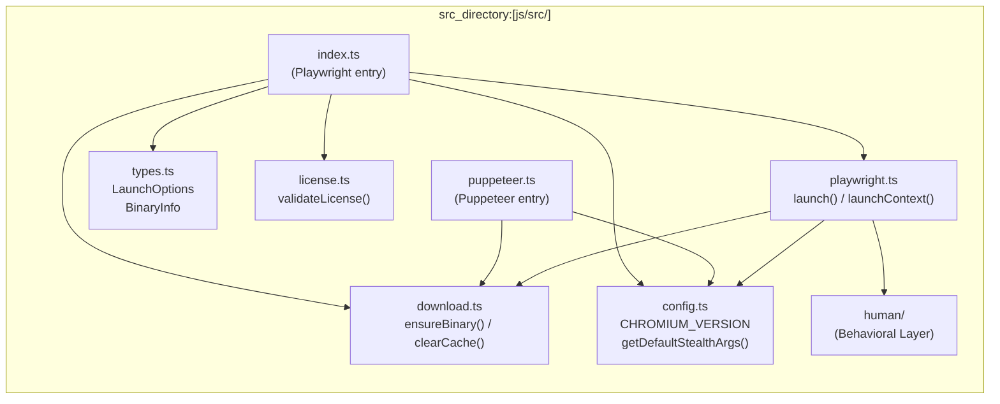

<!-- source: DeepWiki mcp.deepwiki.com · repo CloakHQ/CloakBrowser · page 4 JavaScript Package · fetched 2026-10-30 -->

# JavaScript Package

<details>
<summary>Relevant source files</summary>

The following files were used as context for generating this wiki page:

- [cloakbrowser/__init__.py](cloakbrowser/__init__.py)
- [cloakbrowser/_version.py](cloakbrowser/_version.py)
- [js/README.md](js/README.md)
- [js/package.json](js/package.json)
- [js/src/index.ts](js/src/index.ts)
- [js/src/types.ts](js/src/types.ts)
- [js/tests/launch.test.ts](js/tests/launch.test.ts)

</details>


This page covers the structure, module format, export paths, dependencies, and build configuration of the `cloakbrowser` npm package located in the `js/` subdirectory of the repository. It is a structural overview intended to orient developers to how the package is laid out.

- For the **Playwright API reference** (functions like `launch()`, `launchContext()`), see [JavaScript Playwright API](#4.1).
- For the **Puppeteer API reference**, see [JavaScript Puppeteer API](#4.2).
- For the **configuration module** (`src/config.ts`), see [JavaScript Configuration Module](#4.3).
- For **binary download and management** (`src/download.ts`), see [JavaScript Binary Management](#4.4).

---

## Package Identity

The package is published to npm under the name `cloakbrowser`. Its manifest is at [js/package.json:1-97]().

| Field | Value |
|---|---|
| `name` | `cloakbrowser` [js/package.json:2]() |
| `version` | `0.5.7` [js/package.json:3]() |
| `license` | MIT [js/package.json:50]() |
| `type` | `module` (ESM) [js/package.json:5]() |
| Node.js requirement | `>=20.0.0` [js/package.json:58]() |
| Repository subdirectory | `js/` [js/package.json:54]() |

The `"type": "module"` declaration means all `.js` files in the package are treated as ES Modules. There is no CommonJS build. The version `0.5.7` is synchronized with the Python package version [cloakbrowser/_version.py:1]().

Sources: [js/package.json:1-59](), [cloakbrowser/_version.py:1]()

---

## Module Format and Build Output

The package is written in TypeScript and compiled with `tsc`. Source files live under `js/src/`, and the compiler emits into `js/dist/`. Only the `dist/` directory is included in the published package [js/package.json:25-27]().

The build script is `tsc`, invoked via `npm run build` [js/package.json:93]() or `npm run typecheck` for validation [js/package.json:94](). The package targets Node.js environments supporting ESM.

Sources: [js/package.json:92-96]()

---

## Export Paths

The package defines three named export conditions in the `"exports"` field [js/package.json:8-21]():

**Package export map:**

```mermaid
graph TD
    subgraph "npm_package:[cloakbrowser]"
        ExportRoot["\".\"<br/>(default export)"]
        ExportPuppeteer["\"./puppeteer\"<br/>(subpath export)"]
        ExportHuman["\"./human\"<br/>(subpath export)"]
        CLIBin["\"bin\": \"cloakbrowser\""]
    end

    subgraph "dist_output:[dist/]"
        IndexJS["dist/index.js"]
        IndexDTS["dist/index.d.ts"]
        PuppeteerJS["dist/puppeteer.js"]
        PuppeteerDTS["dist/puppeteer.d.ts"]
        HumanIndexJS["dist/human/index.js"]
        CLIJS["dist/cli.js"]
    end

    subgraph "src_source:[src/]"
        SrcIndex["src/index.ts"]
        SrcPuppeteer["src/puppeteer.ts"]
        SrcPlaywright["src/playwright.ts"]
        SrcDownload["src/download.ts"]
        SrcConfig["src/config.ts"]
        SrcTypes["src/types.ts"]
        SrcHuman["src/human/index.ts"]
    end

    ExportRoot -->|"import"| IndexJS
    ExportRoot -->|"types"| IndexDTS
    ExportPuppeteer -->|"import"| PuppeteerJS
    ExportPuppeteer -->|"types"| PuppeteerDTS
    ExportHuman -->|"import"| HumanIndexJS
    CLIBin --> CLIJS

    IndexJS --> SrcIndex
    PuppeteerJS --> SrcPuppeteer
    SrcIndex --> SrcPlaywright
    SrcIndex --> SrcDownload
    SrcIndex --> SrcConfig
    SrcIndex --> SrcTypes
    HumanIndexJS --> SrcHuman
```

Sources: [js/package.json:8-24](), [js/src/index.ts:18-33]()

### Default export (`.`)

Importing from `'cloakbrowser'` resolves to `dist/index.js`, which re-exports from the Playwright integration. The entry point is `js/src/index.ts`, which aggregates:

| Export Category | Source module |
|---|---|
| Playwright Launchers | `src/playwright.ts` [js/src/index.ts:19]() |
| Binary Lifecycle | `src/download.ts` [js/src/index.ts:22]() |
| Constants & Stealth | `src/config.ts` [js/src/index.ts:25]() |
| Licensing | `src/license.ts` [js/src/index.ts:28]() |
| Type Definitions | `src/types.ts` [js/src/index.ts:31]() |

### Puppeteer subpath (`./puppeteer`)

Importing from `'cloakbrowser/puppeteer'` resolves to `dist/puppeteer.js`, which exposes the Puppeteer-based `launch()` function. This is a separate entry point because Puppeteer's API and behavior differ from Playwright's (notably around proxy credential injection). See [JavaScript Puppeteer API](#4.2) for details.

Sources: [js/package.json:13-16]()

---

## Source File Layout

**Diagram: Source modules and their roles**



| File | Responsibility |
|---|---|
| `src/index.ts` | Default (Playwright) export aggregator [js/src/index.ts:1-33]() |
| `src/puppeteer.ts` | Puppeteer-specific entry point [js/package.json:13-16]() |
| `src/playwright.ts` | Playwright `launch()` implementations and option builders [js/src/index.ts:19]() |
| `src/download.ts` | Binary lifecycle: download, extract, cache, update [js/src/index.ts:22]() |
| `src/config.ts` | Constants and platform-specific configuration [js/src/index.ts:25]() |
| `src/types.ts` | Shared TypeScript type definitions [js/src/types.ts:1-84]() |
| `src/license.ts` | Pro license validation logic [js/src/index.ts:28]() |
| `src/human/` | Humanize behavioral layer for mouse/keyboard simulation [js/package.json:17-20]() |

Sources: [js/package.json:8-21](), [js/src/index.ts:18-33]()

---

## Dependencies

### Runtime dependency

| Package | Version constraint | Purpose |
|---|---|---|
| `tar` | `^7.0.0` | Extracts the downloaded `.tar.gz` binary archive [js/package.json:81]() |

`tar` is the mandatory runtime dependency used for binary extraction across all supported platforms.

Sources: [js/package.json:80-82]()

### Peer dependencies (optional)

Automation frameworks and GeoIP libraries are declared as **optional** peer dependencies [js/package.json:60-79]().

| Peer dependency | Minimum version | Optional |
|---|---|---|
| `playwright-core` | `>=1.53.0` | Yes [js/package.json:67-69]() |
| `puppeteer-core` | `>=21.0.0` | Yes [js/package.json:70-72]() |
| `mmdb-lib` | `>=2.0.0` | Yes [js/package.json:73-75]() |
| `socks-proxy-agent`| `>=10.0.0` | Yes [js/package.json:76-78]() |

The `peerDependenciesMeta` block marks these as `optional: true`, suppressing package manager warnings when only one is installed. A missing peer dependency only throws an error if the corresponding `launch()` function is called.

Sources: [js/package.json:60-79]()

### Dev dependencies

| Package | Purpose |
|---|---|
| `typescript` | TypeScript compiler [js/package.json:89]() |
| `@types/node` | Node.js type declarations [js/package.json:84]() |
| `playwright-core` | Used in tests and development [js/package.json:86]() |
| `puppeteer-core` | Used in tests and development [js/package.json:87]() |
| `vitest` | Test runner [js/package.json:90]() |

Sources: [js/package.json:83-91]()

---

## npm Scripts

| Script | Command | Purpose |
|---|---|---|
| `build` | `tsc` | Compile TypeScript to `dist/` [js/package.json:93]() |
| `typecheck` | `tsc --noEmit` | Type-check without emitting files [js/package.json:94]() |
| `test` | `vitest run` | Run the test suite [js/package.json:95]() |

Sources: [js/package.json:92-96]()

---

## Published Files

Only the `dist/` directory is included in the npm tarball [js/package.json:25-27](). The `dist/` directory contains:

- Compiled `.js` files (ESM)
- `.d.ts` type declaration files for full TypeScript support [js/package.json:7]()
- CLI entry point `dist/cli.js` mapped to the `cloakbrowser` command [js/package.json:22-24]()

Sources: [js/package.json:22-27]()

---

