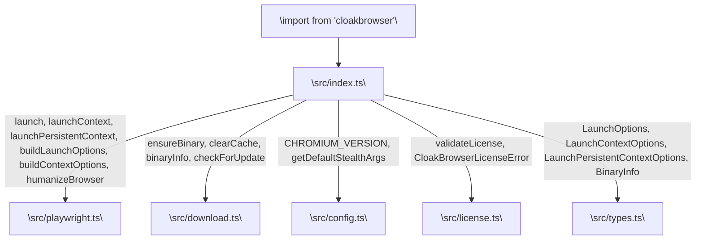

<!-- source: DeepWiki mcp.deepwiki.com · repo CloakHQ/CloakBrowser · page 4.1 JavaScript Playwright API · fetched 2026-10-30 -->

# JavaScript Playwright API

<details>
<summary>Relevant source files</summary>

The following files were used as context for generating this wiki page:

- [cloakbrowser/__init__.py](cloakbrowser/__init__.py)
- [cloakbrowser/browser.py](cloakbrowser/browser.py)
- [cloakbrowser/human/__init__.py](cloakbrowser/human/__init__.py)
- [js/src/human/index.ts](js/src/human/index.ts)
- [js/src/index.ts](js/src/index.ts)
- [js/src/playwright.ts](js/src/playwright.ts)
- [js/src/puppeteer.ts](js/src/puppeteer.ts)
- [js/src/types.ts](js/src/types.ts)
- [js/tests/launch.test.ts](js/tests/launch.test.ts)

</details>


This page covers the default `cloakbrowser` npm export, which uses `playwright-core` as its automation backend. It documents every exported function, type, and constant available when you import from `'cloakbrowser'`.

For the Puppeteer export path, see [4.2](). For the underlying binary download and caching logic, see [4.4](). For configuration constants and stealth argument generation, see [4.3]().

---

## Module Entry Point

All Playwright-facing symbols are re-exported from [js/src/index.ts:1-33]() in five groups:

| Export group | Source file | Symbols |
|---|---|---|
| Launch functions | `src/playwright.ts` | `launch`, `launchContext`, `launchPersistentContext`, `buildLaunchOptions`, `buildContextOptions`, `humanizeBrowser` |
| Binary management | `src/download.ts` | `ensureBinary`, `clearCache`, `binaryInfo`, `checkForUpdate` |
| Configuration | `src/config.ts` | `CHROMIUM_VERSION`, `getDefaultStealthArgs` |
| License | `src/license.ts` | `validateLicense`, `CloakBrowserLicenseError` |
| Types | `src/types.ts` | `LaunchOptions`, `LaunchContextOptions`, `LaunchPersistentContextOptions`, `BinaryInfo` |

**Export map diagram**



Sources: [js/src/index.ts:1-33](), [js/src/playwright.ts:1-20]()

---

## Types

### `LaunchOptions`
Base options for launching a browser instance [js/src/types.ts:8-44]().

| Property | Type | Default | Description |
|---|---|---|---|
| `headless` | `boolean` | `true` | Runs Chromium without a visible window [js/src/types.ts:9-10](). |
| `proxy` | `string \| object` | — | Proxy URL string or Playwright proxy object [js/src/types.ts:17](). |
| `args` | `string[]` | — | Additional Chromium CLI arguments [js/src/types.ts:19](). |
| `stealthArgs` | `boolean` | `true` | When `false`, suppresses default `--fingerprint-*` flags [js/src/types.ts:22-23](). |
| `timezone` | `string` | — | IANA timezone (e.g., "America/New_York"). Sets `--fingerprint-timezone` [js/src/types.ts:24-25](). |
| `locale` | `string` | — | BCP 47 locale (e.g., "en-US"). Sets `--lang` binary flag [js/src/types.ts:26-27](). |
| `geoip` | `boolean` | — | Auto-detect timezone/locale from proxy IP (requires `mmdb-lib`) [js/src/types.ts:28-29](). |
| `humanize` | `boolean` | — | Enables human-like mouse/keyboard behavioral layer [js/src/types.ts:38-39](). |
| `humanPreset` | `'default' \| 'careful'` | — | Behavioral preset for humanize layer [js/src/types.ts:40-41](). |
| `humanConfig` | `Partial<HumanConfig>` | — | Override individual human behavior parameters [js/src/types.ts:42-43](). |
| `licenseKey` | `string` | — | Pro license key for v150+ binaries [js/src/types.ts:30-31](). |
| `browserVersion`| `string` | — | Exact Chromium version pin [js/src/types.ts:32-33](). |
| `launchOptions` | `Record<string, unknown>` | — | Raw options passed to `chromium.launch()` [js/src/types.ts:36-37](). |

### `LaunchContextOptions`
Extends `LaunchOptions` for ephemeral contexts [js/src/types.ts:46-66]().

| Property | Type | Description |
|---|---|---|
| `userAgent` | `string` | Custom User-Agent string [js/src/types.ts:47-48](). |
| `viewport` | `object \| null` | Viewport dimensions. Set `null` to disable emulation [js/src/types.ts:49-50](). |
| `colorScheme` | `string` | 'light', 'dark', or 'no-preference' [js/src/types.ts:55-56](). |
| `timezoneId` | `string` | Alias for `timezone`. Resolved via `resolveTimezone()` [js/src/types.ts:53-54](). |
| `contextOptions` | `BrowserContextOptions` | Extra options forwarded to `browser.newContext()`. `locale` and `timezoneId` are stripped here to avoid CDP detection [js/src/types.ts:61-65](). |

### `LaunchPersistentContextOptions`
Extends `LaunchContextOptions` for persistent profiles [js/src/types.ts:68-71]().

| Property | Type | Description |
|---|---|---|
| `userDataDir` | `string` | **Required.** Path to the user profile directory [js/src/types.ts:69-70](). |

### `BinaryInfo`
Metadata about the local stealth binary [js/src/types.ts:73-83](). Includes `version`, `bundledVersion`, `platform`, `tier` ("pro" or "free"), `binaryPath`, `installed` status, `cacheDir`, and `downloadUrl`.

Sources: [js/src/types.ts:1-83](), [js/src/playwright.ts:28-58]()

---

## Launch Functions

### `launch(options?)`
**Signature:** `async function launch(options: LaunchOptions = {}): Promise<Browser>`

Launches the stealth Chromium browser via `playwright-core` [js/src/playwright.ts:194-222]().

1. **Options Processing**: Uses `buildLaunchOptions()` to resolve the binary path, GeoIP data, and proxy settings [js/src/playwright.ts:200]().
2. **Execution**: Calls `chromium.launch()` with generated arguments [js/src/playwright.ts:200](). It catches license errors and rethrows them as `CloakBrowserLicenseError` [js/src/playwright.ts:202-203]().
3. **Viewport Patch**: For headed launches, it patches `newContext` and `newPage` to default to `noViewport: true`, preventing the "impossible window" tell (outerWidth < innerWidth) [js/src/playwright.ts:206-212]().
4. **Humanize**: If `humanize: true`, the returned `Browser` is patched via `humanizeBrowser()` [js/src/playwright.ts:214]().

### `launchContext(options?)`
**Signature:** `async function launchContext(options: LaunchContextOptions = {}): Promise<BrowserContext>`

Creates a browser and an ephemeral context in one call [js/src/playwright.ts:241-286]().

*   **Native Stealth**: Calls `filterStealthCtxOptions()` to strip `locale` and `timezoneId` from `contextOptions`. These are instead passed as binary flags to avoid detectable CDP emulation [js/src/playwright.ts:42-58](), [js/src/playwright.ts:256]().
*   **Close Patching**: The `context.close()` method is patched to also call `browser.close()`, ensuring the browser process is reaped when the context is closed [js/src/playwright.ts:267-271]().
*   **Default Viewport**: Applies `DEFAULT_VIEWPORT` if no viewport is provided and the binary version requires it for headless coherence [js/src/playwright.ts:98-103]().

### `launchPersistentContext(options)`
**Signature:** `async function launchPersistentContext(options: LaunchPersistentContextOptions): Promise<BrowserContext>`

Launches a non-incognito session with a disk-based profile using `chromium.launchPersistentContext()` [js/src/playwright.ts:305-357]().

Sources: [js/src/playwright.ts:194-357](), [js/src/types.ts:46-71]()

---

## Internal Logic & Helpers

### `buildLaunchOptions(options)`
**Signature:** `async function buildLaunchOptions(options: LaunchOptions = {}): Promise<PlaywrightLaunchOptions>`

Constructs the final object passed to Playwright's `launch()` [js/src/playwright.ts:120-161](). It resolves the binary path via `ensureBinary()` [js/src/playwright.ts:126-130](), parses proxies via `resolveProxyConfig()` [js/src/playwright.ts:132-137](), and merges CLI arguments via `buildArgs()` [js/src/playwright.ts:140]().

### `buildContextOptions(options)`
**Signature:** `export function buildContextOptions(options: LaunchContextOptions = {}): BrowserContextOptions`

Resolves context-level settings, specifically managing viewport logic [js/src/playwright.ts:83-112]().
*   **Headed**: Sets `viewport: null` so the page tracks the real window [js/src/playwright.ts:103]().
*   **Headless**: Uses `DEFAULT_VIEWPORT` (1280x720) unless the binary is new enough to support `headlessNoViewport` [js/src/playwright.ts:98-103]().

### Proxy URL Parsing
The system uses `parseProxyUrl()` and `resolveProxyConfig()` to handle authentication.
*   **SOCKS5**: Credentials are auto-encoded into the URL via `normalizeSocksStringUrl()` to prevent truncation [js/src/proxy.ts:106-158]().
*   **HTTP**: On newer binaries, inline credentials (`user:pass@host`) are passed via `--proxy-server` [js/src/proxy.ts:168-174](). On older binaries, credentials are stripped and injected via `page.authenticate()` [js/src/puppeteer.ts:124-137]().

### Timezone Resolution (`resolveTimezone`)
A helper that aliases `timezoneId` to `timezone` to support various API naming conventions without warnings [js/src/playwright.ts:28-35]().

---

## Code Entity Map

The diagram below maps high-level user-facing concepts to the exact code entities that implement them.

```mermaid
graph LR
    subgraph "User API"
        UC1["\"launch()\""]
        UC2["\"launchContext()\""]
        UC3["\"launchPersistentContext()\""]
    end

    subgraph "src/playwright.ts"
        PL1["\"launch()\""]
        PL2["\"launchContext()\""]
        PL3["\"launchPersistentContext()\""]
        PL4["\"resolveTimezone()\""]
        PL5["\"buildLaunchOptions()\""]
        PL6["\"buildContextOptions()\""]
        PL7["\"effectiveHeadless()\""]
    end

    subgraph "src/proxy.ts"
        PR1["\"resolveProxyConfig()\""]
        PR2["\"parseProxyUrl()\""]
    end

    subgraph "src/human/index.ts"
        HU1["\"patchBrowser()\""]
        HU2["\"patchContext()\""]
    end

    subgraph "playwright-core"
        PW1["\"chromium.launch()\""]
        PW2["\"browser.newContext()\""]
        PW3["\"chromium.launchPersistentContext()\""]
    end

    UC1 --> PL1
    UC2 --> PL2
    UC3 --> PL3

    PL1 --> PL5
    PL5 --> PW1
    PL5 --> PR1
    PR1 --> PR2
    PL1 --> HU1

    PL2 --> PL4
    PL2 --> PL1
    PL2 --> PL6
    PL6 --> PL7
    PL6 --> PW2
    PL2 --> HU2
    
    PL3 --> PL4
    PL3 --> PW3
    PL3 --> PR1
    PL3 --> HU2
```

Sources: [js/src/playwright.ts:1-357](), [js/src/proxy.ts:1-180](), [js/src/index.ts:1-33]()

---

## Behavioral Layer (Humanize)

When `humanize: true` is passed, the package activates the behavioral stealth layer.

*   **Data Flow**: Functions import `patchBrowser` or `patchContext` and `resolveConfig` dynamically to minimize startup overhead [js/src/playwright.ts:172-173](), [js/src/playwright.ts:278-279]().
*   **Configuration**: The `humanPreset` and `humanConfig` are merged into a final configuration object via `resolveConfig()` [js/src/playwright.ts:174-177]().
*   **Patching**: 
    *   `launch()` calls `humanizeBrowser()` which calls `patchBrowser()` [js/src/playwright.ts:178]().
    *   `launchContext()` and `launchPersistentContext()` call `patchContext()` [js/src/playwright.ts:283](), [js/src/playwright.ts:353]().
*   **Cursor Tracking**: The system maintains a `CursorState` instance per-page to track `x` and `y` coordinates for Bézier curve calculations [js/src/human/index.ts:148-152]().

Sources: [js/src/playwright.ts:166-179](), [js/src/playwright.ts:277-284](), [js/src/playwright.ts:347-355](), [js/src/human/index.ts:1-152]()

---

