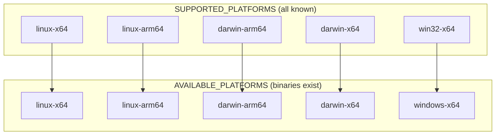
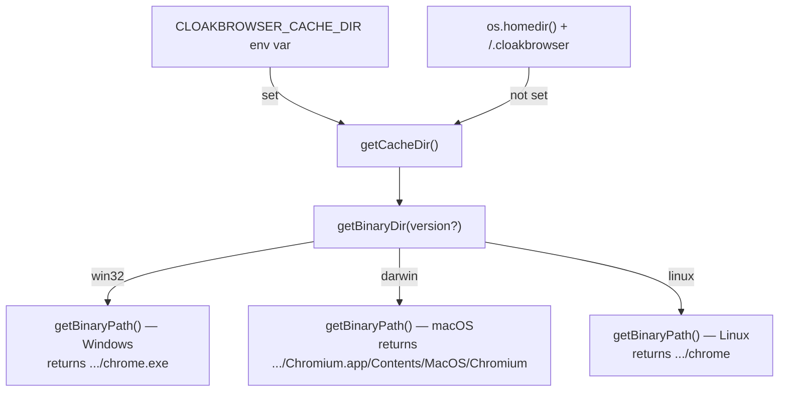
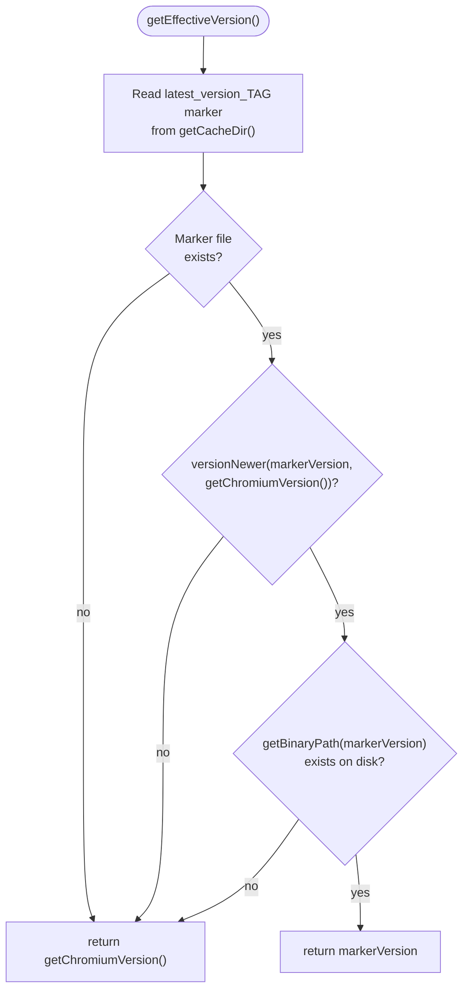
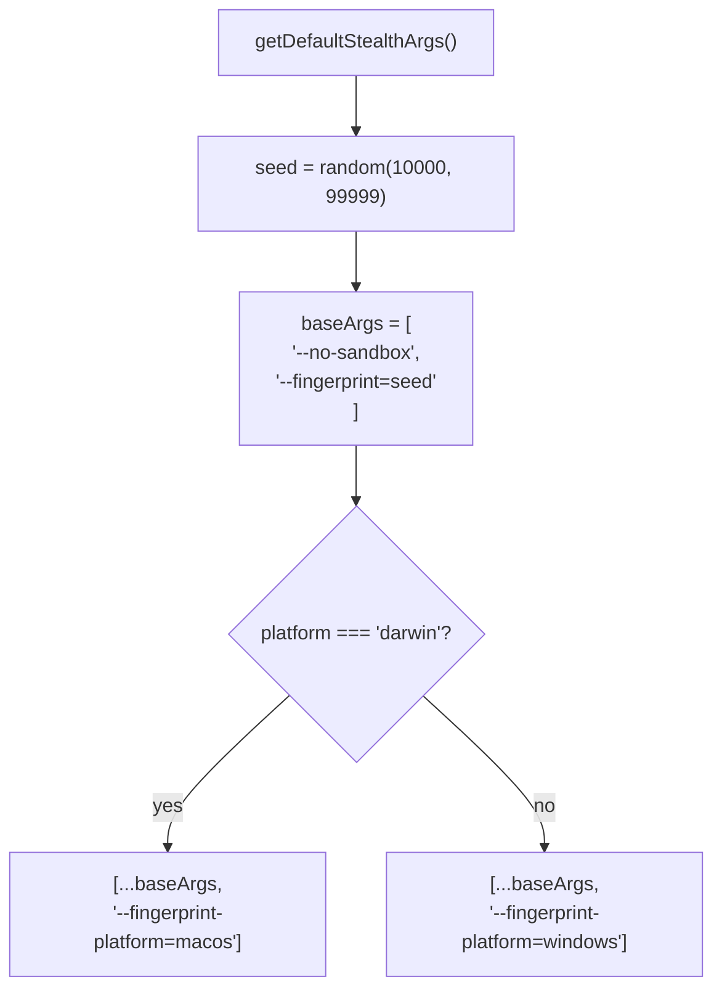

<!-- source: DeepWiki mcp.deepwiki.com · repo CloakHQ/CloakBrowser · page 4.3 JavaScript Configuration Module · fetched 2026-10-30 -->

# JavaScript Configuration Module

Relevant source files

The following files were used as context for generating this wiki page:

- [cloakbrowser/config.py](cloakbrowser/config.py)
- [dotnet/src/CloakBrowser/Config.cs](dotnet/src/CloakBrowser/Config.cs)
- [dotnet/tests/CloakBrowser.Tests/ConfigTests.cs](dotnet/tests/CloakBrowser.Tests/ConfigTests.cs)
- [js/src/args.ts](js/src/args.ts)
- [js/src/config.ts](js/src/config.ts)
- [js/tests/config.test.ts](js/tests/config.test.ts)
- [tests/test_build_args.py](tests/test_build_args.py)
- [tests/test_config.py](tests/test_config.py)

This page documents `js/src/config.ts`, the central configuration module for the JavaScript package. It provides version constants, platform detection, binary path resolution, version comparison utilities, download URL construction, and the default stealth argument set used when launching the patched Chromium binary.

For how these values are consumed at launch time, see the binary management page ([4.4]()) and the Playwright API page ([4.1]()). The Python equivalent of this module is documented at [3.2]().

---

## Constants

### `WRAPPER_VERSION`
[js/src/config.ts:13-23]()

The version of the `cloakbrowser` npm package itself, read from `package.json`. This is used during update checks to compare the local installation against the latest available release on GitHub.

### `CHROMIUM_VERSION`
[js/src/config.ts:31]()

The hardcoded version string for the Stealth Chromium binary associated with this release. Format: `MAJOR.MINOR.PATCH.BUILD.PATCH_REV` (e.g. `146.0.7680.177.5`). This value acts as the baseline in all version comparisons.

### `PLATFORM_CHROMIUM_VERSIONS`
[js/src/config.ts:33-39]()

A mapping of platform tags to specific Chromium versions. This allows different platforms to ship different binary versions during transition periods or platform-specific patch cycles.

### `BINARY_SIGNING_PUBKEYS`
[js/src/config.ts:50-52]()

A list of Ed25519 public keys (base64 encoded) used to verify the `SHA256SUMS` manifest signature during binary downloads. This ensures that the download origin alone cannot certify a tampered binary.

### `DOWNLOAD_BASE_URL`
[js/src/config.ts:156-158]()

Resolved from the `CLOAKBROWSER_DOWNLOAD_URL` environment variable at module load time. Defaults to `https://cloakbrowser.dev`.

### `GITHUB_API_URL`
[js/src/config.ts:160-161]()

The GitHub Releases API endpoint used for update checks: `https://api.github.com/repos/CloakHQ/cloakbrowser/releases`.

---

## Platform Model

**Title: Platform sets and their membership**

Sources: [js/src/config.ts:57-66]()

`SUPPORTED_PLATFORMS` maps Node.js `process.platform` and `process.arch` combinations to internal platform tags [js/src/config.ts:57-63](). `AVAILABLE_PLATFORMS` is derived from the keys of `PLATFORM_CHROMIUM_VERSIONS` [js/src/config.ts:66](), representing platforms where a pre-built binary is hosted.

| Node Platform | Node Arch | Internal Tag | Available |
|---|---|---|---|
| `linux` | `x64` | `linux-x64` | Yes |
| `linux` | `arm64` | `linux-arm64` | Yes (Version: 146.0.7680.177.3) |
| `darwin` | `arm64` | `darwin-arm64` | Yes |
| `darwin` | `x64` | `darwin-x64` | Yes |
| `win32` | `x64` | `windows-x64` | Yes |

**Note on ARM64 Linux:** While `linux-arm64` is supported and present in the version map [js/src/config.ts:35](), it currently tracks a different patch revision than the x64 counterpart [js/src/config.ts:34-35](). Note that while it is supported in code, binaries may not always be available for every patch revision.

Sources: [js/src/config.ts:33-39](), [js/src/config.ts:57-66](), [js/src/config.ts:94-113]()

---

## Platform Detection Functions

### `getPlatformTag()`
[js/src/config.ts:94-113]()

Maps the current environment's `process.platform` and `process.arch` to a normalized tag string used for directory naming and download URL construction. It throws an `Error` if the platform is not supported.

### `checkPlatformAvailable()`
[js/src/config.ts:140-151]()

Ensures the current platform has a pre-built binary available by checking against `AVAILABLE_PLATFORMS`. It skips the check if a local binary override is provided via `CLOAKBROWSER_BINARY_PATH`.

---

## Binary Path Functions

**Title: Binary path construction logic**

Sources: [js/src/config.ts:118-138]()

### `getCacheDir()`
[js/src/config.ts:118-122]()

Returns the base directory for CloakBrowser data. Defaults to `~/.cloakbrowser` unless overridden by `CLOAKBROWSER_CACHE_DIR`.

### `getBinaryDir(version?, pro?)`
[js/src/config.ts:124-127]()

Returns the directory path for a specific Chromium version: `<cacheDir>/chromium-<version>`. If `pro` is true, a `-pro` suffix is appended to the folder name.

### `getBinaryPath(version?, pro?)`
[js/src/config.ts:129-138]()

Returns the absolute path to the executable file. It handles platform-specific internal structures, such as the `.app` bundle on macOS [js/src/config.ts:131-133]() and `.exe` extension on Windows [js/src/config.ts:134-136]().

---

## Version Resolution

### `getEffectiveVersion(pro?, releaseChannel?, version?)`
[js/src/config.ts:185-207]()

Determines the best binary version to use. It checks for a `latest_version_<platform>` marker file in the cache directory (e.g., `latest_version_linux-x64`) [js/src/config.ts:192](). If the marker contains a version newer than the hardcoded baseline and the binary exists on disk, it returns the newer version [js/src/config.ts:197-201]().

**Title: getEffectiveVersion() decision flow**

Sources: [js/src/config.ts:185-207]()

### `parseVersion(v)`
[js/src/config.ts:209-211]()

Converts a version string (e.g., `146.0.7680.177.5`) into a `number[]` for comparison.

### `versionNewer(a, b)`
[js/src/config.ts:213-221]()

Performs a segment-by-segment numeric comparison of two version strings. Returns `true` if `a > b`.

---

## Download URL Construction

### `getDownloadUrl(version?)`
[js/src/config.ts:174-177]()

Constructs the primary download URL using `DOWNLOAD_BASE_URL`.

### `getFallbackDownloadUrl(version?)`
[js/src/config.ts:179-182]()

Constructs a fallback URL pointing to GitHub Releases using `GITHUB_DOWNLOAD_BASE_URL`.

### `getArchiveName(tag?)`
[js/src/config.ts:170-172]()

Returns the filename for the binary archive, using `.zip` for Windows and `.tar.gz` for other platforms via `getArchiveExt()` [js/src/config.ts:166-168]().

---

## Default Stealth Arguments

### `getDefaultStealthArgs()`
[js/src/config.ts:242-270]()

Returns the CLI flags required to activate source-level patches. It generates a random seed between 10000 and 99999 for the `--fingerprint` flag [js/src/config.ts:248].

**Title: getDefaultStealthArgs() platform branching**

Sources: [js/src/config.ts:242-270](), [js/tests/config.test.ts:23-45]()

| Platform | Fingerprint Platform | Hardware Spoofing |
|---|---|---|
| macOS | `macos` | Native values used |
| Linux | `windows` | Windows profile (v14+ auto-gen) |
| Windows | `windows` | Windows profile (v14+ auto-gen) |

---

## Local Binary Override

### `getLocalBinaryOverride()`
[js/src/config.ts:226-228]()

Checks for the `CLOAKBROWSER_BINARY_PATH` environment variable. If set, this path will be used directly, bypassing platform availability checks and the automatic download/update system.

---

## Module Export Summary

| Export | Kind | Description |
|---|---|---|
| `CHROMIUM_VERSION` | `const string` | Latest baseline version across all platforms |
| `WRAPPER_VERSION` | `let string` | Version of the npm package |
| `getPlatformTag()` | function | Detects normalized platform string |
| `getBinaryPath()` | function | Resolves executable path based on OS |
| `getEffectiveVersion()` | function | Resolves version including auto-updates |
| `getDefaultStealthArgs()` | function | Generates randomized stealth CLI flags |
| `getDownloadUrl()` | function | Constructs binary download URL |
| `getFallbackDownloadUrl()` | function | Constructs GitHub fallback download URL |
| `getLocalBinaryOverride()` | function | Returns path from `CLOAKBROWSER_BINARY_PATH` |

Sources: [js/src/config.ts:1-270](), [js/tests/config.test.ts:1-167]()

---

