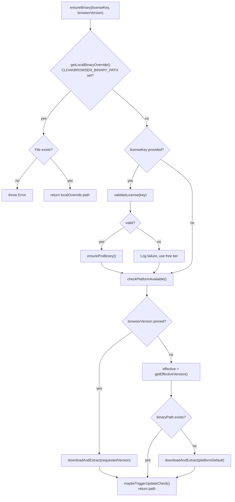
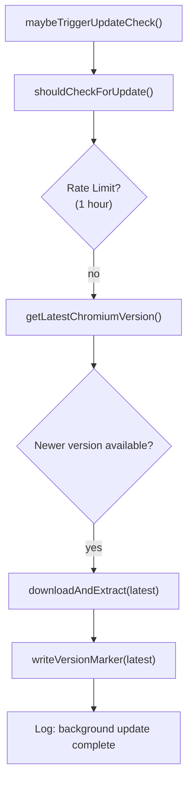

<!-- source: DeepWiki mcp.deepwiki.com · repo CloakHQ/CloakBrowser · page 4.4 JavaScript Binary Management · fetched 2026-10-30 -->

# JavaScript Binary Management

<details>
<summary>Relevant source files</summary>

The following files were used as context for generating this wiki page:

- [cloakbrowser/download.py](cloakbrowser/download.py)
- [dotnet/src/CloakBrowser/Download.cs](dotnet/src/CloakBrowser/Download.cs)
- [js/src/download.ts](js/src/download.ts)
- [js/tests/signature.test.ts](js/tests/signature.test.ts)
- [js/tests/update.test.ts](js/tests/update.test.ts)
- [tests/test_update.py](tests/test_update.py)

</details>


This page documents `js/src/download.ts`, which handles downloading, caching, and updating the patched Chromium binary in the JavaScript package. It covers the public API (`ensureBinary`, `clearCache`, `binaryInfo`, `checkForUpdate`) and all internal helpers involved in download, extraction, and background update logic.

For the equivalent Python implementation, see [Python Binary Management](3.3). For the configuration values (`CHROMIUM_VERSION`, `getCacheDir`, `getBinaryPath`, `getEffectiveVersion`, etc.) that `download.ts` depends on, see [JavaScript Configuration Module](4.3). For how `ensureBinary` is called from the launch path, see [JavaScript Playwright API](4.1).

---

## Public API

The module exports several public functions for managing the lifecycle of the stealth binary:

| Function | Signature | Purpose |
|---|---|---|
| `ensureBinary` | `(licenseKey?, browserVersion?) => Promise<string>` | Returns path to the chrome executable, downloading if necessary. Supports Free and Pro tiers. |
| `clearCache` | `() => void` | Deletes the entire `~/.cloakbrowser/` directory. |
| `binaryInfo` | `() => BinaryInfo` | Returns version, tier, path, and installation status of the current binary. |
| `checkForUpdate` | `() => Promise<string \| null>` | Checks GitHub Releases (Free) or cloakbrowser.dev (Pro) for updates. |

Sources: [js/src/download.ts:76-80](), [js/src/download.ts:212-218](), [js/src/download.ts:221-236](), [js/src/download.ts:518-522]()

---

## Constants

Timing and tier constants govern download and update behavior:

| Constant | Value | Purpose |
|---|---|---|
| `DOWNLOAD_TIMEOUT_MS` | `600_000` (10 minutes) | Timeout for the HTTP download stream. |
| `UPDATE_CHECK_INTERVAL_SEC` | `3600` (1 hour) | Minimum elapsed time between background update checks. |
| `WELCOME_FREE_INTERVAL_SEC` | `86_400` (1 day) | Interval to re-show the Pro upsell banner to free users. |
| `PRO_MAJOR` | `"150"` | Major version indicator for the Pro tier. |

Sources: [js/src/download.ts:40-52]()

---

## `ensureBinary()` Resolution Flow

`ensureBinary` applies a strict priority order: local override first, then Pro tier resolution (if a license key is provided), and finally the Free tier resolution.

**`ensureBinary` decision diagram:**



Sources: [js/src/download.ts:76-186]()

### Pro vs. Free Resolution
If a valid license key is detected via `validateLicense`, the system attempts `ensureProBinary`. [js/src/download.ts:98-116]() A `BinaryVerificationError` during Pro download is re-thrown immediately to prevent silent downgrades to the Free tier, which might compromise stealth requirements. [js/src/download.ts:119-128]()

---

## `getEffectiveVersion()` and the `latest_version` Marker

The "effective version" determines which cached binary is used. It is resolved in `config.ts` but driven by the `download.ts` update logic.

- On first use, no marker file exists, so `getChromiumVersion()` (the hardcoded version) is used.
- After a successful background update, `writeVersionMarker` writes the new version string to `latest_version_{platform}` in the cache directory. [js/src/download.ts:606-613]()
- `getEffectiveVersion()` reads this marker. It only returns the marker version if:
  1. The marker version is strictly newer than `getChromiumVersion()` (per `versionNewer`). [js/src/config.ts:182-184]()
  2. The binary file for that version actually exists on disk. [js/src/config.ts:187-190]()

Sources: [js/src/config.ts:170-194](), [js/src/download.ts:606-613]()

---

## `downloadAndExtract()`

`downloadAndExtract(version?)` orchestrates the full download + extraction sequence. It uses an atomic temp-file approach to prevent partial or corrupted downloads from being treated as valid binaries.

**Download and extraction diagram:**

```mermaid
sequenceDiagram
    participant "ensureBinary / checkForUpdate" as Caller
    participant "downloadAndExtract()" as DAE
    participant "downloadFile()" as DF
    participant "verifyDownloadChecksum()" as VDC
    participant "extractArchive()" as EA
    participant "flattenSingleSubdir()" as FSS

    Caller->>"downloadAndExtract()": call with optional version
    "downloadAndExtract()"->>DAE: getDownloadUrl(version)
    DAE->>"downloadFile()": tmpPath = _download_{Date.now()}.tar.gz
    "downloadFile()"->>DF: pipeline(fetch, writeStream)
    DF-->>DAE: file written to tmpPath
    DAE->>"verifyDownloadChecksum()": verify signature & hash
    VDC-->>DAE: BinaryVerificationError if tampered
    DAE->>"extractArchive()": archivePath=tmpPath, destDir=binaryDir
    "extractArchive()"->>EA: tarExtract (or PowerShell on Windows)
    EA->>"flattenSingleSubdir()": move contents up if single subdir
    "flattenSingleSubdir()"-->>EA: done
    EA-->>DAE: binary ready
    DAE-->>Caller: tmpPath deleted in finally block
```

Sources: [js/src/download.ts:279-322]()

### Verification (Checksums & Signatures)
Unless `CLOAKBROWSER_SKIP_CHECKSUM` is set, the system performs multi-stage verification:
1. **Signature Verification**: `verifySignature()` fetches `SHA256SUMS.sig` and verifies it against the pinned `BINARY_SIGNING_PUBKEYS` using Ed25519 via `cryptoVerify`. [js/src/download.ts:346-372]()
2. **Checksum Verification**: `verifyDownloadChecksum()` fetches the `SHA256SUMS` manifest, parses the hash for the current platform, and compares it against `createHash("sha256")` of the local file. [js/src/download.ts:324-344]()
3. **Version Binding**: The signed manifest must contain a `version=X.X.X.X` line matching the requested version to prevent downgrade attacks. [js/src/download.ts:336-339]()

Sources: [js/src/download.ts:324-372](), [js/src/config.ts:50-54]()

### `extractArchive()` and Windows Support
Extraction logic branches based on the platform:
- **Windows**: Uses `execFileSync` to call `PowerShell` with `Expand-Archive`. This avoids a dependency on `tar` for Windows users. [js/src/download.ts:474-490]()
- **Other**: Uses the `tar` npm package (`tarExtract`) with a `filter` that blocks absolute paths and path-traversal (`..`) sequences. [js/src/download.ts:448-471]()

Sources: [js/src/download.ts:440-491]()

### `flattenSingleSubdir()`
Detects if `destDir` contains exactly one subdirectory and moves its contents up one level. This is skipped for `.app` bundles on macOS to preserve application structure. [js/src/download.ts:497-514]()

---

## Background Auto-Update

After `ensureBinary()` finds a valid binary, it calls `maybeTriggerUpdateCheck()`. This fires a fire-and-forget background check if the `UPDATE_CHECK_INTERVAL_SEC` has passed. [js/src/download.ts:560-569]()

**Update check flow:**



Sources: [js/src/download.ts:560-604]()

### `getLatestChromiumVersion()`
Queries the GitHub Releases API (`GITHUB_API_URL`). It iterates through the releases, looking for a tag that:
1. Is not a draft. [js/src/download.ts:628]()
2. Starts with `chromium-v`. [js/src/download.ts:631]()
3. Contains an asset matching the current platform tag (e.g., `cloakbrowser-linux-x64.tar.gz`). [js/src/download.ts:636-639]()

Sources: [js/src/download.ts:616-648]()

---

## `clearCache()` and `binaryInfo()`

- **`clearCache()`**: Force-removes the entire cache directory using `fs.rmSync`. [js/src/download.ts:212-218]()
- **`binaryInfo()`**: Aggregates metadata including the effective version, tier (Free/Pro), local path, and the download URL. [js/src/download.ts:221-236]()

Sources: [js/src/download.ts:212-236]()

---

