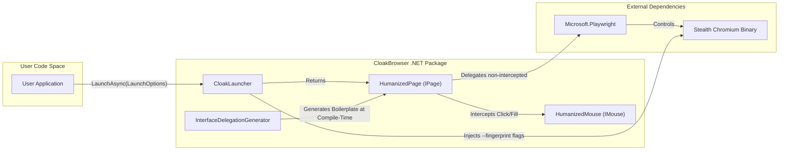
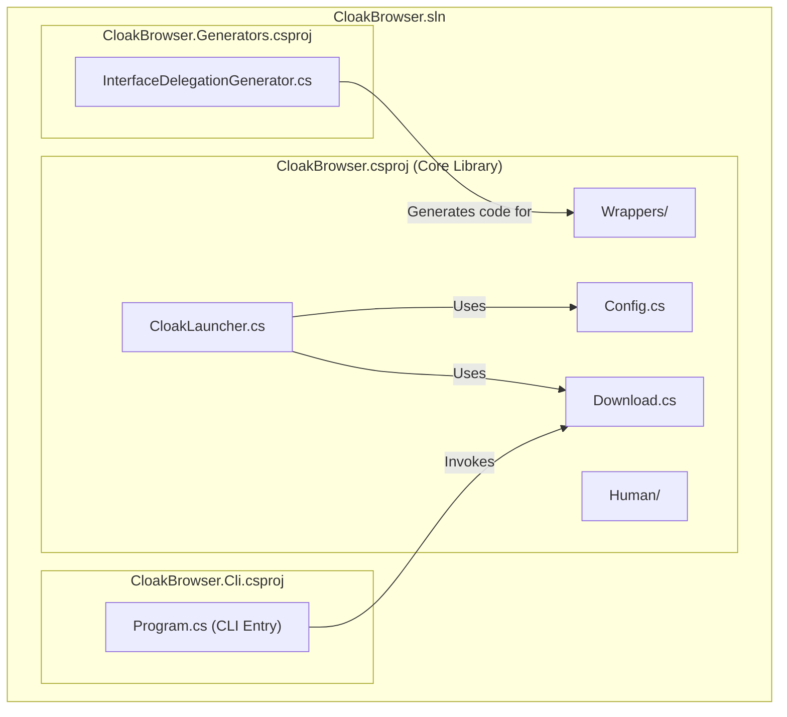

<!-- source: DeepWiki mcp.deepwiki.com · repo CloakHQ/CloakBrowser · page 5 .NET Package · fetched 2026-10-30 -->

# .NET Package

Relevant source files

The following files were used as context for generating this wiki page:

- [dotnet/.gitignore](dotnet/.gitignore)
- [dotnet/CloakBrowser.sln](dotnet/CloakBrowser.sln)
- [dotnet/README.md](dotnet/README.md)
- [dotnet/examples/CloakBrowser.Examples/CloakBrowser.Examples.csproj](dotnet/examples/CloakBrowser.Examples/CloakBrowser.Examples.csproj)
- [dotnet/examples/CloakBrowser.Examples/Program.cs](dotnet/examples/CloakBrowser.Examples/Program.cs)
- [dotnet/src/CloakBrowser.Cli/CloakBrowser.Cli.csproj](dotnet/src/CloakBrowser.Cli/CloakBrowser.Cli.csproj)
- [dotnet/src/CloakBrowser.Generators/CloakBrowser.Generators.csproj](dotnet/src/CloakBrowser.Generators/CloakBrowser.Generators.csproj)
- [dotnet/src/CloakBrowser.Generators/InterfaceDelegationGenerator.cs](dotnet/src/CloakBrowser.Generators/InterfaceDelegationGenerator.cs)
- [dotnet/src/CloakBrowser/CloakBrowser.csproj](dotnet/src/CloakBrowser/CloakBrowser.csproj)
- [dotnet/src/CloakBrowser/CloakLauncher.cs](dotnet/src/CloakBrowser/CloakLauncher.cs)
- [dotnet/src/CloakBrowser/CloakVersion.cs](dotnet/src/CloakBrowser/CloakVersion.cs)
- [js/package-lock.json](js/package-lock.json)

The CloakBrowser .NET package is a complete, faithful port of the CloakBrowser Python and JavaScript wrappers, built for **.NET 8 / C#**. It provides a drop-in replacement for the official `Microsoft.Playwright` library, enabling source-level fingerprint patches and humanized interaction patterns while maintaining a statically-typed API surface [dotnet/src/CloakBrowser/CloakBrowser.csproj:12-15]().

## Architecture Overview

Unlike Python or JavaScript, .NET's Playwright implementation uses **sealed interfaces** (e.g., `IPage`, `ILocator`, `IMouse`) that cannot be monkey-patched at runtime [dotnet/README.md:50-52](). To overcome this, CloakBrowser uses a **transparent decorator pattern** powered by a custom Roslyn source generator [dotnet/src/CloakBrowser/CloakBrowser.csproj:39-43]().

### The Decorator Pattern
When `Humanize = true` is passed to the launch options, CloakBrowser returns wrapped versions of Playwright objects [dotnet/src/CloakBrowser/CloakLauncher.cs:80-89](). These wrappers (e.g., `HumanizedPage`) intercept specific calls like `ClickAsync` or `FillAsync` to inject human-like behavior while delegating all other members verbatim to the underlying Playwright instance via the `InterfaceDelegationGenerator` [dotnet/src/CloakBrowser.Generators/InterfaceDelegationGenerator.cs:11-25]().

### Code Entity Mapping: Decorator Flow
The following diagram illustrates how user code interacts with the decorator layer to reach the patched Chromium binary.

**System Entity Mapping: .NET Wrapper Architecture**

Sources: [dotnet/src/CloakBrowser/CloakLauncher.cs:58-66](), [dotnet/src/CloakBrowser.Generators/InterfaceDelegationGenerator.cs:11-25](), [dotnet/README.md:63-66]()

---

## Primary Entry Point: CloakLauncher

The `CloakLauncher` static class is the primary entry point for the library, mirroring the `launch` functions in the Python and JS implementations [dotnet/src/CloakBrowser/CloakLauncher.cs:12-16](). Because .NET Playwright is async-only, `CloakLauncher` provides an exclusively asynchronous surface [dotnet/src/CloakBrowser/CloakLauncher.cs:13-14]().

### Launch Methods
- **`LaunchAsync`**: Launches a browser instance with specified `LaunchOptions`. It returns a `CloakBrowserHandle` which wraps the `IBrowser` [dotnet/src/CloakBrowser/CloakLauncher.cs:22-98]().
- **`LaunchContextAsync`**: Launches a browser and creates a new `IBrowserContext` in one call, returning a `CloakContextHandle` [dotnet/src/CloakBrowser/CloakLauncher.cs:105-155]().
- **`LaunchPersistentContextAsync`**: Launches a browser using a persistent user profile directory, ensuring cookies and local storage survive across runs [dotnet/examples/CloakBrowser.Examples/Program.cs:101-109]().

For a full list of parameters and return types, see [.NET API Reference](#5.1).

---

## Core Subsystems

The .NET package achieves feature parity with other implementations through several specialized modules:

| Subsystem | File(s) | Responsibility |
| :--- | :--- | :--- |
| **Configuration** | `Config.cs` | Platform detection, versioning, and capability gates like `BinarySupportsHeadlessNoViewport` [dotnet/README.md:115-115](). |
| **Binary Management** | `Download.cs` | SHA-256 and Ed25519 verified downloads of the patched binary using `BouncyCastle.Cryptography` [dotnet/src/CloakBrowser/CloakBrowser.csproj:33-36](). |
| **Humanize Layer** | `Human/`, `Wrappers/` | Bézier mouse curves, human typing with mistype simulation, and actionability checks [dotnet/README.md:125-146](). |
| **GeoIP** | `GeoIp.cs` | Auto-detecting timezone/locale from proxy exit IPs via MaxMind GeoLite2 [dotnet/src/CloakBrowser/CloakLauncher.cs:29-30](). |

### Code Entity Mapping: Project Structure
This diagram maps the logical subsystems to their physical file locations within the `dotnet/` directory.

**System Entity Mapping: Project Layout**

Sources: [dotnet/CloakBrowser.sln:6-21](), [dotnet/src/CloakBrowser/CloakBrowser.csproj:30-43](), [dotnet/README.md:110-149]()

---

## Distribution and Tooling

### NuGet Distribution
The package is distributed via NuGet as `CloakBrowser`. It targets `net8.0` and depends on `Microsoft.Playwright` (v1.49.0), `MaxMind.GeoIP2`, and `BouncyCastle.Cryptography` for Ed25519 signature verification [dotnet/src/CloakBrowser/CloakBrowser.csproj:12-36](). The library version is centrally defined in `CloakVersion.cs` [dotnet/src/CloakBrowser/CloakVersion.cs:4-8]().

### Command Line Interface (CLI)
The package includes a CLI tool (`cloakbrowser-cli`) that provides utilities for managing the environment [dotnet/src/CloakBrowser.Cli/CloakBrowser.Cli.csproj:8-8]():
- `install`: Pre-downloads the patched Chromium binary.
- `info`: Displays diagnostic information, platform detection, and license status.
- `update`: Checks for and installs binary updates.
- `clear-cache`: Removes downloaded binaries and temporary files.

For details on configuration and the CLI, see [.NET Configuration and Binary Management](#5.2).

---

## Child Pages

- **[.NET API Reference](#5.1)** — Full reference for `CloakLauncher` methods, `LaunchOptions`, and the async-only surface.
- **[.NET Configuration and Binary Management](#5.2)** — Details on platform detection, Ed25519 signature verification via BouncyCastle, and the CLI.
- **[.NET Humanize Decorator Layer](#5.3)** — Deep dive into the Roslyn source generator and the transparent interaction engine (Bézier mouse, human typing).

---

