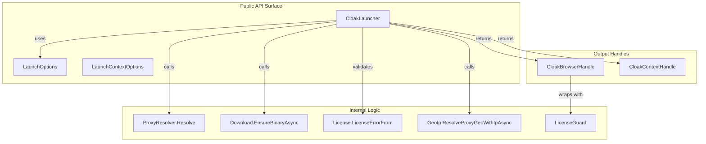
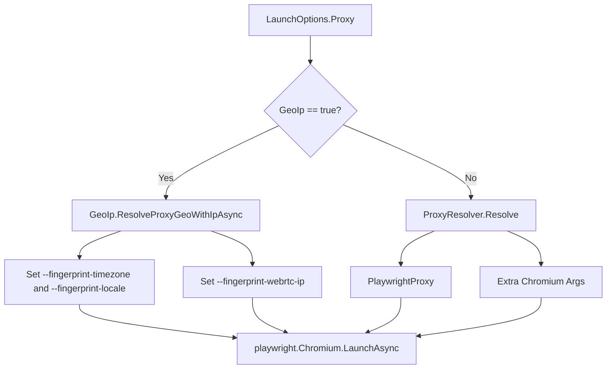

<!-- source: DeepWiki mcp.deepwiki.com · repo CloakHQ/CloakBrowser · page 5.1 .NET API Reference · fetched 2026-10-30 -->

# .NET API Reference

Relevant source files

The following files were used as context for generating this wiki page:

- [bin/docker-entrypoint.sh](bin/docker-entrypoint.sh)
- [dotnet/src/CloakBrowser/CloakLauncher.cs](dotnet/src/CloakBrowser/CloakLauncher.cs)
- [dotnet/src/CloakBrowser/GeoIp.cs](dotnet/src/CloakBrowser/GeoIp.cs)
- [dotnet/src/CloakBrowser/Handles.cs](dotnet/src/CloakBrowser/Handles.cs)
- [dotnet/src/CloakBrowser/LaunchOptions.cs](dotnet/src/CloakBrowser/LaunchOptions.cs)
- [dotnet/src/CloakBrowser/ProxySettings.cs](dotnet/src/CloakBrowser/ProxySettings.cs)
- [dotnet/src/CloakBrowser/Wrappers/HumanizedBrowserContext.cs](dotnet/src/CloakBrowser/Wrappers/HumanizedBrowserContext.cs)
- [dotnet/tests/CloakBrowser.Tests/MiscTests.cs](dotnet/tests/CloakBrowser.Tests/MiscTests.cs)
- [dotnet/tests/CloakBrowser.Tests/Wrappers/BrowserContextWrapperTests.cs](dotnet/tests/CloakBrowser.Tests/Wrappers/BrowserContextWrapperTests.cs)

This page provides a detailed technical reference for the `CloakBrowser` .NET 8 / C# package. The .NET implementation follows a decorator/wrapper pattern, primarily using the `CloakLauncher` static class to interface with a patched stealth Chromium binary through the Playwright framework.

Unlike the Python implementation, which offers both synchronous and asynchronous APIs, the .NET package is **async-only** to align with the native architecture of the Microsoft Playwright library [dotnet/src/CloakBrowser/CloakLauncher.cs:9-14]().

## CloakLauncher Static Methods

`CloakLauncher` is the primary entry point for launching stealth browser instances. It handles binary resolution, GeoIP detection, license validation, and argument construction before delegating the actual launch to Playwright.

### `LaunchAsync()`
Launches a stealth Chromium browser and returns a `CloakBrowserHandle`. This is the equivalent of Playwright's `IBrowserType.LaunchAsync`.

*   **Signature:** `public static async Task<CloakBrowserHandle> LaunchAsync(LaunchOptions? options = null)` [dotnet/src/CloakBrowser/CloakLauncher.cs:22]()
*   **Data Flow:**
    1.  Resolves binary path via `Download.EnsureBinaryAsync` [dotnet/src/CloakBrowser/CloakLauncher.cs:26-28]().
    2.  Optionally resolves GeoIP data (timezone, locale, exit IP) using `MaybeResolveGeoIpAsync` [dotnet/src/CloakBrowser/CloakLauncher.cs:29-30]().
    3.  Resolves proxy settings into Playwright options or Chrome CLI args via `ProxyResolver.Resolve` [dotnet/src/CloakBrowser/CloakLauncher.cs:31-32]().
    4.  Builds final stealth arguments including random fingerprint seeds and timezone/locale flags [dotnet/src/CloakBrowser/CloakLauncher.cs:38-41]().
    5.  Launches the process via `playwright.Chromium.LaunchAsync` [dotnet/src/CloakBrowser/CloakLauncher.cs:58-66]().
    6.  Wraps the resulting `IBrowser` in a `CloakBrowserHandle` which manages the Playwright lifecycle [dotnet/src/CloakBrowser/CloakLauncher.cs:88-89]().

### `LaunchContextAsync()`
Launches a browser and immediately creates a new browser context. This is a convenience wrapper that returns a `CloakContextHandle`.

*   **Signature:** `public static async Task<CloakContextHandle> LaunchContextAsync(LaunchContextOptions? options = null)` [dotnet/src/CloakBrowser/CloakLauncher.cs:105]()
*   **Implementation:** It calls `LaunchAsync` internally with a suppressed maximize flag if a viewport is provided, then invokes `NewContextAsync` on the resulting browser handle [dotnet/src/CloakBrowser/CloakLauncher.cs:115-141]().

### `LaunchPersistentContextAsync()`
Launches a stealth browser with a persistent user data directory. Returns a `CloakContextHandle`.

*   **Signature:** `public static async Task<CloakContextHandle> LaunchPersistentContextAsync(string userDataDir, LaunchContextOptions? options = null)` [dotnet/src/CloakBrowser/CloakLauncher.cs:158-159]()

**Sources:** [dotnet/src/CloakBrowser/CloakLauncher.cs:15-159]()

---

## Configuration Classes

### LaunchOptions
The base configuration class for all launch methods. It mirrors the keyword arguments of the Python implementation [dotnet/src/CloakBrowser/LaunchOptions.cs:9]().

| Property | Type | Description |
| :--- | :--- | :--- |
| `Headless` | `bool` | Whether to run the browser in headless mode. Defaults to `true` [dotnet/src/CloakBrowser/LaunchOptions.cs:12](). |
| `Proxy` | `object?` | Proxy: a URL string or a `ProxySettings` object [dotnet/src/CloakBrowser/LaunchOptions.cs:15](). |
| `Args` | `List<string>?` | Additional Chromium command-line arguments [dotnet/src/CloakBrowser/LaunchOptions.cs:18](). |
| `StealthArgs` | `bool` | Include default stealth fingerprint args. Defaults to `true` [dotnet/src/CloakBrowser/LaunchOptions.cs:21](). |
| `Timezone` | `string?` | IANA timezone ID (e.g., `America/New_York`) - sets `--fingerprint-timezone` [dotnet/src/CloakBrowser/LaunchOptions.cs:24](). |
| `Locale` | `string?` | BCP 47 locale (e.g., `en-US`) - sets `--lang` and `--fingerprint-locale` [dotnet/src/CloakBrowser/LaunchOptions.cs:27](). |
| `GeoIp` | `bool` | Auto-detect Timezone/Locale (and WebRTC exit IP) from proxy IP [dotnet/src/CloakBrowser/LaunchOptions.cs:30](). |
| `Humanize` | `bool` | Enable the human-like behavior layer [dotnet/src/CloakBrowser/LaunchOptions.cs:33](). |
| `HumanPreset` | `HumanPreset` | Preset for humanization behaviors. Defaults to `Default` [dotnet/src/CloakBrowser/LaunchOptions.cs:36](). |
| `HumanConfig` | `IReadOnlyDictionary<string, object>?` | Custom humanize config overrides [dotnet/src/CloakBrowser/LaunchOptions.cs:39](). |
| `ExtensionPaths` | `List<string>?` | Paths to Chromium extensions to load [dotnet/src/CloakBrowser/LaunchOptions.cs:42](). |
| `LicenseKey` | `string?` | CloakBrowser Pro license key [dotnet/src/CloakBrowser/LaunchOptions.cs:49](). |
| `BrowserVersion` | `string?` | Specific Chromium version to pin [dotnet/src/CloakBrowser/LaunchOptions.cs:58](). |
| `Viewport` | `(int, int)?` | Viewport size (Width, Height). Null means "use default 1920x947" [dotnet/src/CloakBrowser/LaunchOptions.cs:81](). |
| `UserAgent` | `string?` | Custom User-Agent string [dotnet/src/CloakBrowser/LaunchOptions.cs:78](). |

### LaunchContextOptions
Extends `LaunchOptions` for context-specific emulation settings [dotnet/src/CloakBrowser/LaunchOptions.cs:75]().

| Property | Type | Description |
| :--- | :--- | :--- |
| `NoViewport` | `bool` | Disable viewport emulation to track OS window [dotnet/src/CloakBrowser/LaunchOptions.cs:84](). |
| `ColorScheme` | `string?` | Color scheme preference: `light`, `dark`, or `no-preference` [dotnet/src/CloakBrowser/LaunchOptions.cs:87](). |
| `StorageStatePath` | `string?` | Path to Playwright storage-state JSON [dotnet/src/CloakBrowser/LaunchOptions.cs:90](). |

**Sources:** [dotnet/src/CloakBrowser/LaunchOptions.cs:1-91]()

---

## Core Infrastructure Entities

### ProxySettings
Defines the proxy configuration, mirroring the Python `ProxySettings` TypedDict [dotnet/src/CloakBrowser/ProxySettings.cs:7]().
*   `Server`: Proxy server URL (e.g., `http://proxy:8080` or `socks5://proxy:1080`) [dotnet/src/CloakBrowser/ProxySettings.cs:10]().
*   `Username` / `Password`: Credentials for authenticated proxies [dotnet/src/CloakBrowser/ProxySettings.cs:16-19]().
*   `Bypass`: Comma-separated bypass list [dotnet/src/CloakBrowser/ProxySettings.cs:13]().

### CloakBrowserHandle
A launched stealth browser that owns the underlying Playwright instance [dotnet/src/CloakBrowser/Handles.cs:13]().
1.  **Lifecycle Management:** Disposing of the `IPlaywright` instance when `CloseAsync` is called [dotnet/src/CloakBrowser/Handles.cs:109-113]().
2.  **Humanize Injection:** If `Humanize` is enabled, it wraps the browser in a transparent humanizing decorator [dotnet/src/CloakBrowser/Handles.cs:56-58]().
3.  **License Guard:** Wraps the browser to surface post-handshake license denials [dotnet/src/CloakBrowser/Handles.cs:61-62]().
4.  **Raw Access:** Provides `RawBrowser` as an escape hatch to the un-wrapped Playwright browser [dotnet/src/CloakBrowser/Handles.cs:33]().

### CloakBrowserLicenseError
The .NET package maps binary exit codes and handshake denials to `CloakBrowserLicenseError` [dotnet/src/CloakBrowser/CloakLauncher.cs:71-72](). This is handled by the `LicenseGuard` which monitors a per-launch denial file written by the binary [dotnet/src/CloakBrowser/Handles.cs:130-137]().

**Sources:** [dotnet/src/CloakBrowser/ProxySettings.cs:1-21](), [dotnet/src/CloakBrowser/Handles.cs:1-137](), [dotnet/src/CloakBrowser/CloakLauncher.cs:46-74]()

---

## Architecture Diagrams

### Entity Association Map
This diagram bridges the natural language concepts of the .NET API to the specific code entities implementing them.

**Sources:** [dotnet/src/CloakBrowser/CloakLauncher.cs:15-159](), [dotnet/src/CloakBrowser/GeoIp.cs:97-133](), [dotnet/src/CloakBrowser/Handles.cs:13-62]()

### Proxy and GeoIP Data Flow
Detailed view of how the `CloakLauncher` coordinates proxy resolution and GeoIP detection before launching Chromium.

**Sources:** [dotnet/src/CloakBrowser/CloakLauncher.cs:26-66](), [dotnet/src/CloakBrowser/GeoIp.cs:97-133]()

---

