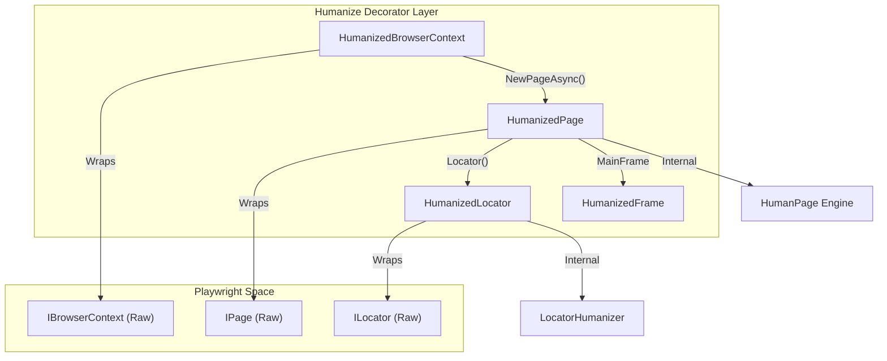
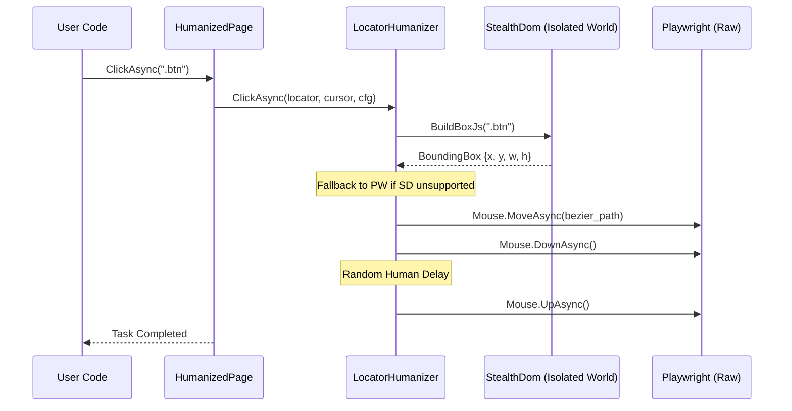

<!-- source: DeepWiki mcp.deepwiki.com · repo CloakHQ/CloakBrowser · page 5.3 .NET Humanize Decorator Layer · fetched 2026-10-30 -->

# .NET Humanize Decorator Layer

Relevant source files

The following files were used as context for generating this wiki page:

- [dotnet/.gitignore](dotnet/.gitignore)
- [dotnet/CloakBrowser.sln](dotnet/CloakBrowser.sln)
- [dotnet/examples/CloakBrowser.Examples/CloakBrowser.Examples.csproj](dotnet/examples/CloakBrowser.Examples/CloakBrowser.Examples.csproj)
- [dotnet/examples/CloakBrowser.Examples/Program.cs](dotnet/examples/CloakBrowser.Examples/Program.cs)
- [dotnet/src/CloakBrowser.Cli/CloakBrowser.Cli.csproj](dotnet/src/CloakBrowser.Cli/CloakBrowser.Cli.csproj)
- [dotnet/src/CloakBrowser.Generators/CloakBrowser.Generators.csproj](dotnet/src/CloakBrowser.Generators/CloakBrowser.Generators.csproj)
- [dotnet/src/CloakBrowser.Generators/InterfaceDelegationGenerator.cs](dotnet/src/CloakBrowser.Generators/InterfaceDelegationGenerator.cs)
- [dotnet/src/CloakBrowser/Human/Actionability.cs](dotnet/src/CloakBrowser/Human/Actionability.cs)
- [dotnet/src/CloakBrowser/Human/HumanPage.cs](dotnet/src/CloakBrowser/Human/HumanPage.cs)
- [dotnet/src/CloakBrowser/Human/StealthDom.cs](dotnet/src/CloakBrowser/Human/StealthDom.cs)
- [dotnet/src/CloakBrowser/Wrappers/HumanCursor.cs](dotnet/src/CloakBrowser/Wrappers/HumanCursor.cs)
- [dotnet/src/CloakBrowser/Wrappers/Humanize.cs](dotnet/src/CloakBrowser/Wrappers/Humanize.cs)
- [dotnet/src/CloakBrowser/Wrappers/HumanizedFrame.cs](dotnet/src/CloakBrowser/Wrappers/HumanizedFrame.cs)
- [dotnet/src/CloakBrowser/Wrappers/HumanizedLocator.cs](dotnet/src/CloakBrowser/Wrappers/HumanizedLocator.cs)
- [dotnet/src/CloakBrowser/Wrappers/HumanizedPage.cs](dotnet/src/CloakBrowser/Wrappers/HumanizedPage.cs)
- [dotnet/src/CloakBrowser/Wrappers/LocatorHumanizer.cs](dotnet/src/CloakBrowser/Wrappers/LocatorHumanizer.cs)
- [dotnet/tests/CloakBrowser.Tests/Human/StealthDomTests.cs](dotnet/tests/CloakBrowser.Tests/Human/StealthDomTests.cs)

The .NET Humanize Decorator Layer provides a transparent behavioral wrapper over the Playwright .NET library. It implements human-like interaction patterns (mouse movement, typing, and scrolling) while maintaining the standard Playwright interface. This layer is critical for bypassing behavioral bot detection by ensuring that automation signals match human-typical kinematics and timings.

## Overview and Motivation

Unlike Python or JavaScript, where dynamic monkey-patching allows modifying library behavior at runtime, Playwright .NET uses `sealed` classes and internal interfaces that prevent traditional decoration of the core library objects. To achieve a "drop-in" experience where users can simply use `IPage`, `ILocator`, or `IMouse` as normal, CloakBrowser utilizes a **Roslyn Source Generator** (`InterfaceDelegationGenerator`) to create a decorator tree at compile time [dotnet/src/CloakBrowser/CloakBrowser.csproj:20-20]().

### Key Characteristics
*   **Transparent Interception**: Methods like `ClickAsync`, `FillAsync`, and `TypeAsync` are intercepted and routed through humanization logic [dotnet/src/CloakBrowser/Wrappers/HumanizedPage.cs:108-124]().
*   **Compile-Time Generation**: Wrappers for `IBrowser`, `IBrowserContext`, `IPage`, `ILocator`, `IFrame`, `IKeyboard`, and `IMouse` are generated to forward all non-intercepted calls to the underlying Playwright instance via the `[GenerateInterfaceDelegation]` attribute [dotnet/src/CloakBrowser/Wrappers/HumanizedPage.cs:16-17]().
*   **Zero Leakage**: Every object returned by a humanized parent (e.g., a `Locator` from a `Page`) is automatically re-wrapped, ensuring the "humanized" state persists throughout the object graph [dotnet/src/CloakBrowser/Wrappers/Humanize.cs:11-18]().
*   **Parity**: The Bézier curves, typing jitters, and scroll acceleration math are direct ports of the Python/JS implementations, ensuring cross-language behavioral consistency [dotnet/src/CloakBrowser/Human/HumanPage.cs:31-35]().

---

## Architecture: The Decorator Tree

The humanization layer starts at the `CloakLauncher` and propagates down through the Playwright hierarchy.

### Data Flow and Wrapping Logic
The following diagram illustrates how a raw Playwright object is transformed into a humanized version that satisfies the same interface.

**Humanization Object Graph**

Sources: [dotnet/src/CloakBrowser/Wrappers/Humanize.cs:26-47](), [dotnet/src/CloakBrowser/Wrappers/HumanizedPage.cs:97-102](), [dotnet/src/CloakBrowser/Wrappers/HumanizedLocator.cs:16-17]()

### Component Mapping

| .NET Interface | Humanized Wrapper | Responsibility |
| :--- | :--- | :--- |
| `IBrowserContext` | `HumanizedBrowserContext` | Memoizes wrappers via `ConditionalWeakTable` so `page.Context` returns a stable identity [dotnet/src/CloakBrowser/Wrappers/Humanize.cs:40-50](). |
| `IPage` | `HumanizedPage` | Routes selector-based actions through `HumanPage` engine; wraps `Mouse` and `Keyboard` [dotnet/src/CloakBrowser/Wrappers/HumanizedPage.cs:30-38](). |
| `ILocator` | `HumanizedLocator` | Implements humanized `ClickAsync`, `FillAsync`, and `DragToAsync` using the page's shared cursor [dotnet/src/CloakBrowser/Wrappers/HumanizedLocator.cs:48-95](). |
| `IFrame` | `HumanizedFrame` | Resolves locators within the frame and routes them through `LocatorHumanizer` [dotnet/src/CloakBrowser/Wrappers/HumanizedFrame.cs:41-66](). |
| `IElementHandle` | `HumanizedElementHandle` | Provides humanized interaction for raw handles [dotnet/src/CloakBrowser/Wrappers/Humanize.cs:89-90](). |

---

## Technical Implementation Details

### The HumanCursor and Shared State
To prevent the cursor from "jumping" between independent calls, CloakBrowser uses a `HumanCursor` class. This instance is shared between a `HumanizedPage` and all its derived `Locators`, `Frames`, and `Mouse` objects [dotnet/src/CloakBrowser/Wrappers/HumanCursor.cs:7-12](). It tracks the virtual `(X, Y)` position and maintains the CDP isolated world session for stealthy DOM reads [dotnet/src/CloakBrowser/Wrappers/HumanCursor.cs:32-33]().

### Stealth DOM: Isolated World Reads
Humanized actions often need to check if an element is visible or find its bounding box without triggering Playwright's main-world automation signals.
*   **StealthDom**: Implements a subset of Playwright's selector grammar (CSS, XPath, `text=`, `:has-text`) in JavaScript [dotnet/src/CloakBrowser/Human/StealthDom.cs:16-23]().
*   **IsolatedWorld**: Executes this JS via CDP `Runtime.evaluate` in a separate execution context, making the reads invisible to most bot detectors [dotnet/src/CloakBrowser/Human/StealthDom.cs:11-14]().
*   **Fail-Open**: If a complex selector (e.g., `internal:role`) is used, the system returns `StealthStatus.Unsupported` and falls back to standard Playwright reads [dotnet/src/CloakBrowser/Human/StealthDom.cs:20-23]().

### Actionability and Shared Timeouts
The `.NET` layer implements a retry loop with backoff [100, 250, 500, 1000]ms for actionability checks (attached, visible, stable, enabled, editable) [dotnet/src/CloakBrowser/Human/Actionability.cs:72-100]().
*   **Timeout Budget**: All sub-steps of an action (moving, clicking, waiting) share a single deadline calculated from the initial `Timeout` option to prevent exponential timeout growth [dotnet/src/CloakBrowser/Human/Actionability.cs:110-115]().
*   **OptionReader**: Since Playwright's option classes (e.g., `PageClickOptions`) have no common base, CloakBrowser uses reflection to extract `Timeout`, `Force`, and `Delay` values [dotnet/src/CloakBrowser/Wrappers/Humanize.cs:127-143]().

### Keyboard: Non-ASCII and Stealth Path
The `HumanKeyboard` engine handles text input with specific bypasses:
*   **CDP Stealth Path**: If a CDP session is available, keys are dispatched via `Input.dispatchKeyEvent` to ensure they appear as "trusted" events [dotnet/src/CloakBrowser/Wrappers/HumanCursor.cs:99-100]().
*   **Non-ASCII Handling**: Characters that cannot be represented as physical key codes (emojis, CJK) are handled through a specialized path to ensure compatibility [dotnet/src/CloakBrowser/Human/HumanPage.cs:31-35]().

---

## Interaction Logic Flow

The following diagram bridges the high-level user call to the internal humanization logic.

**Action Execution Flow (e.g., ClickAsync)**

Sources: [dotnet/src/CloakBrowser/Wrappers/LocatorHumanizer.cs:101-151](), [dotnet/src/CloakBrowser/Human/StealthDom.cs:100-107](), [dotnet/src/CloakBrowser/Wrappers/HumanizedPage.cs:108-109]()

## Pointer-Events Fail-Open
Before clicking, the layer verifies if the element is actually receiving pointer events using `document.elementFromPoint` in the isolated world [dotnet/src/CloakBrowser/Human/StealthDom.cs:133-147](). If the element is covered by another tag, it throws a `ElementNotReceivingEventsError` [dotnet/src/CloakBrowser/Human/Actionability.cs:61-66](). However, if the geometry resolution is uncertain, it "fails open" to allow the click to proceed rather than blocking a valid interaction.

Sources:
* [dotnet/src/CloakBrowser/Wrappers/Humanize.cs:1-143]()
* [dotnet/src/CloakBrowser/Wrappers/HumanizedPage.cs:1-130]()
* [dotnet/src/CloakBrowser/Wrappers/HumanizedLocator.cs:1-120]()
* [dotnet/src/CloakBrowser/Human/HumanPage.cs:36-130]()
* [dotnet/src/CloakBrowser/Human/Actionability.cs:72-170]()
* [dotnet/src/CloakBrowser/Human/StealthDom.cs:1-147]()
* [dotnet/src/CloakBrowser/Wrappers/HumanCursor.cs:1-101]()

---

