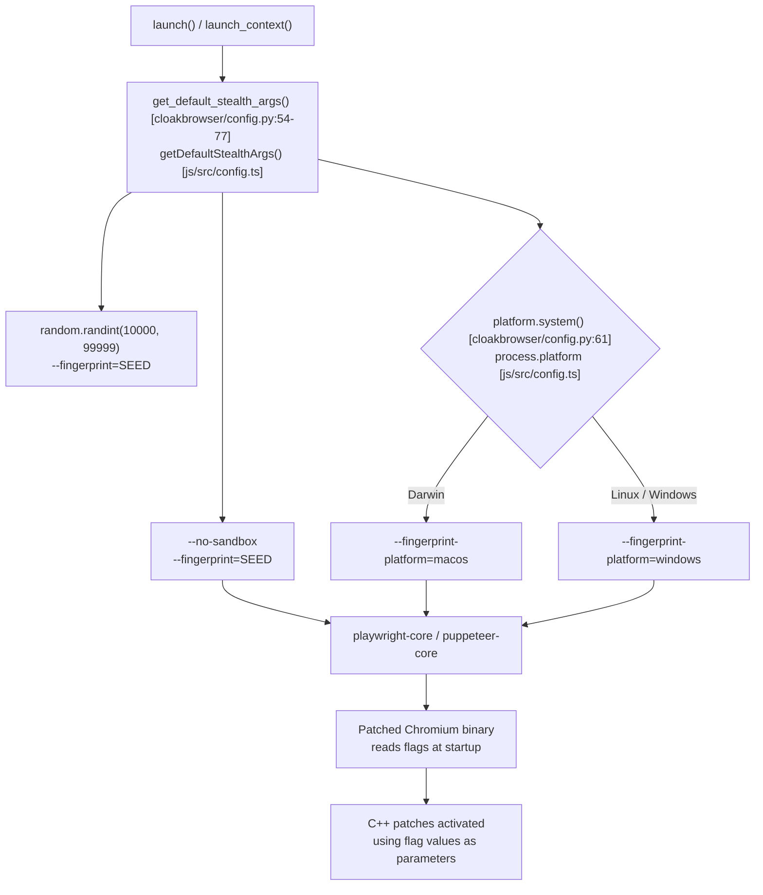
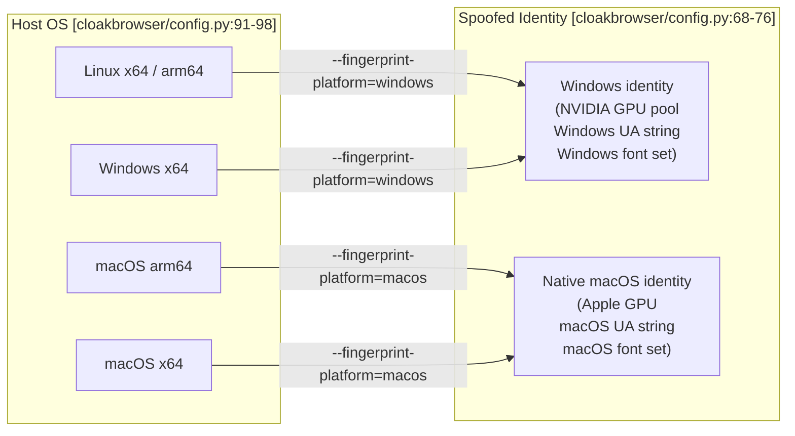

<!-- source: DeepWiki mcp.deepwiki.com · repo CloakHQ/CloakBrowser · page 6 Stealth System · fetched 2026-10-30 -->

# Stealth System

<details>
<summary>Relevant source files</summary>

The following files were used as context for generating this wiki page:

- [CHANGELOG.md](CHANGELOG.md)
- [README.md](README.md)
- [cloakbrowser/config.py](cloakbrowser/config.py)
- [js/src/config.ts](js/src/config.ts)
- [js/src/human-puppeteer/index.ts](js/src/human-puppeteer/index.ts)
- [js/tests/stealth.puppeteer.test.ts](js/tests/stealth.puppeteer.test.ts)
- [js/tests/stealth.test.ts](js/tests/stealth.test.ts)
- [tests/test_stealth_unit.py](tests/test_stealth_unit.py)

</details>


This page explains the end-to-end mechanism by which CloakBrowser evades bot detection: the source-level binary patches, how launch arguments activate them, and how platform-specific fingerprint spoofing is applied. It covers what is patched, why, and the measured detection results.

For the individual `--fingerprint-*` flag reference, see [Fingerprint Flags Reference](#6.1). For how the behavioral layer mimics human interactions, see [Humanize Behavioral Layer](#6.2). For details on the optional GeoIP resolution system, see [GeoIP Auto-Detection](#6.3).

---

## Approach: Source-Level C++ Patches

CloakBrowser's stealth capability comes from **71 source-level C++ patches** (upgraded to 73 in recent Pro builds) applied directly to Chromium's core before compilation [README.md:39-45](). The resulting binary is distributed as a pre-built artifact, ensuring that fingerprints are modified at the binary level rather than via detectable runtime scripts.

This is distinct from common alternative approaches:

| Approach | Example Tools | How It Works | Why It Fails |
|---|---|---|---|
| JavaScript injection | `playwright-stealth` | Overwrites `navigator` properties at runtime | Detectable by JS integrity checks; breaks on Chrome updates |
| Config/flag patches | `undetected-chromedriver` | Sets browser flags to hide automation | Flags themselves become detection signals |
| CDP manipulation | `puppeteer-extra` | Modifies devtools protocol messages | CDP protocol leaks remain visible |
| **C++ source patches** | **CloakBrowser** | Modifies browser internals before compilation | Detection sites see a real browser because it *is* one |

The patched binary is downloaded to `~/.cloakbrowser/` on first launch [cloakbrowser/config.py:160-170](). The Python, JavaScript, and .NET packages are thin wrappers that point Playwright or Puppeteer at this binary with the correct activation arguments.

Sources: [README.md:39-45](), [README.md:153-156](), [CHANGELOG.md:11-17](), [cloakbrowser/config.py:160-170]()

---

## What Is Patched

The C++ patches modify critical browser surfaces that are commonly used for fingerprinting and automation detection. Unlike JS-based spoofing, these patches are active even before the first line of page-script executes.

| Surface | Browser API / Signal | Effect of Patch |
|---|---|---|
| **Canvas** | `toDataURL`, `getImageData` | Deterministic noise seeded by `--fingerprint` [cloakbrowser/config.py:65](). |
| **WebGL/WebGPU** | `UNMASKED_RENDERER_WEBGL` | Returns spoofed GPU renderer, vendor, and device IDs [README.md:39](). |
| **Audio** | `OfflineAudioContext`, AAC | Seeded noise on audio processing and AAC encoder output [README.md:39](). |
| **Fonts** | `document.fonts` / CSS checks | Consistent font list matching spoofed platform [CHANGELOG.md:13](). |
| **Hardware** | `hardwareConcurrency` | Returns configured value via `--fingerprint-hardware-concurrency` [CHANGELOG.md:12](). |
| **Storage** | `StorageBuckets` Quota | Normalizes storage quotas to bypass incognito detection [CHANGELOG.md:14](). |
| **Automation** | `navigator.webdriver` | Returns `false` at the source level by ignoring `--enable-automation` [cloakbrowser/config.py:47](). |
| **Network** | DNS/SSL/Connect timing | Zeroes proxy-induced timing leaks and strips proxy headers [README.md:166](). |
| **WebRTC** | ICE Candidates | Spoofs WebRTC IPs to match proxy exit IP via `--fingerprint-webrtc-ip` [README.md:168](). |
| **User-Agent** | UA string and Client Hints | Matches spoofed platform; removes `HeadlessChrome` [CHANGELOG.md:14](). |
| **SAPI Voices** | `speechSynthesis` | Localized voice tables for Windows personas [CHANGELOG.md:13](). |

Sources: [README.md:39-41](), [README.md:153-168](), [CHANGELOG.md:11-17](), [cloakbrowser/config.py:47-65]()

---

## Stealth Argument Activation

The patches in the binary are dormant unless activated via command-line flags at launch. The wrapper packages call `get_default_stealth_args()` (Python) or `getDefaultStealthArgs()` (JS) to generate these flags automatically on every `launch()` call.

**Activation Flow: Code to Binary**



Sources: [cloakbrowser/config.py:54-77](), [js/src/config.ts:33-39](), [README.md:153-156]()

---

## Platform-Specific Fingerprint Strategy

CloakBrowser applies different strategies based on the host OS to ensure cross-signal consistency.



- **Linux masquerades as Windows:** Linux desktops are a statistical anomaly in web traffic. CloakBrowser defaults Linux hosts to a Windows identity to blend into the largest market share [cloakbrowser/config.py:72-76]().
- **macOS uses native values:** Claiming an NVIDIA GPU on an Apple Silicon machine creates a detectable inconsistency. CloakBrowser uses native macOS values for consistency across all hardware reporting APIs [cloakbrowser/config.py:68-70]().
- **Windows Native GPU Passthrough:** Pro binaries can pass through real hardware values directly to match real browser behavior when not spoofing [README.md:159]().
- **Deterministic GPU Profiles:** GPU vendor/renderer flags drive realistic GPU profiles based on the fingerprint seed [CHANGELOG.md:12]().

Sources: [cloakbrowser/config.py:54-77](), [README.md:153-159](), [CHANGELOG.md:11-17]()

---

## Seed-Based Fingerprint Correlation

A single random integer seed (range 10000–99999) drives all seed-dependent patches via the `--fingerprint=SEED` flag [cloakbrowser/config.py:60-65](). In the Pro tier (v150+), this seed is used to select a "Coherent Identity" where screen size, RAM, CPU cores, and GPU model are chosen together to match a popular, real-world device configuration [CHANGELOG.md:12]().

To maintain a persistent identity across sessions, pin the seed explicitly in the `args` list:

```python
# Python example
browser = launch(args=["--fingerprint=42069"])
```

Sources: [cloakbrowser/config.py:60-65](), [CHANGELOG.md:11-17]()

---

## Detection Test Results

CloakBrowser is verified against live detection services. Pro tier binaries (Chromium 150+) provide the highest scores.

| Detection Service | Stock Playwright | CloakBrowser | Notes |
|---|---|---|---|
| **reCAPTCHA v3** | 0.1 | **0.9** | Human-level score (Pro binary) [README.md:41](). |
| **Cloudflare Turnstile** | FAIL | **PASS** | Bypasses managed and non-interactive challenges [README.md:28-30](). |
| **FingerprintJS** | DETECTED | **PASS** | Passes advanced bot detection; requires `geoip=True` for consistency [README.md:42](). |
| **BrowserScan** | DETECTED | **NORMAL** | 0 abnormal signals detected [README.md:42](). |

Sources: [README.md:28-30](), [README.md:41-42](), [CHANGELOG.md:11-17]()

---

## Subsystems

- [Fingerprint Flags Reference](#6.1) — Detailed reference for every binary flag.
- [Humanize Behavioral Layer](#6.2) — How `humanize=True` enables realistic mouse and keyboard patterns.
- [GeoIP Auto-Detection](#6.3) — Automatically syncing timezone and locale with your proxy IP.

---

