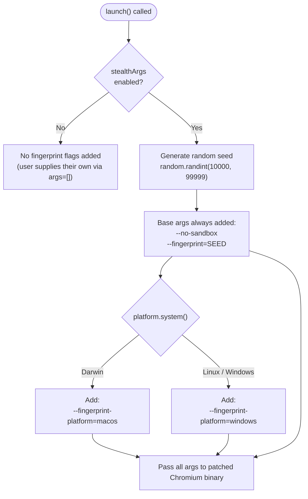
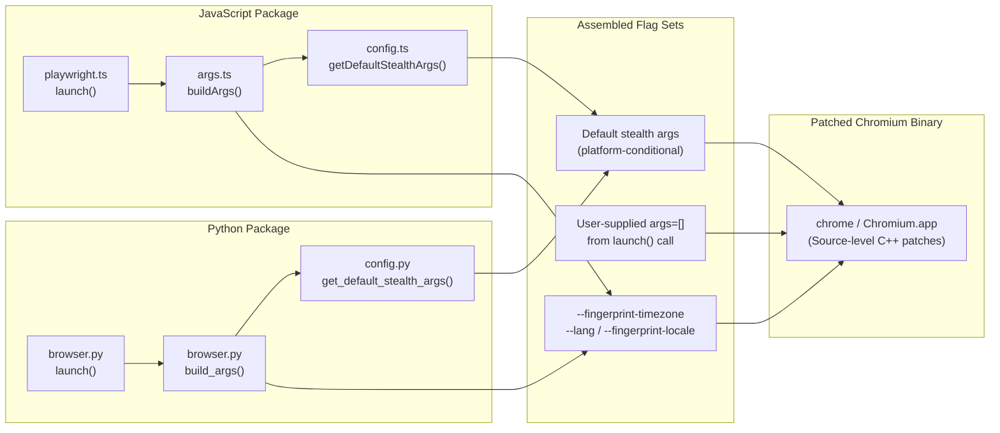

<!-- source: DeepWiki mcp.deepwiki.com · repo CloakHQ/CloakBrowser · page 6.1 Fingerprint Flags Reference · fetched 2026-10-30 -->

# Fingerprint Flags Reference

Relevant source files

The following files were used as context for generating this wiki page:

- [CHANGELOG.md](CHANGELOG.md)
- [README.md](README.md)
- [cloakbrowser/config.py](cloakbrowser/config.py)
- [dotnet/src/CloakBrowser/Config.cs](dotnet/src/CloakBrowser/Config.cs)
- [dotnet/tests/CloakBrowser.Tests/ConfigTests.cs](dotnet/tests/CloakBrowser.Tests/ConfigTests.cs)
- [js/src/args.ts](js/src/args.ts)
- [js/src/config.ts](js/src/config.ts)
- [js/tests/config.test.ts](js/tests/config.test.ts)
- [tests/test_build_args.py](tests/test_build_args.py)
- [tests/test_config.py](tests/test_config.py)

This page documents every `--fingerprint-*` and related Chromium command-line flag recognized by the patched CloakBrowser binary. It covers what browser surface each flag controls, the per-platform defaults applied automatically on each launch, and the additional flags available for manual customization.

For a conceptual explanation of how the stealth system works end-to-end (including the C++ patches these flags activate), see **6. Stealth System**. For the Python and JavaScript functions that assemble and pass these flags, see `cloakbrowser/config.py` [cloakbrowser/config.py:54-76]() and `js/src/config.ts` [js/src/config.ts:31-39]().

---

## How Fingerprint Flags Work

The patched Chromium binary exposes a set of custom command-line flags. These flags are **not** standard Chromium flags — they are read by source-level C++ patches compiled into the binary. Without the patched binary, these flags are silently ignored.

A single integer **seed** (`--fingerprint`) drives the majority of patches. All seed-based surfaces (canvas, WebGL, audio, fonts, client rects) derive their spoofed values from this one number, so they remain internally consistent — they look like they came from a single real machine rather than independent random noise.

The remaining flags override specific browser metadata values (platform, GPU strings, hardware concurrency, etc.) that must match the OS/hardware profile being impersonated.

**Diagram: Seed-to-surface propagation**

```mermaid
graph TD
    seed["--fingerprint=SEED (10000-99999)"]
    canvas["Canvas fingerprint"]
    webgl["WebGL rendering output"]
    audio["Audio processing fingerprint"]
    fonts["Font enumeration results"]
    rects["Client rect measurements"]

    seed --> canvas
    seed --> webgl
    seed --> audio
    seed --> fonts
    seed --> rects

    platform["--fingerprint-platform"]
    ua["navigator.platform\nUser-Agent OS string\nGPU pool selection"]
    platform --> ua

    concurrency["--fingerprint-hardware-concurrency"]
    hc["navigator.hardwareConcurrency"]
    concurrency --> hc

    gpuvendor["--fingerprint-gpu-vendor"]
    gpurenderer["--fingerprint-gpu-renderer"]
    webglunmasked["WebGL UNMASKED_VENDOR_WEBGL\nWebGL UNMASKED_RENDERER_WEBGL"]
    gpuvendor --> webglunmasked
    gpurenderer --> webglunmasked

    brand["--fingerprint-brand"]
    brandver["--fingerprint-brand-version"]
    platformver["--fingerprint-platform-version"]
    uat["User-Agent string\nClient Hints (Sec-CH-UA)"]
    brand --> uat
    brandver --> uat
    platformver --> uat

    location["--fingerprint-location"]
    geo["navigator.geolocation"]
    location --> geo

    timezone["--timezone"]
    tz["Intl.DateTimeFormat\nDate timezone offsets"]
    timezone --> tz
```

Sources: [cloakbrowser/config.py:54-76](), [js/src/args.ts:15-71]()

---

## Default Flags

These flags are assembled and passed automatically by `get_default_stealth_args()` (Python) [cloakbrowser/config.py:54-76](), `getDefaultStealthArgs()` (JS) [js/src/config.ts:31-39](), or `GetDefaultStealthArgs()` (.NET) [dotnet/src/CloakBrowser/Config.cs:70-94]() on every launch call. Starting with recent binary versions, hardware concurrency, device memory, screen, and GPU strings are auto-generated from the seed and platform.

| Flag | Linux/Windows Default | macOS Default | Browser Surface Controlled |
|---|---|---|---|
| `--fingerprint` | Random `10000`–`99999` | Random `10000`–`99999` | Master seed: canvas, WebGL output, audio fingerprint, font enumeration, client rect measurements |
| `--fingerprint-platform` | `windows` | `macos` | `navigator.platform`, User-Agent OS component, GPU string pool selection |

> **Note:** On macOS, CloakBrowser skips general platform/GPU spoofing and runs as a native Mac browser to avoid detectable mismatches in fonts and GPU behavior [cloakbrowser/config.py:57-59](). On Linux and Windows, it defaults to a Windows profile [cloakbrowser/config.py:72-76]().

Sources: [cloakbrowser/config.py:54-76](), [js/tests/config.test.ts:23-45](), [dotnet/src/CloakBrowser/Config.cs:70-94]()

---

## Additional Flags

These flags are recognized by the binary but **not always included in the default stealth args**. Pass them via the `args` parameter of `launch()` to customize specific surfaces.

| Flag | Value Format | Browser Surface Controlled |
|---|---|---|
| `--fingerprint-brand` | String: `Chrome`, `Edge`, etc. | Browser brand name in User-Agent string and `Sec-CH-UA` Client Hints |
| `--fingerprint-brand-version` | Version string, e.g. `130` | Brand version in User-Agent string and `Sec-CH-UA` Client Hints |
| `--fingerprint-platform-version` | Version string, e.g. `10.0.0` | `Sec-CH-UA-Platform-Version` Client Hint |
| `--fingerprint-hardware-concurrency` | Integer | `navigator.hardwareConcurrency` value |
| `--fingerprint-gpu-vendor` | String | Overrides the `UNMASKED_VENDOR_WEBGL` string |
| `--fingerprint-gpu-renderer` | String | Overrides the `UNMASKED_RENDERER_WEBGL` string |
| `--fingerprint-location` | `lat,lon`, e.g. `40.7128,-74.0060` | `navigator.geolocation` coordinates |
| `--timezone` | IANA timezone, e.g. `America/New_York` | `Intl.DateTimeFormat` resolved timezone, `Date` offset behavior |
| `--fingerprint-timezone` | IANA timezone | Alias for `--timezone`, set via `timezone` parameter [js/src/args.ts:55-62]() |
| `--fingerprint-locale` | BCP 47 locale, e.g. `en-US` | Browser language and `navigator.languages` list |
| `--fingerprint-storage-quota` | Integer (bytes) | Normalizes StorageBuckets API quota to close incognito detection vectors |
| `--fingerprint-taskbar-height`| Integer (pixels) | Controls `availHeight` calculation by subtracting taskbar height from screen height |
| `--fingerprint-sapi-voices` | Integer | Spoofs the number of available SpeechSynthesis voices |
| `--fingerprint-noise` | Boolean | Enables/disables rendering noise injection (Canvas/WebGL) |
| `--fingerprint-webrtc-ip` | IP or `auto` | Spoofs WebRTC ICE candidates. `auto` resolves via proxy [tests/test_build_args.py:178-185]() |
| `--fingerprint-allow-3p-cookies`| Boolean | Controls third-party cookie blocking behavior |
| `--fingerprint-windows-font-metrics`| Boolean | Activates high-fidelity Windows font profiles [js/src/args.ts:45-53]() |

Sources: [js/src/args.ts:15-71](), [tests/test_build_args.py:6-35](), [dotnet/tests/CloakBrowser.Tests/ConfigTests.cs:63-78]()

---

## Platform Branching Logic

The default arg assembly uses the runtime OS to decide which flags to emit. This diagram maps platform identity to the exact code paths and output arguments.

**Diagram: `get_default_stealth_args` branching**

Sources: [cloakbrowser/config.py:54-76](), [js/tests/config.test.ts:23-45](), [dotnet/src/CloakBrowser/Config.cs:70-94]()

---

## Code Entity Map

**Diagram: Flag assembly — from launch call to binary args**

Sources: [js/src/args.ts:15-71](), [cloakbrowser/config.py:54-76](), [tests/test_build_args.py:3-4]()

---

## Flag Details

### `--fingerprint`
- **Type:** Integer, range `10000`–`99999`
- **Role:** Master seed for all seed-derived patches.
- **Surfaces affected:** Canvas 2D fingerprint, WebGL rendering noise, AudioContext fingerprint, font metric perturbation, `getBoundingClientRect` / `getClientRects` output.
- **Default:** A new random integer is generated per `launch()` call [cloakbrowser/config.py:60-60](), [js/tests/config.test.ts:39-45](), [dotnet/src/CloakBrowser/Config.cs:73-78]().

### `--fingerprint-platform`
- **Type:** String enum: `windows`, `macos`, `linux`
- **Role:** Tells the binary which OS profile to impersonate. Controls `navigator.platform` and the OS component of the User-Agent string.
- **Linux/Windows default:** `windows` [cloakbrowser/config.py:76-76]().
- **macOS default:** `macos` [cloakbrowser/config.py:70-70]().

### `--timezone` / `--fingerprint-timezone`
- **Type:** IANA timezone identifier, e.g. `America/New_York`
- **Role:** Sets the browser's timezone natively via C++ patch, replacing detectable CDP-level emulation.
- **Implementation:** The `timezone` parameter in `launch()` is injected as `--fingerprint-timezone` in the argument builder [js/src/args.ts:55-62]() and [tests/test_build_args.py:6-9]().

### `--fingerprint-locale`
- **Type:** BCP 47 locale string, e.g. `en-US`
- **Role:** Sets the browser's language natively. 
- **Implementation:** Injected alongside `--lang` when the `locale` parameter is passed to `launch()` [js/src/args.ts:63-71]() and [tests/test_build_args.py:12-16]().

### `--fingerprint-webrtc-ip`
- **Type:** String (IP address or `auto`)
- **Role:** Spoofs the IP address reported by WebRTC ICE candidates.
- **Implementation:** When set to `auto`, the wrapper resolves the exit IP of the provided proxy and injects the actual IP as the flag value [tests/test_build_args.py:178-185]().

Sources: [cloakbrowser/config.py:54-76](), [js/src/args.ts:15-71](), [tests/test_build_args.py:6-185](), [dotnet/src/CloakBrowser/Config.cs:70-94]()

---

