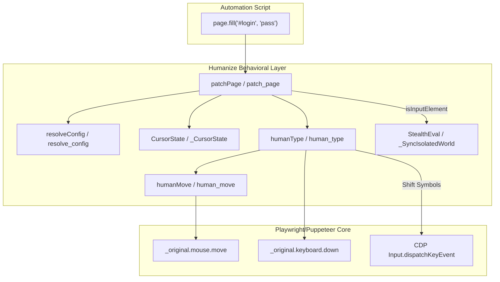
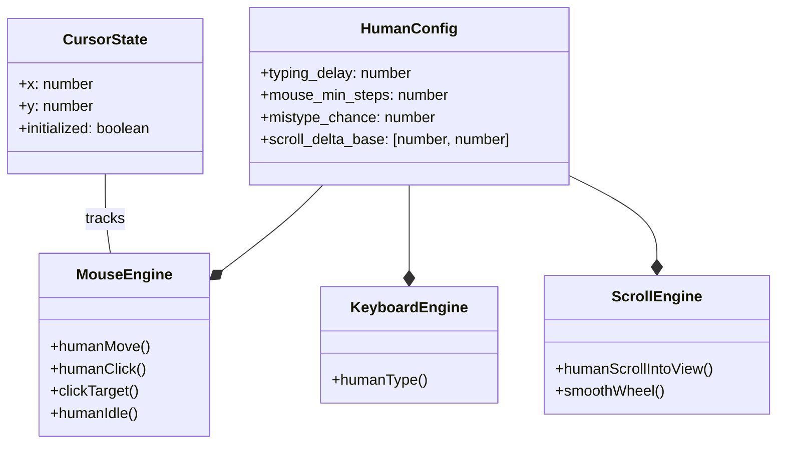

<!-- source: DeepWiki mcp.deepwiki.com · repo CloakHQ/CloakBrowser · page 6.2 Humanize Behavioral Layer · fetched 2026-10-30 -->

# Humanize Behavioral Layer

Relevant source files

The following files were used as context for generating this wiki page:

- [cloakbrowser/human/__init__.py](cloakbrowser/human/__init__.py)
- [cloakbrowser/human/actionability.py](cloakbrowser/human/actionability.py)
- [cloakbrowser/human/actionability_async.py](cloakbrowser/human/actionability_async.py)
- [cloakbrowser/human/config.py](cloakbrowser/human/config.py)
- [cloakbrowser/human/keyboard.py](cloakbrowser/human/keyboard.py)
- [cloakbrowser/human/keyboard_async.py](cloakbrowser/human/keyboard_async.py)
- [cloakbrowser/human/mouse.py](cloakbrowser/human/mouse.py)
- [cloakbrowser/human/mouse_async.py](cloakbrowser/human/mouse_async.py)
- [cloakbrowser/human/scroll.py](cloakbrowser/human/scroll.py)
- [cloakbrowser/human/scroll_async.py](cloakbrowser/human/scroll_async.py)
- [js/src/human-puppeteer/scroll.ts](js/src/human-puppeteer/scroll.ts)
- [js/src/human/actionability.ts](js/src/human/actionability.ts)
- [js/src/human/config.ts](js/src/human/config.ts)
- [js/src/human/elementhandle.ts](js/src/human/elementhandle.ts)
- [js/src/human/index.ts](js/src/human/index.ts)
- [js/src/human/keyboard.ts](js/src/human/keyboard.ts)
- [js/src/human/mouse.ts](js/src/human/mouse.ts)
- [js/src/human/scroll.ts](js/src/human/scroll.ts)
- [js/tests/humanize.test.ts](js/tests/humanize.test.ts)
- [tests/test_humanize_unit.py](tests/test_humanize_unit.py)
- [tests/test_stealth_reproduction_110.py](tests/test_stealth_reproduction_110.py)

The **Humanize Behavioral Layer** is a sophisticated subsystem within CloakBrowser designed to bypass behavioral analysis used by advanced bot detection services (e.g., reCAPTCHA v3, Cloudflare Turnstile, DataDome). It replaces the "teleporting" mouse movements and instantaneous typing typical of automation frameworks with realistic, non-linear, and randomized human-like interactions across Python, JavaScript, and .NET.

## Overview

When `humanize=True` (Python), `humanize: true` (JS), or `Humanize = true` (.NET) is passed to launch functions, CloakBrowser activates a suite of patches via `patch_browser`/`patch_context`/`patch_page` (Python) or `patchBrowser`/`patchContext`/`patchPage` (JS) [[cloakbrowser/human/__init__.py:1-12]](), [[js/src/human/index.ts:1-23]](). In .NET, where monkey-patching is restricted by sealed interfaces, a transparent decorator pattern is used via a Roslyn source generator [[dotnet/src/CloakBrowser/Config.cs:20-25]]().

### Key Capabilities
*   **Bézier Curve Mouse Movement:** Replaces straight-line jumps with organic, curved paths using cubic Bézier math [[cloakbrowser/human/mouse.py:32-41]](), [[js/tests/humanize.test.ts:147-157]]().
*   **Per-Character Typing:** Simulates realistic keystroke timing, including shift-key delays and intentional mistype simulation [[cloakbrowser/human/keyboard.py:66-105]](), [[js/src/human/keyboard.ts:28-34]]().
*   **Inertial Scrolling:** Implements mouse wheel acceleration, deceleration, and overshoot to mimic physical scrolling [[cloakbrowser/human/scroll.py:136-163]](), [[js/src/human/scroll.ts:105-137]]().
*   **Idle Micro-movements:** Optionally adds subtle cursor drift between actions to simulate a resting human hand [[cloakbrowser/human/mouse.py:122-132]](), [[js/src/human/mouse.js:27]]().
*   **Cursor State Tracking:** Maintains a persistent `_CursorState` (Python) or `CursorState` (JS) to ensure movements start from the last known position rather than (0,0) [[cloakbrowser/human/__init__.py:189-196]](), [[js/src/human/index.ts:144-148]]().
*   **Stealth DOM Evaluation:** Uses CDP Isolated Worlds for `isInputElement` and `isSelectorFocused` checks to remain invisible to main-world JS monkey-patches [[cloakbrowser/human/__init__.py:70-139]](), [[js/src/human/index.ts:43-141]]().
*   **Actionability Engine:** Implements a retry loop with backoff ([100, 250, 500, 1000]ms) for `attached`, `visible`, `stable`, `enabled`, and `editable` checks [[cloakbrowser/human/actionability.py:73-86]](), [[js/src/human/actionability.ts:80-91]]().

**Sources:** [[cloakbrowser/human/__init__.py:1-12]](), [[js/src/human/index.ts:1-23]](), [[js/src/human/config.ts:1-6]]().

---

## Configuration: HumanConfig and Presets

The behavioral engine is governed by the `HumanConfig` dataclass (Python) or interface (JS). This object centralizes all numeric parameters for humanization.

### Built-in Presets
CloakBrowser provides two primary presets:
1.  **`default`**: Balanced speed and humanization suitable for most use cases [[cloakbrowser/human/config.py:170]](), [[js/src/human/config.ts:83-139]]().
2.  **`careful`**: Slower typing, longer aiming delays, and mandatory idle micro-movements between actions [[cloakbrowser/human/config.py:138-166]](), [[js/src/human/config.ts:145-180]]().

### Parameters Reference
| Parameter | Type | Description |
| :--- | :--- | :--- |
| `typing_delay` | `float` | Base delay between keystrokes in ms (Default: 70) [[js/src/human/config.ts:85]](). |
| `mistype_chance` | `float` | Probability (0-1) of hitting an adjacent key [[js/src/human/config.ts:94]](). |
| `mouse_steps_divisor` | `float` | Controls the density of points in a Bézier curve relative to distance [[js/src/human/config.ts:99]](). |
| `scroll_delta_base` | `Range` | The amount of pixels moved per "click" of the scroll wheel [[js/src/human/config.ts:120]](). |
| `idle_between_actions`| `bool` | If true, performs micro-movements while waiting for next command [[js/src/human/config.ts:67]](). |
| `mouse_wobble_max` | `float` | Maximum amplitude of random deviation during movement [[js/src/human/config.ts:102]](). |

### Configuration Resolution
The `resolve_config()` (Python) and `resolveConfig()` (JS) functions merge a named preset with optional user overrides to produce a final `HumanConfig` instance [[cloakbrowser/human/config.py:175-201]](), [[js/src/human/config.ts:196-208]]().

**Sources:** [[cloakbrowser/human/config.py:71-131]](), [[js/src/human/config.ts:12-69]](), [[js/tests/humanize.test.ts:9-69]]().

---

## Architecture and Data Flow

The humanize layer operates by monkey-patching the `Page`, `BrowserContext`, and `Locator` classes (Python/JS) or using decorators (.NET). When a user calls a method like `page.click()`, the patched version calculates movements before calling the "original" unpatched methods.

Title: Humanize Layer Interaction Flow

**Sources:** [[cloakbrowser/human/__init__.py:189-196]](), [[js/src/human/index.ts:149-153]](), [[js/src/human/keyboard.ts:161-189]](), [[js/src/human/index.ts:58-92]]().

---

## Implementation Details

### Mouse Movement (Bézier Curves)
CloakBrowser uses a cubic Bézier curve calculation to generate intermediate points between the current position and the target [[cloakbrowser/human/mouse.py:32-41]](). 
*   **Wobble:** A `mouse_wobble_max` factor adds random deviation to the path [[js/src/human/config.ts:102]]().
*   **Bursting:** Movement is broken into "bursts" with micro-pauses defined by `mouse_burst_size` and `mouse_burst_pause` [[js/src/human/config.ts:105-106]]().

### Keyboard Simulation
The `human_type` function processes strings character-by-character:
1.  **Mistype Simulation:** If a mistype occurs (via `mistype_chance`), the system types an adjacent key, pauses, hits 'Backspace', then types the correct key [[js/src/human/keyboard.ts:104-112]]().
2.  **Stealth Shift Symbols:** When a CDP session is available, shift symbols are typed via `Input.dispatchKeyEvent` to produce `isTrusted=true` events without triggering `evaluate` stack traces [[js/src/human/keyboard.ts:161-189]]().

### Scroll Logic
Scrolling via `scrollToElement` or `humanScrollIntoView` involves:
1.  Moving mouse to a random neutral viewport area [[js/src/human/scroll.ts:83-88]]().
2.  Inertia simulation loop: acceleration steps, cruise, and deceleration [[js/src/human/scroll.ts:105-120]]().
3.  **Smooth Wheel:** Breaks each logical click into a burst of small wheel events [[js/src/human/scroll.ts:29-40]]().
4.  **Overshoot:** Optional chance to scroll past target and then correct back [[js/src/human/scroll.ts:140-151]]().

Title: Behavioral Logic Hierarchy

**Sources:** [[js/src/human/config.ts:12-69]](), [[js/src/human/index.ts:149-153]](), [[js/src/human/mouse.js:1-10]](), [[js/src/human/keyboard.ts:1-10]](), [[js/src/human/scroll.ts:1-8]]().

---

## Patching Mechanism

### 1. Interception Levels
CloakBrowser patches standard methods: `click()`, `fill()`, `type()`, `hover()`, `dblclick()`, `scroll`, `drag_to()`. For example, `page.click(selector)` will:
1.  Ensure actionability (attached, visible, stable) [[js/src/human/actionability.ts:149-190]]().
2.  Scroll element into view using humanized logic if off-screen [[js/src/human/elementhandle.ts:157-165]]().
3.  Calculate a random `clickTarget` within the bounding box [[js/src/human/elementhandle.ts:171]]().
4.  Check pointer events via `elementFromPoint` in a CDP isolated world [[js/src/human/actionability.ts:197-210]]().

### 2. Locator & ElementHandle
The Playwright `Locator` class and `ElementHandle` instances are patched. Methods like `page.locator("button").click()` or an element returned by `page.$()` automatically use the behavioral engine [[js/src/human/elementhandle.ts:83-110]](), [[cloakbrowser/human/__init__.py:112-135]]().

### 3. Python Async & Sync
The Python package provides full parity. Every sync function (e.g., `patch_page`) has an `_async` counterpart (e.g., `patch_page_async`) using `asyncio.sleep` and `await` [[cloakbrowser/human/mouse_async.py:24-66]](), [[cloakbrowser/human/keyboard_async.py:27-66]]().

**Sources:** [[cloakbrowser/human/__init__.py:145-173]](), [[js/src/human/index.ts:25-36]](), [[js/src/human/elementhandle.ts:1-23]](), [[cloakbrowser/human/scroll_async.py:68-179]]().

---

