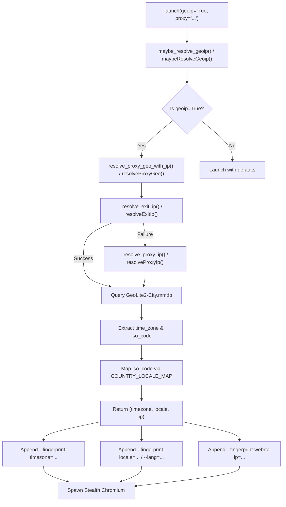
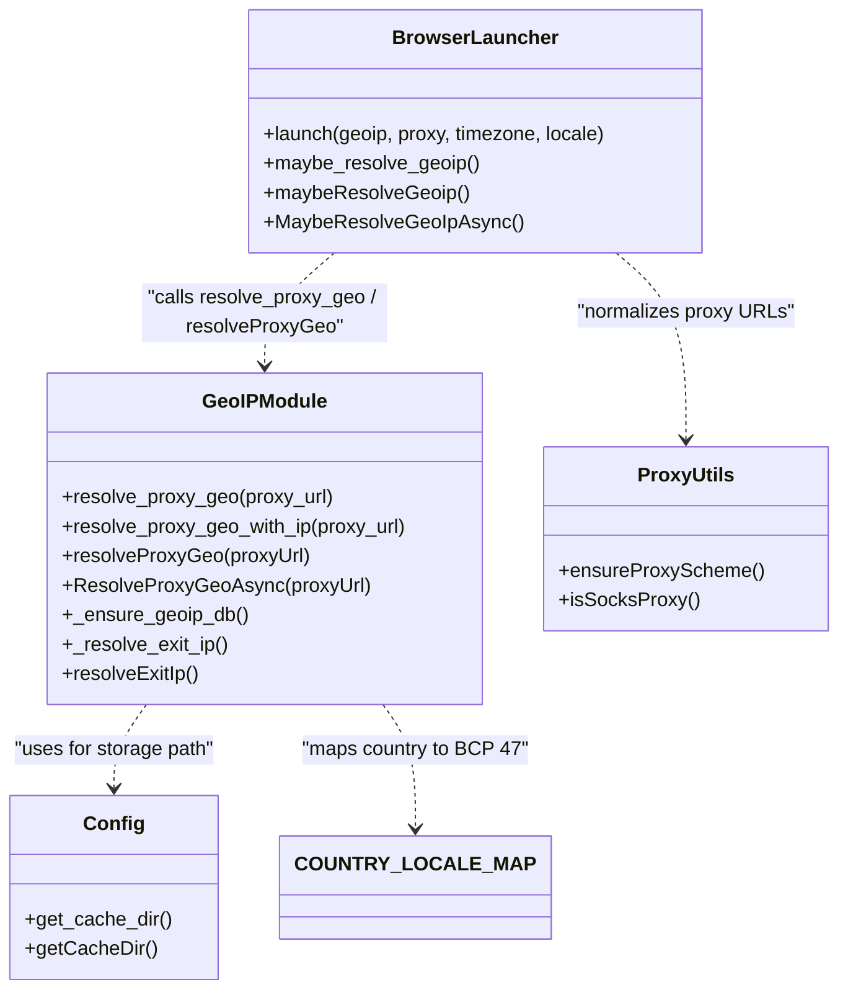

<!-- source: DeepWiki mcp.deepwiki.com · repo CloakHQ/CloakBrowser · page 6.3 GeoIP Auto-Detection · fetched 2026-10-30 -->

# GeoIP Auto-Detection

<details>
<summary>Relevant source files</summary>

The following files were used as context for generating this wiki page:

- [bin/docker-entrypoint.sh](bin/docker-entrypoint.sh)
- [cloakbrowser/geoip.py](cloakbrowser/geoip.py)
- [dotnet/src/CloakBrowser/GeoIp.cs](dotnet/src/CloakBrowser/GeoIp.cs)
- [dotnet/src/CloakBrowser/LaunchOptions.cs](dotnet/src/CloakBrowser/LaunchOptions.cs)
- [dotnet/tests/CloakBrowser.Tests/MiscTests.cs](dotnet/tests/CloakBrowser.Tests/MiscTests.cs)
- [js/src/geoip.ts](js/src/geoip.ts)
- [js/tests/geoip.test.ts](js/tests/geoip.test.ts)
- [pyproject.toml](pyproject.toml)
- [tests/test_geoip.py](tests/test_geoip.py)

</details>


The GeoIP auto-detection feature allows CloakBrowser to automatically align the browser's fingerprint (specifically timezone and locale) with the physical location of the proxy server being used. This prevents a common "mismatch" signal used by bot detection services where a browser claims to be in one timezone while its IP address originates from another.

## Overview

When `geoip=True` is passed to the `launch()` function, CloakBrowser attempts to resolve the proxy's geographic location before starting the browser process. The resolved values are then injected directly into the Stealth Chromium binary via command-line flags (`--fingerprint-timezone`, `--fingerprint-locale`, and `--fingerprint-webrtc-ip`), ensuring they are active from the very first request [cloakbrowser/browser.py:114-116](), [js/src/playwright.ts:83-85](), [dotnet/src/CloakBrowser/LaunchOptions.cs:29-30]().

### Key Features
*   **Automatic Synchronization**: Automatically sets `--fingerprint-timezone` and `--lang` (or `--fingerprint-locale`) based on the proxy IP [js/src/geoip.ts:123-127](), [cloakbrowser/geoip.py:140-147](), [dotnet/src/CloakBrowser/GeoIp.cs:131-133]().
*   **Local Database**: Uses a local GeoLite2-City.mmdb (~70 MB) for fast, privacy-preserving lookups [js/src/geoip.ts:7-9](), [cloakbrowser/geoip.py:7-9]().
*   **Exit IP Resolution**: Attempts to find the real "exit IP" of the proxy (using a CONNECT tunnel or SOCKS tunnel) to handle cases where the proxy gateway is in a different region than the exit node [cloakbrowser/geoip.py:209-212](), [js/src/geoip.ts:181-185]().
*   **WebRTC Spoofing**: The resolved exit IP is passed to the binary via `--fingerprint-webrtc-ip`, preventing leaks of the local machine's public IP through WebRTC [cloakbrowser/browser.py:151-153](), [js/src/playwright.ts:106-108]().
*   **Fallback Logic**: If the exit IP cannot be determined, it falls back to resolving the proxy hostname's IP via DNS [js/src/geoip.ts:108](), [cloakbrowser/geoip.py:126-127](), [dotnet/src/CloakBrowser/GeoIp.cs:114-115]().
*   **Resolution Timeout**: To prevent hanging browser launch, the process is bounded by a timeout (default 5s), configurable via `CLOAKBROWSER_GEOIP_TIMEOUT_SECONDS` [cloakbrowser/geoip.py:32-33](), [js/src/geoip.ts:25](), [dotnet/src/CloakBrowser/GeoIp.cs:26-27]().

## Installation

GeoIP is an optional feature to keep the base package weight low.

### Python
Install the `geoip` extra to pull in the `geoip2` and `socksio` dependencies.
```bash
pip install cloakbrowser[geoip]
```
Sources: [pyproject.toml:58](), [cloakbrowser/geoip.py:3-6]()

### JavaScript / Node.js
Install the `mmdb-lib` peer dependency.
```bash
npm install mmdb-lib
```
Sources: [js/src/geoip.ts:4-5]()

## Implementation Detail

### Data Flow: Proxy to Browser Flags

The following diagram illustrates how a proxy URL is transformed into browser configuration flags across the different language implementations.

**Proxy Geo-Resolution Flow**

Sources: [cloakbrowser/browser.py:114-153](), [js/src/geoip.ts:81-131](), [cloakbrowser/geoip.py:93-151](), [dotnet/src/CloakBrowser/GeoIp.cs:97-151]()

### Exit IP Resolution
CloakBrowser performs an "Exit IP" check by making a request to an IP echo service (like `api.ipify.org`) *through* the configured proxy [cloakbrowser/geoip.py:181-185](), [js/src/geoip.ts:181-185](). 

*   **Python**: Uses `httpx` with proxy support. If SOCKS proxies are used, it handles them via `httpx` SOCKS support (requires `socksio`) [cloakbrowser/geoip.py:209-245]().
*   **JavaScript**: For SOCKS5, it uses `socks-proxy-agent` [js/src/geoip.ts:192-202](). For HTTP/HTTPS, it implements a manual `CONNECT` tunnel using `node:http` to establish a socket and then performs an `https` request over that socket to an echo service [js/src/geoip.ts:228-269]().
*   **Direct Connection**: If no proxy is provided but `geoip=True` is set, CloakBrowser queries the echo services directly to determine the machine's public IP and adjust the timezone/locale accordingly [cloakbrowser/geoip.py:101-103](), [js/src/geoip.ts:78-80](), [dotnet/src/CloakBrowser/GeoIp.cs:93-95]().

### Database Management
*   **Storage**: The database is stored in `~/.cloakbrowser/geoip/GeoLite2-City.mmdb` [cloakbrowser/geoip.py:270-273](), [js/src/geoip.ts:316-318]().
*   **Update Interval**: The system checks the file age every time it is used. If the database is older than 30 days (`GEOIP_UPDATE_INTERVAL`), a background update is triggered [cloakbrowser/geoip.py:31](), [js/src/geoip.ts:24](), [dotnet/src/CloakBrowser/GeoIp.cs:21]().
*   **Atomic Updates**: Downloads are performed to a `.tmp` file and renamed only upon successful completion to prevent database corruption [cloakbrowser/geoip.py:302-306](), [js/src/geoip.ts:340-343]().
*   **Concurrency**: A lock (`_GEOIP_DOWNLOAD_LOCK` in Python, `GeoIpDownloadGate` in .NET) ensures that multiple concurrent browser launches do not trigger multiple simultaneous 70MB downloads [cloakbrowser/geoip.py:37](), [dotnet/src/CloakBrowser/GeoIp.cs:25](), [js/tests/geoip.test.ts:119-153]().

## Country to Locale Mapping

Because GeoIP databases provide ISO country codes (e.g., `US`) but browsers require BCP 47 locales (e.g., `en-US`), CloakBrowser maintains a `COUNTRY_LOCALE_MAP` covering 132 countries, including common residential and mobile proxy exit regions [cloakbrowser/geoip.py:40-77](), [js/src/geoip.ts:28-65](), [dotnet/src/CloakBrowser/GeoIp.cs:38-77]().

| ISO Code | BCP 47 Locale | ISO Code | BCP 47 Locale |
| :--- | :--- | :--- | :--- |
| US | en-US | JP | ja-JP |
| GB | en-GB | DE | de-DE |
| FR | fr-FR | BR | pt-BR |
| ES | es-ES | RU | ru-RU |
| CN | zh-CN | KR | ko-KR |
| SI | sl-SI | PE | es-PE |

Sources: [cloakbrowser/geoip.py:40-77](), [js/src/geoip.ts:28-65](), [dotnet/src/CloakBrowser/GeoIp.cs:38-77](), [tests/test_geoip.py:56-69]()

## Code Entities

### Functions and Classes
| Language | Entity | Role |
| :--- | :--- | :--- |
| Python | `resolve_proxy_geo()` | Entry point for resolving (tz, locale) from a URL. [cloakbrowser/geoip.py:80]() |
| Python | `maybe_resolve_geoip()` | Logic deciding if resolution is needed based on params and raw flags. [cloakbrowser/browser.py:114]() |
| JS | `resolveProxyGeo()` | Async function returning a `GeoResult` object. [js/src/geoip.ts:81]() |
| JS | `resolveExitIp()` | Node.js implementation of the CONNECT/SOCKS tunnel resolution. [js/src/geoip.ts:181]() |
| .NET | `GeoIp` | Static class containing `ResolveProxyGeoAsync()` and the locale map. [dotnet/src/CloakBrowser/GeoIp.cs:15]() |

### Constants and Environment
| Constant | Value / Purpose |
| :--- | :--- |
| `GEOIP_DB_URL` | P3TERX mirror for GeoLite2-City.mmdb (no license key required). [cloakbrowser/geoip.py:27](), [js/src/geoip.ts:21](), [dotnet/src/CloakBrowser/GeoIp.cs:18-19]() |
| `GEOIP_UPDATE_INTERVAL` | 30 days (seconds in Python, MS in JS). [cloakbrowser/geoip.py:31](), [js/src/geoip.ts:24]() |
| `CLOAKBROWSER_GEOIP_TIMEOUT_SECONDS` | Env var to override the default 5s resolution budget. [cloakbrowser/geoip.py:33](), [js/src/geoip.ts:134](), [dotnet/src/CloakBrowser/GeoIp.cs:27]() |

**GeoIP System Architecture**

Sources: [cloakbrowser/browser.py:114-143](), [cloakbrowser/geoip.py:36-66](), [js/src/geoip.ts:16-43](), [dotnet/src/CloakBrowser/GeoIp.cs:15-88](), [js/src/playwright.ts:83-85]()

---

