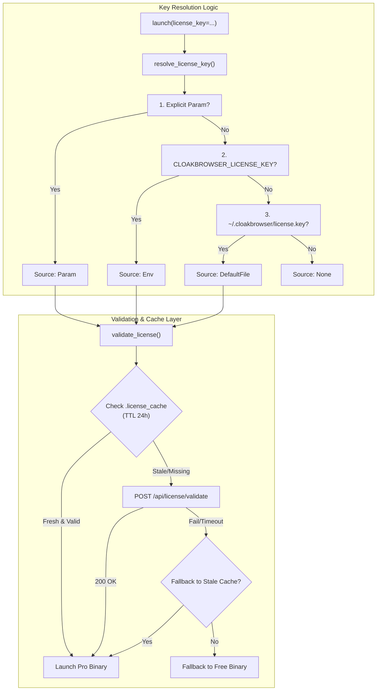
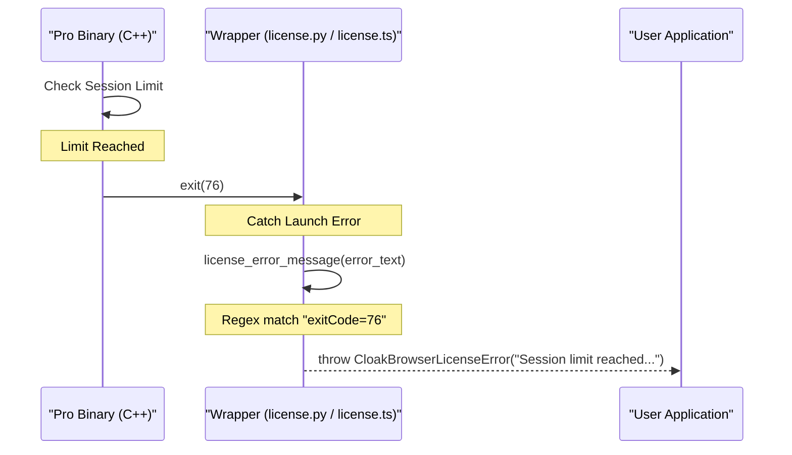

<!-- source: DeepWiki mcp.deepwiki.com · repo CloakHQ/CloakBrowser · page 7 Licensing and Pro Tier · fetched 2026-10-30 -->

# Licensing and Pro Tier

Relevant source files

The following files were used as context for generating this wiki page:

- [.gitattributes](.gitattributes)
- [BINARY-LICENSE.md](BINARY-LICENSE.md)
- [LICENSE](LICENSE)
- [cloakbrowser/license.py](cloakbrowser/license.py)
- [dotnet/src/CloakBrowser/License.cs](dotnet/src/CloakBrowser/License.cs)
- [dotnet/tests/CloakBrowser.Tests/LicenseTests.cs](dotnet/tests/CloakBrowser.Tests/LicenseTests.cs)
- [js/src/license.ts](js/src/license.ts)
- [js/tests/license.test.ts](js/tests/license.test.ts)
- [tests/test_license.py](tests/test_license.py)
- [tests/test_license_error.py](tests/test_license_error.py)

CloakBrowser operates on a dual-tier model consisting of a **Free** tier and a **Pro** tier. While the Free tier provides the foundational stealth patches (up to version 146), the Pro tier (v150+) unlocks advanced features, continuous updates, and higher-fidelity fingerprinting. This page documents the licensing resolution logic, validation mechanics, and the error-handling system used to manage Pro access across Python, JavaScript, and .NET implementations.

### Tier Comparison

| Feature | Free Tier | Pro Tier |
| :--- | :--- | :--- |
| **Chromium Version** | Fixed (v146) | Latest (v150+) |
| **Binary Source** | Public GitHub Releases | Private `cloakbrowser.dev` CDN |
| **License Key** | Not Required | Required |
| **Session Limits** | Unlimited | Plan-dependent (Solo/Team/Business) |
| **Updates** | Manual | Automated via Pro API |

Sources: [cloakbrowser/license.py:1-20](), [js/src/license.ts:1-20](), [dotnet/src/CloakBrowser/License.cs:45-60](), [BINARY-LICENSE.md:23-35]()

---

## License Key Resolution

The wrapper implementations resolve the license key using a strict priority hierarchy. This ensures that developers can easily override keys for CI/CD or local development without modifying code.

### Resolution Priority
1.  **Explicit Parameter**: The `license_key` (Python) / `licenseKey` (JS/.NET) argument passed to `launch()`.
2.  **Environment Variable**: The `CLOAKBROWSER_LICENSE_KEY` variable.
3.  **Local File**: The contents of `~/.cloakbrowser/license.key`.

### Key Injection Logic
The Pro binary is designed to read the license key from its own environment. The wrappers use `build_launch_env` (Python/JS) or `BuildLaunchEnv` (.NET) to decide if the key needs to be injected into the child process:
*   **Injected**: If the key comes from a parameter or a custom file path (since the binary cannot see these).
*   **Not Injected**: If the key is already in the parent environment or exists in the default `~/.cloakbrowser/license.key` file (which the binary reads directly).

### License Resolution Flow
The following diagram illustrates how the system resolves and validates a key before launching the binary.

Title: License Key Resolution and Validation Pipeline

Sources: [cloakbrowser/license.py:19-68](), [js/src/license.ts:45-84](), [dotnet/src/CloakBrowser/License.cs:80-124](), [tests/test_license.py:27-68]()

---

## Validation and Caching

To minimize latency and avoid dependency on the license server for every launch, CloakBrowser implements a local caching mechanism.

### API Interactions
The wrappers communicate with `https://cloakbrowser.dev` for three primary functions:
1.  **Validation**: `validate_license()` / `validateLicense()` checks key validity and plan details.
2.  **Version Check**: `get_pro_latest_version()` determines the latest available Pro binary.
3.  **Session Tracking**: `get_active_session_count()` reports how many concurrent sessions are currently active for the key.

### Local Cache (`.license_cache`)
*   **Location**: Stored in the cache directory (default `~/.cloakbrowser/.license_cache`).
*   **Security**: The key itself is **never stored** in plain text; only the SHA-256 hash of the key is saved.
*   **TTL**: Valid for 24 hours (`LICENSE_CACHE_TTL` / `LICENSE_CACHE_TTL_MS`).
*   **Stale Fallback**: If the license server is unreachable, the system will allow a launch if a stale (expired) cache entry exists and was previously valid.

Sources: [cloakbrowser/license.py:26-47](), [js/src/license.ts:16-21](), [dotnet/src/CloakBrowser/License.cs:54-65](), [tests/test_license.py:70-138](), [js/tests/license.test.ts:88-158]()

---

## Error Handling and Exit Codes

When a Pro binary refuses to run (e.g., due to an expired license or session limit), it exits with a specific numeric code. The wrappers intercept these codes and raise a `CloakBrowserLicenseError` with a human-readable message.

### Pro Binary Exit Codes
| Code | Message |
| :--- | :--- |
| **76** | Session limit reached for your plan. |
| **77** | License key is invalid, expired, or missing. |
| **78** | License server unreachable (and no valid cache). |
| **79** | Local configuration problem (cache directory not writable). |

### Code Entity Mapping: Error Propagation
The system uses `license_error_message` (Python), `licenseErrorMessage` (JS), or `LicenseErrorMessage` (.NET) to parse exit codes from automation framework error strings (e.g., Playwright's `process did exit: exitCode=N` logs).

Title: Binary Exit Code to Wrapper Exception Mapping

Sources: [cloakbrowser/license.py:79-118](), [js/src/license.ts:52-82](), [dotnet/src/CloakBrowser/License.cs:81-108](), [tests/test_license_error.py:23-37]()

### Post-Handshake Denials
For denials that occur after a successful CDP connection (e.g., a session limit check that resolves late), the binary writes the exit code to a unique JSON file specified by the `CLOAKBROWSER_LICENSE_STATUS_FILE` environment variable. The wrapper's `read_denial_file()` / `readDenialFile()` function performs a destructive read of this file to surface the error on the next API call.

Sources: [cloakbrowser/license.py:127-179](), [js/src/license.ts:100-148](), [dotnet/src/CloakBrowser/License.cs:128-155]()

---

## CLI and Session Monitoring

The CLI provides tools to inspect the current license status and active session usage. This is particularly useful for debugging "Session limit reached" errors.

*   **Session Count**: The `info` command (or `doctor`) displays the current number of active sessions reported by the server via `get_active_session_count`.
*   **License Info**: Displays the plan type (e.g., `solo`, `team`) and expiration date.
*   **Welcome Banner**: On launch, a tier-aware banner is displayed to notify the user of their current status (Free vs. Pro).

For more information on using the CLI to diagnose license issues, see [CLI Reference](#7.2).

### Related Pages
- [Environment Variables Reference](#7.1) — Detailed list of variables including `CLOAKBROWSER_LICENSE_KEY`.
- [CLI Reference](#7.2) — Using the `info` command to check license and session status.

Sources: [cloakbrowser/license.py:214-235](), [js/src/license.ts:250-270](), [dotnet/src/CloakBrowser/License.cs:60-64]()

---

