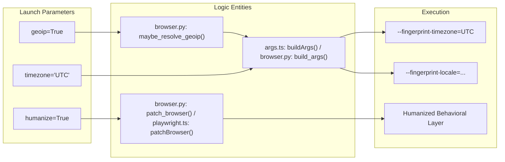

<!-- source: DeepWiki mcp.deepwiki.com · repo CloakHQ/CloakBrowser · page 7.1 Environment Variables Reference · fetched 2026-10-30 -->

# Environment Variables Reference

Relevant source files

The following files were used as context for generating this wiki page:

- [cloakbrowser/__main__.py](cloakbrowser/__main__.py)
- [cloakbrowser/config.py](cloakbrowser/config.py)
- [dotnet/src/CloakBrowser.Cli/Program.cs](dotnet/src/CloakBrowser.Cli/Program.cs)
- [dotnet/src/CloakBrowser/Config.cs](dotnet/src/CloakBrowser/Config.cs)
- [dotnet/src/CloakBrowser/Diagnostics.cs](dotnet/src/CloakBrowser/Diagnostics.cs)
- [dotnet/tests/CloakBrowser.Tests/ConfigTests.cs](dotnet/tests/CloakBrowser.Tests/ConfigTests.cs)
- [js/src/args.ts](js/src/args.ts)
- [js/src/cli.ts](js/src/cli.ts)
- [js/src/config.ts](js/src/config.ts)
- [js/tests/config.test.ts](js/tests/config.test.ts)
- [tests/test_build_args.py](tests/test_build_args.py)
- [tests/test_cli.py](tests/test_cli.py)
- [tests/test_config.py](tests/test_config.py)

This page provides a comprehensive reference for all environment variables used by CloakBrowser to manage binary resolution, caching, and licensing, alongside a consolidated summary of parameters for the `launch()` family of functions across Python, JavaScript, and .NET.

---

## Environment Variables

CloakBrowser uses environment variables to allow flexible configuration in CI/CD, Docker, and restricted environments without changing code.

| Variable | Type | Default | Purpose |
|:---|:---|:---|:---|
| `CLOAKBROWSER_BINARY_PATH` | Path | *(None)* | Local override for the Chromium executable path. Bypasses automatic downloads [cloakbrowser/config.py:180-184](), [js/src/config.ts:141-142](). |
| `CLOAKBROWSER_CACHE_DIR` | Path | `~/.cloakbrowser` | Root directory for downloaded binaries, license keys, and GeoIP databases [cloakbrowser/config.py:160-169](), [js/src/config.ts:118-122](). |
| `CLOAKBROWSER_DOWNLOAD_URL` | URL | `https://cloakbrowser.dev` | Primary mirror for binary downloads and Pro version API [cloakbrowser/config.py:189-191](), [js/src/config.ts:156-158](). |
| `CLOAKBROWSER_VERSION` | String | *(Bundled)* | Force a specific Chromium version (e.g., `148.0.7778.215.2`) [cloakbrowser/config.py:124-135](), [js/src/config.ts:75-87](). |
| `CLOAKBROWSER_LICENSE_KEY` | String | *(None)* | Pro license key for latest patches and Pro binaries [cloakbrowser/license.py:19-20](), [js/src/license.ts:48-51](), [dotnet/src/CloakBrowser/License.cs:86-87](). |
| `CLOAKBROWSER_AUTO_UPDATE` | Boolean | `true` | Enable background version checks and automatic binary updates [cloakbrowser/download.py:270-271](). |
| `CLOAKBROWSER_SKIP_CHECKSUM` | Boolean | `false` | Skip SHA-256 and Ed25519 signature verification (not recommended) [cloakbrowser/download.py:410-412](). |
| `CLOAKBROWSER_BACKEND` | String | `playwright` | (Python only) Switch between `playwright` and `patchright` backends [cloakbrowser/browser.py:109-109](). |
| `CLOAKBROWSER_RELEASE_CHANNEL`| String | `stable` | Select `stable` or `preview` binary release channels [cloakbrowser/config.py:107-114](), [js/src/config.ts:70-73](). |

**Sources:** [cloakbrowser/config.py:107-191](), [js/src/config.ts:70-158](), [cloakbrowser/license.py:19-30](), [dotnet/src/CloakBrowser/Config.cs:119-150]()

---

## Implementation and Data Flow

Environment variables are resolved early in the `ensure_binary` (Python), `ensureBinary` (JS), or `EnsureBinaryAsync` (.NET) lifecycle. If `CLOAKBROWSER_BINARY_PATH` is present, all download and version logic is bypassed [cloakbrowser/config.py:180-184](), [js/src/config.ts:141-142]().

### Environment Resolution Diagram

The following diagram shows how environment variables map to internal configuration entities and functions across the different language implementations.

```mermaid
graph TD
    subgraph "EnvVars" ["Environment Variables"]
        EBP["CLOAKBROWSER_BINARY_PATH"]
        ECD["CLOAKBROWSER_CACHE_DIR"]
        ELK["CLOAKBROWSER_LICENSE_KEY"]
        ECV["CLOAKBROWSER_VERSION"]
    end

    subgraph "PythonEntities" ["Python: cloakbrowser/"]
        PY_CFG_LBO["config.py: get_local_binary_override()"]
        PY_CFG_GCD["config.py: get_cache_dir()"]
        PY_LIC_RLK["license.py: resolve_license_key()"]
        PY_CFG_NRV["config.py: normalize_requested_version()"]
    end

    subgraph "JSEntities" ["JavaScript: js/src/"]
        JS_CFG_LBO["config.ts: getLocalBinaryOverride()"]
        JS_CFG_GCD["config.ts: getCacheDir()"]
        JS_LIC_RLK["license.ts: resolveLicenseKey()"]
        JS_CFG_NRV["config.ts: normalizeRequestedVersion()"]
    end

    subgraph "DotNetEntities" ["DotNet: CloakBrowser/"]
        DN_CFG_LBO["Config.cs: GetLocalBinaryOverride()"]
        DN_LIC_RLK["License.cs: ResolveLicenseKey()"]
    end

    EBP --> PY_CFG_LBO
    EBP --> JS_CFG_LBO
    EBP --> DN_CFG_LBO
    
    ECD --> PY_CFG_GCD
    ECD --> JS_CFG_GCD
    
    ELK --> PY_LIC_RLK
    ELK --> JS_LIC_RLK
    ELK --> DN_LIC_RLK
    
    ECV --> PY_CFG_NRV
    ECV --> JS_CFG_NRV

    PY_CFG_LBO --> PY_DWN["download.py: ensure_binary()"]
    JS_CFG_LBO --> JS_DWN["download.ts: ensureBinary()"]
```

**Sources:** [cloakbrowser/config.py:107-169](), [js/src/config.ts:70-138](), [cloakbrowser/license.py:19-20](), [js/src/license.ts:48-84](), [dotnet/src/CloakBrowser/License.cs:80-123]()

---

## Launch Parameters Reference

Across all three languages, the `launch()`, `launch_context()`, and `launch_persistent_context()` functions share a core set of parameters that control the stealth engine and browser behavior.

### Parameters Summary

| Parameter | Type (Py/JS/.NET) | Default | Description |
|:---|:---|:---|:---|
| `headless` | `bool` / `boolean` / `bool` | `True` | Run in headless mode. Injects `DEFAULT_VIEWPORT` (1920x947) to maintain coherence [cloakbrowser/config.py:86-86](), [js/src/config.ts:31-39](). |
| `proxy` | `ProxySettings` \| `str` | `None` | Proxy configuration. Inline credentials in URLs are parsed automatically [js/src/playwright.ts:24-30](). |
| `args` | `list[str]` / `string[]` | `[]` | Extra CLI flags passed to Chromium. Merged with stealth defaults [js/src/args.ts:15-40](). |
| `stealth_args` | `bool` | `True` | Inject source-level fingerprinting flags like `--fingerprint` [cloakbrowser/config.py:54-76](), [js/src/args.ts:18-22](). |
| `timezone` | `str` | `None` | IANA Timezone (e.g., `Europe/Berlin`). Injects `--fingerprint-timezone` [js/src/args.ts:55-62](), [tests/test_build_args.py:6-9](). |
| `locale` | `str` | `None` | BCP 47 Locale (e.g., `de-DE`). Injects `--lang` and `--fingerprint-locale` [js/src/args.ts:63-71](), [tests/test_build_args.py:12-16](). |
| `geoip` | `bool` | `False` | Auto-detect Timezone/Locale from Proxy exit IP [cloakbrowser/browser.py:63-63](). |
| `humanize` | `bool` | `False` | Enable behavioral humanization layer (Bézier curves, typing delays) [cloakbrowser/browser.py:65-65](). |
| `human_preset` | `str` | `"default"` | Behavioral preset (`default` or `careful`) [cloakbrowser/browser.py:66-66](). |
| `license_key` | `str` | `None` | Override `CLOAKBROWSER_LICENSE_KEY` for this launch [cloakbrowser/license.py:28-30](). |
| `browser_version` | `str` | `None` | Override `CLOAKBROWSER_VERSION` for this launch [cloakbrowser/config.py:138-141](). |

**Sources:** [cloakbrowser/browser.py:56-71](), [js/src/args.ts:15-109](), [cloakbrowser/config.py:54-86](), [dotnet/src/CloakBrowser/Config.cs:70-94]()

---

### Parameter Transformation Logic

The following diagram illustrates how high-level parameters provided by the user are transformed into low-level Chromium CLI flags and behavioral patches.

**Sources:** [cloakbrowser/browser.py:154-187](), [js/src/args.ts:15-109](), [js/src/playwright.ts:16-17]()

---

### Licensing and Pro Exit Codes

When using CloakBrowser Pro, the binary performs license validation. If validation fails, the binary exits with specific codes that the wrapper translates into a `CloakBrowserLicenseError` with a human-readable message.

| Code | Message |
|:---|:---|
| `76` | **Session limit reached**: You have exceeded the concurrent session limit for your plan [cloakbrowser/license.py:80-83](), [js/src/license.ts:53-53](). |
| `77` | **Invalid License**: Key is invalid, expired, or missing [cloakbrowser/license.py:84-87](), [js/src/license.ts:54-54](). |
| `78` | **Server Unreachable**: Could not verify license due to network issues [cloakbrowser/license.py:88-91](), [js/src/license.ts:55-55](). |
| `79` | **Config Problem**: The `~/.cloakbrowser` directory is not writable [cloakbrowser/license.py:92-95](), [js/src/license.ts:56-56](). |

**Sources:** [cloakbrowser/license.py:79-96](), [js/src/license.ts:49-57](), [dotnet/src/CloakBrowser/License.cs:81-87]()

---

