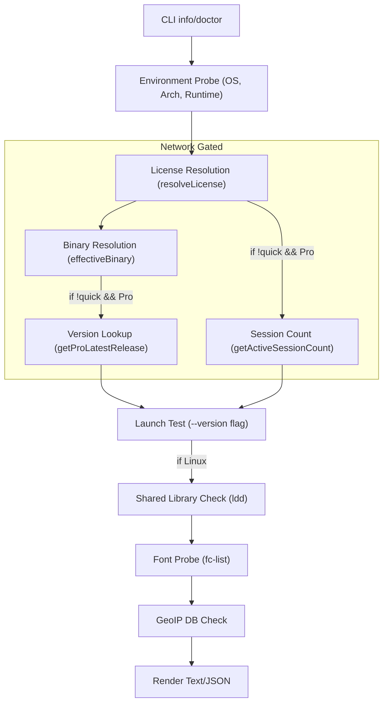
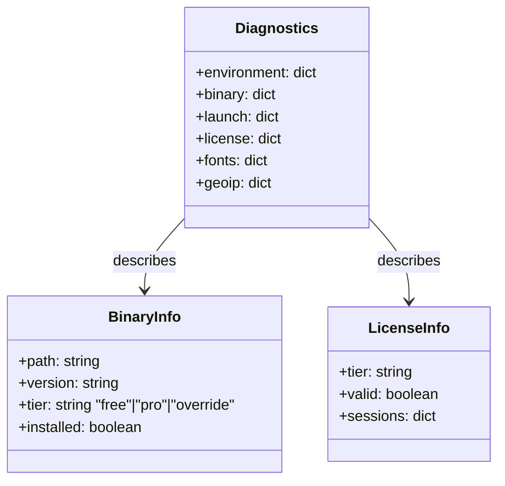

<!-- source: DeepWiki mcp.deepwiki.com · repo CloakHQ/CloakBrowser · page 7.2 CLI Reference · fetched 2026-10-30 -->

# CLI Reference

Relevant source files

The following files were used as context for generating this wiki page:

- [cloakbrowser/__main__.py](cloakbrowser/__main__.py)
- [dotnet/src/CloakBrowser.Cli/Program.cs](dotnet/src/CloakBrowser.Cli/Program.cs)
- [dotnet/src/CloakBrowser/Diagnostics.cs](dotnet/src/CloakBrowser/Diagnostics.cs)
- [dotnet/tests/CloakBrowser.Tests/DiagnosticsTests.cs](dotnet/tests/CloakBrowser.Tests/DiagnosticsTests.cs)
- [dotnet/tests/CloakBrowser.Tests/FontWarningTests.cs](dotnet/tests/CloakBrowser.Tests/FontWarningTests.cs)
- [js/src/cli.ts](js/src/cli.ts)
- [js/src/fonts.ts](js/src/fonts.ts)
- [js/tests/cli.test.ts](js/tests/cli.test.ts)
- [js/tests/fonts.test.ts](js/tests/fonts.test.ts)
- [tests/test_cli.py](tests/test_cli.py)
- [tests/test_font_warning.py](tests/test_font_warning.py)
- [tests/test_free_version_pin.py](tests/test_free_version_pin.py)
- [tests/test_login.py](tests/test_login.py)

The CloakBrowser CLI provides a unified interface across all three language implementations (Python, JavaScript, and .NET) for managing the stealth Chromium binary lifecycle and diagnosing environment compatibility.

## Command Overview

The CLI is accessible via the following entry points:
*   **Python**: `python -m cloakbrowser <command>` [cloakbrowser/__main__.py:1-9]()
*   **JavaScript**: `npx cloakbrowser <command>` [js/src/cli.ts:1-11]()
*   ** .NET**: `dotnet cloakbrowser <command>` (or the compiled `cloakbrowser` executable) [dotnet/src/CloakBrowser.Cli/Program.cs:7-12]()

### Subcommands

| Command | Description | Implementation Detail |
| :--- | :--- | :--- |
| `login` | Saves a license key (or gets a free key via GitHub). | Validates key before saving to `license.key`. [js/src/cli.ts:45]() |
| `logout` | Removes the saved license key, reverting to the free binary. | Deletes the local `license.key` file. [js/src/cli.ts:46]() |
| `install` | Downloads the Chromium binary with progress reporting. | Calls `ensure_binary()` / `ensureBinary()`. [js/src/cli.ts:53-56]() |
| `info` | Displays environment and binary diagnostics. | Alias: `doctor`. Supports `--quick` and `--json`. [js/src/cli.ts:48-49]() |
| `update` | Checks for and downloads a newer binary. | Rate-limited by `.last_update_check`. [js/src/cli.ts:50]() |
| `clear-cache` | Removes all cached binaries from the local system. | Deletes the contents of the cache directory. [js/src/cli.ts:51]() |

**Sources:** [js/src/cli.ts:42-52](), [cloakbrowser/__main__.py:1-9](), [dotnet/src/CloakBrowser.Cli/Program.cs:8-15]()

---

## Diagnostics Pipeline (`info` / `doctor`)

The `collectDiagnostics` (JS) / `_collect_diagnostics` (Python) / `Diagnostics.Collect` (.NET) function aggregates system state into a structured dictionary. This data is then rendered as human-readable text or raw JSON.

### Diagnostic Flow

Title: "CLI Diagnostic Pipeline"

**Sources:** [js/src/cli.ts:170-220](), [cloakbrowser/__main__.py:179-230](), [dotnet/src/CloakBrowser/Diagnostics.cs:13-107]()

### 1. Environment Probe
The CLI captures the host OS, architecture, and runtime version (Node.js `process.version`, Python `platform.python_version()`, or .NET `RuntimeInformation.FrameworkDescription`). It also computes the `platform_tag` used for binary selection.
*   **Sources**: [js/src/cli.ts:173-177](), [cloakbrowser/__main__.py:183-187](), [dotnet/src/CloakBrowser/Diagnostics.cs:17-23]()

### 2. License and Session Resolution
The CLI resolves the license key via `resolveLicenseKey()` from environment variables (`CLOAKBROWSER_LICENSE_KEY`) or the local `license.key` file.
*   **Pro License**: If a valid Pro key is found and `--quick` is not passed, the CLI performs a network request to `cloakbrowser.dev` to retrieve the `latest_version` and the `active` session count via `getActiveSessionCount`. [js/src/cli.ts:164-171](), [cloakbrowser/__main__.py:207-213]()
*   **Session Display**: For Pro users, the CLI shows "active" sessions. If the server is unreachable or the license is "leaseless", it reports the status as such in the JSON output. [dotnet/src/CloakBrowser/Diagnostics.cs:33-43]()
*   **Sources**: [js/src/cli.ts:119-133](), [cloakbrowser/__main__.py:122-146](), [dotnet/src/CloakBrowser/Diagnostics.cs:27-42]()

### 3. Binary Resolution via `effectiveBinary()`
This logic mirrors the runtime `ensure_binary()` flow but avoids downloading. It determines which binary *would* launch based on priority:
1.  **Override**: `CLOAKBROWSER_BINARY_PATH` via `getLocalBinaryOverride()`. [js/src/cli.ts:140-153]()
2.  **Pinned**: `CLOAKBROWSER_VERSION` via `normalizeRequestedVersion()`. [js/src/cli.ts:154]()
3.  **Tier-based**: Pro (cached or latest) vs. Free (bundled version). [js/src/cli.ts:177-183]()

If a Pro license is present but no binary is cached, it indicates that the "next launch downloads the latest". [dotnet/src/CloakBrowser.Cli/Program.cs:141-143]()
*   **Sources**: [js/src/cli.ts:136-168](), [cloakbrowser/__main__.py:148-177](), [dotnet/src/CloakBrowser/Diagnostics.cs:144-200]()

### 4. Shared Library and Font Checks
On Linux, the CLI performs specific checks to ensure the binary can execute and spoofing is coherent:
*   **ldd Check**: Runs `ldd -- <path>` against the binary to identify missing `.so` dependencies (e.g., `libnss3.so`). It filters lines containing `=> not found`. [js/src/cli.ts:95-116](), [cloakbrowser/__main__.py:102-119]()
*   **Font Probe**: Uses `fc-list` via `countFontsPresent()` to count installed fonts against two sets:
    *   `WINDOWS_FONT_TELLS`: 8 core fonts (e.g., Segoe UI, Calibri, Consolas). [js/src/fonts.ts:20-29]()
    *   `OFFICE_FONT_TELLS`: 10 supplemental fonts (e.g., Wingdings, Book Antiqua). [js/src/fonts.ts:35-46]()
*   **Sources**: [js/src/cli.ts:27](), [dotnet/src/CloakBrowser/Diagnostics.cs:80-91](), [js/src/fonts.ts:57-68]()

### 5. Launch Test
Unless `--quick` is specified, the CLI attempts to execute the resolved binary with the `--version` flag.
*   **Windows Handling**: On Windows, Chromium ignores `--version` and starts a browser. The CLI appends `--no-startup-window` to force an immediate exit, allowing the return code to serve as the health check. [js/src/cli.ts:77-79](), [cloakbrowser/__main__.py:75-87]()
*   **Sources**: [js/src/cli.ts:67-92](), [cloakbrowser/__main__.py:75-99](), [dotnet/src/CloakBrowser/Diagnostics.cs:66-76]()

---

## Code Entity Map

The following table maps CLI concepts to their specific implementation entities across the codebase.

| CLI Concept | Python Entity | JavaScript Entity | .NET Entity |
| :--- | :--- | :--- | :--- |
| **Main Entry** | `cloakbrowser.__main__` | `js/src/cli.ts` | `CloakBrowser.Cli/Program.cs` |
| **Diagnostics** | `_collect_diagnostics()` | `collectDiagnostics()` | `Diagnostics.Collect()` |
| **Binary Logic** | `_effective_binary()` | `effectiveBinary()` | `Diagnostics.EffectiveBinary()` |
| **Font Sets** | `WINDOWS_FONT_TELLS` | `WINDOWS_FONT_TELLS` | `CloakLauncher.WindowsFontTells` |
| **GeoIP Check** | `os.path.isfile` | `fs.existsSync` | `File.Exists` |

Title: "Diagnostic Data Structure"

**Sources:** [js/src/cli.ts:170-171](), [cloakbrowser/__main__.py:179-181](), [dotnet/src/CloakBrowser/Diagnostics.cs:13-15]()

---

## GeoIP and Modules

*   **GeoIP**: The CLI checks for the presence of `GeoLite2-City.mmdb` in the `~/.cloakbrowser/geoip/` directory. It reports `db_present` as a boolean. If a `--proxy` flag is passed to the `info` command, it performs a live resolution test via `resolveProxyGeoWithIpAsync` (or equivalent) to show the `exit_ip`, `timezone`, and `locale`. [js/src/cli.ts:208-212](), [dotnet/src/CloakBrowser/Diagnostics.cs:96-119]()
*   **Modules**: The CLI verifies if optional dependencies (like `playwright` or `mmdb-lib` in JS, or `Microsoft.Playwright` in .NET) are available in the current environment via `moduleAvailable()`. [js/src/cli.ts:58-65](), [dotnet/src/CloakBrowser/Diagnostics.cs:123-129]()

**Sources:** [js/src/cli.ts:208-220](), [cloakbrowser/__main__.py:221-230](), [dotnet/src/CloakBrowser/Diagnostics.cs:95-106](), [js/tests/cli.test.ts:88-102]()

---

