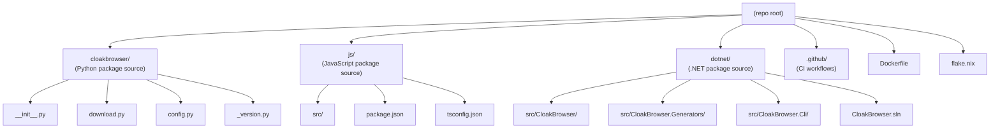
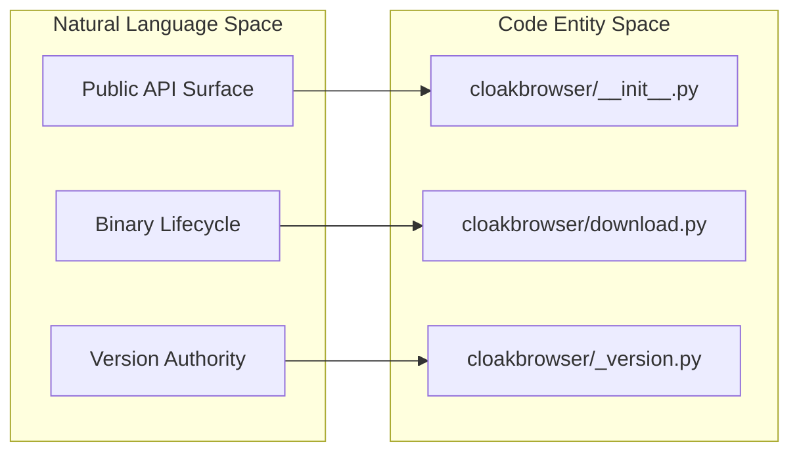
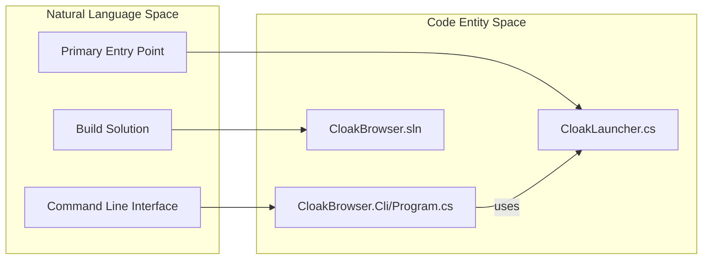

<!-- source: DeepWiki mcp.deepwiki.com · repo CloakHQ/CloakBrowser · page 8 Development Guide · fetched 2026-10-30 -->

# Development Guide

<details>
<summary>Relevant source files</summary>

The following files were used as context for generating this wiki page:

- [.github/dependabot.yml](.github/dependabot.yml)
- [.github/workflows/attest-release.yml](.github/workflows/attest-release.yml)
- [.github/workflows/ci.yml](.github/workflows/ci.yml)
- [.github/workflows/publish.yml](.github/workflows/publish.yml)
- [flake.lock](flake.lock)
- [flake.nix](flake.nix)
- [js/tsconfig.json](js/tsconfig.json)

</details>


This page covers the repository layout, toolchain setup, and build procedures for contributors to CloakBrowser. It describes the structure of the Python, JavaScript, and .NET packages, how to build each, and how the test suites are organized across all three ecosystems.

For detailed documentation on individual test cases and how to run them, see the [Testing](#8.1) child page. For the binary release workflow, see [Releasing Binaries](#8.2). For integration examples across various frameworks, see [Integration Examples](#8.3).

---

## Repository Layout

The repository hosts three independently publishable packages — the Python package at the root, the JavaScript package under `js/`, and the .NET package under `dotnet/` — along with shared infrastructure for examples, tests, and CI.

**Repository structure map**



Sources: [.github/workflows/publish.yml:58-60](), [js/package.json:1-21](), [flake.nix:19-30](), [js/tsconfig.json:1-19]()

---

## Python Package

### Build System

The Python package uses [hatchling](https://hatch.pypa.io/) as its build backend. Versioning is managed centrally in `cloakbrowser/_version.py`.

| Setting | Value |
|---|---|
| Build backend | `hatchling.build` |
| Version source | `cloakbrowser/_version.py` [cloakbrowser/_version.py:1-1]() |
| Runtime dependencies | `playwright`, `httpx` |

### Building and Running

To build the Python package for distribution:

```bash
pip install build
python -m build
```

The CLI can be run during development using the module syntax:
```bash
python -m cloakbrowser info
```

### Python Module Roles



Sources: [.github/workflows/publish.yml:77-80](), [.github/workflows/ci.yml:18-20](), [cloakbrowser/_version.py:1-1]()

---

## JavaScript Package

### Build System

The JavaScript package lives under `js/` and uses the TypeScript compiler (`tsc`) to produce ESM output in the `dist/` directory. It defines multiple export paths for Playwright, Puppeteer, and the Humanize layer [js/package.json:8-21]().

| Setting | Value |
|---|---|
| Build tool | `typescript` (tsc) [js/package.json:93-93]() |
| Module format | ESM (`type: module`) [js/package.json:5-5]() |
| Target Output | `js/dist/` [js/tsconfig.json:9-9]() |
| Primary Exports | `.`, `./puppeteer`, `./human` [js/package.json:8-21]() |

Sources: [js/package.json:1-97](), [js/tsconfig.json:1-19](), [.github/workflows/publish.yml:94-97]()

### npm Scripts

| Script | Command | Purpose |
|---|---|---|
| `build` | `npm run build` | Compile TypeScript source to `dist/` [js/package.json:93-93]() |
| `typecheck` | `npm run typecheck` | Type-check without emitting files [js/package.json:94-94]() |
| `test` | `npm test` | Run the JavaScript test suite via Vitest [js/package.json:95-95]() |

---

## .NET Package

### Build System

The .NET package targets .NET 8.0 and includes a specialized Roslyn source generator for the humanize decorator layer.

| Project | Role |
|---|---|
| `CloakBrowser.csproj` | Main library (Playwright wrapper) |
| `CloakBrowser.Generators.csproj` | Roslyn source generator for interface delegation |
| `CloakBrowser.Cli.csproj` | Command-line tool |
| `CloakBrowser.sln` | Solution file for building all components |

Sources: [.github/workflows/publish.yml:118-120](), [.github/workflows/ci.yml:44-46]()

### Building and Running

Build the entire solution from the `dotnet/` directory:
```bash
dotnet build dotnet/CloakBrowser.sln -c Release
```

Run the tests:
```bash
dotnet test dotnet/CloakBrowser.sln -c Release
```

### .NET Entity Roles



Sources: [.github/workflows/publish.yml:118-120](), [.github/workflows/ci.yml:44-46]()

---

## CLI and Utilities

CloakBrowser provides CLI tools in all three languages to manage the underlying patched Chromium binary.

| Command | Action | Implementation (Py / JS / .NET) |
|---|---|---|
| `install` | Download binary | CLI subcommand |
| `info` | Show diagnostic info | CLI subcommand |
| `update` | Check for newer binary | CLI subcommand |
| `clear-cache` | Wipe `.cloakbrowser/` | CLI subcommand |

Sources: [js/package.json:22-24](), [.github/workflows/publish.yml:118-120]()

---

## CI/CD and Releasing

The project uses GitHub Actions for continuous integration and automated publishing across all three package managers.

* **CI Workflow**: Runs Python (pytest), JavaScript (vitest), and .NET (xUnit) tests on every push [.github/workflows/ci.yml:10-46]().
* **Publish Workflow**: Triggered by version tags. It validates version synchronization across `_version.py`, `package.json`, and `CloakBrowser.csproj` before publishing to PyPI, npm, and NuGet [.github/workflows/publish.yml:55-64]().
* **OIDC Trusted Publishing**: The workflow uses OIDC for secure, passwordless publishing to PyPI, npm, and NuGet [.github/workflows/publish.yml:70-71, 88-89, 105-106]().
* **Docker**: Builds and signs multi-arch images (`linux/amd64`, `linux/arm64`) using Cosign [.github/workflows/publish.yml:148-157]().
* **Attestation**: Release binaries are attested for build provenance using Sigstore OIDC [.github/workflows/attest-release.yml:1-30]().

---

## Test Suite Overview

Detailed documentation is available on the [Testing](#8.1) child page.

| Aspect | Python | JavaScript | .NET |
|---|---|---|---|
| Framework | `pytest` | `vitest` | `xUnit` |
| Location | `tests/` | `js/tests/` | `dotnet/tests/` |
| Fast CI | `-m "not slow"` | `npm test` | `dotnet test` |

Sources: [.github/workflows/ci.yml:20-46](), [.github/workflows/publish.yml:32-45](), [js/package.json:95-95]()

---

