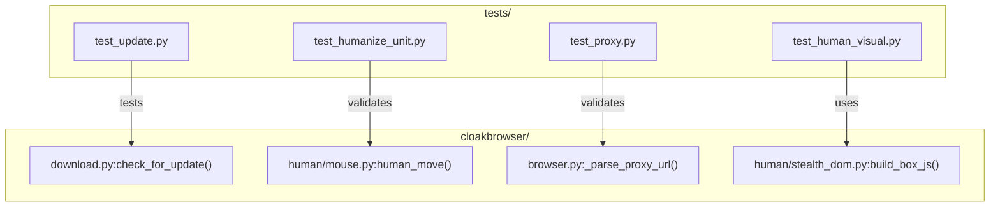
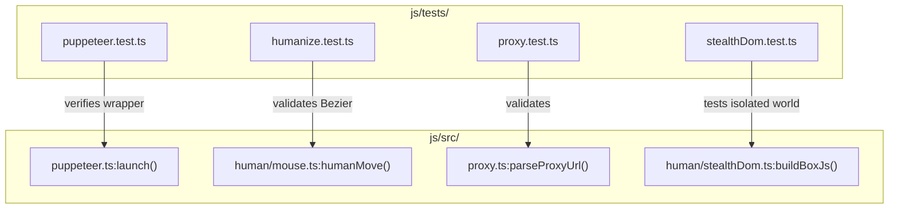

<!-- source: DeepWiki mcp.deepwiki.com · repo CloakHQ/CloakBrowser · page 8.1 Testing · fetched 2026-10-30 -->

# Testing

<details>
<summary>Relevant source files</summary>

The following files were used as context for generating this wiki page:

- [cloakbrowser/human/stealth_dom.py](cloakbrowser/human/stealth_dom.py)
- [js/src/human/stealthDom.ts](js/src/human/stealthDom.ts)
- [js/src/proxy.ts](js/src/proxy.ts)
- [js/tests/extension-loading.test.ts](js/tests/extension-loading.test.ts)
- [js/tests/humanize.test.ts](js/tests/humanize.test.ts)
- [js/tests/proxy.test.ts](js/tests/proxy.test.ts)
- [js/tests/puppeteer.test.ts](js/tests/puppeteer.test.ts)
- [js/tests/setup.ts](js/tests/setup.ts)
- [js/tests/stealthDom.test.ts](js/tests/stealthDom.test.ts)
- [js/tests/update.test.ts](js/tests/update.test.ts)
- [js/vitest.config.ts](js/vitest.config.ts)
- [tests/conftest.py](tests/conftest.py)
- [tests/test_extension_loading.py](tests/test_extension_loading.py)
- [tests/test_human_visual.mjs](tests/test_human_visual.mjs)
- [tests/test_human_visual.py](tests/test_human_visual.py)
- [tests/test_humanize_unit.py](tests/test_humanize_unit.py)
- [tests/test_proxy.py](tests/test_proxy.py)
- [tests/test_update.py](tests/test_update.py)

</details>


This page documents the test suites for the Python, JavaScript, and .NET packages in CloakBrowser. It covers unit tests for configuration and version logic, proxy parsing, signature verification, and the behavioral "humanize" layer, as well as integration tests against live bot detection services.

## Overview

CloakBrowser maintains three parallel test suites to ensure feature parity and stability across all supported languages.

| Language | Framework | Test Directory | Key Features Tested |
|:---|:---|:---|:---|
| **Python** | `pytest` | `tests/` | Versioning, Stealth integration, Humanize logic, Persistent Context, GeoIP |
| **JavaScript** | `vitest` | `js/tests/` | Versioning, Stealth CDP, Humanize logic, Ed25519 Signatures |
| **.NET** | `xUnit` | `dotnet/tests/` | Signature verification, API parity, Humanize decorator logic |

All suites utilize the `CLOAKBROWSER_BINARY_PATH` environment variable in CI to point to a pre-downloaded Stealth Chromium binary, skipping the download phase during test execution [js/tests/launch.test.ts:26-31]().

---

## Python Test Suite (pytest)

The Python suite is located in the `tests/` directory and uses `pytest-asyncio` for asynchronous test support.

### Running Tests

```bash
# Run all fast tests (excludes slow network-dependent tests)
pytest -m "not slow"

# Run all tests including live bot detection (requires network)
pytest

# Run humanize visual verification script
python tests/test_human_visual.py
```

The `slow` marker is used to categorize tests that hit external services or require a live browser binary [tests/test_humanize_unit.py:7-10]().

### Core Test Modules

#### Version and Update Logic (`tests/test_update.py`)
- **`TestVersionComparison`**: Validates `_version_tuple` and `_version_newer` [tests/test_update.py:46-80](). It handles 4-part (e.g., `145.0.7718.0`) and 5-part build numbers [tests/test_update.py:65-70]().
- **`TestShouldCheckForUpdate`**: Tests the rate-limiting logic using the `.last_update_check` marker file [tests/test_update.py:116-147]().
- **`TestEffectiveVersion`**: Verifies that `get_effective_version` correctly prioritizes the `latest_version_{platform}` marker file [tests/test_update.py:150-166]().

#### Proxy Parsing (`tests/test_proxy.py`)
- **`TestParseProxyUrl`**: Verifies extraction of credentials, handling of URL-encoded passwords (e.g., `p%40ss%3Aword`), and protocol detection for `socks5://` [tests/test_proxy.py:13-43]().
- **`TestBuildProxyKwargs`**: Tests the version-gated logic that decides between Playwright's `proxy` dict and CloakBrowser's inline `--proxy-server` arg based on the Chromium version floor [tests/test_proxy.py:45-108]().

#### Humanize Unit Tests (`tests/test_humanize_unit.py`)
- **`TestBezierMath`**: Verifies that `human_move` generates a non-linear curved path with multiple intermediate steps [tests/test_humanize_unit.py:121-166]().
- **`TestAsyncCompat`**: Ensures async versions of the mouse/keyboard drivers correctly handle Playwright's `AsyncRawMouse` [tests/test_humanize_unit.py:192-205]().

#### Isolated World DOM Reads (`js/tests/stealthDom.test.ts`)
The humanize layer uses an isolated CDP world to read DOM state without triggering standard Playwright automation signals.
- **`stealthDom builders`**: Tests the JS generation for `buildBoxJs`, `buildActionableJs`, and `buildPointerJs` [js/tests/stealthDom.test.ts:64-83]().
- **`resolver semantics`**: Executes the shipped resolver JS against Node-based DOM stubs to verify that `:has-text` and `nth` selectors resolve correctly [js/tests/stealthDom.test.ts:90-118]().

**Sources:** `tests/test_update.py`, `tests/test_proxy.py`, `tests/test_humanize_unit.py`, `js/tests/stealthDom.test.ts`, `cloakbrowser/human/stealth_dom.py`

---

## JavaScript Test Suite (vitest)

The JavaScript suite is located in `js/tests/` and uses `vitest` for fast, concurrent execution.

### Core Test Modules

#### Puppeteer Integration (`js/tests/puppeteer.test.ts`)
- **`launch`**: Verifies that the Puppeteer wrapper correctly calls `ensureBinary`, injects stealth args, and handles `defaultViewport` based on headless state [js/tests/puppeteer.test.ts:44-97]().
- **`Proxy Fallback`**: Tests that macOS (Free tier) correctly falls back to `page.authenticate` for HTTP proxies since the binary lacks inline auth [js/tests/puppeteer.test.ts:147-167]().

#### Humanize Unit Tests (`js/tests/humanize.test.ts`)
- **`resolveConfig`**: Validates preset resolution for `default` and `careful` configurations, including custom overrides [js/tests/humanize.test.ts:8-68]().
- **`humanMove`**: Mocks `raw.move` to ensure Bézier paths are curved and do not contain single jumps exceeding 50% of the total distance [js/tests/humanize.test.ts:103-157]().

#### Proxy URL Parsing (`js/tests/proxy.test.ts`)
- **`parseProxyUrl`**: Tests extraction of credentials from both standard URLs and bare `user:pass@host:port` formats [js/tests/proxy.test.ts:8-53]().
- **`isSocksProxy`**: Validates protocol detection for `socks5://` and `socks5h://` [js/tests/proxy.test.ts:122-150]().
- **`resolveProxyConfig`**: Tests the logic that maps proxy inputs to either Playwright `proxyOption` or Chrome `proxyArgs` [js/tests/proxy.test.ts:152-205]().

#### Update Logic (`js/tests/update.test.ts`)
- **`version comparison`**: Tests `parseVersion` and `versionNewer` for 4-part and 5-part versions [js/tests/update.test.ts:30-71]().
- **`wrapper update check`**: Verifies that the library warns the user if a newer npm package version is available on GitHub [js/tests/update.test.ts:167-205]().

**Sources:** `js/tests/puppeteer.test.ts`, `js/tests/humanize.test.ts`, `js/tests/proxy.test.ts`, `js/tests/update.test.ts`, `js/src/proxy.ts`

---

## .NET Test Suite (xUnit)

The .NET suite is located in `dotnet/tests/CloakBrowser.Tests/` and targets .NET 8.

- **`SignatureTests.cs`**: Mirrors the JS/Python signature verification logic using BouncyCastle's Ed25519 implementation.
- **`BezierMathTests.cs`**: Validates that the C# implementation of Bézier curves produces points within the expected bounds and matches the Python/JS trajectory.
- **Humanize Decorator Tests**: Verifies that the Roslyn source-generated `HumanizedPage` correctly intercepts calls to `ClickAsync` and `TypeAsync` to inject behavioral delays.

---

## Visual Humanize Testing

Behavioral "human-like" movements are difficult to assert with boolean logic, so CloakBrowser includes visual test scripts for manual observation.

- **Python**: `tests/test_human_visual.py`
- **JavaScript**: `js/tests/test_human_visual.mjs`

These scripts launch the browser with `humanize=True` and perform sequences of `hover()`, `click()`, and `type()` to demonstrate non-linear mouse paths and variable typing speeds.

---

## System Mapping Diagrams

**Diagram: Python Test Entity Mapping**


Sources: `tests/test_update.py`, `tests/test_humanize_unit.py`, `tests/test_proxy.py`, `cloakbrowser/human/stealth_dom.py`

**Diagram: JavaScript Test Entity Mapping**


Sources: `js/tests/puppeteer.test.ts`, `js/tests/humanize.test.ts`, `js/tests/proxy.test.ts`, `js/tests/stealthDom.test.ts`

**Sources:**
- `tests/test_update.py`
- `tests/test_humanize_unit.py`
- `tests/test_proxy.py`
- `js/tests/humanize.test.ts`
- `js/tests/update.test.ts`
- `js/tests/proxy.test.ts`
- `js/tests/puppeteer.test.ts`
- `js/tests/stealthDom.test.ts`
- `js/src/proxy.ts`
- `cloakbrowser/human/stealth_dom.py`
- `js/src/human/stealthDom.ts`
- `tests/conftest.py`

---

