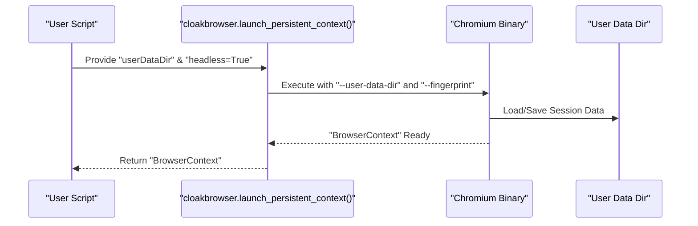
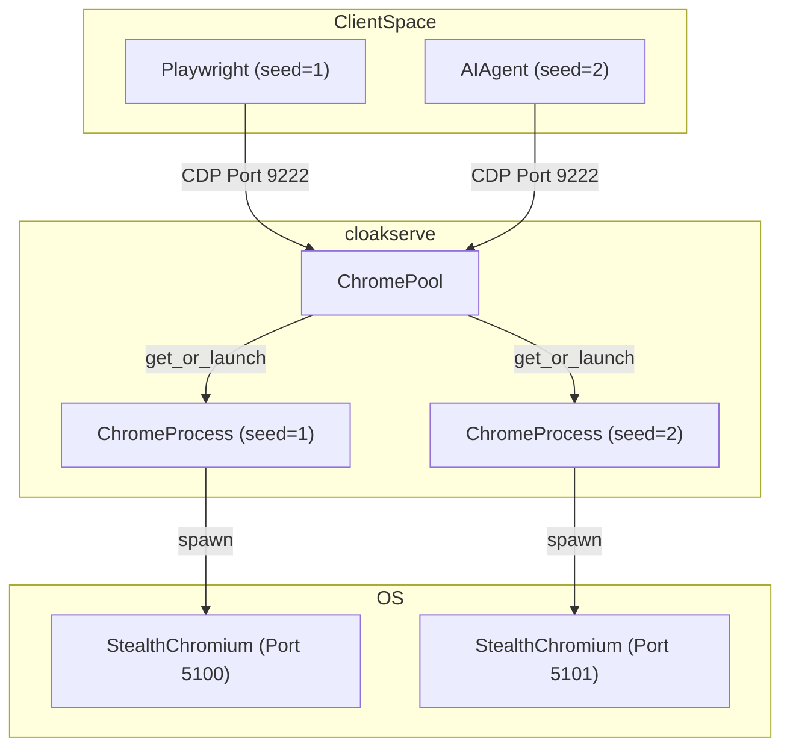
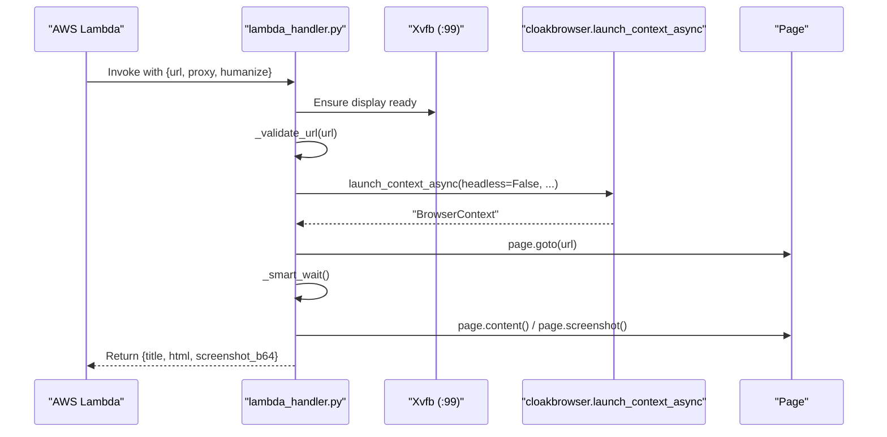

<!-- source: DeepWiki mcp.deepwiki.com · repo CloakHQ/CloakBrowser · page 8.3 Integration Examples · fetched 2026-10-30 -->

# Integration Examples

<details>
<summary>Relevant source files</summary>

The following files were used as context for generating this wiki page:

- [Dockerfile](Dockerfile)
- [bin/cloakserve](bin/cloakserve)
- [bin/cloaktest](bin/cloaktest)
- [examples/basic.py](examples/basic.py)
- [examples/fingerprint_scan_test.py](examples/fingerprint_scan_test.py)
- [examples/integrations/agent_browser.sh](examples/integrations/agent_browser.sh)
- [examples/integrations/aws_lambda/Dockerfile](examples/integrations/aws_lambda/Dockerfile)
- [examples/integrations/aws_lambda/INSTRUCTIONS.md](examples/integrations/aws_lambda/INSTRUCTIONS.md)
- [examples/integrations/aws_lambda/lambda-entrypoint.sh](examples/integrations/aws_lambda/lambda-entrypoint.sh)
- [examples/integrations/aws_lambda/lambda_handler.py](examples/integrations/aws_lambda/lambda_handler.py)
- [examples/integrations/browser_use_example.py](examples/integrations/browser_use_example.py)
- [examples/integrations/crawl4ai_example.py](examples/integrations/crawl4ai_example.py)
- [examples/integrations/crawlee_example.py](examples/integrations/crawlee_example.py)
- [examples/integrations/langchain_loader.py](examples/integrations/langchain_loader.py)
- [examples/integrations/scrapling_example.py](examples/integrations/scrapling_example.py)
- [examples/integrations/selenium_example.py](examples/integrations/selenium_example.py)
- [examples/integrations/undetected_chromedriver.py](examples/integrations/undetected_chromedriver.py)
- [examples/persistent_context.py](examples/persistent_context.py)
- [examples/recaptcha_score.py](examples/recaptcha_score.py)
- [examples/stealth_test.py](examples/stealth_test.py)
- [js/examples/basic-playwright.ts](js/examples/basic-playwright.ts)
- [js/examples/basic-puppeteer.ts](js/examples/basic-puppeteer.ts)
- [js/examples/persistent-context.ts](js/examples/persistent-context.ts)
- [js/examples/stagehand.ts](js/examples/stagehand.ts)
- [js/examples/stealth-test.ts](js/examples/stealth-test.ts)
- [tests/test_cloakserve.py](tests/test_cloakserve.py)
- [tests/test_lambda_security.py](tests/test_lambda_security.py)
- [tests/test_stealth.py](tests/test_stealth.py)

</details>


The `examples/` and `js/examples/` directories provide a comprehensive suite of implementation patterns for CloakBrowser. These examples demonstrate how to leverage the patched Chromium binary across various automation frameworks, AI agents, and stealth testing platforms.

## Core Usage Examples

These examples demonstrate the fundamental lifecycle of a CloakBrowser instance, including binary resolution, context management, and basic navigation.

| Example File | Framework | Key Feature |
|:---|:---|:---|
| `examples/basic.py` | Playwright (Python) | Standard `launch()` and page navigation. |
| `js/examples/basic-playwright.ts` | Playwright (JS) | ESM-based `launch()` with TypeScript types. |
| `js/examples/basic-puppeteer.ts` | Puppeteer (JS) | Integration via the `cloakbrowser/puppeteer` subpath. |
| `examples/persistent_context.py` | Playwright (Python) | `launch_persistent_context()` for session retention. |

### Persistent Context Flow
Persistent contexts allow for the reuse of browser profiles (cookies, local storage, cache) across restarts while maintaining stealth patches.

**Persistent Context Initialization**

Sources: `examples/persistent_context.py:1-25`(), `js/examples/persistent-context.ts:1-30`()

## Stealth & Fingerprint Testing

CloakBrowser includes specialized scripts to validate its effectiveness against modern bot detection services.

### Stealth Test Suite (`stealth_test.py` / `stealth-test.ts`)
This script executes a battery of tests against industry-standard detectors. It uses `page.evaluate()` to extract pass/fail verdicts directly from the DOM of the target sites.

*   **Sannysoft**: Checks for classic leaks like `navigator.webdriver` [examples/stealth_test.py:26-50]().
*   **Incolumitas**: Performs 30+ comprehensive checks [examples/stealth_test.py:52-71]().
*   **Rebrowser**: Detects automation signals and CDP leaks [examples/stealth_test.py:74-88]().
*   **reCAPTCHA v3**: Specifically targets the `recaptcha-demo.appspot.com` endpoint to verify human-level scores (typically 0.9) [examples/recaptcha_score.py:1-35]().

### Fingerprint Scanning (`fingerprint_scan_test.py`)
This script focuses on "weak signals" often used to detect headless environments, such as taskbar height, content index presence, and WebGPU availability [examples/fingerprint_scan_test.py:27-86](). It also extracts deep signal breakdowns from **CreepJS**, including `likeHeadless`, `headless`, and `stealth` percentages [examples/fingerprint_scan_test.py:89-177]().

Sources: `examples/stealth_test.py:1-180`(), `examples/fingerprint_scan_test.py:1-180`(), `examples/recaptcha_score.py:1-35`(), `tests/test_stealth.py:1-188`()

## Framework Integrations (Python)

CloakBrowser can be integrated into existing Python scraping ecosystems by manually providing the binary path and stealth arguments.

### Selenium & Undetected Chromedriver
*   **Selenium**: Integration via `selenium_example.py` uses `Options.binary_location` and `Options.add_argument()` for each stealth flag.
*   **Undetected Chromedriver**: The `undetected_chromedriver.py` example combines `uc`'s driver-level patches with CloakBrowser's source-level patches.

### Crawlee & Scrapling
*   **Crawlee**: Integration in `crawlee_example.py` subclassing `PlaywrightBrowserPlugin` to override the `new_browser` method.
*   **Scrapling**: Uses CDP via WebSocket to connect the `StealthyFetcher` to a CloakBrowser instance.

**Crawlee Plugin Implementation**
```mermaid
classDiagram
    class PlaywrightBrowserPlugin {
        <<Crawlee>>
    }
    class CloakBrowserPlugin {
        +new_browser() PlaywrightBrowserController
    }
    class PlaywrightBrowserController {
        <<Crawlee>>
    }
    PlaywrightBrowserPlugin <|-- CloakBrowserPlugin
    CloakBrowserPlugin ..> PlaywrightBrowserController : creates
    CloakBrowserPlugin ..> "ensure_binary()" : calls
    CloakBrowserPlugin ..> "get_default_stealth_args()" : calls
```
Sources: `examples/integrations/crawlee_example.py:1-30`(), `examples/integrations/scrapling_example.py:1-30`(), `examples/integrations/selenium_example.py:1-30`(), `examples/integrations/undetected_chromedriver.py:1-30`()

## AI Agent Integrations

CloakBrowser acts as the "stealth browser provider" for various LLM-driven agent frameworks, typically via the Chrome DevTools Protocol (CDP).

| Integration | Method | Implementation Detail |
|:---|:---|:---|
| **browser-use** | CDP | Launches with `--remote-debugging-port=9242` and connects via `BrowserSession(cdp_url=...)` [examples/integrations/browser_use_example.py:20-27](). |
| **Crawl4AI** | CDP | Connects `AsyncWebCrawler` to a CloakBrowser instance via `BrowserConfig(cdp_url=...)` [examples/integrations/crawl4ai_example.py:18-24](). |
| **LangChain** | Custom Loader | Wraps `launch_async()` in `langchain_loader.py` to produce LangChain `Document` objects. |
| **Stagehand** | Local Launch | In `js/examples/stagehand.ts`, it passes `binaryPath` and `stealthArgs` to the `Stagehand` constructor. |

Sources: `examples/integrations/browser_use_example.py:1-43`(), `examples/integrations/crawl4ai_example.py:1-39`(), `examples/integrations/langchain_loader.py:1-40`(), `js/examples/stagehand.ts:1-30`()

## CLI & Shell Utilities

### cloakserve (CDP Multiplexer)
The `bin/cloakserve` utility is a CDP multiplexer that spawns separate Chrome processes per unique fingerprint seed, routing connections through a single port [bin/cloakserve:2-16](). It manages a `ChromePool` of `ChromeProcess` objects [bin/cloakserve:174-201]().

**CDP Multiplexer Architecture**

Sources: `bin/cloakserve:1-168`(), `tests/test_cloakserve.py:1-170`()

### agent_browser.sh
A reference shell script for the `agent-browser` Node.js CLI. It uses Python one-liners to resolve the binary path and stealth arguments, then exports them as environment variables for the agent.

Sources: `examples/integrations/agent_browser.sh:1-15`()

## AWS Lambda Deployment

CloakBrowser can be deployed to AWS Lambda using a container image. This pattern allows for one-shot stealth scrapes in a serverless environment.

### Dockerfile & Entrypoint
The `Dockerfile` derives from `cloakhq/cloakbrowser:latest` and adds the `awslambdaric` (Runtime Interface Client) and `aws-lambda-rie` (Runtime Interface Emulator) [examples/integrations/aws_lambda/Dockerfile:36-47](). 

The `lambda-entrypoint.sh` script handles Xvfb startup on display `:99` and routes commands to the Lambda runtime if the command matches a `module.func` pattern [examples/integrations/aws_lambda/lambda-entrypoint.sh:41-50]().

### Lambda Handler (`lambda_handler.py`)
The handler provides a robust scraping interface that includes:
*   **URL Validation**: Rejects non-HTTP schemes and private/internal IP ranges to prevent SSRF [examples/integrations/aws_lambda/lambda_handler.py:79-97]().
*   **Smart Wait**: Polls the DOM until the HTML length stabilizes, providing a more reliable stopping condition than `networkidle` for SPAs [examples/integrations/aws_lambda/lambda_handler.py:151-180]().
*   **Retry Orchestration**: Automatically retries on transient failures (e.g., certificate errors or timeouts) with adjusted internal arguments [examples/integrations/aws_lambda/lambda_handler.py:43-55]().

**Lambda Scrape Flow**


Sources: `examples/integrations/aws_lambda/Dockerfile:1-80`(), `examples/integrations/aws_lambda/lambda_handler.py:1-200`(), `examples/integrations/aws_lambda/lambda-entrypoint.sh:1-53`(), `examples/integrations/aws_lambda/INSTRUCTIONS.md:1-150`(), `Dockerfile:1-55`()

---

