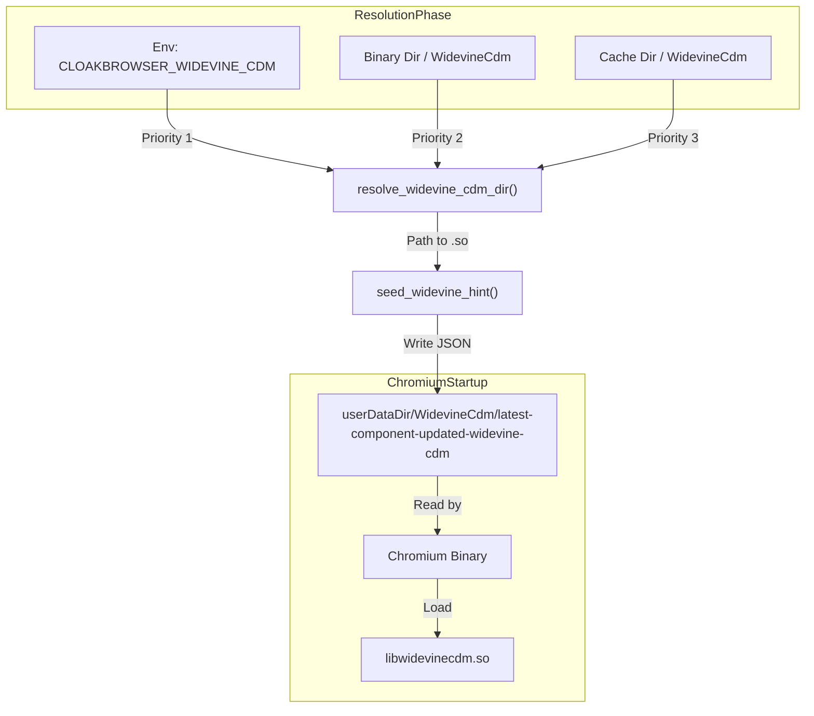
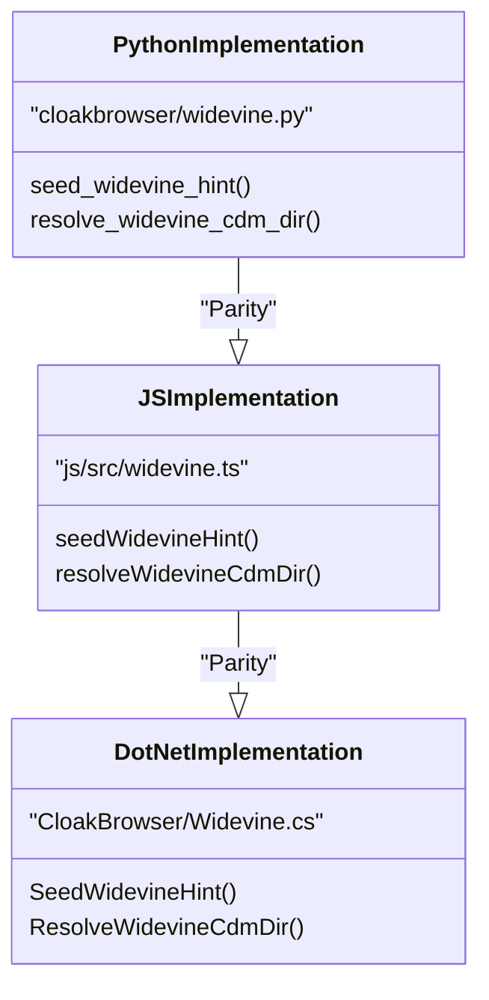

<!-- source: DeepWiki mcp.deepwiki.com · repo CloakHQ/CloakBrowser · page 9 Widevine DRM · fetched 2026-10-30 -->

# Widevine DRM

Relevant source files

The following files were used as context for generating this wiki page:

- [bin/fetch-widevine.py](bin/fetch-widevine.py)
- [cloakbrowser/widevine.py](cloakbrowser/widevine.py)
- [dotnet/src/CloakBrowser/Widevine.cs](dotnet/src/CloakBrowser/Widevine.cs)
- [js/src/widevine.ts](js/src/widevine.ts)
- [js/tests/widevine-integration.test.ts](js/tests/widevine-integration.test.ts)
- [js/tests/widevine.test.ts](js/tests/widevine.test.ts)
- [tests/test_fetch_widevine.py](tests/test_fetch_widevine.py)
- [tests/test_widevine.py](tests/test_widevine.py)

CloakBrowser binaries are built with Widevine support enabled; however, the Content Decryption Module (CDM) is a proprietary Google component that cannot be redistributed with the browser package [cloakbrowser/widevine.py:3-6](). To enable DRM-protected video playback (e.g., Netflix, Hulu), users must sideload the CDM. 

This page documents the automation tools provided to fetch the CDM and the internal "hint-file" seeding mechanism that allows the CDM to be recognized on the very first launch of a persistent profile [js/src/widevine.ts:5-12]().

## The Hint-File Mechanism

Chromium discovers sideloaded CDMs in two phases. First, an early-startup pass reads a "hint file" from the user data directory. Second, a later asynchronous component-updater pass writes that hint file. Because automation frameworks like Playwright and Puppeteer launch with `--disable-component-update`, the updater never writes the hint, typically requiring a "two-launch dance" to activate DRM [cloakbrowser/widevine.py:8-12]().

CloakBrowser solves this by pre-seeding the hint file `latest-component-updated-widevine-cdm` inside the `<user-data-dir>/WidevineCdm/` directory before the browser process starts [cloakbrowser/widevine.py:33-35]().

### Platform Limitations
*   **Linux**: Fully supported. The hint-file mechanism is specific to Linux and ChromeOS [js/src/widevine.ts:14-15]().
*   **Windows**: No-op. The CDM cannot initialize due to DRM host verification requirements [cloakbrowser/widevine.py:18-20]().
*   **macOS**: No-op. macOS uses a different CDM layout [cloakbrowser/widevine.py:20-21]().

**Sources:** [cloakbrowser/widevine.py:1-21](), [js/src/widevine.ts:1-15]()

## CDM Resolution Logic

The library attempts to locate a valid CDM directory (defined as a directory containing `manifest.json`) using the following priority [js/src/widevine.ts:50-60]():

1.  **Environment Variable**: If `CLOAKBROWSER_WIDEVINE_CDM` is set, it is used exclusively. If the path is invalid (lacks `manifest.json`), seeding is skipped without falling back [cloakbrowser/widevine.py:61-69]().
2.  **Binary Directory**: `<chrome-binary-dir>/WidevineCdm`. This is the standard location for manual sideloads [cloakbrowser/widevine.py:73-74]().
3.  **Cache Directory**: `<cache-dir>/WidevineCdm` (typically `~/.cloakbrowser/WidevineCdm`). This allows a single CDM fetched by `fetch-widevine.py` to serve multiple browser versions or Pro/Free tiers [cloakbrowser/widevine.py:74-77]().

### Widevine System Data Flow
This diagram illustrates how the CDM is resolved and how the hint file is seeded into the profile.

**Sources:** [cloakbrowser/widevine.py:43-77](), [js/src/widevine.ts:63-79](), [dotnet/src/CloakBrowser/Widevine.cs:37-61]()

## Utility Scripts

### fetch-widevine.py (Python)
The `bin/fetch-widevine.py` script automates the retrieval of the CDM from Google's component-update servers.

*   **Architecture**: Supports Linux x86-64 only. Google does not publish an ARM64 Linux CDM [bin/fetch-widevine.py:44-57]().
*   **Integrity**:
    *   Verifies the download against server-provided SHA-256 hashes [bin/fetch-widevine.py:16-20]().
    *   If the `cryptography` library is available, it performs CRX3 RSA publisher signature verification to ensure the binary was signed by the official Widevine app ID (`oimompecagnajdejgnnjijobebaeigek`) [bin/fetch-widevine.py:100-150]().
*   **Protobuf Parsing**: Implements a minimal `_parse_pb` reader to extract signature proofs and signed headers from the CRX3 container [bin/fetch-widevine.py:74-91]().

**Sources:** [bin/fetch-widevine.py:1-21](), [bin/fetch-widevine.py:37-38](), [bin/fetch-widevine.py:74-91]()

## Implementation Reference

### Python
The Python implementation in `cloakbrowser/widevine.py` uses `pathlib` for cross-platform path resolution and `json.dumps` to create the hint file.

| Function | Description |
| :--- | :--- |
| `resolve_widevine_cdm_dir(binary_path)` | Scans the filesystem for a `manifest.json` in prioritized locations [cloakbrowser/widevine.py:43](). |
| `seed_widevine_hint(user_data_dir, binary_path)` | The main entry point called during `launch_persistent_context()` [cloakbrowser/widevine.py:80](). |
| `_seeding_disabled()` | Checks `CLOAKBROWSER_WIDEVINE` for "0", "false", or "off" [cloakbrowser/widevine.py:37](). |

**Sources:** [cloakbrowser/widevine.py:25-129]()

### JavaScript / TypeScript
The JS implementation in `js/src/widevine.ts` mirrors the Python logic using `node:fs` and `node:path`.

| Function | Description |
| :--- | :--- |
| `resolveWidevineCdmDir(binaryPath)` | Returns the absolute, symlink-resolved path to the CDM [js/src/widevine.ts:63](). |
| `seedWidevineHint(userDataDir, binaryPath)` | Writes the hint file; uses `fs.mkdirSync` with `{ recursive: true }` [js/src/widevine.ts:87](). |

**Sources:** [js/src/widevine.ts:1-126]()

### .NET (C#)
The .NET implementation in `Widevine.cs` is a direct port of the Python logic.

| Function | Description |
| :--- | :--- |
| `ResolveWidevineCdmDir(string binaryPath)` | Uses `Environment.GetEnvironmentVariable` and `Path.Combine` [dotnet/src/CloakBrowser/Widevine.cs:37](). |
| `SeedWidevineHint(string? userDataDir, string binaryPath)` | Uses `JsonSerializer` with `UnsafeRelaxedJsonEscaping` to match JS output formatting [dotnet/src/CloakBrowser/Widevine.cs:68](). |

**Sources:** [dotnet/src/CloakBrowser/Widevine.cs:20-124]()

## Testing

The Widevine subsystem is covered by integration and unit tests that verify resolution logic and framework wiring.

*   **Python Unit Tests**: `tests/test_widevine.py` verifies idempotency, environment variable exclusivity, and cache-root fallbacks [tests/test_widevine.py:78-150]().
*   **Fetch Utility Tests**: `tests/test_fetch_widevine.py` exercises CRX3/Protobuf parsing and signature verification using synthesized CRX files and throwaway RSA keys [tests/test_fetch_widevine.py:1-8]().
*   **JavaScript Unit Tests**: `js/tests/widevine.test.ts` provides comprehensive coverage for resolution order and Linux-only constraints [js/tests/widevine.test.ts:51-157]().
*   **JavaScript Integration Tests**: `js/tests/widevine-integration.test.ts` mocks `playwright-core` and `puppeteer-core` to ensure `seedWidevineHint` is invoked during `launchPersistentContext` [js/tests/widevine-integration.test.ts:31-57]().

### Code Entity Mapping
This diagram maps the logical Widevine operations to specific functions across the three language implementations.

**Sources:** [cloakbrowser/widevine.py:1-30](), [js/src/widevine.ts:1-20](), [dotnet/src/CloakBrowser/Widevine.cs:1-20]()

---

