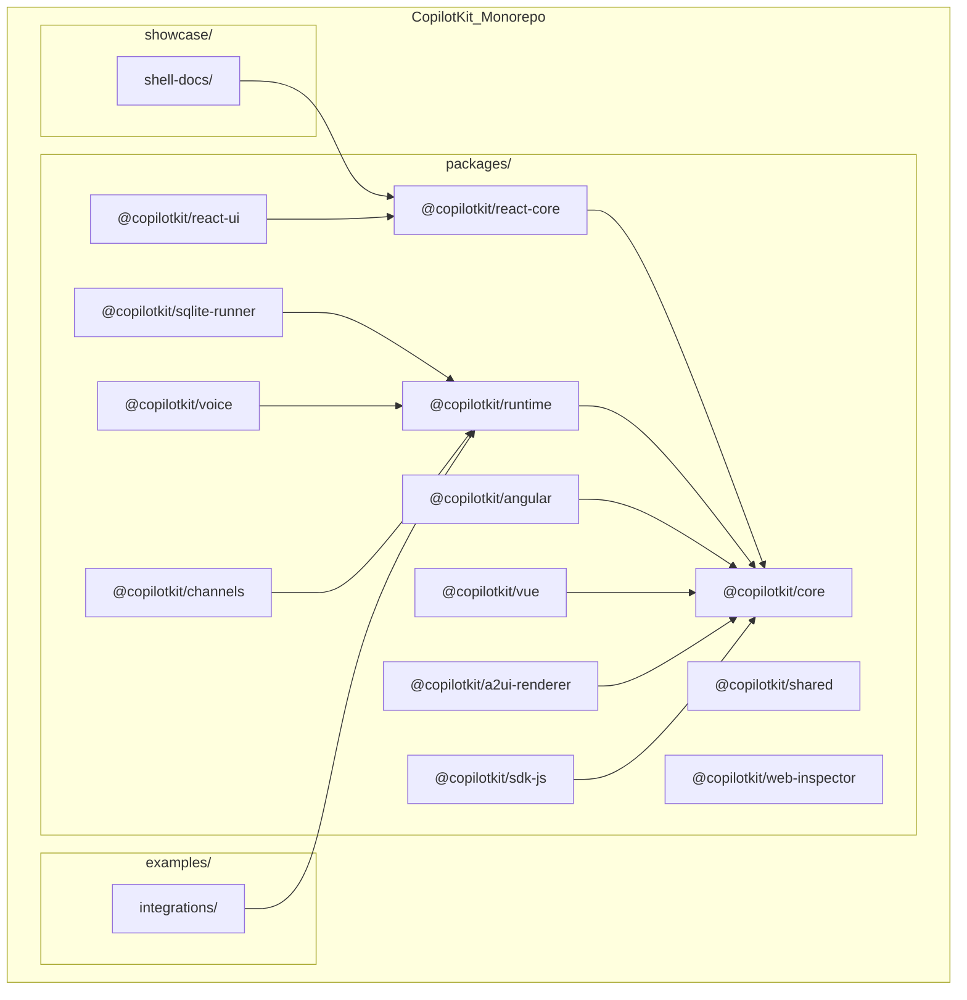
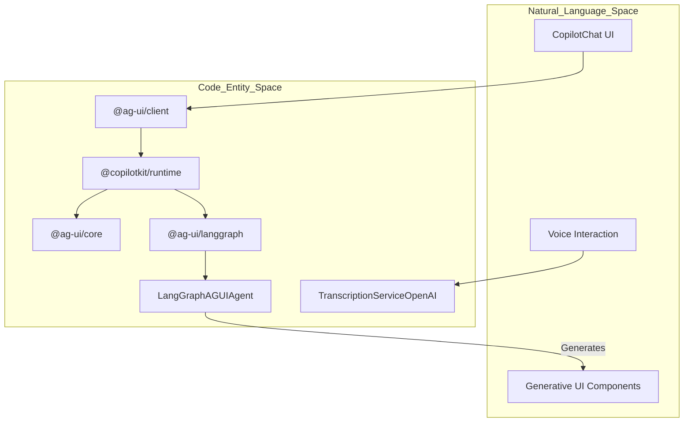

<!-- source: DeepWiki mcp.deepwiki.com · repo CopilotKit/CopilotKit · page 1 Overview · fetched 2026-10-30 -->

# Overview

Relevant source files

The following files were used as context for generating this wiki page:

- [README.md](README.md)
- [assets/CopilotTextarea.gif](assets/CopilotTextarea.gif)
- [assets/CopilotTextarea_old.gif](assets/CopilotTextarea_old.gif)
- [assets/demo.gif](assets/demo.gif)
- [assets/proejct-perplexity-clone.png](assets/proejct-perplexity-clone.png)
- [assets/project-canvas-demo.png](assets/project-canvas-demo.png)
- [assets/spreadsheet-demo-big-file.gif](assets/spreadsheet-demo-big-file.gif)
- [packages/a2ui-renderer/package.json](packages/a2ui-renderer/package.json)
- [packages/core/package.json](packages/core/package.json)
- [packages/react-core/package.json](packages/react-core/package.json)
- [packages/react-textarea/package.json](packages/react-textarea/package.json)
- [packages/react-ui/package.json](packages/react-ui/package.json)
- [packages/runtime-client-gql/package.json](packages/runtime-client-gql/package.json)
- [packages/runtime/package.json](packages/runtime/package.json)
- [packages/sdk-js/package.json](packages/sdk-js/package.json)
- [packages/shared/package.json](packages/shared/package.json)
- [packages/sqlite-runner/package.json](packages/sqlite-runner/package.json)
- [packages/voice/package.json](packages/voice/package.json)
- [packages/web-inspector/package.json](packages/web-inspector/package.json)
- [showcase/angular/src/app/features/mastra/mastra-cards.ts](showcase/angular/src/app/features/mastra/mastra-cards.ts)
- [showcase/angular/src/app/features/mastra/mastra-feature.component.ts](showcase/angular/src/app/features/mastra/mastra-feature.component.ts)
- [showcase/shell-docs/src/content/docs/(other)/contributing/code-contributions/package-linking.mdx](showcase/shell-docs/src/content/docs/(other)/contributing/code-contributions/package-linking.mdx)
- [showcase/shell-docs/src/content/docs/(other)/contributing/meta.json](showcase/shell-docs/src/content/docs/(other)/contributing/meta.json)
- [showcase/shell-docs/src/content/docs/agentic-protocols/a2a.mdx](showcase/shell-docs/src/content/docs/agentic-protocols/a2a.mdx)
- [showcase/shell-docs/src/content/docs/integrations/adk/shared-state/workflow-execution.mdx](showcase/shell-docs/src/content/docs/integrations/adk/shared-state/workflow-execution.mdx)
- [showcase/shell-docs/src/content/docs/integrations/deepagents/shared-state/workflow-execution.mdx](showcase/shell-docs/src/content/docs/integrations/deepagents/shared-state/workflow-execution.mdx)
- [showcase/shell-docs/src/content/docs/integrations/langgraph/tutorials/ai-travel-app/step-5-stream-progress.mdx](showcase/shell-docs/src/content/docs/integrations/langgraph/tutorials/ai-travel-app/step-5-stream-progress.mdx)
- [showcase/shell-docs/src/content/docs/integrations/langgraph/tutorials/ai-travel-app/step-6-human-in-the-loop.mdx](showcase/shell-docs/src/content/docs/integrations/langgraph/tutorials/ai-travel-app/step-6-human-in-the-loop.mdx)

This document provides a high-level introduction to the CopilotKit repository, its purpose as an agentic application platform and SDK for the AG-UI Protocol, and an overview of the repository structure. For information about specific architectural patterns, see [System Architecture](#1.2). For core concepts like Agent-native applications and Generative UI, see [Core Concepts](#1.1). For detailed guidance on integration, see [Frontend Integration](#3) and [Backend Runtime](#4).

## Purpose and Scope

CopilotKit is a best-in-class SDK for building full-stack agentic applications, Generative UI, and chat applications [README.md:56-58](). It serves as the reference implementation and SDK provider for the **AG-UI Protocol** (Agent-User Interaction Protocol), an industry-standard protocol adopted by Google, LangChain, AWS, Microsoft, Mastra, and PydanticAI [README.md:60-61]().

The repository is organized as a monorepo containing:
- **Multi-framework Frontend SDKs**: Support for React, Angular, Vue, and React Native [README.md:101-108]().
- **Backend Runtime**: Implementation of the `CopilotRuntime` for processing agent requests and managing LLM interactions [packages/runtime/package.json:2]().
- **Python SDK**: Integration with agent frameworks like LangGraph and CrewAI [README.md:109]().
- **Agent Skills**: Tools that teach coding agents (like Claude Code) how to build and debug with CopilotKit [README.md:70-73]().
- **Channels Framework**: An umbrella framework for deploying agents to Slack, MS Teams, Discord, and more [README.md:111-119]().

**Sources:** [README.md:54-73](), [README.md:101-119](), [packages/runtime/package.json:1-3]()

## What is CopilotKit

CopilotKit provides the following core capabilities for building agent-native applications [README.md:88-95]():

| Feature | Description |
|---------|-------------|
| **Chat UI** | Fully customizable interface supporting message streaming, tool calls, and agent responses [README.md:90](). |
| **Backend Tool Rendering** | Enables agents to call backend tools that return UI components rendered directly in the client [README.md:91](). |
| **Generative UI** | Dynamic generation and updates of UI components at runtime based on user intent [README.md:92](). |
| **Shared State** | A synchronized state layer that both agents and UI components can read/write in real time [README.md:93](). |
| **Human-in-the-Loop** | Workflow pauses for user input, confirmation, or edits before execution continues [README.md:94](). |
| **Self-Learning** | Continuous improvement via reinforcement learning from human feedback (CLHF) [README.md:95](). |
| **Beyond the Browser** | Deployment to Slack, Teams, and other messaging platforms via the `@copilotkit/channels` framework [README.md:111-119]().

The platform connects UI, agents, and tools into a single interaction loop where the agent logic remains consistent while AG-UI handles the wire protocol [README.md:109]().

**Sources:** [README.md:88-119]()

## Repository Structure

The repository is a monorepo managed by `pnpm`. The `packages/` directory contains the core logic and framework-specific SDKs. Documentation is actively managed within `showcase/shell-docs/` while the top-level `docs/` folder is retired [showcase/shell-docs/src/content/docs/(other)/contributing/meta.json]().

**Sources:** [packages/runtime/package.json:1-121](), [packages/react-core/package.json:1-103](), [packages/shared/package.json:1-63](), [packages/runtime/package.json:126]()

## Core Package Ecosystem

### Frontend and Frameworks

The frontend architecture provides framework-specific wrappers around the core logic and the AG-UI protocol.

| Package | Purpose |
|---------|---------|
| `@copilotkit/react-core` | React hooks (e.g., `useAgent`, `useCoAgent`) and context providers [packages/react-core/package.json:2](). |
| `@copilotkit/react-ui` | Pre-built UI components like `CopilotChat` and `CopilotSidebar` [packages/react-ui/package.json:2](). |
| `@copilotkit/react-textarea` | Specialized AI-powered textarea component for autocompletion [packages/react-textarea/package.json:2](). |
| `@copilotkit/angular` | Angular-specific integration patterns [README.md:104](). |
| `@copilotkit/vue` | Vue.js integration patterns [README.md:105](). |
| `@copilotkit/web-inspector` | Lit-based web component for debugging agent interactions [packages/web-inspector/package.json:4](). |
| `@copilotkit/a2ui-renderer` | Renderer for A2UI (Agent-to-UI) surfaces in React [packages/a2ui-renderer/package.json:5](). |

**Sources:** [packages/react-core/package.json:2](), [packages/react-ui/package.json:2](), [packages/react-textarea/package.json:2](), [packages/web-inspector/package.json:4](), [packages/a2ui-renderer/package.json:5]()

### Backend Runtime and Utilities

The backend runtime orchestrates communication between the LLM and agentic logic.

| Package | Key Entities | Role |
|---------|--------------|------|
| `@copilotkit/runtime` | `CopilotRuntime` | Primary entry point for backend integrations (Express, Hono, Next.js) [packages/runtime/package.json:2](). |
| `@copilotkit/shared` | Common Types | Utilities and type definitions used monorepo-wide [packages/shared/package.json:2](). |
| `@copilotkit/sqlite-runner` | `SqliteAgentRunner` | SQLite-backed persistence for agent state and threads [packages/sqlite-runner/package.json:4](). |
| `@copilotkit/voice` | `TranscriptionServiceOpenAI` | Voice services including OpenAI-based transcription [packages/voice/package.json:4](). |
| `@copilotkit/sdk-js` | Framework-agnostic SDK | JS SDK for custom integrations and LangChain/LangGraph middleware [packages/sdk-js/package.json:2](). |
| `@copilotkit/channels` | `createChannel` | Umbrella package for messaging platform adapters (Slack, Teams) [packages/runtime/package.json:126](). |

**Sources:** [packages/runtime/package.json:2](), [packages/sqlite-runner/package.json:4](), [packages/voice/package.json:4](), [packages/sdk-js/package.json:2]()

## AG-UI Protocol Integration

CopilotKit implements the **AG-UI Protocol**, standardizing how agents and UIs communicate across the "Natural Language Space" and "Code Entity Space".

The protocol enables seamless integration with major agent frameworks by standardizing event streaming (SSE) and state synchronization. The `@copilotkit/runtime` package depends heavily on `@ag-ui/core`, `@ag-ui/client`, and `@ag-ui/encoder` to maintain this standard [packages/runtime/package.json:81-84]().

**Sources:** [README.md:60-61](), [packages/runtime/package.json:81-84](), [packages/voice/package.json:37-38]()

## Entry Points for Developers

CopilotKit provides multiple entry points depending on the user's needs:

- **New Projects**: `npx copilotkit@latest create` scaffolds a full-stack application [README.md:67]().
- **Agent Skills**: `npx copilotkit@latest skills install` provides the latest tools for coding agents (Claude Code, Cursor, etc.) to help them understand the codebase [README.md:72-77]().
- **Core Hook**: The `useAgent` hook in `@copilotkit/react-core` is the primary interface for managing agent state in the frontend [packages/react-core/package.json:53]().

**Sources:** [README.md:67-77](), [packages/react-core/package.json:51-53]()

---

