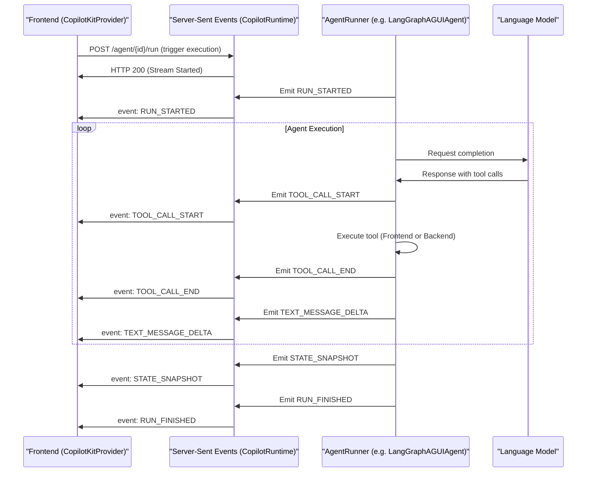
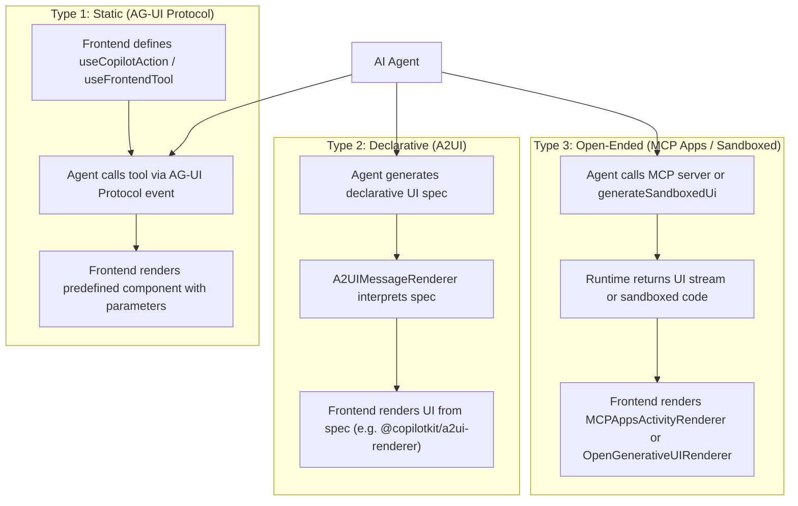
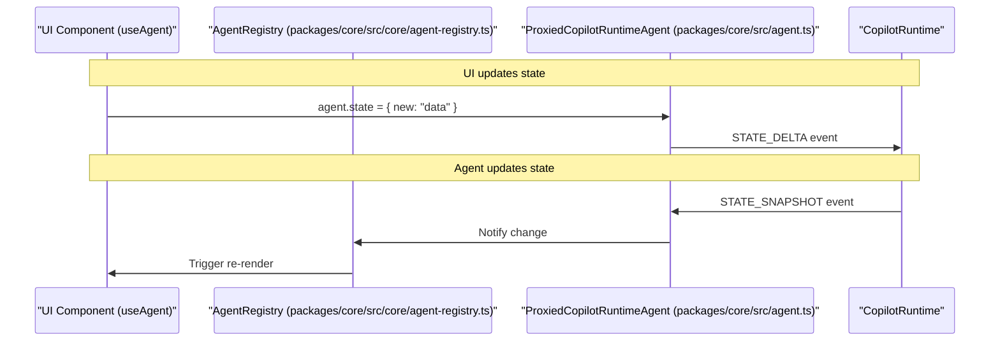
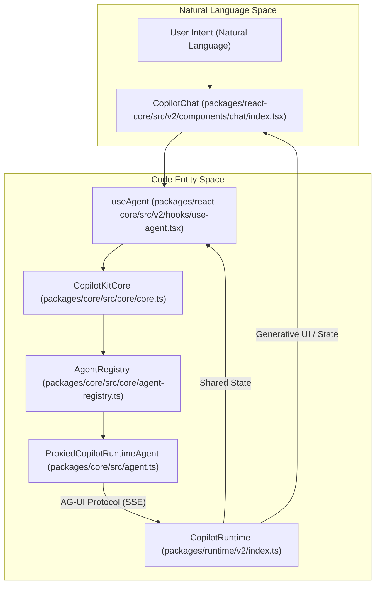

<!-- source: DeepWiki mcp.deepwiki.com · repo CopilotKit/CopilotKit · page 1.1 Core Concepts · fetched 2026-10-30 -->

# Core Concepts

<details>
<summary>Relevant source files</summary>

The following files were used as context for generating this wiki page:

- [README.md](README.md)
- [assets/CopilotTextarea.gif](assets/CopilotTextarea.gif)
- [assets/CopilotTextarea_old.gif](assets/CopilotTextarea_old.gif)
- [assets/demo.gif](assets/demo.gif)
- [assets/proejct-perplexity-clone.png](assets/proejct-perplexity-clone.png)
- [assets/project-canvas-demo.png](assets/project-canvas-demo.png)
- [assets/spreadsheet-demo-big-file.gif](assets/spreadsheet-demo-big-file.gif)
- [examples/v2/react/demo/src/app/api/copilotkit/[[...slug]]/route.ts](examples/v2/react/demo/src/app/api/copilotkit/[[...slug]]/route.ts)
- [packages/angular/src/lib/agent.spec.ts](packages/angular/src/lib/agent.spec.ts)
- [packages/angular/src/lib/agent.ts](packages/angular/src/lib/agent.ts)
- [packages/angular/src/lib/config.ts](packages/angular/src/lib/config.ts)
- [packages/angular/src/lib/copilotkit.spec.ts](packages/angular/src/lib/copilotkit.spec.ts)
- [packages/angular/src/lib/directives/__tests__/copilotkit-config.directive.spec.ts](packages/angular/src/lib/directives/__tests__/copilotkit-config.directive.spec.ts)
- [packages/angular/src/lib/license-watermark.ts](packages/angular/src/lib/license-watermark.ts)
- [packages/core/src/__tests__/core-credentials.test.ts](packages/core/src/__tests__/core-credentials.test.ts)
- [packages/core/src/__tests__/core-headers.test.ts](packages/core/src/__tests__/core-headers.test.ts)
- [packages/core/src/__tests__/core-register-proxied-agent.test.ts](packages/core/src/__tests__/core-register-proxied-agent.test.ts)
- [packages/core/src/__tests__/core-subscribe-to-agent.test.ts](packages/core/src/__tests__/core-subscribe-to-agent.test.ts)
- [packages/core/src/__tests__/proxied-runtime-transport.test.ts](packages/core/src/__tests__/proxied-runtime-transport.test.ts)
- [packages/core/src/agent.ts](packages/core/src/agent.ts)
- [packages/core/src/core/agent-registry.ts](packages/core/src/core/agent-registry.ts)
- [packages/core/src/core/core.ts](packages/core/src/core/core.ts)
- [packages/react-core/src/__tests__/threadid-propagation.contract.test.tsx](packages/react-core/src/__tests__/threadid-propagation.contract.test.tsx)
- [packages/react-core/src/hooks/use-agent-nodename.ts](packages/react-core/src/hooks/use-agent-nodename.ts)
- [packages/react-core/src/v2/components/chat/__tests__/CopilotChatActivityRendering.e2e.test.tsx](packages/react-core/src/v2/components/chat/__tests__/CopilotChatActivityRendering.e2e.test.tsx)
- [packages/react-core/src/v2/components/chat/__tests__/copilot-chat-throttle.test.tsx](packages/react-core/src/v2/components/chat/__tests__/copilot-chat-throttle.test.tsx)
- [packages/react-core/src/v2/hooks/__tests__/use-agent-provider-headers.e2e.test.tsx](packages/react-core/src/v2/hooks/__tests__/use-agent-provider-headers.e2e.test.tsx)
- [packages/react-core/src/v2/hooks/__tests__/use-agent-stability.test.tsx](packages/react-core/src/v2/hooks/__tests__/use-agent-stability.test.tsx)
- [packages/react-core/src/v2/hooks/__tests__/use-agent-throttle.test.tsx](packages/react-core/src/v2/hooks/__tests__/use-agent-throttle.test.tsx)
- [packages/react-core/src/v2/hooks/__tests__/use-agent-types.test.tsx](packages/react-core/src/v2/hooks/__tests__/use-agent-types.test.tsx)
- [packages/react-core/src/v2/hooks/__tests__/use-capabilities.test.tsx](packages/react-core/src/v2/hooks/__tests__/use-capabilities.test.tsx)
- [packages/react-core/src/v2/hooks/use-agent.tsx](packages/react-core/src/v2/hooks/use-agent.tsx)
- [packages/react-core/src/v2/hooks/use-capabilities.tsx](packages/react-core/src/v2/hooks/use-capabilities.tsx)
- [packages/react-core/src/v2/hooks/use-render-activity-message.tsx](packages/react-core/src/v2/hooks/use-render-activity-message.tsx)
- [packages/react-core/src/v2/providers/CopilotKitProvider.tsx](packages/react-core/src/v2/providers/CopilotKitProvider.tsx)
- [packages/react-core/src/v2/providers/__tests__/CopilotKitProvider.stability.test.tsx](packages/react-core/src/v2/providers/__tests__/CopilotKitProvider.stability.test.tsx)
- [showcase/angular/src/app/features/mastra/mastra-cards.ts](showcase/angular/src/app/features/mastra/mastra-cards.ts)
- [showcase/angular/src/app/features/mastra/mastra-feature.component.ts](showcase/angular/src/app/features/mastra/mastra-feature.component.ts)
- [showcase/shell-docs/src/content/docs/(other)/contributing/code-contributions/package-linking.mdx](showcase/shell-docs/src/content/docs/(other)/contributing/code-contributions/package-linking.mdx)
- [showcase/shell-docs/src/content/docs/(other)/contributing/meta.json](showcase/shell-docs/src/content/docs/(other)/contributing/meta.json)
- [showcase/shell-docs/src/content/docs/agentic-protocols/a2a.mdx](showcase/shell-docs/src/content/docs/agentic-protocols/a2a.mdx)
- [showcase/shell-docs/src/content/docs/integrations/adk/shared-state/workflow-execution.mdx](showcase/shell-docs/src/content/docs/integrations/adk/shared-state/workflow-execution.mdx)
- [showcase/shell-docs/src/content/docs/integrations/deepagents/shared-state/workflow-execution.mdx](showcase/shell-docs/src/content/docs/integrations/deepagents/shared-state/workflow-execution.mdx)
- [showcase/shell-docs/src/content/docs/integrations/langgraph/tutorials/ai-travel-app/step-5-stream-progress.mdx](showcase/shell-docs/src/content/docs/integrations/langgraph/tutorials/ai-travel-app/step-5-stream-progress.mdx)
- [showcase/shell-docs/src/content/docs/integrations/langgraph/tutorials/ai-travel-app/step-6-human-in-the-loop.mdx](showcase/shell-docs/src/content/docs/integrations/langgraph/tutorials/ai-travel-app/step-6-human-in-the-loop.mdx)

</details>


This document explains the fundamental concepts underlying CopilotKit's architecture and programming model. It covers agent-native applications, the AG-UI Protocol, generative UI patterns, the `useAgent` hook, shared state management, and human-in-the-loop workflows.

---

## Agent-Native Applications

Agent-native applications treat AI agents as first-class architectural components rather than auxiliary features. In CopilotKit, this means:

- **Agents drive workflows**: Agents orchestrate multi-step processes, make decisions, and coordinate tool execution [README.md:16-16]().
- **Agents render UI**: Agents can call tools that return UI components rendered directly in the client [README.md:91-92]().
- **Agents manage state**: Agents read from and write to shared application state in real-time [README.md:93-93]().
- **Agents request input**: Agents can pause execution to ask users for confirmation, edits, or additional information [README.md:94-94]().

The interaction loop in agent-native applications flows through three layers: the UI layer (user interactions), the agent layer (decision-making and orchestration), and the tool layer (actions and data access). These layers communicate through the AG-UI Protocol [README.md:109-109]().

### Key Characteristics

| Characteristic        | Traditional Apps          | Agent-Native Apps                 |
|----------------------|--------------------------|---------------------------------|
| Control Flow         | User-initiated actions    | Agent-orchestrated workflows     |
| UI Updates           | Explicit state mutations  | Generative UI from agent actions |
| Backend Calls        | REST/GraphQL APIs         | Agent tool invocations           |
| User Interaction     | Forms and buttons         | Natural language + human-in-the-loop |

**Sources:** [README.md:16-16](), [README.md:88-95](), [README.md:109-109]()

---

## The AG-UI Protocol

The **AG-UI Protocol** (Agent-User Interaction Protocol) is an industry-standard event-driven specification defining communication between AI agents and user interfaces. It provides a common, structured "language" of event types used to orchestrate agent runs, tool calls, state syncing, UI rendering, and user interaction.

CopilotKit is the originator and primary steward of the AG-UI Protocol, which has been adopted by major companies like Google, AWS, Microsoft, LangChain, Mastra, and PydanticAI [README.md:56-60]().

### Core Protocol Capabilities

- **Streaming text messages** to the UI [README.md:90-90]().
- **Executing tool calls** and returning results [README.md:91-91]().
- **Synchronizing state bidirectionally** using `STATE_SNAPSHOT` and `STATE_DELTA` events [README.md:93-93]().
- **Requesting user input** during agent execution to pause and resume workflows [README.md:94-94]().
- **Rendering UI components** that get streamed and rendered client-side [README.md:92-92]().

### AG-UI Protocol Event Flow



### Protocol Events and Subscribers

`CopilotKitCore` defines an event subscription system that maps AG-UI events to lifecycle callbacks [packages/core/src/core/core.ts:134-197](). These feed into stores like `AgentStore` in Angular or the `useAgent` state in React that frontends observe for rendering and state management [packages/angular/src/lib/agent.ts:30-82]().

| Event Handler        | Description                                                  | Direction    |
|----------------------|--------------------------------------------------------------|--------------|
| `onRunInitialized`   | Signals the start of agent execution                         | Agent → UI   |
| `onMessagesChanged`  | Streams text content or messages (e.g., chat messages)       | Agent → UI   |
| `onStateChanged`     | Signals state synchronization events                         | Bidirectional|
| `onRunFinalized`     | Signals successful run completion                             | Agent → UI   |
| `onRunFailed`        | Signals run failure or local exception                        | Agent → UI   |
| `onRunErrorEvent`    | Signals backend protocol-level `RUN_ERROR` events            | Agent → UI   |

**Sources:** [README.md:56-60](), [README.md:90-94](), [packages/core/src/core/core.ts:134-197](), [packages/angular/src/lib/agent.ts:30-82]()

---

## Generative UI

Generative UI in CopilotKit enables agents to dynamically create and modify UI components at runtime as part of the interaction experience [README.md:92-92]().

### Types of Generative UI in CopilotKit



### 1. Static Generative UI (AG-UI Protocol)
Frontends register tools/actions. Agents invoke these via tool calls, and the frontend executes the associated component with parameters. This is handled through the `onToolExecutionStart` and `onToolExecutionEnd` subscribers [packages/core/src/core/core.ts:139-153]().

### 2. Declarative Generative UI (A2UI)
Agents produce a structured specification describing controls and layout. The `createA2UIMessageRenderer` creates components that interpret these messages [packages/react-core/src/v2/providers/CopilotKitProvider.tsx:43-43]().

### 3. Open-Ended Generative UI
- **MCP Apps**: Agents interact with Model Context Protocol apps, requesting arbitrary UI fragments handled by `MCPAppsActivityRenderer` [packages/react-core/src/v2/providers/CopilotKitProvider.tsx:32-35]().
- **Sandboxed UI**: The `OpenGenerativeUIRenderer` handles rendering sandboxed code (HTML/CSS/JS) generated by the LLM securely within an iframe [packages/react-core/src/v2/providers/CopilotKitProvider.tsx:37-42](). The prompt for this generation is specifically tuned for a minimal, flat aesthetic [packages/react-core/src/v2/providers/CopilotKitProvider.tsx:89-98]().

**Sources:** [README.md:91-92](), [packages/react-core/src/v2/providers/CopilotKitProvider.tsx:32-43](), [packages/react-core/src/v2/providers/CopilotKitProvider.tsx:89-98]()

---

## The `useAgent` Hook

The `useAgent` hook is the primary React API for connecting components with agents. It manages subscriptions to agent messages, state, and run status [packages/react-core/src/v2/hooks/use-agent.tsx:13-17]().

### Architecture and Data Flow

```mermaid
graph TB
    Component["React Component"]
    useAgent["useAgent Hook (packages/react-core/src/v2/hooks/use-agent.tsx)"]
    CopilotKitCore["CopilotKitCore (packages/core/src/core/core.ts)"]
    AgentRegistry["AgentRegistry (packages/core/src/core/agent-registry.ts)"]
    Proxy["ProxiedCopilotRuntimeAgent (packages/core/src/agent.ts)"]
    Runtime["CopilotRuntime (Backend)"]

    Component-->"const { agent } = useAgent()"-->useAgent
    useAgent-->"subscribeToAgentWithOptions"-->CopilotKitCore
    CopilotKitCore-->"AgentRegistry.getAgent()"-->AgentRegistry
    AgentRegistry-->"manages"-->Proxy
    Proxy-->"HTTP POST /agent/{id}/run"-->Runtime

    Runtime-->"SSE Event Stream"-->Proxy
    Proxy-->"updates subscribers"-->CopilotKitCore
    CopilotKitCore-->"batched forceUpdate"-->Component
```

### Key Features
- **Provisional Agents**: While the runtime is connecting or in an error state, `useAgent` returns a `ProxiedCopilotRuntimeAgent` with `runtimeMode: "pending"`. This prevents React tree crashes and keeps reference stability [packages/react-core/src/v2/hooks/use-agent.tsx:160-202]().
- **Throttled Updates**: Uses `throttleMs` to coalesce high-frequency streaming updates (e.g., token-by-token text) into fewer re-renders, using a leading+trailing pattern [packages/react-core/src/v2/hooks/use-agent.tsx:32-50]().
- **Precedence Logic**: Resolves `agentId` by checking explicit props, then surrounding `CopilotChatConfiguration`, then the global default [packages/react-core/src/v2/hooks/use-agent.tsx:112-121]().

**Sources:** [packages/react-core/src/v2/hooks/use-agent.tsx:32-202](), [packages/core/src/core/core.ts:41-73]()

---

## Shared State Management

CopilotKit provides a synchronized state layer where agents and UI components share a common `State` object.

### State Synchronization Flow



- **Isolation**: `AgentRegistry` allows registering proxied agents that route to different runtime IDs while keeping local state isolated [packages/core/src/core/agent-registry.ts:32-45]().
- **Signal-Based Sync (Angular)**: In Angular, the `AgentStore` uses signals to provide reactive access to `messages`, `state`, and `isRunning` status, seeded synchronously from the agent instance [packages/angular/src/lib/agent.ts:30-57]().

**Sources:** [packages/core/src/core/agent-registry.ts:32-45](), [packages/angular/src/lib/agent.ts:30-57]()

---

## Human-in-the-Loop Workflows (HITL)

HITL allows agents to pause execution to request user intervention. This is implemented via tool calls that the frontend intercepts to render interaction UI [README.md:94-94]().

- **Preservation**: The agent's execution state is held while waiting for user input.
- **Implementation**: The `CopilotKitProvider` accepts a `humanInTheLoop` array defining how specific requests should be rendered and handled [packages/react-core/src/v2/providers/CopilotKitProvider.tsx:139-139]().
- **Protocol Support**: Agents emit activity snapshots and tool calls that the UI interprets to show progress or prompt for input [packages/react-core/src/v2/components/chat/__tests__/CopilotChatActivityRendering.e2e.test.tsx:178-189]().

**Sources:** [README.md:94-94](), [packages/react-core/src/v2/providers/CopilotKitProvider.tsx:139-139](), [packages/react-core/src/v2/components/chat/__tests__/CopilotChatActivityRendering.e2e.test.tsx:178-189]()

---

## Integration Summary Diagram

This diagram maps the bridge from Natural Language Space (User Intent) to Code Entity Space (Implementation).



**Sources:** [packages/react-core/src/v2/hooks/use-agent.tsx:142-202](), [packages/core/src/core/core.ts:19-31](), [packages/core/src/agent.ts:100-150](), [packages/core/src/core/agent-registry.ts:56-99]()

---

