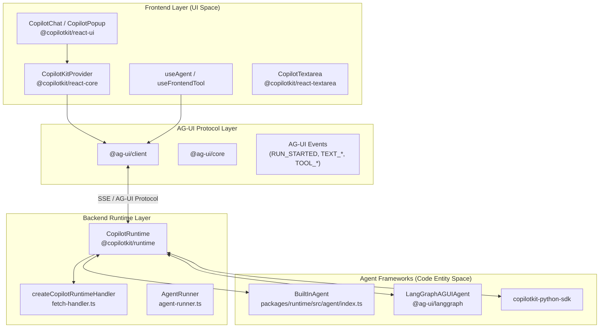
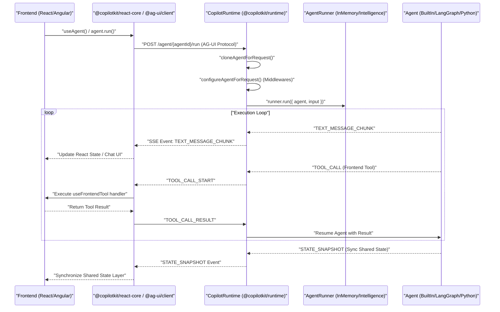
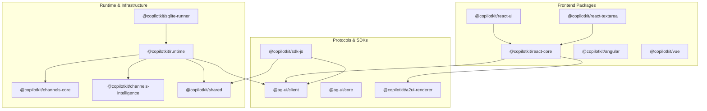
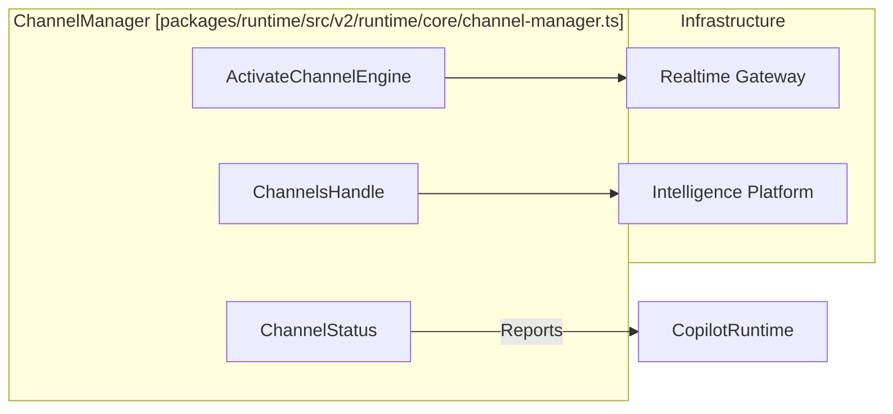

<!-- source: DeepWiki mcp.deepwiki.com · repo CopilotKit/CopilotKit · page 1.2 System Architecture · fetched 2026-10-30 -->

# System Architecture

Relevant source files

The following files were used as context for generating this wiki page:

- [.claude/docs/architecture.md](.claude/docs/architecture.md)
- [README.md](README.md)
- [assets/CopilotTextarea.gif](assets/CopilotTextarea.gif)
- [assets/CopilotTextarea_old.gif](assets/CopilotTextarea_old.gif)
- [assets/demo.gif](assets/demo.gif)
- [assets/proejct-perplexity-clone.png](assets/proejct-perplexity-clone.png)
- [assets/project-canvas-demo.png](assets/project-canvas-demo.png)
- [assets/spreadsheet-demo-big-file.gif](assets/spreadsheet-demo-big-file.gif)
- [packages/a2ui-renderer/package.json](packages/a2ui-renderer/package.json)
- [packages/core/package.json](packages/core/package.json)
- [packages/core/src/__tests__/debug-config-threading.test.ts](packages/core/src/__tests__/debug-config-threading.test.ts)
- [packages/react-core/package.json](packages/react-core/package.json)
- [packages/react-textarea/package.json](packages/react-textarea/package.json)
- [packages/react-ui/package.json](packages/react-ui/package.json)
- [packages/runtime-client-gql/package.json](packages/runtime-client-gql/package.json)
- [packages/runtime/package.json](packages/runtime/package.json)
- [packages/runtime/src/v2/runtime/__tests__/agent-header-precedence.test.ts](packages/runtime/src/v2/runtime/__tests__/agent-header-precedence.test.ts)
- [packages/runtime/src/v2/runtime/__tests__/agent-utils-header-forwarding.test.ts](packages/runtime/src/v2/runtime/__tests__/agent-utils-header-forwarding.test.ts)
- [packages/runtime/src/v2/runtime/__tests__/agents-factory.test.ts](packages/runtime/src/v2/runtime/__tests__/agents-factory.test.ts)
- [packages/runtime/src/v2/runtime/__tests__/debug-sse-response.test.ts](packages/runtime/src/v2/runtime/__tests__/debug-sse-response.test.ts)
- [packages/runtime/src/v2/runtime/__tests__/handle-connect.test.ts](packages/runtime/src/v2/runtime/__tests__/handle-connect.test.ts)
- [packages/runtime/src/v2/runtime/__tests__/handle-run.test.ts](packages/runtime/src/v2/runtime/__tests__/handle-run.test.ts)
- [packages/runtime/src/v2/runtime/__tests__/header-utils.test.ts](packages/runtime/src/v2/runtime/__tests__/header-utils.test.ts)
- [packages/runtime/src/v2/runtime/__tests__/intelligence-lock-heartbeat.test.ts](packages/runtime/src/v2/runtime/__tests__/intelligence-lock-heartbeat.test.ts)
- [packages/runtime/src/v2/runtime/__tests__/intelligence-run-telemetry.test.ts](packages/runtime/src/v2/runtime/__tests__/intelligence-run-telemetry.test.ts)
- [packages/runtime/src/v2/runtime/__tests__/thread-names.test.ts](packages/runtime/src/v2/runtime/__tests__/thread-names.test.ts)
- [packages/runtime/src/v2/runtime/core/runtime.ts](packages/runtime/src/v2/runtime/core/runtime.ts)
- [packages/runtime/src/v2/runtime/handlers/handle-connect.ts](packages/runtime/src/v2/runtime/handlers/handle-connect.ts)
- [packages/runtime/src/v2/runtime/handlers/handle-run.ts](packages/runtime/src/v2/runtime/handlers/handle-run.ts)
- [packages/runtime/src/v2/runtime/handlers/handle-stop.ts](packages/runtime/src/v2/runtime/handlers/handle-stop.ts)
- [packages/runtime/src/v2/runtime/handlers/header-utils.ts](packages/runtime/src/v2/runtime/handlers/header-utils.ts)
- [packages/runtime/src/v2/runtime/handlers/intelligence/connect.ts](packages/runtime/src/v2/runtime/handlers/intelligence/connect.ts)
- [packages/runtime/src/v2/runtime/handlers/intelligence/run.ts](packages/runtime/src/v2/runtime/handlers/intelligence/run.ts)
- [packages/runtime/src/v2/runtime/handlers/intelligence/thread-names.ts](packages/runtime/src/v2/runtime/handlers/intelligence/thread-names.ts)
- [packages/runtime/src/v2/runtime/handlers/shared/agent-utils.ts](packages/runtime/src/v2/runtime/handlers/shared/agent-utils.ts)
- [packages/runtime/src/v2/runtime/handlers/shared/sse-response.ts](packages/runtime/src/v2/runtime/handlers/shared/sse-response.ts)
- [packages/runtime/src/v2/runtime/handlers/sse/__tests__/sse-connect-agent-id.test.ts](packages/runtime/src/v2/runtime/handlers/sse/__tests__/sse-connect-agent-id.test.ts)
- [packages/runtime/src/v2/runtime/handlers/sse/connect.ts](packages/runtime/src/v2/runtime/handlers/sse/connect.ts)
- [packages/runtime/src/v2/runtime/handlers/sse/run.ts](packages/runtime/src/v2/runtime/handlers/sse/run.ts)
- [packages/runtime/src/v2/runtime/runner/__tests__/bounded-thread-store.test.ts](packages/runtime/src/v2/runtime/runner/__tests__/bounded-thread-store.test.ts)
- [packages/runtime/src/v2/runtime/runner/agent-runner.ts](packages/runtime/src/v2/runtime/runner/agent-runner.ts)
- [packages/sdk-js/package.json](packages/sdk-js/package.json)
- [packages/shared/package.json](packages/shared/package.json)
- [packages/shared/src/__tests__/debug.test.ts](packages/shared/src/__tests__/debug.test.ts)
- [packages/shared/src/debug.ts](packages/shared/src/debug.ts)
- [packages/sqlite-runner/package.json](packages/sqlite-runner/package.json)
- [packages/voice/package.json](packages/voice/package.json)
- [packages/web-inspector/package.json](packages/web-inspector/package.json)
- [showcase/angular/src/app/features/mastra/mastra-cards.ts](showcase/angular/src/app/features/mastra/mastra-cards.ts)
- [showcase/angular/src/app/features/mastra/mastra-feature.component.ts](showcase/angular/src/app/features/mastra/mastra-feature.component.ts)
- [showcase/shell-docs/src/content/docs/(other)/contributing/code-contributions/package-linking.mdx](showcase/shell-docs/src/content/docs/(other)/contributing/code-contributions/package-linking.mdx)
- [showcase/shell-docs/src/content/docs/(other)/contributing/meta.json](showcase/shell-docs/src/content/docs/(other)/contributing/meta.json)
- [showcase/shell-docs/src/content/docs/agentic-protocols/a2a.mdx](showcase/shell-docs/src/content/docs/agentic-protocols/a2a.mdx)
- [showcase/shell-docs/src/content/docs/integrations/adk/shared-state/workflow-execution.mdx](showcase/shell-docs/src/content/docs/integrations/adk/shared-state/workflow-execution.mdx)
- [showcase/shell-docs/src/content/docs/integrations/deepagents/shared-state/workflow-execution.mdx](showcase/shell-docs/src/content/docs/integrations/deepagents/shared-state/workflow-execution.mdx)
- [showcase/shell-docs/src/content/docs/integrations/langgraph/tutorials/ai-travel-app/step-5-stream-progress.mdx](showcase/shell-docs/src/content/docs/integrations/langgraph/tutorials/ai-travel-app/step-5-stream-progress.mdx)
- [showcase/shell-docs/src/content/docs/integrations/langgraph/tutorials/ai-travel-app/step-6-human-in-the-loop.mdx](showcase/shell-docs/src/content/docs/integrations/langgraph/tutorials/ai-travel-app/step-6-human-in-the-loop.mdx)

This document provides a technical overview of the CopilotKit system architecture. It describes how the UI, agents, and tools interact via the **AG-UI Protocol**, the three-layer architecture (Frontend, Runtime, and Agent), and the repository's package dependency map.

## Architecture Overview

CopilotKit is built on a three-layer stack where the **AG-UI Protocol** serves as the unified communication standard. This architecture bridges the "Natural Language Space" of agents with the "Code Entity Space" of application logic.

**Sources:** [README.md:54-61](), [README.md:97-101](), [packages/runtime/src/v2/runtime/core/runtime.ts:179-210](), [packages/runtime/src/v2/runtime/core/fetch-handler.ts:114-180]()

### Core Architectural Layers

| Layer | Primary Packages | Purpose |
|-------|------------------|---------|
| **Frontend** | `@copilotkit/react-core`, `@copilotkit/react-ui`, `@copilotkit/angular`, `@copilotkit/vue` | Provides framework-specific components, hooks, and providers for UI integration. |
| **Runtime** | `@copilotkit/runtime` | Orchestrates agent execution, manages LLM adapters, and handles the SSE event stream via `CopilotSseRuntime` or `CopilotIntelligenceRuntime`. |
| **Agent** | `BuiltInAgent`, `@copilotkit/sdk-js`, `copilotkit` (Python) | SDKs and classes for building agents that implement the `AbstractAgent` interface and communicate via AG-UI events. |
| **Shared** | `@copilotkit/shared` | Common utilities, telemetry, and shared types used across all packages. |

**Sources:** [packages/runtime/package.json:79-95](), [packages/react-core/package.json:77-84](), [packages/runtime/src/v2/runtime/core/runtime.ts:179-210](), [packages/runtime/src/v2/runtime/core/fetch-handler.ts:53-109]()

## The Interaction Loop

CopilotKit connects the application UI, backend agents, and local tools into a continuous interaction loop. This loop is powered by Server-Sent Events (SSE) and the AG-UI Protocol specification.

**Sources:** [packages/runtime/src/v2/runtime/handlers/handle-run.ts:13-97](), [packages/runtime/src/v2/runtime/handlers/shared/agent-utils.ts:52-73](), [packages/runtime/src/v2/runtime/runner/agent-runner.ts:1-20]()

### Key Components in the Loop

*   **`CopilotRuntime`**: The primary backend class that manages agent registration and routing. It supports two modes: `CopilotSseRuntime` for standard SSE and `CopilotIntelligenceRuntime` for durable, persistent sessions. [packages/runtime/src/v2/runtime/core/runtime.ts:179-210]()
*   **`fetch-handler`**: A framework-agnostic handler that maps HTTP requests to runtime operations like `handleRunAgent`, `handleConnectAgent`, and `handleGetRuntimeInfo`. [packages/runtime/src/v2/runtime/core/fetch-handler.ts:75-109]()
*   **`AgentRunner`**: Interface for executing agents. `InMemoryAgentRunner` handles execution in the current process, while `IntelligenceAgentRunner` (via `@copilotkit/channels-intelligence`) delegates to the CopilotKit Intelligence Platform. [packages/runtime/src/v2/runtime/runner/agent-runner.ts:1-20]()
*   **`BuiltInAgent`**: A powerful agent implementation that uses the Vercel AI SDK and supports Model Context Protocol (MCP) servers. [packages/runtime/package.json:90-91]()

## Package Dependency Map

The repository is managed as a pnpm workspace. The architecture is modular, with the `@copilotkit/runtime` package serving as the backend hub.

**Sources:** [packages/runtime/package.json:79-95](), [packages/react-core/package.json:77-84](), [packages/react-ui/package.json:59-61](), [packages/react-textarea/package.json:57-59](), [packages/sqlite-runner/package.json:34-36]()

### Package Responsibilities

| Package | Responsibility |
|---------|----------------|
| `@copilotkit/runtime` | Backend orchestration, agent management, and SSE/Intelligence protocol handling. [packages/runtime/package.json:2-16]() |
| `@copilotkit/channels-core` | Core logic for multi-platform messaging (Slack, Teams, Discord). [packages/runtime/package.json:92]() |
| `@copilotkit/shared` | Shared logic for telemetry, logging, and license verification. [packages/shared/package.json:52-63]() |
| `@ag-ui/client` | Implementation of the AG-UI Protocol client-side logic. [packages/core/package.json:38]() |
| `@copilotkit/sqlite-runner` | Persistence layer for agent threads using SQLite. [packages/sqlite-runner/package.json:4-5]() |

## Implementation Detail: Managed Channels

CopilotKit introduces **Managed Channels** for "Beyond the Browser" interactions (e.g., Slack, MS Teams). This is orchestrated by the `ChannelManager`.

1.  **Lazy Activation**: Channels are only activated when `handler.channels.ready()` is called, making the runtime safe for serverless environments. [packages/runtime/src/v2/runtime/core/fetch-handler.ts:28-44]()
2.  **`ChannelManager`**: Tracks the lifecycle status (`connecting`, `online`, `reconnecting`, `error`) of each activated channel. [packages/runtime/src/v2/runtime/core/channel-manager.ts:13-43]()
3.  **`IntelligenceAgentRunner`**: Enables durable execution where agent state is persisted on the Intelligence Platform, allowing agents to respond across different platforms (Web vs Slack) in the same thread. [packages/runtime/src/v2/runtime/core/runtime.ts:188-210]()

**Sources:** [packages/runtime/src/v2/runtime/core/channel-manager.ts:13-60](), [packages/runtime/src/v2/runtime/core/fetch-handler.ts:28-51](), [packages/runtime/package.json:92-93]()

---

